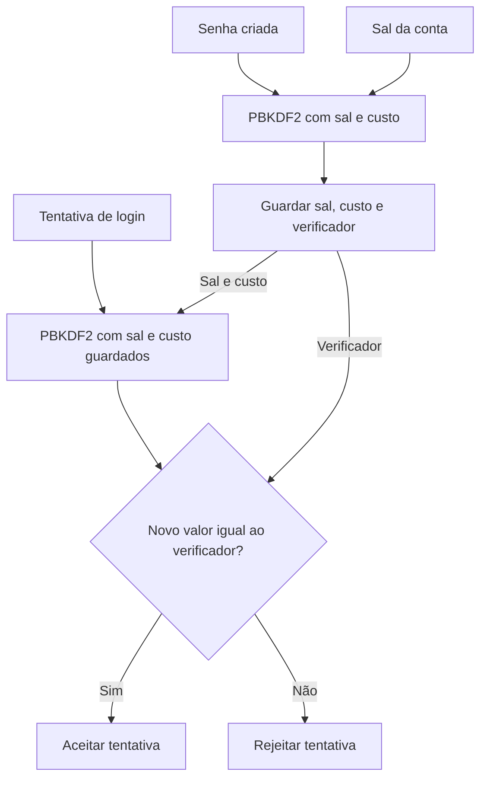
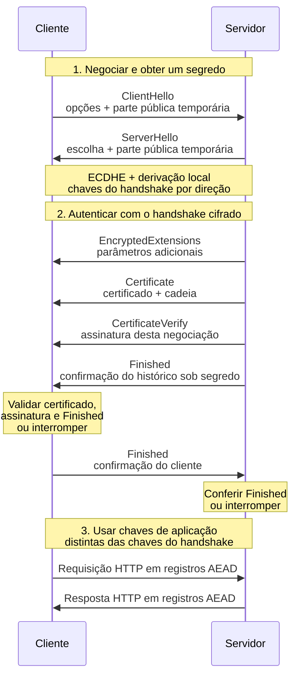

# A16 — Hash, HMAC, senhas e TLS

**Como comparar bytes, conferir um segredo e aceitar um canal?** Vamos executar primeiro os mecanismos de verificação; depois localizar suas funções em uma conexão TLS real. Hash, HMAC, assinatura e verificador de senha respondem a perguntas diferentes.

**Tempo:** 100 minutos, com conceitos e práticas intercalados.

**Recursos:** Linux ou Ubuntu/WSL, OpenSSL, VS Code, Python 3 e certificados locais da [A15](A15-chaves-assinaturas-certificados.md#pki-local). Verifique a preparação antes de iniciar; use somente dados e segredos descartáveis.

**Objetivos de aprendizagem**

1. Comparar arquivos e autenticar mensagens, distinguindo SHA-256, HMAC e assinatura.
2. Conferir tentativas de senha com sal e custo, explicando o registro necessário sem guardar a senha legível.
3. Estabelecer uma conexão TLS local, localizar acordo, certificado, assinatura e Finished e observar recusa por nome incorreto.

Continue C3 no [registro único A14–A17](../atividades/A14-A18-criptografia-confianca.md#atividade). VPN e gestão operacional serão aplicadas na A17; não há entrega separada hoje.

## Arquivos prontos da prática {#arquivos}

Use a pasta **a16** do [repositório de práticas](https://github.com/rafaelrezo/seguranca-digital-praticas/tree/main/a16), baixado na A14. Se ainda não o tiver, siga a [preparação única](https://github.com/rafaelrezo/seguranca-digital-praticas#preparar-uma-vez), por clone ou ZIP. Não crie os arquivos por copiar e colar: abra as fontes prontas e execute a etapa indicada.

No terminal **Linux ou Ubuntu/WSL**:

```bash
source ~/seguranca-digital-praticas/.venv/bin/activate
cd ~/seguranca-digital-praticas/a16
code .
```

`source` reativa o ambiente Python; `cd` escolhe a pasta da aula; `code .` abre os arquivos existentes. Se o editor não abrir, use o menu de abertura de pasta. O [README de a16](https://github.com/rafaelrezo/seguranca-digital-praticas/tree/main/a16) lista os comandos por etapa. Os trechos na página servem à leitura, sem montagem incremental dos arquivos.

## Hash e digest: comparar o conteúdo exato {#digest}

**Uso real — conferir um download do Ubuntu:** a distribuição publica `SHA256SUMS`, com resumos das imagens de instalação, e uma assinatura desse arquivo. Primeiro se verifica a origem da referência; depois se calcula o resumo da imagem baixada e se compara.

Isso ajuda a detectar download incompleto ou conteúdo modificado. ([Tutorial oficial do Ubuntu](https://ubuntu.com/tutorials/how-to-verify-ubuntu).)

Uma **função hash criptográfica** recebe bytes e produz um resumo de tamanho fixo, chamado **digest**. SHA-256 produz 256 bits (32 bytes). Os mesmos bytes produzem o mesmo digest; alterar os bytes quase certamente muda o resultado. Hash não cifra: o conteúdo pode continuar legível.

A função é projetada para dificultar encontrar duas entradas diferentes com o mesmo digest. Ainda assim, um digest igual não identifica quem criou ou publicou o arquivo.

Para conferir uma cópia, calcule seu digest e compare com um valor publicado pelo fornecedor **por um canal confiável**. Se alguém puder substituir tanto a cópia quanto a referência, a igualdade não demonstra legitimidade. Essa distinção entre comparação de bytes e confiança na origem reaparece nas assinaturas e nos certificados estudados na A15.

O exemplo `abc` tem um digest SHA-256 conhecido: `ba7816bf8f01cfea414140de5dae2223b00361a396177a9cb410ff61f20015ad` ([exemplo NIST](https://csrc.nist.gov/csrc/media/projects/cryptographic-standards-and-guidelines/documents/examples/sha256.pdf)).

A entrada são exatamente três bytes ASCII, sem aspas, espaço ou quebra de linha. Uma comparação exige os mesmos bytes e a mesma codificação; aparência semelhante não basta.

**Prática curta no WSL/Linux:** na pasta a16 já obtida, abra `hash-a.txt`, `hash-b.txt` e `hash_hmac.sh`. Preveja os dois resumos e execute a etapa hash:

Os arquivos de três bytes tornam essa comparação rápida, sem baixar uma imagem de instalação. A operação de calcular o resumo é a mesma; a referência conhecida vem do exemplo NIST.

```bash
bash hash_hmac.sh hash
```

Os arquivos de entrada já contêm três bytes, sem quebra de linha. A etapa `hash` usa `sha256sum` para calcular o digest SHA-256 **de cada arquivo**, seguido do nome. O primeiro deve corresponder ao valor NIST acima; o segundo deve diferir.

**Registre D1:** `abc` coincide com a referência NIST; `abd` difere. Anote os bytes comparados e a origem da referência. Se `sha256sum` faltar, use o valor NIST como **dado fornecido**. A igualdade não atribui autoria.

## HMAC: verificar mensagem com segredo compartilhado {#hmac}

Um **código de autenticação de mensagem** (*MAC*) depende de uma chave secreta compartilhada. **HMAC** é um MAC construído a partir de hash ([RFC 2104](https://www.rfc-editor.org/info/rfc2104/)). Quem recebe a mensagem confere o código com a **mesma chave** usada para produzi-lo.

**Uso real — notificações automáticas do GitHub:** um **webhook** envia uma mensagem HTTP quando ocorre um evento, como uma alteração no repositório. Quando configurado com um segredo, o GitHub calcula HMAC-SHA256 do corpo enviado e inclui o resultado em `X-Hub-Signature-256`, um cabeçalho da requisição. ([Documentação do GitHub](https://docs.github.com/en/webhooks/using-webhooks/validating-webhook-deliveries).)

O programa receptor recalcula o código com o segredo que já possui e compara antes de processar o evento. Uma divergência exige rejeição. O corpo continua legível no receptor; o HMAC verifica sua correspondência sob o segredo, enquanto HTTPS protege o transporte.

| Operação | Entrada necessária | Resultado | O conteúdo fica secreto? |
|---|---|---|---|
| SHA-256 de D1 | Bytes do arquivo. | Digest para comparar com uma referência confiável. | Não. |
| HMAC de M1–M3 | Bytes da mensagem **e chave compartilhada**. | Código que deve mudar se a mensagem ou a chave mudar. | Não. |

Um código válido demonstra correspondência sob a chave. Se duas partes a conhecem, não distingue qual delas criou a mensagem.

**Prática curta no WSL:** no mesmo diretório, execute:

`msg-a.txt` representa um corpo recebido; mudar `valor=10` para `valor=11` altera seus bytes. Recalcular o HMAC permite observar a divergência que um receptor precisaria detectar. O ensaio não envia um webhook e usa um segredo descartável.

```bash
bash hash_hmac.sh hmac
bash hash_hmac.sh mensagem-alterada
bash hash_hmac.sh chave-alterada
```

**Abra `hash_hmac.sh` e localize cada etapa:**

| Etapa | Operação no script |
|---|---|
| `hmac` | Calcula duas vezes HMAC-SHA256 de `msg-a.txt` com a mesma chave fictícia: os códigos devem coincidir. |
| `mensagem-alterada` | Compara `msg-a.txt` e `msg-b.txt` sob a mesma chave: os códigos devem diferir. |
| `chave-alterada` | Mantém `msg-a.txt` e troca a chave: os códigos devem diferir. |

Os dois arquivos já vêm no repositório. `-sha256` escolhe o hash; `-hmac` fornece a chave literal descartável; o último argumento escolhe o arquivo. Execute uma etapa por vez e preveja sua comparação.

A saída traz códigos HMAC, **não mensagens cifradas**. Os dois textos continuam legíveis nos arquivos.

**Registre M1–M3:** compare os códigos gerados para mesma mensagem/chave, mensagem alterada e chave alterada. A chave literal é pública nesta página e serve apenas ao ensaio. Se OpenSSL faltar, use M1–M3 abaixo como **dados fornecidos**. O código não identifica qual detentor da chave produziu a mensagem.

### Quadro de resultados para acompanhar ou substituir o terminal

Estas linhas são **referência de comportamento esperado**. O valor calculado no terminal depende exatamente dos bytes da mensagem e da chave literal de teste.

| ID | Entradas | Resultado esperado | O que ainda não foi provado |
|---|---|---|---|
| D1 | SHA-256 de `abc` contra a referência NIST; depois `abd` | Coincide; depois difere | Autoria e procedência de qualquer arquivo externo. |
| M1 | Mensagem original e mesma chave de teste | Código coincide ao recalcular | Qual detentor da chave produziu a primeira versão. |
| M2 | Mensagem com `valor=11`, mesma chave | Código difere do M1 | Qual campo mudou fora deste teste controlado. |
| M3 | Mensagem original, outra chave | Código difere do M1 | Se a chave real está protegida no sistema. |

Se `sha256sum` ou OpenSSL não funcionar, leia o quadro na ordem D1–M3 e identifique-o como resultado fornecido. Se houver outro erro, anote comando e mensagem sem dados sensíveis. Espaços, acentos, quebras de linha e codificação mudam os bytes; confira a entrada exata antes de atribuir divergência a adulteração. A aceitação e rejeição do HMAC dependem da chave correta, mas não entregam diagnóstico causal de um evento real por si só.

## Senhas: conferir uma tentativa sem guardar a senha {#senhas}

**Uso real — cadastro e login no Django:** Django é um framework para desenvolver aplicações web. Na versão 5.2, seu esquema padrão usa PBKDF2 e guarda uma representação com **algoritmo, iterações, sal e valor derivado**. A aplicação pode conferir a senha digitada usando esse registro, sem guardar a senha legível. ([Documentação do Django 5.2](https://docs.djangoproject.com/en/5.2/topics/auth/passwords/).)

Na prática D1 acima, SHA-256 permitiu comparar os bytes de **arquivos**. Agora a pergunta é outra: quando alguém cria uma conta e depois digita uma senha, como um programa confere essa tentativa sem manter uma cópia da senha na base de contas? Aqui, **serviço** significa o programa que recebe e confere a senha, como o responsável pelo login de um site. Nesta aula, vamos executar somente as operações locais, sem criar um site ou contas reais.

Guardar a senha em texto legível expõe todas as contas se a base for copiada. Guardar apenas `SHA-256(senha)` também é inadequado: SHA-256 é rápido, e uma base vazada permite testar muitos palpites fora do serviço. O hash de D1 continua útil para comparar arquivos; a finalidade de **verificar senhas** pede um esquema próprio, com sal e custo ([OWASP](https://cheatsheetseries.owasp.org/cheatsheets/Password_Storage_Cheat_Sheet.html)).

### Cadastro e conferência: duas operações sobre o mesmo registro



No **cadastro**, o programa gera um sal para aquela conta, deriva um **verificador** da senha e guarda `esquema + custo + sal + verificador`. A senha legível não entra nesse registro. O sal pode ser público; sua função é separar contas, inclusive quando duas pessoas escolhem a mesma senha.

Na **conferência**, o programa recebe uma tentativa, usa o **sal e o custo guardados para aquela conta** e calcula outro valor. Se ele corresponder ao verificador, a tentativa é aceita. Não existe operação de “decifrar o verificador” para recuperar a senha.

**No fluxo de login, cada mecanismo tem uma função:**

- **HTTPS:** protege a senha em trânsito até o servidor.
- **Derivação e comparação:** conferem a tentativa usando o registro da conta.
- **Autorização:** decide o que a conta pode fazer após entrar.

A base de contas guarda o registro necessário à conferência. Essas proteções atuam em pontos diferentes do mesmo fluxo.

O **custo** define trabalho repetido para cada derivação. Isso também torna mais caras as tentativas de um atacante que obteve a base. Não torna uma senha fraca segura nem substitui a limitação de tentativas no serviço. O [NIST SP 800-63B-4](https://pages.nist.gov/800-63-4/sp800-63b/authenticators/) descreve sal, custo e registro do esquema para verificadores de senha.

A prática usa **PBKDF2-HMAC-SHA256**, usado em T2 na A14. Lá ele derivou chave e IV para cifrar uma cópia; aqui gera um verificador para conferir uma senha. As **100.000 iterações são apenas um parâmetro didático**. Para um sistema real, escolha um esquema e custo conforme recomendações atuais, como [Argon2id na OWASP](https://cheatsheetseries.owasp.org/cheatsheets/Password_Storage_Cheat_Sheet.html), e meça o desempenho no ambiente.

### Prática curta no VS Code e WSL: observar cadastro e conferência {#senha-terminal}

**Objetivo:** com a **mesma senha fictícia** em duas contas, observar o efeito de sais diferentes e conferir uma tentativa correta e outra incorreta. Os valores são gerados e verificados pelo próprio programa.

1. Na pasta a16 do repositório, abra `verificador_senhas_a16.py` no VS Code. O programa já está completo; não crie outro arquivo nem copie blocos. O [download anterior](../assets/a14-a17/verificador_senhas_a16.py) permanece disponível.
O programa lê as opções em `args`; `args.repetir_sal` só fica verdadeiro quando você informa `--repetir-sal`. Sem a opção, cada conta recebe outro sal.

**Antes de executar, preveja S1–S3:** os dois verificadores serão iguais? Qual tentativa será aceita?

<details markdown="1">
<summary>Ler o trecho do programa pronto</summary>

```python
from hashlib import pbkdf2_hmac
from hmac import compare_digest
from os import urandom

# Dados fictícios: o programa não recebe nem guarda uma senha real.
senha_de_teste = b'senha-ficticia-123'
iteracoes = 100_000  # valor didático; não é configuração de produção


def derivar(senha_digitada, sal):
    return pbkdf2_hmac('sha256', senha_digitada, sal, iteracoes)


# Cadastro: duas contas usam a mesma senha, mas recebem sais próprios.
sal_7 = urandom(16)
sal_8 = sal_7 if args.repetir_sal else urandom(16)
verificador_7 = derivar(senha_de_teste, sal_7)
verificador_8 = derivar(senha_de_teste, sal_8)

print('Conta 7 — sal:', sal_7.hex())
print('Conta 7 — verificador:', verificador_7.hex())
print('Conta 8 — sal:', sal_8.hex())
print('Conta 8 — verificador:', verificador_8.hex())
print('Custo: ', iteracoes, 'iterações')
print('S1 — verificadores iguais?', compare_digest(verificador_7, verificador_8))

# Conferência: usar o sal e o custo guardados com o verificador da conta 7.
tentativa_correta = b'senha-ficticia-123'
tentativa_incorreta = b'outra-senha'
print('S2 — senha correta aceita?', compare_digest(
    derivar(tentativa_correta, sal_7), verificador_7
))
print('S3 — senha incorreta aceita?', compare_digest(
    derivar(tentativa_incorreta, sal_7), verificador_7
))
```

</details>

No terminal WSL, entre na pasta e execute:

```bash
cd ~/seguranca-digital-praticas/a16
python3 verificador_senhas_a16.py
```

`cd` seleciona a pasta a16 baixada do repositório. `python3` executa o arquivo. **Leia o código e a saída:**

- `urandom(16)` gera **16 bytes de sal** para cada conta; `.hex()` permite ver esses bytes. Os valores mudam a cada execução.
- `pbkdf2_hmac('sha256', senha, sal, iteracoes)` deriva o verificador. O `sha256` aqui **faz parte do PBKDF2**, com sal e repetições; não é o SHA-256 direto de D1.
- `compare_digest` compara os valores derivados. Na conferência de S2/S3, o programa usa o sal da conta 7; a senha de teste só existe em memória neste exercício.

| Saída | Resultado esperado | O que demonstra |
|---|---|---|
| S1 — verificadores iguais? | `False` | A mesma senha com sais diferentes produz verificadores diferentes. |
| S2 — senha correta aceita? | `True` | A tentativa refeita com o sal e o custo da conta 7 corresponde ao registro. |
| S3 — senha incorreta aceita? | `False` | A tentativa diferente não corresponde ao verificador da conta 7. |

**Contraprova S4:** o programa já permite repetir o sal por uma opção, sem editar a fonte:

```bash
python3 verificador_senhas_a16.py --repetir-sal
```

Preveja S1 antes de olhar: ele passa a `True` porque senha, sal e custo agora coincidem nas duas contas. A opção apenas seleciona `sal_8 = sal_7` nesse ensaio. Execute de novo sem a opção para voltar a sais próprios; não use a contraprova como configuração de armazenamento.

**Registre S1–S4:** anote os valores lógicos (`True`/`False`) e explique a mudança em S4 em uma frase. Não copie a senha nem os verificadores completos para a entrega. Se Python não abrir o arquivo, confira `pwd` e `ls`; se `pbkdf2_hmac` não estiver disponível, use a tabela S1–S3 e a previsão de S4 como **dados fornecidos**, sem marcar o teste como executado.

### O que este teste permite decidir

O programa executou a derivação e a comparação de bytes em memória. Ele **não criou uma base de dados nem um login de produção**. Para armazenar um registro real, seriam necessários ao menos o esquema, seus parâmetros, o sal e o verificador por conta; acesso à base, proteção contra tentativas online e atualização futura do custo também precisam ser planejados.

Na [atividade única](../atividades/A14-A18-criptografia-confianca.md#atividade), acrescente a C3 uma conclusão curta: **quais campos o programa precisaria guardar para repetir a conferência e qual dado não deveria guardar?** Use S1/S4 para justificar o sal individual e S2/S3 para justificar a comparação. Essa conclusão se apoia no que foi executado, sem exigir desenho de um serviço imaginário.

## TLS 1.3: autenticação, chaves e tráfego {#tls}

**Uso real — abrir o site do curso:** o navegador precisa confirmar a identidade de `rafaelrezo.github.io` e proteger as requisições e respostas. **HTTPS** é HTTP transportado sobre TLS; a porta usual é 443.

Antes dos dados HTTP, ocorre um **handshake**: a troca inicial que combina parâmetros, estabelece chaves e verifica a outra parte. Aqui acompanharemos uma conexão nova de TLS 1.3, com ECDHE e certificado do servidor, sem retomada de sessão nem certificado do cliente.

### As funções de A14 e A15 no protocolo

| Conceito já estudado | Função nesta conexão |
|---|---|
| ECDHE — acordo com chaves temporárias | Produzir um segredo comum sem enviá-lo pela rede. |
| Certificado | Vincular uma chave pública à identidade do servidor, conforme a cadeia e as verificações do cliente. |
| Assinatura | Provar que o servidor controla a chave privada do certificado e vincular essa prova à negociação atual. |
| Derivação de chaves | Produzir chaves específicas para cada fase e direção a partir do segredo e do contexto. |
| Cifra autenticada, como AES-GCM | Cifrar os dados e detectar alteração nos registros protegidos. |

Um **registro TLS** é uma unidade que o protocolo protege e transporta. Não é sinônimo de mensagem de handshake nem de pacote TCP: uma mensagem pode ocupar mais de um registro.

O **histórico da negociação**, chamado *transcript*, contém as mensagens de handshake em ordem. Seu hash resume os bytes acumulados até uma etapa. Essa função já apareceu na assinatura da A15; a comparação de arquivos foi observada no início desta aula.

### Diagrama: da primeira mensagem ao HTTP protegido {#sequencia-tls}

Leia de cima para baixo. As linhas verticais representam cliente e servidor; cada seta horizontal é uma mensagem enviada. As notas mostram cálculos locais, que não são transmitidos. Em tela estreita, deslize a figura horizontalmente; pelo teclado, selecione a área com Tab e use as setas.

<div id="figura-21" class="diagrama-protocolo" tabindex="0" role="region" aria-label="Figura 21: sequência TLS" markdown="1">



</div>

**Figura 21 — sequência TLS 1.3 com autenticação do servidor.** Após `ServerHello`, as mensagens representadas são cifradas. Neste exemplo, o HTTP começa depois das duas confirmações. O protocolo também permite ao servidor enviar dados de aplicação após seu próprio `Finished`. ([RFC 8446, visão geral](https://www.rfc-editor.org/rfc/rfc8446.html#section-2).) [Abrir a Figura 21 para ampliar](../assets/a14-a17/figura21-tls-sequencia.svg).

### Etapa 1: combinar parâmetros e derivar chaves

O cliente cria um par temporário e envia sua parte pública em `ClientHello`. Também informa versões aceitas, opções criptográficas e o nome solicitado, na extensão **SNI** (*Server Name Indication*).

O servidor escolhe parâmetros compatíveis e envia sua parte pública temporária em `ServerHello`. Cada lado usa **sua chave privada temporária e a parte pública recebida** para calcular o mesmo segredo ECDHE. As chaves privadas e esse segredo não atravessam a rede.

**HKDF** é a função de derivação utilizada por TLS 1.3. Ela combina material secreto e contexto para obter segredos e chaves com funções distintas. Não é PBKDF2: aqui não se tenta transformar uma senha humana em chave.

Neste ponto, ambos já conseguem cifrar o restante do handshake. **O servidor ainda precisa ser autenticado.** A simples capacidade de combinar um segredo não demonstra sua identidade.

### Etapa 2: verificar identidade e confirmar a negociação

As quatro mensagens do servidor cumprem funções diferentes:

1. **`EncryptedExtensions`:** transmite parâmetros adicionais negociados, já sob proteção do handshake.
2. **`Certificate`:** apresenta o certificado e a cadeia. O cliente verifica nome, validade, finalidade e confiança, como nos testes P1–P3 da A15.
3. **`CertificateVerify`:** contém uma assinatura ligada ao histórico atual. O cliente usa a chave pública do certificado para conferir a prova de posse da chave privada.
4. **`Finished`:** contém um código HMAC calculado sobre o resumo do histórico, com uma chave derivada para essa confirmação. O cliente recalcula e confere o código.

**HMAC** é um código de autenticação que depende de um segredo: os mesmos bytes e a mesma chave permitem reproduzir o código. Os testes M1–M3 mostraram a dependência da mensagem e do segredo. `Finished` confirma correspondência do histórico e posse do segredo; ele não é a assinatura `CertificateVerify`.

Também há **duas assinaturas com papéis distintos**: a assinatura da autoridade no certificado sustenta o vínculo de identidade; a assinatura do servidor em `CertificateVerify` prova o controle da chave privada nesta conexão.

Se as verificações passarem, o cliente envia seu `Finished`, que o servidor confere. Como este exemplo não inclui certificado do cliente, essa confirmação **não identifica uma pessoa nem realiza login**. ([RFC 8446, mensagens de autenticação](https://www.rfc-editor.org/rfc/rfc8446.html#section-4.4).)

### Etapa 3: proteger os dados com chaves por direção

A derivação produz chaves de aplicação separadas das chaves do handshake. Há também separação por direção:

- A chave usada pelo cliente para cifrar corresponde à usada pelo servidor para abrir esse tráfego.
- A direção servidor → cliente usa outra chave correspondente entre os dois extremos.

Assim, **a chave privada do certificado não cifra as respostas HTTP**. Ela participa da prova por assinatura. Os pares temporários participam do acordo; as chaves simétricas derivadas protegem os registros.

Na A14, o programa gerava um nonce aleatório para cada cifragem GCM. TLS calcula o nonce de cada registro combinando um IV derivado com o número sequencial do registro. O cabeçalho do registro entra como AAD; uma tag inválida causa rejeição. A biblioteca TLS administra esses valores. ([RFC 8446, proteção de registros](https://www.rfc-editor.org/rfc/rfc8446.html#section-5.2).)

Uma **suíte criptográfica** é uma combinação nomeada de algoritmos. Em `TLS_AES_128_GCM_SHA256`:

- `AES_128_GCM` indica AES-GCM com chave de 128 bits para os registros.
- `SHA256` indica o hash utilizado no histórico e na derivação.
- O nome da suíte TLS 1.3 não informa a curva do acordo nem o algoritmo da assinatura; esses parâmetros são negociados separadamente.

**Valide sua compreensão:** em que etapa as mensagens passam a ser cifradas? Qual verificação impede aceitar qualquer pessoa que consiga executar ECDHE? Quais chaves protegem o HTTP?

**Limite do canal:** no ponto que termina TLS, o programa autorizado recebe os dados legíveis. Se a requisição contiver uma senha, a aplicação ainda precisa conferi-la e armazenar seu verificador adequadamente. ([Django: senhas e HTTPS](https://docs.djangoproject.com/en/5.2/topics/auth/passwords/).)

Uma resposta HTTP `403` pode chegar por uma conexão TLS válida: a **aplicação recusou acesso**. Um `200` não demonstra que todos os objetos foram autorizados corretamente. A decisão `identidade → ação → recurso` continua no servidor de aplicação.


## Prática TLS local: aceitar a identidade esperada {#oficina}

**Pergunta:** como o certificado emitido na A15 participa de uma conexão? Um processo será servidor; outro será cliente. Não é preciso abrir uma porta à Internet nem instalar a CA no sistema.

**Estado inicial:** use Linux/WSL com OpenSSL e os arquivos de `~/seguranca-digital-praticas/a15`: `ca-a15.pem`, `servidor-a15.pem` e `servidor-chave-a15.pem`. Confira P1 da A15. Se estiverem vencidos, use uma cópia nova da pasta a15 para reemitir antes de avançar.

### Terminal 1: iniciar o servidor

```bash
cd ~/seguranca-digital-praticas/a16
bash tls.sh servidor
```

`tls.sh servidor` executa `openssl s_server`; abra o script para localizar os parâmetros abaixo. `s_server` recebe conexões TLS. `-accept 127.0.0.1:8443` limita a escuta à máquina local; `-cert` apresenta o certificado e `-key` permite a prova de posse da privada. `-tls1_3` fixa a versão; `-www` oferece uma resposta HTTP de diagnóstico quando houver requisição.

**Resultado esperado:** o processo permanece aberto, aguardando conexões, normalmente com `ACCEPT`. Não execute os comandos seguintes nesse terminal. Se a porta estiver ocupada, encerre seu teste anterior ou defina `A16_TLS_PORT=8444` antes de executar o script nos dois terminais.

### Terminal 2: conferir o handshake {#terminal-tls}

Abra outro terminal no **mesmo Linux/WSL** e entre em a16. A etapa `handshake` executa `s_client`, grava o rastro e filtra as mensagens; os parâmetros estão no script:

```bash
cd ~/seguranca-digital-praticas/a16
bash tls.sh handshake
```

| Parâmetro | O que faz |
|---|---|
| `-connect 127.0.0.1:8443` | Escolhe endereço e porta reais do processo local. |
| `-servername servidor.aula.invalid` | Envia o nome por SNI; não consulta DNS nem valida identidade sozinho. |
| `-CAfile ../a15/ca-a15.pem` | Aceita explicitamente a CA local para essa conexão. |
| `-verify_hostname ... -verify_return_error` | Compara o nome e interrompe se a verificação falhar. |
| `-tls1_3 -groups X25519` | Exige TLS 1.3 e usa X25519 no acordo temporário. A assinatura do certificado continua ECDSA/P-256. |
| `-msg -brief` | Mostra mensagens e resumo; o arquivo recebe também diagnósticos por `2>&1`. |
| Entrada redirecionada de `/dev/null` | Fecha a entrada sem enviar requisição HTTP. |
| `grep -E ...` | Filtra o arquivo pelos padrões separados por `|`; não executa nova conexão. |

**L1 esperado:** versão `TLSv1.3`, uma suíte compatível, `Verification: OK` e sequência comparável à Figura 21:

```text
>>> ... ClientHello
<<< ... ServerHello
<<< ... EncryptedExtensions
<<< ... Certificate
<<< ... CertificateVerify
<<< ... Finished
>>> ... Finished
```

`>>>` significa enviado pelo cliente; `<<<`, recebido. Comprimentos e mensagens adicionais variam. O OpenSSL mostra mensagens que ele próprio abre: isso não demonstra transmissão do certificado em texto aberto na rede. Confirme a versão em `Protocol version`, pois alguns cabeçalhos mantêm valores legados.

### Contraprova: trocar somente a identidade esperada

Mantenha o servidor e execute a etapa `nome-errado` no Terminal 2. O script muda somente o nome esperado e confirma que a falha corresponde a `hostname mismatch`:

```bash
bash tls.sh nome-errado
```

**L2 esperado:** falha por `hostname mismatch`. O certificado continua assinado pela CA aceita; a recusa ocorre porque o nome esperado mudou. O endereço `.invalid` não é acessado.

**Registre L1/L2:** versão, suíte, função de `CertificateVerify`, função de `Finished` e motivo da recusa. Não envie a privada. O teste não demonstra revogação nem autorização de usuário. **Pare** se L1 falhar; erro de arquivo, porta ou versão não equivale a L2.

### Aplicação: transportar uma requisição

No Terminal 2, a etapa `http` prepara e envia o pedido ao servidor de diagnóstico; não é preciso digitar a requisição completa:

```bash
bash tls.sh http
```

`printf` cria a requisição; `\r\n` separa suas linhas. O pipe entrega esses bytes ao cliente TLS. Espere `HTTP/1.0 200 ok` e a página de diagnóstico; se o cliente permanecer aberto depois da resposta, encerre com `Ctrl+C`.

**L3:** a aplicação respondeu por uma conexão validada. Esse servidor de teste não implementa login nem controle de objetos. Uma aplicação real também poderia devolver `403` sobre TLS válido.

**Encerramento:** `Ctrl+C` no Terminal 1 fecha o servidor de teste. O Terminal 2 volta ao prompt. Preserve apenas os recortes sanitizados; não deixe um servidor em execução sem necessidade.

### Diagnóstico e alternativa

| Sinal | Conferência antes de concluir |
|---|---|
| `Connection refused` | Servidor aberto, mesmo Linux e porta 8443. |
| Arquivo ausente | `pwd`, `ls ../a15` e nomes exatos. |
| Certificado vencido | Relógio e `openssl x509 -in ../a15/servidor-a15.pem -noout -dates`; gere novo conjunto A15 em uma cópia nova da pasta. |
| `unknown ca` / cadeia inválida | Compare o arquivo CA do cliente com o emissor usado na A15. |
| Erro de TLS/grupo | Confira `openssl version`; não retire verificação de identidade para obter sucesso. |

Se a ferramenta falhar, use a sequência L1 e a recusa L2 acima como **resultados fornecidos**, identificando essa fonte em C3. L3 é comportamento esperado do servidor `s_server -www`, não uma resposta observada pelo estudante.

**Consulta HTTPS real:** o teste externo abaixo aceita as âncoras do WSL/Linux e verifica o nome do curso. Não substitui os testes locais nem demonstra revogação:

```bash
bash tls.sh publico
```

## Ponte: do canal TLS ao servidor VPN

Na [A17](A17-openvpn-ec2.md), você lançará duas EC2 na mesma VPC pelo console: um gateway OpenVPN público e uma máquina interna sem Internet. O cliente Windows ou Linux alcançará a interna por seu IPv4 privado, com rotas de ida e volta.

TLS protegerá o controle da conexão; o OpenVPN manterá um canal de dados próprio para os pacotes IP até o gateway. A CA e os segredos precisam chegar aos lados corretos antes da primeira conexão.

<span id="vpn"></span><span id="topologia-vpn"></span><span id="sequencia-vpn"></span><span id="manutencao-vpn"></span><span id="vpn-terminal"></span>

O [percurso, os canais e a manutenção do OpenVPN](A17-openvpn-ec2.md#vpn) estão na A17.

<span id="ciclo"></span><span id="inventario"></span>

A [gestão das chaves e a revogação](A17-openvpn-ec2.md#ciclo) serão aplicadas ao servidor VPN. Renovar uma chave de sessão, renovar um certificado e revogar um cliente são ações diferentes.

## Atividade {#atividade}

Preencha **C3** após D1, M1–M3, S1–S4 e L1–L3. Registre uma comparação de hash/HMAC, os valores lógicos do verificador de senha e a diferença entre canal TLS aceito e recusado por nome. Explique por que `CertificateVerify` é assinatura e `Finished` usa um segredo. Identifique o que foi observado e o que foi fornecido.

Continue a [mesma atividade na A17](../atividades/A14-A18-criptografia-confianca.md#atividade), com configuração e validação do OpenVPN. O prazo da entrega única será definido no Classroom.

## Revisão rápida

1. O que muda entre SHA-256 de arquivo, HMAC de mensagem e verificador de senha?
2. Por que o segredo de ECDHE ainda precisa de autenticação e por que a privada do certificado não cifra cada resposta HTTP?
3. Por que a conexão L2 é recusada, mesmo com o mesmo servidor e a mesma CA de L1?

## Referências

- [RFC 8446 — TLS 1.3](https://www.rfc-editor.org/info/rfc8446/), [RFC 5280](https://www.rfc-editor.org/info/rfc5280/), [NIST SP 800-57 Part 1 Rev. 5](https://csrc.nist.gov/pubs/sp/800/57/pt1/r5/final).
- [OpenVPN 2.6 — manual](https://openvpn.net/community-docs/community-articles/openvpn-2-6-manual.html) e [protocolo](https://openvpn.net/community-docs/openvpn-protocol.html).
- [OpenSSL `s_client`](https://docs.openssl.org/3.5/man1/openssl-s_client/) e [`dgst`](https://docs.openssl.org/3.5/man1/openssl-dgst/).
- [NIST FIPS 180-4 — hash](https://csrc.nist.gov/pubs/fips/180-4/upd1/final), [RFC 2104 — HMAC](https://www.rfc-editor.org/info/rfc2104/).
- [Python — `hashlib.pbkdf2_hmac`](https://docs.python.org/3/library/hashlib.html#hashlib.pbkdf2_hmac), [RFC 8018](https://www.rfc-editor.org/info/rfc8018/), [OWASP Password Storage Cheat Sheet](https://cheatsheetseries.owasp.org/cheatsheets/Password_Storage_Cheat_Sheet.html).
