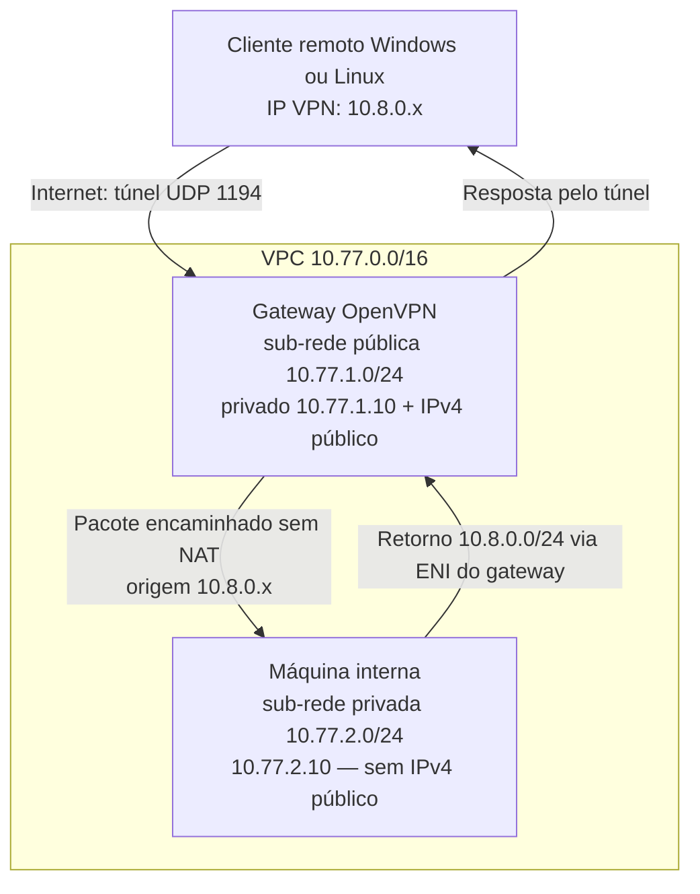

# A17 — Acessar uma máquina interna pelo OpenVPN

**Como acessar uma máquina sem Internet a partir de um computador remoto?** Você lançará duas EC2 na mesma VPC: um gateway OpenVPN público e uma máquina interna privada. O cliente Windows ou Linux chegará ao IPv4 privado da máquina interna pelo túnel; depois, você verificará recusas por identidade e revogação.

**Tempo do encontro:** 100 minutos, com preparação demonstrada de rede e cliente estimada em 30–45 minutos antes do encontro. **Trabalho:** duas EC2 por dupla; uma pessoa executa e a outra prevê e interpreta, alternando os papéis. A criação da VPC e a instalação do cliente estão descritas abaixo; acompanhe a preparação antes de reproduzir. Reserve os minutos finais para terminar os recursos.

**Objetivos de aprendizagem**

1. Configurar servidor e cliente, distinguindo segredo compartilhado, certificado, chave privada, controle TLS e canal de dados.
2. Configurar rotas de ida e volta, validar acesso à máquina interna e observar recusa por identidade incorreta e por certificado revogado em nova conexão.
3. Explicar os limites da VPN, distinguir renovação e revogação e encerrar os recursos cobrados.

**Recursos:** AWS Academy autorizado, navegador, duas EC2 Ubuntu, cliente OpenVPN Community na máquina local, SSH/SCP e Python com `cryptography` já usado na A14. No Windows, os comandos de preparação local usam Ubuntu/WSL; a VPN usa **OpenVPN GUI nativo do Windows**. No Linux, o cliente é executado no terminal do próprio sistema.

Use somente as duas EC2 e a VPC dedicadas ao seu laboratório, com dados de teste. Não conecte perfis institucionais nem altere a rede da organização. Não publique IPs, perfis `.ovpn`, chaves ou frases secretas. Se uma etapa falhar, pare e registre o erro sem segredos; há [alternativa](#alternativa) nesta página.

## Arquivos prontos da prática {#arquivos}

Use a pasta **a17** do [repositório de práticas](https://github.com/rafaelrezo/seguranca-digital-praticas/tree/main/a17), baixado na A14. Se ainda não o tiver, siga a [preparação única](https://github.com/rafaelrezo/seguranca-digital-praticas#preparar-uma-vez), por clone ou ZIP. Não crie os arquivos por copiar e colar: abra as fontes prontas e execute a etapa indicada.

No terminal **Linux ou Ubuntu/WSL**:

```bash
source ~/seguranca-digital-praticas/.venv/bin/activate
cd ~/seguranca-digital-praticas/a17
code .
```

`source` reativa o ambiente Python; `cd` escolhe a pasta da aula; `code .` abre os arquivos existentes. Se o editor não abrir, use o menu de abertura de pasta. Se você baixou os arquivos antes desta revisão, atualize o clone sem edições próprias com `git pull --ff-only`; para ZIP, obtenha uma cópia nova preservando as chaves geradas na anterior. O [README de a17](https://github.com/rafaelrezo/seguranca-digital-praticas/tree/main/a17) lista os comandos por etapa. Os trechos na página servem à leitura, sem montagem incremental dos arquivos.

## Percurso: qual trecho o túnel protege? {#vpn}

**VPC e VPN são redes diferentes.** A **VPC** (*Virtual Private Cloud*) é a rede privada na AWS; nela ficam as duas EC2. A **VPN** cria o túnel entre seu computador e o gateway. A máquina interna usa a rede da VPC e não precisa executar OpenVPN.



**Leia o percurso:** o cliente envia para `10.77.2.10` usando a interface VPN. O gateway abre o pacote protegido, encaminha-o para a VPC e recebe a resposta pela rota de retorno. O serviço HTTP está na **segunda EC2**, em `10.77.2.10:8080`.

- **Controle:** TLS autentica os extremos da VPN e sustenta estabelecimento/renovação de chaves.
- **Dados:** AES-GCM protege pacotes entre cliente e gateway. O túnel termina no gateway, não na máquina interna.
- **Roteamento:** rota no cliente, encaminhamento Linux e rota de retorno na AWS são necessários.
- **Filtro:** a prática permite apenas TCP 22/8080 no destino interno. Uma rota não concede autorização de aplicação.

O trecho **gateway → máquina interna** está fora da proteção criptográfica do OpenVPN. O HTTP de teste está em claro nesse trecho; SSH ou HTTPS protegem a comunicação até o serviço. A rede privada não substitui essa proteção.

### Endereços: distinguir a rede física do túnel

| Componente | Endereço de referência | Função |
|---|---|---|
| VPC | `10.77.0.0/16` | Contém as duas sub-redes AWS. |
| Sub-rede pública | `10.77.1.0/24` | Gateway em `10.77.1.10`; rota para Internet Gateway. |
| Sub-rede privada | `10.77.2.0/24` | Interna em `10.77.2.10`; sem rota para Internet. |
| Pool VPN | `10.8.0.0/24` | Endereços virtuais dos clientes; TUN do gateway em `10.8.0.1`. |

Antes de criar recursos, confira as rotas locais com `ip -4 route` no Linux ou `route print` no Windows. **Pare se essas redes coincidirem com outra rede/VPN em uso.** A configuração depende desses endereços; não altere apenas um arquivo para contornar conflito.

A máquina interna não terá IP público, IPv6, NAT, proxy de saída nem rota `0.0.0.0/0` em sua **tabela de rotas VPC**. Isso impede Internet sem impedir resposta às conexões permitidas pela VPN. Não confunda essa tabela AWS com a tabela do Ubuntu, que pode ter uma rota padrão para o roteador da sub-rede.

## Preparação local: instalar o cliente certo {#cliente}

Escolha **uma** alternativa conforme seu sistema. Permissão de instalação e conectividade devem ser conferidas antes do lançamento. Não execute comandos Linux no PowerShell nem comandos do servidor na máquina local.

### Windows: OpenVPN GUI e preparação pelo WSL

1. Abra a [página oficial OpenVPN Community](https://openvpn.net/community/) e obtenha o instalador Windows compatível com a arquitetura da sua máquina. Use a edição Community que inclui **OpenVPN GUI**, com núcleo 2.6 ou posterior; confirme a versão instalada. A origem e a versão devem ser registradas, pois os instaladores mudam.
2. Execute o instalador com a autorização administrativa da sua máquina. Mantenha OpenVPN GUI, serviço interativo e driver de túnel. Abra **OpenVPN GUI** pelo menu Iniciar; o ícone fica na área de notificação, às vezes dentro da seta de ícones ocultos. Ainda não existe perfil para conectar.
3. Abra Ubuntu/WSL, o ambiente da A14. Confira os comandos abaixo. O WSL será usado para certificados e SSH; **o túnel será conectado pelo Windows**, não pelo WSL.

```bash
cd ~/seguranca-digital-praticas/a17
openssl version
python3 -c 'import cryptography; print(cryptography.__version__)'
ssh -V
code .
```

`cd` entra na pasta a17 já baixada. Os três comandos seguintes conferem ferramentas, sem conectar à EC2. `code .` abre essa pasta no editor. Se faltar a biblioteca, retome o ambiente Python demonstrado na A14; não trate erro de dependência como falha da VPN.

**Checkpoint Windows:** GUI instalado e ícone acessível; terminal WSL com OpenSSL, Python e SSH. Se faltar privilégio administrativo ou a instalação for bloqueada, acompanhe a demonstração e use a alternativa.

### Linux: cliente OpenVPN no próprio sistema

Em **Ubuntu/Debian**, abra o terminal local:

```bash
sudo apt update
sudo apt install openvpn openssh-client
cd ~/seguranca-digital-praticas/a17
openvpn --version
python3 -c 'import cryptography; print(cryptography.__version__)'
code .
```

`apt update` atualiza o índice; `apt install` instala o cliente e SSH/SCP pelos repositórios do sistema. `sudo` pede a senha administrativa local. Confira núcleo OpenVPN 2.6 ou posterior. Python/VS Code são os da A14; se faltar `code`, abra a pasta manualmente no editor. Em outra distribuição, use o pacote oficial correspondente com orientação antes de seguir; os comandos `apt` não se aplicam a todo Linux.

**Checkpoint Linux:** cliente instalado e ambiente Python funcional. Pare se houver versão incompatível. O cliente ficará em primeiro plano num terminal e os testes usarão outro terminal.

## VPC: preparar duas sub-redes pelo console {#ec2}

**Região de referência:** Norte da Virgínia, `us-east-1`, se permitida no AWS Academy. Inicie o laboratório e abra o console pela sessão temporária, sem gerar access keys. Use somente recursos dedicados à dupla; não altere tabelas de rede compartilhadas. Se a conta impedir criação de VPC ou mudança de rotas/ENI, pare e use a [alternativa](#alternativa).

### Criar a rede e associar as tabelas

1. Em **VPC → Your VPCs → Create VPC**, escolha **VPC only**, nome `a17-vpc-dupla`, IPv4 `10.77.0.0/16`, **sem IPv6** e tenancy **Default**. Preserve DNS resolution habilitado. Confira o ID criado. Não escolha um assistente que crie NAT automaticamente.
2. Em **Subnets → Create subnet**, selecione essa VPC. Crie `a17-publica` com `10.77.1.0/24` e `a17-privada` com `10.77.2.0/24`, na **mesma zona de disponibilidade** permitida. Mantenha atribuição automática de IPv4 público desativada nas sub-redes; será habilitada apenas no lançamento do gateway.
3. Em **Internet gateways → Create internet gateway**, crie `a17-igw`. Selecione-o → **Actions → Attach to a VPC** → sua VPC. Anexar o gateway à VPC não dá Internet automaticamente a toda sub-rede.
4. Em **Route tables → Create route table**, crie `a17-rt-publica` e `a17-rt-privada`, ambas nessa VPC. Para cada uma, abra **Subnet associations → Edit subnet associations** e associe **somente** a sub-rede correspondente. Confira a associação explícita, sem depender da tabela principal automática.
5. Na tabela **pública**, abra **Routes → Edit routes → Add route** e adicione `0.0.0.0/0` → **Internet Gateway** → `a17-igw`. Na **privada**, preserve apenas a rota local por enquanto; a rota de retorno VPN será adicionada depois de lançar o gateway.

| Tabela / associação | Destino | Alvo |
|---|---|---|
| Pública / `a17-publica` | `10.77.0.0/16` | `local`, criado pela AWS. |
| Pública / `a17-publica` | `0.0.0.0/0` | Seu Internet Gateway. |
| Privada / `a17-privada` | `10.77.0.0/16` | `local`, criado pela AWS. |
| Privada / `a17-privada` | `10.8.0.0/24` | ENI do gateway; adicionar na próxima seção. |

Não crie NAT Gateway, Elastic IP, endpoints adicionais ou rotas IPv6. Preserve a NACL padrão da VPC; os filtros específicos serão os security groups e o encaminhamento no gateway. Veja [criação da VPC](https://docs.aws.amazon.com/vpc/latest/userguide/create-vpc.html) e [tabelas de rotas](https://docs.aws.amazon.com/vpc/latest/userguide/VPC_Route_Tables.html).

**Checkpoint:** duas sub-redes e duas associações corretas; somente a pública tem `0.0.0.0/0`. Registre os IDs localmente. Não avance com a privada associada à tabela pública.

### Security groups: abrir somente o fluxo necessário

Em **EC2 → Security Groups → Create security group**, crie `a17-gateway` e `a17-interna` na VPC da dupla. Edite **Inbound rules** e **Outbound rules** conforme a tabela. Atribua somente o grupo correspondente a cada instância.

| Grupo / sentido | Protocolo e porta | Origem ou destino |
|---|---|---|
| Gateway / entrada | TCP 22 | **My IP**, IPv4 público de saída da dupla `/32`, para administração. |
| Gateway / entrada | UDP 1194 | O mesmo IPv4 público `/32`, para OpenVPN. |
| Gateway / saída | Padrão: todo tráfego IPv4 | `0.0.0.0/0`; usado para pacotes Ubuntu e encaminhamento autorizado pelo filtro Linux. |
| Interna / entrada | TCP 22 e TCP 8080, duas regras | **Origem CIDR `10.8.0.0/24`**, os clientes VPN. |
| Interna / saída | **Nenhuma regra** | Remova a regra padrão de saída. |

No grupo interno, informe o **CIDR do pool VPN**, não o grupo do gateway: sem NAT, a origem dos pacotes continua `10.8.0.x`. O retorno de conexões de entrada permitidas é aceito pelo SG stateful mesmo sem regra de saída. Serviços locais AWS, como DNS, DHCP e metadados, têm exceções próprias; “sem Internet” não significa ausência desses serviços. ([AWS: funcionamento dos security groups](https://docs.aws.amazon.com/vpc/latest/userguide/vpc-security-groups.html).)

**My IP** é a saída pública da sala, não o endereço privado do notebook. Se mudar, ajuste apenas as duas regras do gateway. Não abra origens gerais nem TCP 8080 público para diagnosticar.

## EC2: lançar o gateway e a máquina interna {#instancias}

Entre em **EC2 → Instances → Launch instances** e faça **dois lançamentos separados**. Rótulos podem aparecer traduzidos; confira cada valor.

| Campo | Gateway OpenVPN | Máquina interna |
|---|---|---|
| Name | `a17-openvpn-dupla` | `a17-interna-dupla` |
| AMI | Ubuntu Server **24.04 LTS**, x86_64, oficial Canonical. | A mesma imagem oficial; Python 3 e cloud-init devem estar presentes. |
| Instance type | `t3.micro`, uma unidade. | `t3.micro`, uma unidade. |
| Key pair | Crie `acesso-a17`, RSA, formato `.pem`; guarde o download. | Selecione o mesmo par SSH descartável. Não é a PKI VPN. |
| Network settings → Edit | Sua VPC, `a17-publica`, privado primário **`10.77.1.10`**. | Sua VPC, `a17-privada`, privado primário **`10.77.2.10`**. |
| Auto-assign public IP | **Enable**, somente neste lançamento. | **Disable**; sem IPv6. |
| Firewall | Selecione apenas `a17-gateway`. | Selecione apenas `a17-interna`. |
| Storage | gp3, mínimo da AMI, referência 8 GiB; Delete on termination. | Mesmo critério; um volume, sem disco extra. |
| Advanced details → User data | Vazio. | **Choose file** → `a17/interna-user-data.sh` do repositório; não marcar conteúdo já codificado em base64. |
| Outros detalhes | Sem role extra; cifra EBS quando permitida; créditos CPU Standard se disponível. | Mesmo critério. |

No Windows, `explorer.exe .` no WSL abre a pasta a17; copie `interna-user-data.sh` para uma pasta Windows para escolhê-lo no navegador. O arquivo não contém segredo.

**O que faz o user data?** No primeiro boot, cloud-init executa o script como root. Ele usa o Python já existente na AMI para iniciar HTTP em `10.77.2.10:8080`, com `systemd` e usuário sem privilégio. Não executa `apt`, download ou acesso à Internet. Abra o arquivo antes de usá-lo. Se a AMI não tiver Python, pare e adeque a imagem com orientação; não dê Internet temporária à interna. ([AWS: user data](https://docs.aws.amazon.com/AWSEC2/latest/UserGuide/user-data.html).)

Espere **Running** e status checks aprovados em ambas. Anote região, AMI ID, zona, tipo, instâncias, volumes, grupos e horário no registro local. Confirme que a interna mostra **nenhum IPv4 público**. Status checks não provam que o serviço terminou de iniciar.

### ENI e retorno: preparar o gateway para rotear {#retorno}

Uma **ENI** é a interface de rede da instância na VPC, identificada por `eni-...`. Não é a interface virtual TUN do OpenVPN.

1. Selecione **somente `a17-openvpn-dupla`** → **Actions → Networking → Change source/destination check** → desative a verificação e salve. A AWS normalmente exige que os pacotes sejam da própria EC2; o gateway encaminhará pacotes de terceiros. Mantenha essa verificação habilitada na máquina interna.
2. Na aba **Networking** do gateway, localize a interface com IPv4 privado `10.77.1.10` e anote seu **Network interface ID**. Não use o ID da interna nem um IP como alvo da rota.
3. Volte a **VPC → Route tables → a17-rt-privada → Routes → Edit routes**. Adicione destino **`10.8.0.0/24`**, tipo de alvo **Network Interface**, e selecione essa ENI. Salve; espere estado **Active**, sem `blackhole`.
4. Confira novamente que a tabela privada está associada à sub-rede privada e **não** tem rota `0.0.0.0/0`. A pública mantém apenas local e Internet Gateway; não precisa de rota adicional para o pool conectado à TUN do gateway.

**Preveja:** sem a rota de retorno, o pedido pode chegar à interna, mas a resposta não sabe alcançar `10.8.0.x`. Sem source/destination check desativado, a AWS bloqueia o trânsito pelo gateway. Essas mudanças não substituem o forwarding Linux que configuraremos adiante. ([AWS: verificação de origem/destino](https://docs.aws.amazon.com/AWSEC2/latest/UserGuide/using-eni.html).)

### Custo: duas instâncias, dois discos e um IPv4

Para **duas horas**, sem assumir gratuidade: reserve US$ 0,02/h **por EC2** como margem didática, US$ 0,005/h pelo único IPv4 público e cerca de US$ 0,002 por volume gp3 de 8 GiB por duas horas. Isso dá base aproximada de **US$ 0,094 por dupla**; reserve **US$ 0,15** incluindo alguma folga para tráfego, sem tratar como teto garantido.

Reconfira tipo/região, tamanho mínimo da AMI, preço e saldo antes de lançar. Preparação com instâncias ligadas também consome tempo. Respeite o crédito US$ 50 por estudante. As tarifas e o prazo podem mudar: [IPv4](https://aws.amazon.com/vpc/pricing/), [EBS](https://aws.amazon.com/ebs/pricing/) e [EC2 sob demanda](https://aws.amazon.com/ec2/pricing/on-demand/), consultados em 15 out. 2026.

## SSH: separar administração e VPN {#ssh}

**Na máquina local Linux ou WSL**, coloque o download da chave EC2 na pasta `~/seguranca-digital-praticas/a17` e renomeie-o para `acesso-a17.pem`. No Windows, `explorer.exe .` no WSL abre essa pasta no Explorer; copie o arquivo pelo gerenciador, sem publicar seu conteúdo.

No mesmo terminal, substitua `SEU_IPV4_PUBLICO` pelo valor da sua EC2, sem espaços:

```bash
cd ~/seguranca-digital-praticas/a17
chmod 600 acesso-a17.pem
IP_EC2=SEU_IPV4_PUBLICO
ssh -i acesso-a17.pem ubuntu@"$IP_EC2"
```

`chmod 600` restringe a privada ao dono. A variável guarda apenas o endereço; `-i` escolhe a chave SSH e `ubuntu` é o usuário desta AMI. Antes de aceitar a primeira chave do host, confira a impressão digital com o registro da sua instância no console (**Actions → Monitor and troubleshoot → Get system log**, quando disponível) ou com a verificação conduzida. Se a identidade não puder ser confirmada, pare; não use `StrictHostKeyChecking=no`.

**Resultado esperado:** prompt `ubuntu@...` do servidor. Identifique esse terminal como **EC2**. A conexão SSH não é o túnel OpenVPN.

### Na EC2: instalar os pacotes e gerar o segredo adicional

```bash
mkdir -p ~/a17
```

Agora abra um terminal **local Linux/WSL**, entre na pasta a17 do repositório e envie os scripts do gateway. Defina `IP_EC2` nesse terminal com o IPv4 da sua instância, como na etapa SSH:

```bash
cd ~/seguranca-digital-praticas/a17
scp -i acesso-a17.pem servidor.sh roteamento.sh ubuntu@"$IP_EC2":a17/
```

Volte ao terminal **EC2** e execute:

```bash
cd ~/a17
bash servidor.sh preparar
```

O script instala OpenVPN, Python, iptables e curl pelos repositórios Ubuntu, mostra a versão e confere `/dev/net/tun`. Depois cria `ta.key` somente se o segredo não existir. Abra `servidor.sh` para ler esses comandos; ele não lança recursos AWS.

`openvpn --genkey tls-auth` gera o segredo do **HMAC adicional do controle**. Não é certificado nem chave AES digitada pelo aluno. O perfil local precisará da mesma chave, transferida pelo SSH já verificado.

**Checkpoint:** OpenVPN 2.6+, TUN disponível e `ta.key` criado/preservado. Se faltar TUN ou instalação, pare. Mantenha o SSH aberto; a PKI e o envio de certificados usam o terminal **local**.

## PKI local: o que cada lado recebe? {#pki}

A A15 verificou certificados locais; agora usaremos uma CA nova e descartável, com finalidades separadas para servidor e cliente. A CA será aceita explicitamente no perfil, sem instalação no repositório de confiança do sistema.

| Arquivo | Onde fica e para que serve |
|---|---|
| `ca.key` | Somente local, cifrado por frase: assina certificados/CRL. Nunca enviar à EC2. |
| `ca.crt` | Certificado público da CA, nos dois lados. Sua distribuição precisa ser confiável. |
| `servidor.key` / `.crt` | Privada e certificado do servidor; somente esse par vai à EC2. |
| `cliente.key` / `.crt` | Privada cifrada e certificado do cliente; ficam locais e entram no perfil. |
| `crl.pem` | Lista de revogação assinada, inicialmente vazia, que o servidor consultará. |
| `ta.key` | Segredo adicional compartilhado, gerado na EC2 e copiado ao cliente por SCP. |

**Operação local:** na pasta a17 já obtida, abra `pki_a17.py` antes de executar. Ele gera pares EC/P-256, certificados ECDSA/SHA-256 com prazo de dois dias e CRL; não lança EC2 nem configura a rede.

O [código completo de `pki_a17.py`](https://github.com/rafaelrezo/seguranca-digital-praticas/blob/main/a17/pki_a17.py) já está na pasta a17; abra-o no VS Code. O [download anterior](../assets/a17/pki_a17.py) contém o mesmo arquivo. Não copie código para montar o programa. A geração, o perfil e a revogação são ações separadas.


No terminal **local Linux/WSL**:

```bash
cd ~/seguranca-digital-praticas/a17
python3 pki_a17.py iniciar
openssl verify -CAfile pki/ca.crt -purpose sslserver pki/servidor.crt
openssl verify -CAfile pki/ca.crt -purpose sslclient pki/cliente.crt
```

O programa pede duas vezes uma frase descartável, sem mostrá-la. Ela cifra a privada da CA e a do cliente; guarde-a somente durante o ensaio. As duas verificações devem retornar `OK`, cada uma para sua finalidade. Se a pasta `pki` já existir, o programa para para não substituir chaves; use outra pasta de trabalho em um novo ensaio.

**Antes de transferir, explique:** quem conhece a privada de cada identidade? Quem assinou os certificados? Por que o certificado público da CA não entrega a privada?

### Transferir somente os arquivos necessários

Ainda no terminal **local**, defina `IP_EC2` novamente se tiver aberto outro terminal. `server.conf` já vem no repositório; confira o arquivo e envie somente o material listado:

```bash
scp -i acesso-a17.pem pki/ca.crt pki/servidor.crt pki/servidor.key pki/crl.pem server.conf ubuntu@"$IP_EC2":a17/
scp -i acesso-a17.pem ubuntu@"$IP_EC2":a17/ta.key pki/ta.key
python3 pki_a17.py perfil "$IP_EC2"
```

`scp` copia pelo SSH: a primeira linha envia os arquivos listados, **sem** `ca.key` e `cliente.key`; a segunda recupera `ta.key`. `perfil` valida o formato IPv4 e cria `cliente-a17.ovpn` com certificado CA, certificado cliente, privada cliente cifrada e segredo `tls-auth` embutidos. O perfil também é sensível, mesmo com a privada cifrada.

**Resultado esperado:** arquivos transferidos e perfil criado. Não copie o perfil para a EC2 nem para outro estudante. A dupla usa um cliente de cada vez; emitir identidades individuais é necessário numa implantação real.

## Servidor: ler a configuração antes de iniciar {#servidor}

Abra `server.conf` no editor local. O conteúdo é configuração, não comandos Bash:

```conf
# OpenVPN Community 2.6+ / Ubuntu. Arquivos em /etc/openvpn/server.
port 1194
proto udp
dev tun0
topology subnet
server 10.8.0.0 255.255.255.0
# Rota para a sub-rede da maquina interna; sem redirect-gateway ou NAT.
push "route 10.77.2.0 255.255.255.0"
ca ca.crt
cert servidor.crt
key servidor.key
dh none
remote-cert-tls client
crl-verify crl.pem
tls-version-min 1.3
tls-groups X25519:prime256v1
data-ciphers AES-256-GCM
tls-auth ta.key 0
auth SHA256
keepalive 10 60
# Intervalo abreviado para observar renovação no laboratório.
reneg-sec 120
persist-key
persist-tun
disable-dco
user nobody
group nogroup
verb 3
```

| Grupo de diretivas | Efeito e limite |
|---|---|
| `port`, `proto`, `dev`, `topology`, `server` | UDP 1194 e interface `tun0`, rede VPN 10.8.0.0/24, gateway virtual 10.8.0.1. |
| `push "route 10.77.2.0 255.255.255.0"` | Envia ao cliente a rota da sub-rede interna pela VPN. Não muda sua rota padrão nem autoriza todas as portas. |
| `ca`, `cert`, `key` | Definem âncora aceita e identidade local. A privada permite a prova, não cifra diretamente cada pacote. |
| `remote-cert-tls client`, `crl-verify` | Exigem finalidade de cliente e consultam CRL. A CRL deve existir, ser válida e estar legível; ausência não deve ser tratada como teste de revogação bem-sucedido. |
| `dh none`, `tls-version-min 1.3`, `tls-groups X25519:prime256v1` | TLS 1.3 e grupos explícitos para comparar ECDHE com A16; o certificado continua P-256. O recorte do ensaio não é uma política universal de algoritmos. Conferir suporte e negociação no log. |
| `data-ciphers AES-256-GCM` | Define a cifra do canal de dados; não escolhe a suíte do controle TLS. |
| `tls-auth ta.key 0`, `auth SHA256` | Acrescentam HMAC-SHA256 no controle; o cliente usa direção 1. Com GCM, `auth` não acrescenta HMAC separado aos dados. |
| `keepalive 10 60`, `reneg-sec 120` | Atividade/detecção de perda e renovação de chaves de dados; 120 s é intervalo abreviado de laboratório, não validade de certificado. |
| `persist-key`, `persist-tun`, `disable-dco` | Preservam estado em reinícios internos e usam o caminho TUN sem offload, para consistência do ensaio. |
| `user nobody`, `group nogroup`, `verb 3` | Reduzem privilégios após iniciar e definem detalhamento de log. Não substituem proteção do host. |

### Forwarding: permitir o trânsito para a interna {#roteamento}

Antes de iniciar, abra **`roteamento.sh`**. Ele só deve rodar no gateway descartável `10.77.1.10`; não o execute no notebook ou em outro servidor.

| Operação do script | Efeito |
|---|---|
| `ip -4 route get 10.77.2.10` | Descobre a interface física correta, sem presumir nome `eth0` ou `ens5`. |
| `net.ipv4.ip_forward=1` | Permite ao kernel encaminhar pacotes entre TUN e VPC. Durante a configuração fica em 0 para não encaminhar sem filtro. |
| Cadeia `A17_FORWARD` | Permite clientes `10.8.0.0/24` → **10.77.2.10**, somente TCP **22/8080**, e retorno de conexões; descarta outros pacotes encaminhados. Não altera INPUT/OUTPUT usados pelo SSH do gateway. |
| Sem regra NAT | Preserva a origem `10.8.0.x`; por isso a rota de retorno na VPC é indispensável. |

**No gateway EC2**, instale a configuração, aplique o filtro e inicie em primeiro plano:

```bash
cd ~/a17
bash servidor.sh configurar
bash roteamento.sh aplicar
bash servidor.sh iniciar
```

A etapa `configurar` executa `install` com permissões explícitas: certificados/CRL são públicos; as privadas/segredo são restritos. A CRL precisa continuar legível ao processo depois da redução de privilégios. O último comando inicia **esse servidor**, mantendo o terminal ocupado. Espere `Initialization Sequence Completed`; se houver erro, não inicie o cliente.

Em outro SSH **para o gateway**, execute `bash ~/a17/roteamento.sh inspecionar`. Confira forwarding 1, regras e contadores da cadeia, rota para a interna e ausência de SNAT/MASQUERADE. Se houver falha ao aplicar, o forwarding pode permanecer em 0: corrija o motivo e reaplique antes de conectar.

Essas regras e o sysctl são do ensaio em memória; **reaplique após reboot**. O script não muda ENI, SG ou tabelas AWS. O [HOWTO oficial OpenVPN](https://community.openvpn.net/HOWTO#including-multiple-machines-on-the-server-side-when-using-a-routed-vpn-dev-tun) explica a relação entre rota enviada, forwarding e retorno.

O HTTP já deve estar rodando na **máquina interna**, pelo user data. Se a interna não responder, confira o percurso de ida/retorno antes de avançar.

## Cliente: conectar e verificar a função {#conectar}

### V0: prever o acesso sem túnel

Com o cliente **desconectado**, execute `bash verificar_linux.sh` no Linux nativo ou `verificar_windows.cmd` no Windows. Esses arquivos consultam a rota e tentam HTTP em `10.77.2.10:8080`, com prazo de cinco segundos e sem proxy.

**Esperado:** não receber a frase do serviço; não deve existir a rota específica `10.77.2.0/24` pela VPN. Se houver resposta de outra máquina/rede, pare: pode haver sobreposição. A falha isolada ainda não prova isolamento; ela será comparada com V1 e com as configurações AWS.

Não derrube outra VPN de trabalho para executar o ensaio. Confira novamente ausência de conflitos antes de conectar.

### Windows: importar no OpenVPN GUI

1. No WSL, abra a pasta com `explorer.exe .` e copie `cliente-a17.ovpn` e `verificar_windows.cmd` para uma pasta local protegida, por exemplo `%LOCALAPPDATA%\A17`, fora de pastas sincronizadas. O perfil contém segredo; não o envie por chat nem o coloque no OneDrive compartilhado.
2. No ícone do **OpenVPN GUI**, clique com o botão direito, escolha **Import file / Importar arquivo** e selecione o perfil. Depois escolha esse perfil e **Connect / Conectar**.
3. Digite a frase da **privada do cliente** criada na PKI. Não é senha AWS nem login no servidor. Observe a janela de log; espere conexão concluída, sem erro de certificado.
4. Abra PowerShell **do Windows** na pasta em que copiou os arquivos e execute o verificador pronto. O WSL pode ter outra representação da rede; ele não será usado como prova do túnel Windows.

```powershell
.\verificar_windows.cmd
```

O arquivo `.cmd` executa `route print` e o pedido `curl.exe` ao IPv4 interno; localize **10.77.2.0 / 255.255.255.0** na tabela. `route print` permite localizar a rota; `curl.exe` evita o alias PowerShell e solicita o serviço. `--noproxy "*"` evita encaminhar o teste a um proxy HTTP configurado. Espere a frase `A17: maquina interna sem Internet`. Se faltar `curl.exe`, abra esse endereço no navegador Windows, observando eventual política de proxy.

### Linux: conectar no terminal local

No terminal **Linux local**, entre na pasta do perfil:

```bash
cd ~/seguranca-digital-praticas/a17
bash cliente_linux.sh original
```

`cliente_linux.sh` executa OpenVPN com o perfil escolhido. Depois da senha administrativa local, o cliente pede a frase da sua privada. Mantenha o processo aberto até o final do teste. Em **outro terminal Linux local**, entre também em `~/seguranca-digital-praticas/a17`:

```bash
bash verificar_linux.sh
```

`verificar_linux.sh` executa a consulta de rota e o pedido HTTP. `ip route get` consulta a decisão de saída; não testa conectividade sozinho. `curl` envia o pedido ao serviço. Espere uma interface VPN na rota e a frase de teste. Se faltar `curl`, instale o pacote da distribuição antes do ensaio ou use o navegador local sem proxy para esse destino.

### Evidência V1: separar negociação e acesso

Nos logs do cliente e servidor, localize:

- identificação/validação do par, versão e parâmetros do **controle TLS**;
- cifra negociada do **canal de dados**, esperada `AES-256-GCM`;
- conclusão de inicialização e endereço virtual;
- rota **10.77.2.0/24** pela VPN e resposta de **10.77.2.10:8080**;
- contadores da cadeia `A17_FORWARD` no gateway, aumentando no pedido e na resposta.

Registre recortes sanitizados, sem perfil completo, chaves ou IP público. A mensagem de inicialização demonstra um estado da sessão; a resposta do serviço demonstra função. Compare V0 e V1. Um timeout isolado não prova recusa criptográfica nem isolamento da interna.

### Máquina interna: abrir SSH pelo túnel {#interna}

Mantenha V1 conectado. Agora acesse **`10.77.2.10`**, não o IPv4 público do gateway. A chave `acesso-a17.pem` é a mesma selecionada nos dois lançamentos.

- **Linux nativo:** em outro terminal local, na pasta a17, execute `ssh -i acesso-a17.pem ubuntu@10.77.2.10`.
- **Windows:** use SSH nativo do Windows, pois a VPN está nele. No Explorer, crie a pasta `.ssh` na sua pasta de usuário, se necessário, e copie a chave do WSL para `%USERPROFILE%\.ssh\acesso-a17.pem`, em pasta local protegida, sem compartilhamento. Abra **PowerShell Windows** e execute o comando abaixo. Se o OpenSSH Client estiver ausente ou recusar as permissões do arquivo, pare e corrija na preparação; não use o WSL como prova do túnel Windows nem desative verificação do host.

```powershell
ssh.exe -i "$env:USERPROFILE\.ssh\acesso-a17.pem" ubuntu@10.77.2.10
```

Antes de aceitar a primeira chave do host interno, compare sua impressão digital com o log dessa **segunda instância** no console EC2, como no SSH do gateway. A autenticação VPN não substitui essa verificação nem a chave SSH do destino.

**Já no terminal da interna**, execute:

```bash
hostname
ip -4 address
ip -4 route
systemctl is-active a17-http
sudo journalctl -u a17-http --no-pager -n 15
```

Espere privado **10.77.2.10**, serviço `active` e pedido HTTP com origem **10.8.0.x** no journal. Isso relaciona a segunda máquina ao acesso observado e confirma a preservação da origem, sem NAT. Se o serviço falhar, confira `sudo tail -n 30 /var/log/cloud-init-output.log`; não instale pacotes pela Internet para contornar o diagnóstico.

### Isolamento: alcançar a interna não lhe dá Internet {#isolamento}

Compare três evidências de configuração no console:

1. A interna não tem IPv4 público nem IPv6.
2. Sua sub-rede usa a tabela privada, com `local` e retorno `10.8.0.0/24` → ENI do gateway, **sem** `0.0.0.0/0`, NAT ou Internet Gateway como saída.
3. Seu único SG aceita TCP 22/8080 do pool VPN e não tem regras de saída iniciada. O retorno das conexões aceitas continua permitido.

No terminal **da interna**, faça uma tentativa curta de conexão TCP a um endereço externo, sem DNS:

```bash
timeout 5 bash -c 'echo > /dev/tcp/1.1.1.1/443'
echo "status=$?"
```

`/dev/tcp` é uma função do Bash para abrir uma conexão, não um arquivo servido. **Esperado:** falha ou prazo excedido; status diferente de zero, frequentemente 124. Se o status for zero, pare: existe uma saída inesperada e o isolamento precisa ser corrigido. Não abra destinos ou mude rotas para fazer esse teste passar.

A tentativa isolada também poderia falhar por indisponibilidade do destino. Ela só apoia a conclusão junto da configuração e do HTTP/SSH interno funcionando. DNS e metadados AWS locais não são acesso à Internet.

**Feche o SSH da interna com `exit` antes de V2/V3.** Ao final das contraprovas, o cliente não terá acesso; reserve o console para terminar as duas EC2. O tráfego comum de Internet do seu notebook continua saindo pela rede local, pois não enviamos `redirect-gateway`.

## Contraprova V2: uma CA aceita não autoriza qualquer nome {#identidade}

**Estado:** V1 funcionou. Desconecte o cliente: **Disconnect** no Windows ou `Ctrl+C` no processo OpenVPN Linux. Preserve `cliente-a17.ovpn`.

No terminal **local Linux/WSL**, entre em a17 e gere o perfil de contraprova:

```bash
python3 pki_a17.py perfil-errado
```

O programa cria `cliente-nome-errado.ovpn`, alterando **somente** `verify-x509-name vpn-a17 name` para `verify-x509-name outro-servidor name`. Endereço, CA, certificado, privada e segredo permanecem iguais. Não copie nem edite manualmente o perfil.

No Windows, copie e importe esse arquivo como outro perfil no GUI. No Linux, execute `bash cliente_linux.sh nome-errado`.

**Esperado:** recusa de nome X.509, sem estabelecer o túnel. O texto pode incluir `VERIFY X509NAME ERROR`; o cliente pode tentar novamente até você desconectar. Registre o motivo e encerre essa tentativa. Não retire a verificação para “corrigir”.

**Diferença em relação ao HTTPS da A15:** aqui `verify-x509-name ... name` compara o CN esperado `vpn-a17`; `remote-cert-tls server` verifica o papel de servidor. Não é a verificação automática de DNS/SAN do navegador. O perfil precisa declarar a identidade esperada. ([Manual OpenVPN](https://openvpn.net/community-docs/community-articles/openvpn-2-6-manual.html).)

Volte ao perfil original e confira novamente V1 antes de revogar. Isso isola o efeito de cada mudança.

## Ciclo: renovar chaves e revogar um cliente {#ciclo}

<span id="inventario"></span><span id="manutencao-vpn"></span>

| Operação | O que muda | O que continua necessário |
|---|---|---|
| Renovação por `reneg-sec` | Chaves de dados usadas na sessão. | Certificados válidos e controles da conexão. |
| Renovação de certificado | Prazo e material emitido, conforme política. | Tratar exposição da privada; renovar prazo sozinho não resolve comprometimento. |
| Revogação | O certificado passa a constar na CRL assinada. | Distribuir a CRL e verificar sua aplicação no servidor. |
| Recuperação | Restaura o mesmo material autorizado a partir de cópia protegida. | Testar função; gerar outra chave com o mesmo nome não restaura os mesmos bytes. |

Com o cliente válido conectado por mais de dois minutos, podem aparecer eventos de nova negociação. Localize uma evidência se ocorrer durante o ensaio; não registre renovação executada apenas porque existe `reneg-sec 120` no arquivo. Não é a antiga renegociação interna do TLS 1.2; o OpenVPN administra novas negociações para renovar suas chaves.

### Contraprova V3: certificado revogado na nova conexão {#revogacao}

**Previsão:** a tag de dados pode continuar correta para uma mensagem, mas a admissão de um cliente depende também do certificado e da CRL. Vamos testar a recusa em **nova conexão**, sem supor expulsão imediata de uma sessão existente.

1. Desconecte o cliente válido. No terminal **local Linux/WSL**, na pasta da PKI, execute:

```bash
python3 pki_a17.py revogar
openssl verify -CAfile pki/ca.crt -CRLfile pki/crl.pem -crl_check -purpose sslclient pki/cliente.crt
scp -i acesso-a17.pem pki/crl.pem ubuntu@"$IP_EC2":a17/crl.pem
```

`revogar` pede a frase da CA e assina uma CRL com o número de série do cliente. `verify -crl_check` deve recusar com `certificate revoked`. O SCP envia a **nova CRL pública**, sem a privada da CA.

2. Na EC2, em um terminal SSH disponível, instale a nova lista:

```bash
cd ~/a17
bash servidor.sh atualizar-crl
```

O script confere a assinatura da CRL com a CA, instala a lista e mostra emissor/atualização; isso não substitui a tentativa de conexão. A lista precisa continuar legível ao usuário do processo.

3. Neste laboratório descartável, reinicie explicitamente o processo servidor para carregar a CRL atualizada antes da verificação: no terminal OpenVPN da EC2, use `Ctrl+C` e execute novamente `bash ~/a17/servidor.sh iniciar`. Essa ação interrompe todas as sessões desse servidor de teste. Não reproduza esse procedimento em produção sem planejamento.

4. Espere a inicialização do servidor e tente conectar novamente com **o perfil original**, no OpenVPN GUI Windows ou no comando cliente Linux. Observe principalmente o log do **servidor**. O HTTP na segunda EC2 é independente do processo OpenVPN e não precisa ser reiniciado por essa mudança.

**Esperado V3:** recusa por certificado revogado, como `VERIFY ERROR ... certificate revoked`, sem túnel utilizável. O cliente pode mostrar apenas falha/timeout TLS e repetir tentativas; isso sozinho não identifica a causa. Correlacione com a CRL e o log do servidor. Desconecte e encerre a tentativa.

**Pare:** não tente remover a revogação da CRL para reutilizar essa identidade. Um novo ensaio exige outro certificado/PKI descartável. Revogar não apaga cópias da privada nem resolve exposição da CA.

## Relacionar A14–A16 com o resultado {#sequencia-vpn}

```text
CA e segredo distribuídos com confiança
    → controle TLS com certificado e prova de posse
    → configuração TUN e chaves do canal de dados
    → rota interna + forwarding + filtros + retorno AWS
    → serviço da segunda EC2 acessível pelo IPv4 privado
    → nova conexão recusada quando a identidade não atende à política
```

As setas indicam dependências funcionais; não enumeram todas as mensagens internas. Controle e dados podem compartilhar UDP 1194, com funções diferentes.

| Conteúdo anterior | Aplicação ou comparação no caso |
|---|---|
| A14: AES, GCM, nonce, AAD e tag | Dados usam AEAD; parâmetros por pacote são administrados pelo protocolo. Ler a cifra negociada não mostra individualmente nonce/AAD/tag nem executa a contraprova de bit da A14. |
| A14: segredo prévio | `ta.key` precisa existir nos dois extremos antes de validar o HMAC adicional do controle. SCP transporta esse segredo pelo SSH verificado. |
| A15: pública/privada e assinatura | A CA assina certificados; cada extremo prova posse da sua privada no TLS. V2 separa CA aceita de identidade esperada. |
| A15: RSA/OAEP e híbrida | Nosso perfil usa EC/ECDHE; não transporta uma chave AES cifrada por RSA. A composição da A15 é comparação, não descrição desse handshake. |
| A16: hash e HMAC | SHA-256 participa de assinaturas; HMAC protege adicionalmente o controle por `tls-auth`. Não confundir código MAC com assinatura digital. |
| A16: senha, sal e custo | A frase protege arquivos privados. Não há cadastro de senha/login do usuário no servidor; o programa de verificadores da A16 continua sendo outro ensaio. |
| A16: TLS | Autentica controle, enquanto o canal de dados tem suas próprias chaves/cifra. Suíte TLS e `data-ciphers` são escolhas distintas. |
| Replay e limite do gateway | O protocolo mantém estado contra repetição; não basta um nonce por si. A proteção VPN termina no gateway; o HTTP até a interna fica fora do túnel. SSH protege até o destino e a aplicação continua exigindo autorização. |

**Transferência para OT:** uma VPN aceita pode alcançar uma interface de manutenção; ainda faltam autorização de operação, restrição de destino, janela e condições do processo. Esse será o ganho do bloco OT, sem testar equipamentos reais aqui.

## Diagnóstico e alternativa {#alternativa}

| Sinal | Onde conferir | Próxima ação segura |
|---|---|---|
| SSH não conecta | EC2 Running/status, IPv4, usuário `ubuntu`, chave e TCP 22/origem | Corrigir o campo errado; não abrir todas as origens. |
| Cliente VPN só apresenta timeout | UDP 1194/origem, processo servidor, rede local e log remoto | Conferir antes de atribuir ao certificado. Não trocar protocolo sem alinhar os dois lados. |
| HMAC inválido | Mesmo `ta.key`, direções servidor 0 / cliente 1 e `auth SHA256` | Refazer a transferência do arquivo da própria dupla; não desabilitar a proteção. |
| Erro de certificado | CA, finalidade, nome `vpn-a17`, prazo e relógios | Comparar o motivo com V2/V3; não aceitar qualquer certificado. |
| Conecta mas HTTP falha | Rota cliente 10.77.2.0/24, forwarding/filtro, source/destination check, retorno para 10.8.0.0/24, SG interno e user data | Use contadores do gateway e registros da interna; não abra 8080 na Internet. |
| Pedido entra no gateway, mas não volta | Tabela associada à sub-rede privada e alvo ENI correto/Active | Corrigir o retorno; não adicionar NAT para esconder a ausência da rota. |
| Interna aparece sem serviço | User data, IPv4 10.77.2.10, Python da AMI e cloud-init | Conferir log pelo console/SSH VPN; não dar Internet temporária à interna. |
| A interna consegue abrir conexão externa | IPv4/IPv6, tabela privada, grupos adicionais, saídas e proxies | Parar o teste e restabelecer o isolamento. |
| Windows não cria interface | Cliente/driver/serviço interativo e autorização de instalação | Resolver com orientação ou usar a alternativa; não desativar proteções do Windows. |
| Academy nega região/tipo/rede ou sala bloqueia UDP | Restrição da conta/rede | Usar a demonstração e o quadro abaixo. Não contornar por conta pessoal nem rede institucional. |

**Pacote alternativo de comportamento esperado — dados fornecidos, não logs de uma implantação:**

| ID | Entrada e rastro fornecido | Decisão |
|---|---|---|
| V0/V1 | Sem túnel: sem resposta. Com identidade `vpn-a17`, cliente válido e dados AES-256-GCM: rota interna, forwarding e retorno presentes; HTTP 10.77.2.10 responde e registra origem 10.8.0.x. | Acesso roteado à segunda máquina nesse conjunto fornecido; proteção VPN termina no gateway. |
| Isolamento | Interna sem IP público/IPv6, tabela sem saída padrão, SG sem saídas iniciadas; tentativa externa falha. | Sustenta ausência de Internet junto da configuração; timeout sozinho não comprova a causa. |
| V2 | Mesmo conjunto; perfil exige `outro-servidor`; recusa de nome X.509. | Não aceitar identidade diferente da esperada. |
| V3 | Perfil original; CRL assinada inclui serial do cliente; servidor informa certificado revogado na nova conexão. | Recusar nova admissão; não concluir encerramento instantâneo de sessão antiga. |

Sem execução, preencha a mesma decisão em C4 com fonte **fornecida** e explique a próxima verificação. Não invente IDs AWS, tempo de uso, logs ou encerramento. Se você lançou EC2 antes da falha, ainda precisa encerrar todos os recursos que lançou.

## Encerramento: verificar que o laboratório acabou {#encerramento}

1. **Local:** saia do SSH da interna antes de desconectar a VPN. Desconecte o perfil no GUI Windows ou use `Ctrl+C` no cliente Linux. Se já ocorreu V3, use o console para o encerramento; não tente reautorizar o cliente.
2. **Gateway:** pare OpenVPN com `Ctrl+C` no seu terminal remoto e saia dos SSH com `exit`. O HTTP da interna será encerrado pela terminação dessa instância.
3. **EC2 console:** selecione **as duas instâncias da dupla pelos IDs anotados**, `a17-openvpn-dupla` e `a17-interna-dupla` → **Instance state → Terminate (delete) instance**. Confirme a perda dos dados descartáveis e aguarde ambas **Terminated**. `Stop` preserva EBS.
4. **Volumes e interfaces:** confirme remoção dos dois volumes Delete on termination e das ENIs exclusivas. Se restar volume exclusivo disponível, remova-o após conferir o ID. Não remova recursos compartilhados.
5. **Rede dedicada:** remova a rota para a ENI encerrada, os dois SGs exclusivos, as sub-redes, tabelas personalizadas e Internet Gateway (detach e delete) e finalmente a VPC exclusiva. O console pode pedir remoção das dependências nessa ordem; confira o ID em cada ação. Se o docente forneceu uma rede compartilhada, não a apague: remova apenas recursos exclusivos identificados.
6. **Custos e segredos:** nenhum Elastic IP, NAT Gateway ou snapshot deveria existir. Confira que não restou recurso do ensaio cobrando, registre estado final e horário e encerre o Academy. Remova perfis importados no Windows e descarte segredos locais sem reutilizá-los. A atualização do saldo pode atrasar.

Guarde somente a evidência sanitizada. A [AWS explica quais recursos persistem na terminação](https://docs.aws.amazon.com/AWSEC2/latest/UserGuide/how-ec2-instance-termination-works.html); conferir o volume é necessário, mesmo depois de terminar a instância.

## Atividade {#atividade}

Conclua **C4** na [atividade única A14–A17](../atividades/A14-A18-criptografia-confianca.md#atividade): topologia e rotas de ida/volta, configuração comentada, V0/V1/V2/V3, isolamento e encerramento das duas EC2/EBS. Entregue um único PDF, sem `.ovpn`, privadas, frases, IP público ou arquivo bruto de logs. Prazo e submissão serão definidos no Classroom.

**Extensão após o percurso mínimo:** compare outra finalidade de certificado ou uma CA diferente, alterando uma condição por vez. Só execute se houver tempo para repetir encerramento; não crie outra instância nem libere destinos adicionais.

## Revisão rápida

1. O que diferencia a chave SSH, a privada do certificado, `ta.key` e as chaves simétricas de sessão?
2. Por que a recusa V2 é diferente de V3, e por que um timeout no cliente não basta para diagnosticá-las?
3. Por que uma rota enviada ao cliente não basta sem forwarding e retorno, e por que o HTTP após o gateway não está protegido pelo túnel?

## Referências

- [OpenVPN Community e instaladores](https://openvpn.net/community/), [OpenVPN GUI: instalação/importação e operação](https://github.com/OpenVPN/openvpn-gui).
- [Manual OpenVPN 2.6: canais, cifras, verificação e ciclo](https://openvpn.net/community-docs/community-articles/openvpn-2-6-manual.html).
- [AWS: iniciar EC2](https://docs.aws.amazon.com/AWSEC2/latest/UserGuide/EC2_GetStarted.html), [security groups](https://docs.aws.amazon.com/vpc/latest/userguide/vpc-security-groups.html), [terminação](https://docs.aws.amazon.com/AWSEC2/latest/UserGuide/how-ec2-instance-termination-works.html).
- [RFC 8446: TLS 1.3](https://www.rfc-editor.org/rfc/rfc8446.html), [RFC 5280: certificados e CRL](https://www.rfc-editor.org/rfc/rfc5280.html).
- [Biblioteca cryptography: X.509](https://cryptography.io/en/stable/x509/reference/). Consulte o código fornecido e os parâmetros do ensaio; não use a PKI descartável como serviço de produção.
