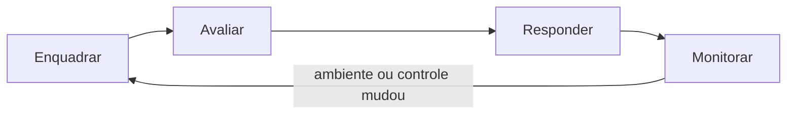
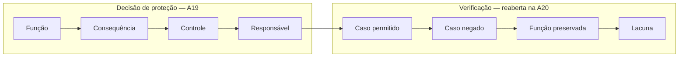

# A19 — Segurança OT pela NIST SP 800-82 (I): por que a planta muda as regras

Um supervisório continua mostrando **47% de nível**, mas o horário da última medição parou de mudar. O processo está estável ou a tela perdeu contato com ele? Antes de bloquear uma conexão ou reiniciar um equipamento, é preciso saber quem mede, quem decide e quem atua.

Esta é a primeira de duas aulas organizadas pelo guia [NIST SP 800-82 Rev. 3 — *Guide to Operational Technology (OT) Security*](https://csrc.nist.gov/pubs/sp/800/82/r3/final). Aqui você estuda as seções 2 a 5: como a OT funciona, por que sua segurança difere da TI, como montar um programa, avaliar risco e desenhar a arquitetura. A [A20](A20-validacao-ot-pentest.md) cobre a seção 6 e os apêndices de controles e incidentes.

## Objetivos de aprendizagem

1. Reconstruir uma malha de controle, identificando medição, decisão, atuação e supervisão, e explicar como uma falha digital pode produzir consequência física.
2. Usar as considerações da SP 800-82 para justificar por que uma prática comum de TI precisa ser adaptada ou evitada em OT.
3. Propor controles em camadas, com responsável e critério verificável, sem perder a função legítima do processo.

**Tempo:** 100 minutos. **Recursos:** navegador e editor de texto; planilha é opcional. **Preparação:** reconhecer confidencialidade, integridade, disponibilidade e controle de acesso. As definições necessárias estão nesta página; não há instalação de simulador.

**Produto:** primeira parte do registro de proteção e validação OT, concluído na A20, com uma única entrega para os dois encontros.

---

## Mapa do guia: o que a SP 800-82 cobre

**Síntese.** A SP 800-82 Rev. 3 foi publicada pelo NIST em **setembro de 2023**, em coautoria com a MITRE. Ela explica como adaptar a segurança a sistemas que monitoram ou controlam o mundo físico. Não é norma de certificação: é um guia de boas práticas, com recomendações e um catálogo de controles adaptado.

-   **Seção 2 — Visão geral de OT** · A19

    ---

    Componentes, arquiteturas (SCADA, DCS, CLP, automação predial, sistemas de segurança, IIoT) e as diferenças entre segurança de OT e de TI.

-   **Seção 3 — Programa de segurança OT** · A19

    ---

    Mandato, caso de negócio, governança, equipe multifuncional, políticas, treinamento, manutenção, resposta e recuperação.

-   **Seção 4 — Gestão de risco em OT** · A19

    ---

    Enquadrar, avaliar, responder e monitorar risco; cadeia de suprimentos, sistemas de segurança e o RMF do NIST aplicado à OT.

-   **Seção 5 — Arquitetura de segurança OT** · A19

    ---

    Defesa em profundidade em cinco camadas, segmentação, considerações de disponibilidade e *safety*, modelos de arquitetura.

-   **Seção 6 — Aplicar o CSF à OT** · A20

    ---

    Recomendações organizadas pelas funções Identificar, Proteger, Detectar, Responder e Recuperar.

-   **Apêndices C, E e F** · A20

    ---

    Fontes de ameaça e incidentes (C), capacidades e ferramentas (E) e o *overlay* OT dos controles da SP 800-53 (F).

Na data de consulta, **29 out. 2026**, a Rev. 3 é a edição final. A [Rev. 4 está em rascunho público](https://csrc.nist.gov/pubs/sp/800/82/r4/ipd), com comentários abertos até 30 nov. 2026. Um rascunho em consulta não substitui a edição final.

**Como ler o guia.** Ele tem mais de 300 páginas. Use estas aulas como mapa: cada seção abaixo indica o trecho correspondente para consulta seletiva, sem exigir leitura integral.

---

## Processo: ligar o dado à consequência física

**Síntese.** OT, *Operational Technology*, é o conjunto de sistemas que **monitoram ou modificam o mundo físico**. Toda análise começa pela malha de controle.

-   **Sensor — medir**

    ---

    Converte uma grandeza física em valor. O número precisa de unidade, qualidade e instante de aquisição.

-   **Controlador — decidir**

    ---

    Executa a lógica (CLP, controlador DCS) que compara medição e referência e decide a ação.

-   **Atuador — agir**

    ---

    Bomba, válvula, motor ou resistência: é onde a decisão digital vira efeito físico.

-   **Supervisório — mostrar**

    ---

    IHM e SCADA apresentam estados, alarmes e comandos autorizados. A tela pode estar desatualizada sem que o processo tenha parado.

Um **sistema de controle industrial**, ou **ICS** (*Industrial Control System*), integra esses elementos para operar uma instalação. OT é mais amplo: inclui também automação predial, controle de acesso físico e transporte.

### Tipos de sistema descritos na seção 2.3

| Sistema | Característica marcante | Pergunta de segurança típica |
|---|---|---|
| **SCADA** | Supervisão de ativos geograficamente distribuídos, com comunicação de longa distância | Como proteger enlaces remotos e estações distantes? |
| **DCS** — sistema de controle distribuído | Controle de processo contínuo em uma mesma planta, com controladores coordenados | Como isolar uma área sem perder a coordenação do processo? |
| **Topologias com CLP** | Controle discreto ou de máquina, muitas vezes local | Quem pode carregar programa e alterar parâmetros? |
| **Automação predial e controle de acesso físico** | HVAC, iluminação, portas e catracas | Um sistema "de prédio" alcança a rede de produção? |
| **Sistemas de segurança (SIS)** | Funções instrumentadas que levam o processo a estado seguro | A proteção depende do mesmo caminho que pode falhar? |
| **IIoT** | Sensores e serviços conectados, frequentemente com nuvem | Que dado sai da planta e que comando pode entrar? |

**CLP** é o controlador lógico programável (**PLC** em inglês); **IHM** é a interface homem–máquina (**HMI**). Um **historiador** armazena séries temporais. Esses papéis podem estar reunidos em um só produto; analise cada função separadamente.

### Exemplo: controle de nível

A figura representa um **modelo didático de tanque de água**, sem planta ou incidente real associado.

{#figura-26 loading=lazy}

*Imagem 26 — Malha de controle do tanque didático.* [Abrir a imagem ampliada](../assets/a19-a20/imagem26.png).

**Leia a figura:** siga primeiro as setas contínuas. A **medição** vai do sensor ao CLP, o **comando** vai do CLP à bomba e a **água** entra no tanque. O contorno verde marca esse laço.

As outras duas ligações estão fora do laço:

- **Supervisão (tracejada):** a IHM mostra estados e envia comandos autorizados, mas a malha local pode continuar funcionando sem a tela.
- **Programa e parâmetros (pontilhada vermelha):** a estação de engenharia não participa do controle a cada ciclo; ela muda **como** o CLP decide.

Perder a supervisão e perder o controle são falhas diferentes. Alterar o programa é uma terceira condição: o laço continua funcionando, mas com outra lógica.

As marcas de 40%, 60% e 80% no tanque são as do exemplo. O nível da água desenhado é apenas ilustrativo, não uma leitura.

| Elemento | Função no exemplo | O que deve ser protegido |
|---|---|---|
| Sensor de nível | Mede o preenchimento em % | Exatidão, disponibilidade e atualidade da leitura |
| CLP | Executa a lógica de controle | Programa, parâmetros, modo de execução e entradas |
| Bomba de entrada | Acrescenta água | Comando e confirmação do estado físico |
| IHM | Permite supervisão local | Informação atual e permissões para comandos |
| Estação de engenharia | Configura programa e parâmetros | Identidade, ferramentas, alterações e cópias |

### Leitura guiada: uma tela parada

Os valores abaixo são **dados artificiais fornecidos para análise**. Observação e aquisição usam o mesmo relógio.

| Observação | Horário da aquisição | Nível na IHM | Qualidade informada |
|---|---|---:|---|
| 09:00:00 | 09:00:00 | 45% | Atual |
| 09:00:01 | 09:00:01 | 46% | Atual |
| 09:00:02 | 09:00:02 | 47% | Atual |
| 09:00:12 | 09:00:02 | 47% | Sem atualização |

1. Leia as duas primeiras colunas antes de comparar os níveis.
2. Calcule a idade da última amostra às 09:00:12.
3. Registre o que a tabela comprova sobre a **visibilidade** do processo.
4. Separe duas hipóteses para a falha e indique que evidência ajudaria a distingui-las.

**Conferência:** a última amostra tem dez segundos. A tabela sustenta perda de atualização na IHM; não informa o nível físico atual nem comprova que o CLP parou.

!!! warning "Pare a interpretação"
    Não declare "nível estável", "transbordamento" ou "ataque confirmado". Essas conclusões exigem outras evidências, que serão discutidas na A20.

---

## OT × TI: as considerações da seção 2.4

**Síntese.** A seção 2.4 lista condições que fazem uma prática comum de TI ser inadequada em OT. Para cada uma, pergunte: **que decisão de segurança isso muda?**

-   **Tempo e desempenho**

    ---

    Muitos sistemas exigem resposta determinística; atraso e variação (*jitter*) importam mais que vazão.

    *Muda:* inspeção de tráfego ou autenticação que acrescente atraso a um comando.

-   **Disponibilidade**

    ---

    Processos contínuos não param sem planejamento; paradas são agendadas com dias ou semanas.

    *Muda:* "reiniciar o componente" deixa de ser resposta padrão.

-   **Gestão de risco orientada a *safety***

    ---

    A preocupação principal inclui vida, saúde, ambiente e equipamento. O guia afirma: **qualquer medida de segurança que prejudique a segurança de pessoas é inaceitável**.

    *Muda:* o critério de aceitação de um controle.

-   **Efeitos físicos**

    ---

    Dispositivos de campo controlam diretamente o processo; entender a consequência exige especialistas do domínio físico.

    *Muda:* quem participa da análise.

-   **Operação do sistema**

    ---

    Redes de controle costumam ser administradas por engenheiros de controle, com outras ferramentas e competências.

    *Muda:* quem aprova e executa uma mudança.

-   **Recursos limitados**

    ---

    Equipamentos legados podem não ter criptografia, registro de eventos ou senha, nem capacidade para recebê-los.

    *Muda:* o controle vai para a rede ou para um compensatório.

-   **Comunicações**

    ---

    Protocolos de campo podem ser proprietários ou diferentes dos de TI.

    *Muda:* ferramentas de monitoração e filtragem precisam entendê-los.

-   **Gestão de mudanças**

    ---

    Atualizações exigem teste pelo fornecedor e pelo usuário, janela e às vezes revalidação; há sistemas operacionais sem suporte.

    *Muda:* *patch* imediato vira processo planejado.

-   **Suporte e vida útil**

    ---

    Suporte muitas vezes de um único fornecedor; vida útil de 10 a 15 anos ou mais, contra 3 a 5 em TI.

    *Muda:* instalar software de terceiros pode violar o contrato de suporte.

-   **Localização**

    ---

    Componentes distribuídos podem ser remotos e de difícil acesso físico.

    *Muda:* acesso remoto torna-se necessidade — e superfície de ataque.

**Explicação.** Essas diferenças não dizem que TI e OT são mundos separados. A seção 2.4 observa o oposto: Ethernet, IP, sistemas operacionais comerciais e acesso remoto aproximaram as duas redes e reduziram o isolamento que protegia os sistemas antigos. Por isso as soluções de TI chegam à OT, mas precisam de precauções.

### Propriedades de segurança no processo

| Propriedade | Pergunta no processo | Exemplo de falha |
|---|---|---|
| Disponibilidade | A função está acessível no tempo necessário? | Operador perde visibilidade durante uma manobra |
| Integridade | Medição, lógica e comando correspondem ao estado autorizado? | Parâmetro é alterado sem autorização |
| Confidencialidade | Quem pode conhecer informações sensíveis? | Programa e credenciais ficam expostos |
| Segurança de pessoas e ambiente | A operação evita consequências físicas inaceitáveis? | Atuação inadequada provoca vazamento |

Não existe regra universal de que disponibilidade sempre vence integridade. Uma leitura falsa, mas disponível, pode induzir uma ação perigosa. A prioridade depende da função e da consequência de cada falha.

**Segurança cibernética** protege sistemas e informações. **Segurança funcional** (*safety*) trata funções de proteção que reduzem o risco de falhas perigosas. Os temas se relacionam, mas instalar firewall ou VPN não demonstra que uma função de proteção física é adequada.

### Estado seguro: uma decisão de engenharia

No tanque, considere como premissa uma proteção de nível alto-alto em 80%, que interrompe a entrada de água. Os números são do exemplo, não recomendações.

Desligar a bomba de entrada reduz a alimentação de um transbordamento. Isso não define o que fazer com saída, pressão ou outros equipamentos. O **estado seguro** é definido pela análise do processo e pelos responsáveis pela operação.

Um **intertravamento** impede ou interrompe uma ação diante de uma condição. Se usa o mesmo sensor, lógica e alimentação do controle que pode falhar, não presuma independência.

**Checkpoint:** diante da tela sem atualização, explique em duas frases por que "reiniciar imediatamente o CLP" não pode ser a primeira recomendação. Use pelo menos um card desta seção.

---

## Programa: quem organiza a segurança OT

**Síntese.** A seção 3 trata segurança OT como **programa permanente**, não como projeto de ferramentas. Sem mandato e equipe multifuncional, as camadas técnicas ficam sem dono.

-   **Mandato e caso de negócio**

    ---

    Uma carta (*charter*) aprovada pela liderança define objetivo, alcance e responsáveis. O caso de negócio relaciona investimento a consequências evitadas: segurança, produção, conformidade.

-   **Governança e equipe multifuncional**

    ---

    Engenharia de controle, operação, manutenção, TI, segurança e fornecedores decidem juntos. Nenhuma área conhece sozinha processo e ameaça.

-   **Políticas, treinamento e manutenção**

    ---

    Políticas próprias de OT (acesso remoto, mídia removível, mudanças), treinamento para quem opera e registro rastreável das manutenções.

-   **Resposta e recuperação**

    ---

    Capacidade de responder a incidentes e de restaurar a operação, planejada antes do evento e coordenada com procedimentos operacionais.

**Exemplo.** Uma regra de firewall que bloqueia a estação de engenharia fora da janela de manutenção é técnica. Decidir **quem aprova a janela** e **quem é avisado quando a regra dispara** é decisão do programa. Sem essa parte, a regra é desativada no primeiro atraso de produção.

---

## Risco: enquadrar, avaliar, responder e monitorar

**Síntese.** A seção 4.1 aplica à OT o ciclo de gestão de risco do NIST. Seus quatro componentes são contínuos.

| Componente | Pergunta em OT |
|---|---|
| **Enquadrar** | Que consequências são inaceitáveis (pessoas, ambiente, produção) e que restrições existem? |
| **Avaliar** | Que ameaça, vulnerabilidade e condição podem levar a essa consequência? |
| **Responder** | Que controle reduz o risco sem criar outro problema operacional? |
| **Monitorar** | O controle continua funcionando e o ambiente mudou? |

A seção 4.2 destaca duas áreas especiais. **Cadeia de suprimentos:** firmware, peças, integradores e acesso remoto de fornecedores também são origem de risco. **Sistemas de segurança:** a análise de risco cibernético deve considerar como um ataque pode afetar funções instrumentadas de segurança. A seção 4.3 aplica os sete passos do RMF (*Risk Management Framework*): preparar, categorizar, selecionar, implementar, avaliar, autorizar e monitorar.

### Inventário: registrar função antes de escolher controle

-   **Função e dependência**

    ---

    Um endereço IP não diz se o ativo pode ser reiniciado. Registre o que ele faz e do que depende.

-   **Alteração sensível**

    ---

    A estação de engenharia parece um PC comum, mas pode alterar o programa do CLP.

-   **Responsável**

    ---

    Quem autoriza mudança, quem opera e quem responde quando o ativo falha.

-   **Lacuna**

    ---

    Registre o que ainda se desconhece. "Não informado" é uma resposta válida; suposição não é.

O inventário pode começar por documentação, configurações e tráfego existente. **Observação passiva** examina comunicações disponíveis; **descoberta ativa** envia consultas aos equipamentos. A passiva pode não ver dispositivos silenciosos; a ativa pode afetar dispositivos sensíveis. A escolha depende de autorização, compatibilidade e impacto, como discute o apêndice E.

Em protocolos como **Modbus TCP**, há operações de leitura e operações que escrevem valores. Poder estabelecer uma conexão não implica permissão para comandar.

### Exemplo trabalhado: alteração de parâmetro

| Campo | Registro de exemplo |
|---|---|
| Função | Manter o nível do tanque dentro da faixa de operação |
| Condição | Estação de engenharia com permissão de alterar o parâmetro de controle |
| Evento considerado | Conta da estação é usada para uma alteração não autorizada |
| Consequência possível | Entrada de água inadequada; transbordamento se as demais barreiras falharem |
| Evidência necessária | Identidade, alteração, instante, versão do programa e resposta do processo |
| Controle proposto | Restringir identidade, destino, janela e alteração; revisar a proteção independente |
| Responsáveis | Operação autoriza; automação verifica a lógica; segurança verifica os acessos |
| Limite | Não foram fornecidos programa, permissões reais nem testes de intertravamento |

Não atribua probabilidade ou classe de risco sem premissas. A [NIST SP 800-30 Rev. 1](https://csrc.nist.gov/pubs/sp/800/30/r1/final) apoia a explicitação dessas incertezas.

**Aplicação:** registre três ativos do esquema. Para cada um, indique função, dependência, alteração sensível, responsável e uma evidência que ajudaria a conhecê-lo. Use "não informado" quando faltar um dado. Não procure equipamentos na rede da instituição.

---

## Arquitetura: defesa em profundidade em cinco camadas

**Síntese.** A seção 5.2 organiza a defesa em profundidade em cinco camadas. O guia recomenda **concluir a camada 1 antes das demais**, porque as decisões de programa e risco orientam todas as outras.

-   **1 — Gestão de segurança**

    ---

    Programa, governança e risco (seções 3 e 4).

    *No tanque:* quem aprova alterações no CLP.

-   **2 — Segurança física**

    ---

    Acesso a salas, painéis, armários e portas de programação.

    *No tanque:* quem pode conectar um notebook ao CLP.

-   **3 — Segurança de rede**

    ---

    Segmentação, filtragem entre zonas, acesso remoto e monitoração.

    *No tanque:* o caminho até a estação de engenharia.

-   **4 — Segurança de hardware**

    ---

    Recursos do próprio dispositivo: chave de modo, inicialização confiável, portas desabilitadas.

    *No tanque:* bloqueio de escrita do programa.

-   **5 — Segurança de software**

    ---

    Configuração segura, atualização planejada, lista de aplicações permitidas.

    *No tanque:* o que roda na estação de engenharia.

**Explicação.** Cada camada tem uma função diferente; uma não prova que a outra funciona. Segmentação limita caminhos; controle de acesso limita ações; monitoração revela condições; recuperação recompõe a operação.

### Zonas, conduítes e níveis

Uma **zona** reúne ativos com necessidades de proteção semelhantes. Um **conduíte** é o canal controlado de comunicação entre zonas. Esses termos vêm da série [ISA/IEC 62443](https://www.isa.org/standards-and-publications/isa-standards/isa-iec-62443-series-of-standards), referência complementar para automação industrial.

A seção 5 usa como exemplo o **modelo Purdue**, que organiza a planta em níveis:

| Nível | Conteúdo típico |
|---|---|
| 0 | Processo físico, sensores e atuadores |
| 1 | Controle básico: CLP, controladores |
| 2 | Supervisão: IHM, SCADA |
| 3 | Operações do site: historiador, engenharia |
| DMZ | Zona intermediária entre OT e corporativo |
| 4–5 | Rede corporativa e empresa |

Os níveis orientam onde colocar fronteiras. Não são uma prescrição universal: IIoT e serviços em nuvem criam caminhos que atravessam vários níveis, e o guia mostra esse modelo ao lado do modelo Purdue.

### Exemplo de percurso remoto limitado

{#figura-30 loading=lazy}

*Imagem 30 — Percurso remoto limitado.* [Abrir a imagem ampliada](../assets/a19-a20/imagem30.png).

**Leia a figura:** cada seta numerada é uma **conexão distinta**, com regra própria. Chegar ao gateway não libera o trecho seguinte.

- **Três áreas:** fora da empresa, DMZ e rede OT, separadas por firewalls.
- **Túnel VPN:** cobre só o trecho ①. Depois do gateway, cada passagem depende da proteção do próprio trecho.
- **Caminho direto:** a seta vermelha mostra o que deve ser negado. O trecho esmaecido indica onde ela chegaria se a fronteira não bloqueasse.

**DMZ** separa serviços e media comunicações entre redes. Uma **estação intermediária** (*jump host*) concentra o acesso ao destino seguinte.

| Camada | O que procura reduzir | O que ainda pode ocorrer |
|---|---|---|
| VPN com autenticação | Interceptação e entrada de cliente não autorizado | Cliente autenticado pode estar comprometido |
| Regras entre zonas | Caminhos diretos e alcance excessivo | Fluxo permitido pode transportar ação indevida |
| Permissão de manutenção | Alteração por identidade ou janela inadequada | Conta autorizada pode cometer erro |
| Proteção do processo | Consequência de condição perigosa | Dependências comuns comprometem barreiras |
| Monitoração e cópias | Falha silenciosa e dificuldade de recompor | Alerta sem resposta ou cópia não restaurável |

!!! note "Três confusões frequentes"
    - **VLAN** separa domínios de rede, mas não demonstra filtragem entre eles.
    - **VPN** protege seu trecho; não concede autoridade para alterar o controlador.
    - Firewall que permite a porta necessária não demonstra autorização dentro da aplicação.

### Caso documentado: controladores expostos

O alerta [CISA AA23-335A, atualizado em dezembro de 2024](https://www.cisa.gov/sites/default/files/2024-12/aa23-335a-irgc-affiliated-cyber-actors-exploit-plcs-in-multiple-sectors.pdf), relata comprometimentos de CLPs Unitronics, incluindo instalações de água, acessíveis pela Internet e com credenciais padrão ou ausentes.

O caso ilustra falhas nas camadas 1, 3 e 5 ao mesmo tempo: ninguém decidiu se o caminho externo deveria existir, a rede permitia alcançá-lo e a configuração mantinha a senha padrão. Não atribua a todos os equipamentos do fabricante a mesma exposição. Os dados do tanque não são evidência desse incidente.

**Aplicação:** na Imagem 30, associe cada controle a um trecho de ① a ④: identidade, restrição de destino, registro de sessão e autorização de alteração. Um trecho pode receber mais de um controle; justifique em uma frase. Depois escolha um caminho que precisa ser negado e um fluxo legítimo que deve permanecer.

---

## Validação: da recomendação ao critério verificável

"Usar segmentação" é ampla demais para ser verificada. Um critério verificável seria: **o cliente remoto não alcança diretamente o CLP; a manutenção autorizada alcança somente a estação prevista, durante a janela aprovada**.

Preencha o registro na ordem abaixo. Os quatro últimos campos serão reabertos na A20.

Identifique o que é proposta e o que foi fornecido ou observado. Nenhum teste de rede é solicitado nesta aula.

## Atividade {#atividade}

Inicie o **registro de proteção e validação OT**, atividade única dos dois encontros. Use o [modelo em branco](../assets/a19-a20/modelo-registro-ot.md) ou um documento com os mesmos campos.

Nesta etapa, registre os três ativos, analise a amostra sem atualização e desenvolva uma decisão de proteção. Na A20, acrescente acesso, resposta, recuperação e o plano de avaliação técnica. O [enunciado completo e a rubrica](../atividades/A19-A20-protecao-validacao-ot.md#atividade) definem a entrega.

## Diagnóstico e alternativa

| Dificuldade | Como prosseguir |
|---|---|
| Não conheço automação | Refaça o esquema com os verbos medir, decidir, atuar e mostrar |
| Não consigo abrir a planilha | Registre os mesmos campos em texto; todos os dados estão na página |
| Não há laboratório industrial | Analise o esquema e os registros fornecidos; identifique a análise como documental |
| Falta evidência para concluir | Registre a lacuna e a próxima coleta; não preencha com suposição |

Ao encerrar, salve o registro. Não há instalação, serviço de rede ou recurso de nuvem para remover. Não use dados ou endereços de plantas reais.

## Revisão rápida e continuidade

1. Por que uma leitura de 47% sem atualização não comprova estabilidade física?
2. Escolha uma consideração da seção 2.4 e explique como ela muda uma prática comum de TI.
3. Por que o guia recomenda concluir a camada de gestão antes das camadas técnicas?

Leve para a [A20](A20-validacao-ot-pentest.md) os campos **caso permitido, caso negado, função preservada e lacuna**. Eles serão confrontados com registros de acesso e de processo.

## Fontes de referência

- [NIST SP 800-82 Rev. 3 — Guide to OT Security](https://csrc.nist.gov/pubs/sp/800/82/r3/final) ([PDF](https://nvlpubs.nist.gov/nistpubs/SpecialPublications/NIST.SP.800-82r3.pdf)): seções 2.3–2.4 (sistemas e OT × TI), 3 (programa), 4 (risco), 5.2–5.4 (camadas e arquiteturas).
- [NIST SP 800-82 Rev. 4 — rascunho público](https://csrc.nist.gov/pubs/sp/800/82/r4/ipd): estado de revisão, não base final desta aula.
- [NIST SP 800-30 Rev. 1](https://csrc.nist.gov/pubs/sp/800/30/r1/final): avaliação de riscos e incertezas.
- [ISA/IEC 62443 — apresentação oficial da série](https://www.isa.org/standards-and-publications/isa-standards/isa-iec-62443-series-of-standards): zonas, conduítes e requisitos; referência complementar.
- [CISA e parceiros — AA23-335A, edição de 2024](https://www.cisa.gov/sites/default/files/2024-12/aa23-335a-irgc-affiliated-cyber-actors-exploit-plcs-in-multiple-sectors.pdf): exemplo documentado de exposição de controladores.

Referências consultadas em **29 out. 2026**.
