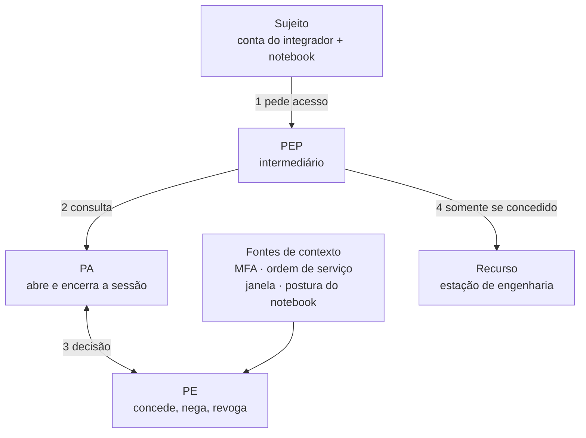

# A20 — Segurança OT pela NIST SP 800-82 (II): zero trust, monitoração e validação no dia a dia da automação

O integrador precisa acessar o CLP amanhã às 10h. A VPN autentica a conta dele, e o firewall bloqueia o acesso direto ao controlador. Isso basta? Quem decide **o que** ele pode fazer, **quando** e **em qual equipamento** — e quem percebe se ele escrever um valor que não deveria?

Esta aula conclui o resumo da [NIST SP 800-82 Rev. 3](https://csrc.nist.gov/pubs/sp/800/82/r3/final). A [A19](A19-seguranca-operacoes-industriais.md) cobriu as seções 2 a 5. Aqui você estuda:

- **zero trust** aplicado à OT (seção 5.2.3.4), com seus limites no chão de fábrica;
- a **seção 6**, que aplica o [*Cybersecurity Framework* (CSF)](https://www.nist.gov/cyberframework) à OT;
- o **apêndice E** (capacidades e ferramentas), ligado a produtos que você vai encontrar no mercado;
- os apêndices **C** (incidentes) e **F** (controles), que fundamentam o cuidado com testes.

## Objetivos de aprendizagem

1. Explicar zero trust pela diferença entre confiar no **local da rede** e decidir **por requisição**, e indicar onde ele se aplica na arquitetura OT e que compensatório protege os níveis em que não se aplica.
2. Interpretar registros de acesso, tráfego Modbus e amostras de processo para separar conexão, ação autorizada e função preservada.
3. Associar cada capacidade de proteção, detecção e recuperação a uma categoria de solução de mercado e planejar uma avaliação técnica com escopo, método e critério de parada.

**Tempo:** 100 minutos. **Recursos:** navegador e editor de texto. O Wireshark é **opcional**: a demonstração é conduzida pelo professor, e a tabela decodificada nesta página substitui a ferramenta. **Preparação:** funções de sensor, controlador, IHM e estação de engenharia, e o percurso remoto da [A19](A19-seguranca-operacoes-industriais.md#exemplo-de-percurso-remoto-limitado).

**Produto:** registro OT concluído, com um plano de avaliação técnica proposto. Nenhum equipamento industrial ou aplicação real será testado.

---

## Quatro demandas, cinco funções do CSF

**Síntese.** O **CSF** (*Cybersecurity Framework*, do NIST) organiza a segurança de uma organização em cinco funções: **Identificar, Proteger, Detectar, Responder e Recuperar**. A seção 6 da SP 800-82 percorre essas funções e explica o que muda em cada uma quando o ambiente é OT. Nesta aula, cada função aparece como uma demanda comum na rotina de quem trabalha com automação.

| Demanda que chega à automação | Função do CSF | Onde está no guia | O que você sai sabendo fazer |
|---|---|---|---|
| "O integrador precisa acessar o CLP amanhã às 10h." | **Proteger (PR)** | 5.2.3.4 zero trust; 6.2.1 identidade; 6.2.10 acesso remoto | Desenhar a decisão de acesso por requisição e reconhecer seus limites |
| "O sensor de rede apontou uma escrita Modbus." | **Detectar (DE)** | 5.2.3.3 monitoração; 6.3; apêndice E.2 | Ler leitura × escrita em uma captura e relacioná-la ao processo |
| "O programa do CLP não bate com o backup." | **Responder (RS)** e **Recuperar (RC)** | 6.4; 6.5; apêndice E.3; controle CM-3 | Conter sem produzir outra falha e definir critérios de retorno |
| "A gerência quer contratar um pentest da planta." | **Identificar (ID)** e avaliação | Apêndices C e F (CA-8) | Escolher a avaliação de menor interferência e escrever regras de engajamento |

!!! note "CSF 1.1 e CSF 2.0"
    A Rev. 3 (2023) usa o **CSF 1.1**, com cinco funções; governança aparece como categoria ID.GV. O [CSF 2.0](https://csrc.nist.gov/pubs/cswp/29/the-nist-cybersecurity-framework-csf-20/final), de 2024, criou a função **Governar (GV)**, que corresponde à camada 1 e à seção 3 vistas na A19. As funções não são uma fila: detectar não começa somente depois de proteger.

---

## Zero trust: do perímetro à decisão por requisição

### O problema do perímetro

Na arquitetura em camadas da A19, cada zona é protegida na fronteira por firewall. A seção 5.2.3.4 da SP 800-82 aponta o limite desse modelo:

- quem passa da fronteira costuma ser tratado como **confiável** e recebe acesso amplo;
- o firewall entre zonas **não contém o movimento lateral dentro de uma zona**;
- redes sem fio, celulares, nuvem e acesso de fornecedores tornam a fronteira menos nítida.

**Movimento lateral** é o deslocamento de um invasor de um equipamento já alcançado para outros da mesma rede. Um notebook comprometido na rede OT, por exemplo, alcança todos os CLPs do mesmo segmento se nada além da fronteira decidir.

### A ideia central

**Síntese.** O guia define **zero trust** (ZTA, *Zero Trust Architecture*) como um paradigma em que as decisões de autorização são tomadas **perto do recurso** e **reavaliadas continuamente**, em vez de concedidas implicitamente. A referência é a [NIST SP 800-207](https://csrc.nist.gov/pubs/sp/800/207/final) (2020). A página de consulta [Zero Trust](../fundamentos_de_seguranca_digital/K-zerotrust.md) traz a origem do conceito e exemplos fora da OT.

| Modelo de perímetro | Zero trust |
|---|---|
| "Está na rede interna, então é confiável." | O local da rede, sozinho, não implica confiança. |
| Autenticou na VPN, alcança o segmento inteiro. | Cada recurso exige sua própria decisão, por sessão. |
| Permissão concedida uma vez vale até alguém revogar. | A política considera identidade, equipamento, horário e comportamento, e pode revogar a sessão. |
| O firewall decide na fronteira. | Um ponto de aplicação fica na frente de cada recurso protegido. |

![Dois painéis da mesma rede OT com um notebook de integrador já dentro dela. No painel Perímetro, a verificação ocorre só no firewall de entrada, e o notebook alcança livremente a estação de engenharia, o historiador e o CLP; a seta até o CLP está marcada como movimento lateral. No painel Zero trust, a fronteira é mantida, mas cada recurso tem um portão PEP ligado a um motor de política, PE, que decide a cada pedido: o notebook recebe sessão somente para a estação de engenharia, nesta janela, e é negado no historiador e no CLP.](../assets/a19-a20/imagem35.png){#figura-35 loading=lazy}

*Imagem 35 — Perímetro × zero trust.* [Abrir a imagem ampliada](../assets/a19-a20/imagem35.png).

**Leia a figura:** nos dois painéis, o notebook **já passou** pela fronteira. A diferença está no que acontece depois dela.

- **Perímetro:** a única verificação foi na entrada. Lá dentro, nada impede o notebook de alcançar o CLP — é o movimento lateral.
- **Zero trust:** a fronteira continua existindo, mas cada recurso tem seu PEP. O PE decide pedido a pedido, e só a estação de engenharia, na janela aprovada, é liberada.

### Os princípios aplicados ao acesso do integrador

A SP 800-207 lista sete princípios (*tenets*). A tabela traduz cada um para a manutenção remota.

| Princípio (SP 800-207, seção 2.1) | No acesso do integrador |
|---|---|
| 1. Dados e serviços são **recursos** | A estação de engenharia e o CLP são recursos distintos, cada um com sua regra. |
| 2. Toda comunicação é protegida, **independentemente do local** | Estar no notebook da própria fábrica não dispensa autenticação nem canal protegido. |
| 3. Acesso **por sessão** e com **menor privilégio** | A sessão vale para a estação prevista e para a manutenção aprovada, não para todo o segmento. |
| 4. Acesso definido por **política dinâmica** | A decisão considera conta, ordem de serviço, janela, estado do notebook e alertas ativos. |
| 5. A **postura dos ativos** é monitorada | Um notebook com antivírus desatualizado ou sistema sem suporte pode ser negado. |
| 6. Autenticação e autorização **dinâmicas e aplicadas antes** do acesso | MFA no início; nova verificação se a sessão tentar outro recurso ou sair da janela. |
| 7. A organização **coleta dados** para melhorar a política | Registros de sessão alimentam a revisão das regras e da janela. |

### Quem decide e quem aplica

A SP 800-207 separa três componentes lógicos.

- **PE — motor de política** (*policy engine*): decide conceder, negar ou revogar o acesso.
- **PA — administrador de política** (*policy administrator*): abre ou encerra a sessão conforme a decisão do PE.
- **PEP — ponto de aplicação** (*policy enforcement point*): fica na frente do recurso e só deixa passar a sessão autorizada.

**Leia o fluxo:** o sujeito nunca fala direto com o recurso. A seta 1 chega ao PEP; as setas 2 e 3 são a consulta e a decisão; a seta 4 só existe se o PE concedeu. A ordem de serviço e a janela entram como **fontes de contexto** da decisão.

### O percurso da A19, relido como zero trust

{#figura-30 loading=lazy}

*Imagem 30 — Percurso remoto limitado, retomado da A19.* [Abrir a imagem ampliada](../assets/a19-a20/imagem30.png).

O desenho da A19 já continha decisões por requisição. Agora elas ganham nome.

| Trecho | Pergunta | Elemento de zero trust |
|---|---|---|
| ① túnel | Quem está se conectando? | Identidade individual com MFA; a VPN protege o canal, mas não decide o destino |
| ② acesso limitado | Até onde essa conexão pode chegar? | Menor privilégio: o túnel só alcança o intermediário |
| ③ sessão autorizada | Agora, para esta manutenção? | **PEP** no intermediário; **PE** consulta janela e ordem de serviço |
| ④ operação autorizada | Esta ação no CLP é permitida? | Autorização **dentro da aplicação de engenharia** ou do protocolo, quando o equipamento suporta |

A **autenticação** verifica a identidade apresentada; a **autorização** decide o que essa identidade pode fazer. **MFA**, autenticação multifator, reduz o uso indevido de credenciais, mas não verifica se a alteração pretendida é operacionalmente adequada. A [A17](A17-openvpn-ec2.md) trata a VPN como canal protegido até o gateway; zero trust trata do que acontece **depois** do túnel.

!!! example "No mercado: acesso remoto seguro para OT"
    O trecho ③ costuma ser implementado por **plataformas de acesso remoto seguro (SRA)** ou **ZTNA** (*Zero Trust Network Access*) para OT. Elas reúnem PEP e PA: pedido de acesso, aprovação, janela, MFA, gravação de sessão e encerramento automático.

    - *Exemplos comerciais:* Claroty Secure Remote Access, Cyolo, Xage, Siemens SINEMA Remote Connect, TOSIBOX.
    - *Alternativa aberta:* um intermediário com [Apache Guacamole](https://guacamole.apache.org/), gateway de área de trabalho remota pelo navegador, com controle de conexões e gravação de sessão.
    - *Cuidado:* o produto aplica a política; **quem aprova a janela** continua sendo decisão do programa de segurança (seção 3, vista na A19).

### Exemplo trabalhado: o que a decisão registrou?

As tabelas desta seção são **dados artificiais para análise documental**, também disponíveis no [pacote de evidências](../assets/a19-a20/pacote-evidencias-ot.md).

**Autorização didática M-01:** conta `prestador_teste`; manutenção das 10:00 às 10:15; acesso somente à estação de engenharia pelo intermediário; consulta de diagnóstico; alteração de lógica e acesso direto ao CLP não autorizados. Todos os horários usam o mesmo relógio.

| Hora | Origem do registro | Evento | Resultado |
|---|---|---|---|
| 09:59:30 | Gateway VPN | Autenticação de `prestador_teste` | Aceita |
| 09:59:35 | Intermediário | Acesso à engenharia fora da janela | Negado |
| 10:00:02 | Firewall | Cliente remoto tenta caminho direto ao CLP | Negado |
| 10:00:04 | Intermediário | Acesso de `prestador_teste` à estação autorizada | Aceito |
| 10:00:06 | Aplicação de engenharia | Consulta de diagnóstico da sessão M-01 | Aceita |

A autenticação das 09:59:30 foi aceita, mas o acesso seguinte, às 09:59:35, foi negado: o PEP do trecho ③ reavaliou o pedido e a janela ainda não tinha começado. Esse é o comportamento esperado de zero trust. **Autenticar não concedeu acesso.**

O bloqueio das 10:00:02 é compatível com a restrição de caminho direto. Ele **não demonstra** ausência de outro caminho, integridade da estação ou bloqueio de toda alteração indevida.

**Ação:**

1. Indique em que trecho da Imagem 30 ocorreu cada evento e qual componente (PE, PEP ou firewall de fronteira) o registrou.
2. Registre um caso permitido e dois negados, citando os horários.
3. Identifique uma pergunta sobre alteração de lógica que a tabela não responde e uma coleta que ajudaria a respondê-la.

**Checkpoint:** pare antes de escrever "acesso remoto seguro". O material permite uma avaliação limitada desses eventos, não uma certificação do ambiente.

---

## Até onde o zero trust chega na planta

**Síntese.** A SP 800-82 recomenda zero trust, mas com uma ressalva própria da OT: muitos componentes não o suportam.

- **Compatibilidade:** CLPs, controladores e IHMs podem não ter os protocolos e as tecnologias que uma ZTA exige.
- **Onde aplicar:** o guia recomenda começar pelos níveis funcionalmente superiores — **níveis 3, 4 e 5 do modelo Purdue e a DMZ OT**.
- **Latência e disponibilidade:** a ZTA não pode atrasar a resposta a uma requisição do processo. Se um componente da ZTA cair, a operação não pode cair junto, o que exige **redundância**.
- **Identidade:** OT ainda usa **credenciais compartilhadas** (o login do turno na IHM, por exemplo), o que impede decidir por pessoa.

Quando a decisão por requisição não chega ao equipamento, a proteção vem de **compensatórios** em volta dele.

![Seis faixas empilhadas, do corporativo ao processo: níveis 4–5 corporativo, DMZ OT com um portão PEP, nível 3 operações, nível 2 supervisão, nível 1 controle e nível 0 processo. Um colchete azul marca zero trust aplicável nos níveis 4–5, na DMZ OT e no nível 3; um colchete tracejado marca o nível 2 como parcial. Os níveis 1 e 0 estão sob o colchete compensatórios: chave RUN/PROG no CLP e proteção independente no tanque. Na fronteira entre supervisão e controle há um filtro de funções do protocolo, e a monitoração passiva cobre os níveis 2 a 0.](../assets/a19-a20/imagem36.png){#figura-36 loading=lazy}

*Imagem 36 — Até onde o zero trust chega na planta.* [Abrir a imagem ampliada](../assets/a19-a20/imagem36.png).

**Leia a figura:** leia os colchetes da direita de cima para baixo. A decisão por requisição cobre os níveis superiores, enfraquece na supervisão e para antes do controle. Abaixo disso, a proteção vem dos elementos destacados: o filtro na fronteira, a chave no CLP, a proteção independente no processo e a monitoração passiva ao lado. A tabela a seguir detalha cada nível.

| Nível (Purdue) | Exemplos | Zero trust aplicável? | Compensatório onde ele não chega |
|---|---|---|---|
| 4–5 Corporativo | ERP, e-mail, estações de escritório | Sim, com identidade corporativa, MFA e ZTNA | — |
| DMZ OT | Intermediário, réplica do historiador, servidor de atualização | Sim: é o lugar natural do **PEP** | Gateway unidirecional quando o fluxo só precisa sair |
| 3 Operações | Estação de engenharia, historiador, servidor SCADA | Em geral sim: conta individual, MFA, controle de aplicações | Segmentação e registro de sessão |
| 2 Supervisão | IHM, estação de operação | Parcial: muitas IHMs só têm login de turno | Segmentação, permissões por função na IHM, monitoração passiva |
| 1 Controle | CLP, controlador DCS | Raramente: protocolos legados não autenticam usuário | Chave de modo **RUN/PROG**, senha ou nível de acesso da CPU, firewall que filtra funções do protocolo, monitoração |
| 0 Processo | Sensores, atuadores, SIS | Não | Segurança física, proteção instrumentada **independente** |

**Explicação.** O controle CM-3(8), no apêndice F, dá um exemplo de compensatório no nível 1. Alguns CLPs têm **chave física** que coloca o equipamento em modo de programação. Com ela, alterar o programa exige **presença física**, o que nenhuma política de rede consegue garantir sozinha.

!!! example "No mercado: proteções nativas do controlador"
    - **Siemens S7-1200/S7-1500:** níveis de acesso da CPU (acesso completo, somente leitura, acesso de IHM, sem acesso), protegidos por senha e configurados no TIA Portal.
    - **Rockwell ControlLogix:** chave de modo RUN/REM/PROG no próprio controlador; *CIP Security* para autenticar e proteger a comunicação EtherNet/IP em equipamentos compatíveis.
    - **OPC UA:** modos de segurança *Sign* e *SignAndEncrypt*, com certificados de aplicação.
    - **Modbus/TCP Security:** variante com TLS publicada pela organização Modbus, ainda pouco suportada em equipamentos legados.

    Nenhum desses recursos protege se ficar desabilitado. Uma chave esquecida em PROG ou uma senha de CPU vazia anula o compensatório.

**Checkpoint:** uma proposta exige MFA a cada comando do operador na IHM. Use a seção 5.2.3.4 para avaliar a proposta em duas frases, e sugira onde a MFA faria sentido no mesmo percurso.

---

## Detectar: ler o protocolo, não só a conexão

**Síntese.** Saber que dois equipamentos conversaram não basta. É preciso saber **o que** foi pedido. Em OT, isso é viável porque o tráfego se repete.

- O guia observa que o tráfego OT é **mais determinístico** que o de TI: repetível, previsível e projetado (seção 5.2.3.3).
- Por isso, uma **linha de base** de quem fala com quem, com que função e com que frequência revela desvios.
- O guia recomenda começar a monitoração em **modo passivo**, de escuta e aprendizado, por porta espelhada (**SPAN**) ou **TAP**, um derivador físico que copia o tráfego sem participar dele.

{#figura-38 loading=lazy}

*Imagem 38 — Monitoração passiva: copiar sem interferir.* [Abrir a imagem ampliada](../assets/a19-a20/imagem38.png).

**Leia a figura:** o sensor **não está no caminho** entre IHM e CLP. Ele recebe uma cópia pela seta azul e não devolve nada à rede (seta vermelha riscada). Se o sensor falhar, o controle continua; o que se perde é a visibilidade.

### Modbus/TCP em uma tabela

O **Modbus/TCP** é um protocolo industrial simples e muito difundido. O cliente (IHM, SCADA, estação) envia uma requisição ao servidor (CLP) na **porta TCP 502**; cada requisição traz um **código de função**.

| Código | Função | Efeito |
|---:|---|---|
| 3 | *Read Holding Registers* | **Lê** registradores |
| 4 | *Read Input Registers* | **Lê** registradores de entrada |
| 6 | *Write Single Register* | **Escreve** um registrador |
| 16 | *Write Multiple Registers* | **Escreve** vários registradores |

O Modbus clássico **não autentica** quem envia a requisição. Se a porta 502 está acessível, um firewall comum não distingue leitura de escrita. É a afirmação da A19, agora visível: **poder conectar não implica permissão para comandar**.

### Demonstração conduzida: a captura C-01

A captura [a20-modbus-c01.pcap](../assets/a19-a20/a20-modbus-c01.pcap) contém **dados sintéticos** gerados para esta aula, sem coleta em planta. Ela usa o tanque didático da A19 e o dicionário de registradores abaixo.

| Endereço | Papel na rede didática |
|---|---|
| `10.10.1.10` | CLP do tanque (nível 1), servidor Modbus na porta 502 |
| `10.10.2.20` | IHM (nível 2) |
| `10.10.3.30` | Estação de engenharia (nível 3) |

| Registrador | Significado | Unidade |
|---:|---|---|
| 0 | Nível medido do tanque | % |
| 1 | Limite de desligamento da bomba de entrada | % |

Lembre a premissa da A19: a faixa operacional é **40–60%**, e a proteção alto-alto atua em **80%**.

**Passos (o professor conduz; reproduza se tiver o Wireshark):**

1. **Abrir.** No Wireshark, use *File → Open* e escolha o arquivo. A coluna *Time* mostra segundos desde o início da captura; use esse tempo relativo. **Esperado:** 45 pacotes.
2. **Filtrar o protocolo.** Digite `mbtcp` na barra de filtro e pressione Enter. **Esperado:** só pacotes Modbus/TCP; a coluna *Info* mostra `Query` e `Response` com `Func: 3` ou `Func: 6`.
3. **Ver quem conversa.** Abra *Statistics → Conversations* e a aba *IPv4*. **Esperado:** dois pares. A IHM conversa com o CLP desde o início; a estação de engenharia aparece em 5,3 s.
4. **Isolar escritas.** Troque o filtro para `modbus.func_code == 6`. **Esperado:** dois pacotes, a requisição e a resposta da escrita.
5. **Ler o conteúdo.** Clique na requisição e expanda *Modbus* no painel de detalhes. Registre o código de função, o número do registrador e o valor.
6. **Comparar antes e depois.** Volte ao filtro `mbtcp` e compare o registrador 1 nas respostas à IHM antes e depois de 7,2 s.

**Critério de parada:** pare quando tiver registrado origem, horário relativo, função, registrador e valor da escrita, e o valor do registrador 1 antes e depois dela.

**Alternativa sem ferramenta:** a tabela abaixo é a saída real do Wireshark (tshark 4.6.4) para os pacotes relevantes da captura.

| Pacote | Tempo (s) | Origem → destino | Info | Registradores lidos ou escritos |
|---:|---:|---|---|---|
| 5 | 0,112 | CLP → IHM | Response, Func 3: Read Holding Registers | reg 0 = 50; reg 1 = 60 |
| 25 | 5,400 | Estação → CLP | Query, Func 3: Read Holding Registers | (pedido de leitura de 0 e 1) |
| 26 | 5,412 | CLP → Estação | Response, Func 3: Read Holding Registers | reg 0 = 52; reg 1 = 60 |
| 34 | 7,200 | Estação → CLP | Query, Func 6: **Write Single Register** | reg 1 ← **85** |
| 35 | 7,212 | CLP → Estação | Response, Func 6: Write Single Register | confirmação: reg 1 = 85 |
| 38 | 8,112 | CLP → IHM | Response, Func 3: Read Holding Registers | reg 0 = 54; reg 1 = **85** |
| 44 | 10,112 | CLP → IHM | Response, Func 3: Read Holding Registers | reg 0 = 55; reg 1 = 85 |

**Interpretação.** A estação de engenharia, que não aparecia na linha de base da IHM, primeiro **leu** e depois **escreveu** 85 no limite de desligamento da bomba. O CLP confirmou, e a IHM passou a mostrar o novo valor.

- **Consequência possível:** com o limite em 85%, o controle normal deixa o nível subir **acima da proteção alto-alto de 80%**. A proteção vira a única barreira contra o transbordamento.
- **O que a captura não autoriza:** dizer quem estava ao teclado, se a escrita tinha autorização, se a proteção de 80% funciona ou se o nível físico chegou a subir. A captura termina em 10 s, com nível em 55%.
- **O que falta:** cruzar com a ordem de serviço e o registro de sessão da estação, como no exemplo M-01.

**Relação com zero trust.** Um firewall comum, que libera a porta 502 da estação, deixa passar a leitura e a escrita. Um firewall com **inspeção de protocolo** pode permitir a função 3 e bloquear a 6 fora da janela aprovada. É a decisão por requisição aplicada **dentro do protocolo**, onde o CLP não sabe decidir sozinho.

{#figura-37 loading=lazy}

*Imagem 37 — Mesma porta, funções diferentes.* [Abrir a imagem ampliada](../assets/a19-a20/imagem37.png).

**Leia a figura:** as duas faixas recebem as mesmas requisições da captura C-01. A diferença está no que o firewall examina: na de cima, só a porta 502; na de baixo, o código de função dentro do pacote. Só a segunda distingue ler de escrever.

!!! example "No mercado: monitoração passiva e inventário OT"
    O que você fez manualmente — identificar quem fala, com que função e o que mudou — é o núcleo das plataformas de **detecção em rede para OT**. Elas recebem cópia do tráfego por SPAN ou TAP, montam o inventário passivo (apêndice E.2.2), aprendem a linha de base e alertam desvios (E.2.5), como uma escrita vinda de origem nova.

    - *Exemplos comerciais:* Claroty, Nozomi Networks Guardian, Dragos Platform, [Microsoft Defender for IoT](https://learn.microsoft.com/en-us/azure/defender-for-iot/organizations/overview), Cisco Cyber Vision, Tenable OT Security.
    - *Alternativas abertas:* [Zeek](https://zeek.org/) com os analisadores industriais [ICSNPP](https://github.com/cisagov/ICSNPP), publicados pela CISA; [Malcolm](https://github.com/cisagov/Malcolm), que reúne Zeek, Suricata e painéis para análise de capturas; e o próprio [Wireshark](https://www.wireshark.org/).
    - *Firewalls com inspeção de protocolo industrial (E.1.1):* Tofino Xenon (Belden), FL mGuard (Phoenix Contact), FortiGate Rugged (Fortinet), Cisco Secure Firewall ISA3000.
    - *Cuidado:* o guia alerta que respostas automáticas de **IPS** podem afetar a operação e sugere posicioná-los em níveis superiores, como as interfaces da DMZ. Monitoração passiva também não vê equipamentos que não transmitem, e o inventário pode levar dias.

### Função preservada: uma segunda evidência

Voltando ao exemplo M-01, estas amostras de processo são independentes da captura C-01 e da tela parada da A19.

| Aquisição | Nível | Qualidade | Modo informado pelo CLP |
|---|---:|---|---|
| 10:00:00 | 50% | Atual | Automático |
| 10:00:05 | 51% | Atual | Automático |
| 10:00:10 | 52% | Atual | Automático |

As amostras são compatíveis com operação na faixa de 40–60% durante dez segundos. Não demonstram independência do sensor, funcionamento do intertravamento ou estabilidade depois desse período.

![Linha do tempo de M-01 com duas raias e o mesmo eixo de horário. Raia de acesso: 09:59:30 autenticação VPN aceita; 09:59:35 engenharia fora da janela negado; 10:00:02 caminho direto ao CLP negado; 10:00:04 estação autorizada aceito; 10:00:06 diagnóstico aceito. Raia de processo: nível de 50% às 10:00:00, 51% às 10:00:05 e 52% às 10:00:10, dentro da faixa de 40 a 60%. A janela M-01 começa às 10:00. Depois de 10:00:10 não há dados. O eixo é interrompido entre 09:59:38 e 09:59:58, intervalo sem eventos.](../assets/a19-a20/figura31-linha-do-tempo-m01.svg){#figura-31 loading=lazy}

*Imagem 31 — Acesso e processo no mesmo relógio.* [Abrir a imagem ampliada](../assets/a19-a20/figura31-linha-do-tempo-m01.svg).

**Leia a figura:** as tabelas de M-01 foram colocadas sobre o **mesmo eixo de horário**. A faixa amarela marca a janela.

- **Raia de acesso:** os dois eventos negados têm motivos diferentes — janela e caminho.
- **Raia de processo:** as amostras ficam dentro da faixa durante os acessos aceitos. A área hachurada mostra onde a conclusão deixa de valer.
- **Eixo interrompido:** o trecho // omite 20 s sem eventos; a escala é a mesma dos dois lados.

Essa leitura conjunta só é válida porque as fontes usam o mesmo relógio. A **sincronização de tempo** é uma categoria própria de Proteger (seção 6.2.12).

### Regra de detecção com contexto

Uma regra possível: sinalizar **escrita Modbus (funções 5, 6, 15 ou 16) para o CLP vinda de origem fora da linha de base ou fora de uma janela aprovada**.

| Situação | O que acontece | O que revisar |
|---|---|---|
| **Falso positivo** | Manutenção legítima é sinalizada porque a aprovação não chegou à fonte consultada | Integração entre ordem de serviço e monitoração |
| **Falso negativo** | Escrita indevida passa porque veio da IHM, que já está na linha de base | Escritas da IHM por registrador e faixa de valor |
| **Revisão necessária** | Escrita em janela, mas em registrador fora do escopo | Escopo da aprovação, identidade, versão do programa e resultado operacional |

**Anomalia** é um desvio do esperado; **incidente** exige análise da violação ou ameaça, conforme os critérios da organização. Na captura C-01, o fato é uma escrita de 85 no registrador 1; ataque e erro de manutenção são hipóteses.

**Aplicação:** escreva uma conclusão de três linhas sobre a C-01 que separe **fato observado**, **consequência possível** e **evidência que falta**.

---

## Responder e recuperar: o programa não bate com o backup

**Síntese.** Em OT, toda ação de resposta é também uma manobra operacional. Antes de desligar algo, é preciso saber o que mais depende dele.

| Etapa | Objetivo | Cuidado em OT |
|---|---|---|
| **Conter** | Limitar a continuidade e o alcance do evento | Coordenar com quem conhece o processo e pode autorizar a manobra |
| **Erradicar** | Tratar a causa e as condições de permanência | Credenciais, caminhos de acesso e alterações no programa |
| **Recuperar** | Recompor a função em estado conhecido | Acessível de novo não significa íntegro |

### Dois casos do apêndice C

O apêndice C registra incidentes reais. Dois deles mostram decisões de resposta, não de ataque.

- **Colonial Pipeline (2021).** Ransomware cifrou sistemas de TI, explorando um **perfil legado de VPN**. Na data da publicação do guia, não havia evidência de impacto direto na OT. Mesmo assim, a empresa **parou a operação física do oleoduto** para conter possíveis danos.
- **Norsk Hydro (2019).** O ransomware LockerGoga cifrou arquivos da empresa de alumínio e energia, que passou a **operar manualmente** durante a recuperação.

**Explicação.** Os dois casos ligam as partes desta aula.

- O perfil legado de VPN é o oposto do princípio de acesso por sessão. A seção 6.2.10 recomenda **remover o acesso quando não for mais necessário**.
- A parada preventiva da Colonial foi uma contenção com alto custo operacional, decidida sem certeza sobre a OT.
- A operação manual da Norsk Hydro só foi possível porque havia procedimento e pessoas para isso. Esse é o tipo de capacidade que o programa de segurança (seção 3) precisa manter.

### Exemplo: escolher o primeiro limite

Condição didática: há tentativa não aprovada de alteração na estação de engenharia, sem confirmação de mudança no CLP. A operação confirma que o controle local está ativo e que pode suspender a sessão de manutenção.

Nesse recorte, suspender a sessão e bloquear o caminho remoto suspeito pode ser uma contenção proporcional. A decisão registra quem autorizou, que dependência foi conferida e como acompanhar o processo.

Desconectar a estação de engenharia interrompe a manutenção sem parar a lógica local. Desconectar o controlador pode ter consequências completamente diferentes.

**Decisão:** qual seria o problema de aplicar a mesma medida se o acesso remoto também sustentasse uma função necessária de supervisão? Registre a informação que precisa ser obtida antes de agir.

### Recuperabilidade: ter cópia não basta

Uma cópia do programa precisa estar relacionada ao equipamento, à versão compatível, aos parâmetros e ao procedimento de restauração. O apêndice E.3 descreve três recursos complementares:

- **backup** com local, frequência e retenção definidos pelo risco (E.3.1);
- **armazenamento imutável**, somente leitura, para que a cópia não seja alterada junto com o original (E.3.2);
- **hash** do arquivo do programa para conferir se a cópia corresponde à referência aprovada (E.3.3).

Um hash detecta diferença; sozinho, não comprova que a referência tem procedência confiável.

| Critério de retorno | Evidência a buscar |
|---|---|
| Programa e parâmetros aprovados | Versão, procedência e comparação com referência autorizada |
| Acesso limitado | Permissões, sessões, credenciais e caminhos revisados |
| Supervisão atual | Aquisição, relógio, qualidade e alarmes conferidos |
| Função operacional | Ensaio previsto no procedimento, com resultado registrado |
| Proteções necessárias | Verificação das funções de proteção por responsáveis competentes |
| Decisão de retorno | Responsável, restrições, risco residual e monitoração posterior |

**RTO** é o objetivo de tempo para recuperar a função; **RPO** é o ponto de recuperação pretendido, associado à perda de dados tolerável. Um prazo de recuperação não define um estado seguro.

!!! example "No mercado: gestão de versões e backup de CLP"
    Na rotina de manutenção, "o programa não bate com o backup" é detectado por ferramentas que guardam versões e comparam o que está no equipamento com a referência aprovada.

    - *Exemplos comerciais:* octoplant (AUVESY-MDT, antigo versiondog) e FactoryTalk AssetCentre (Rockwell), com coleta agendada e comparação de versões de vários fabricantes.
    - *Recursos nativos:* a comparação de projetos do TIA Portal (Siemens) e a ferramenta de comparação do Studio 5000 Logix Designer (Rockwell) mostram diferenças entre o projeto salvo e o que está no CLP.
    - *Cuidado:* a comparação mostra **o que** mudou, não **se** a mudança era autorizada. Isso depende da ordem de serviço.

---

## Avaliar sem derrubar a planta

**Síntese.** A gerência quer um pentest. Antes de contratar, pergunte qual evidência responde à dúvida **com a menor interferência possível** no processo.

### Controle CA-8: o teste de invasão no apêndice F

O apêndice F é um ***overlay***: uma adaptação do catálogo de controles da [NIST SP 800-53 Rev. 5](https://csrc.nist.gov/pubs/sp/800/53/r5/upd1/final) para OT. A discussão OT do controle **CA-8, teste de invasão**, afirma em resumo:

- o teste de invasão é usado **com cuidado** em redes OT, para não afetar funções operacionais;
- sistemas OT são sensíveis a tempo e têm recursos limitados;
- um compensatório é testar em sistema **replicado, virtualizado ou simulado**;
- se o sistema de produção precisar ficar fora de operação, usar **paradas planejadas**;
- testes em redes de TI devem garantir que **não se propaguem** para a rede OT.

O controle não proíbe o teste; condiciona onde, quando e como ele acontece.

### Quando a verificação virou incidente

Entre os **incidentes acidentais** do apêndice C, há casos em que a própria tentativa de verificar ou corrigir causou dano.

| Caso (apêndice C) | Prática de TI aplicada | Consequência |
|---|---|---|
| Varredura e braço robótico | *Ping sweep* em rede SCADA ativa | Braço robótico de cerca de 3 m se moveu e girou 180°; o controlador estava em espera |
| Varredura e fábrica de semicondutores | Varredura para inventário | Travou o controle da fabricação; US$ 50 mil em *wafers* perdidos |
| Pentest que parou um gasoduto | Teste da rede corporativa que alcançou segmento ligado ao SCADA | Sistema travou; quatro horas sem transportar gás |
| Correção que levou a um incêndio | *Patch* com reinício em forno de engenharia da NASA | Incêndio destruiu hardware de espaçonave; não detectado por 3,5 h porque o reinício impediu o alarme |

**Explicação.** Nenhum desses casos envolveu atacante. Em todos, uma prática corriqueira de TI foi aplicada sem considerar tempo, disponibilidade e efeito físico — as considerações da seção 2.4 vistas na A19.

### Varredura passiva, ativa e réplica

O apêndice E distingue três formas de conhecer e testar o ambiente.

| Abordagem | Como funciona | Cuidado em OT |
|---|---|---|
| **Varredura passiva** (E.2.2) | Escuta o tráfego existente; não envia nada | Não vê equipamento silencioso; pode levar dias |
| **Varredura ativa** (E.2.3) | Envia consultas aos equipamentos | Pode causar instabilidade; agendar em paradas planejadas. Algumas ferramentas fazem "consulta ativa segura": aprendem passivamente e depois perguntam na linguagem do próprio equipamento |
| **Réplica ou gêmeo digital** (E.2.8; CA-8) | Reproduz o sistema fora da produção | Só vale para o que a réplica de fato reproduz |

!!! example "No mercado: onde testar sem tocar a produção"
    - *Simuladores dos fabricantes:* S7-PLCSIM (Siemens) e Studio 5000 Logix Emulate (Rockwell) executam o programa do CLP em computador.
    - *Alternativa aberta:* [OpenPLC](https://autonomylogic.com/), CLP de código aberto usado em laboratórios e bancadas de ensino.
    - *Cuidado:* um teste bem-sucedido no simulador não comprova o comportamento do firmware real, da rede da planta ou da proteção instrumentada.

### Abordagens de avaliação

| Abordagem | O que faz | Interferência em OT | O que não demonstra sozinha |
|---|---|---|---|
| Revisão documental e de configuração | Compara regra, autorização e estado registrado | Nenhuma no processo | Comportamento efetivo de todos os caminhos |
| Observação passiva | Examina registros e tráfego existente, como a C-01 | Muito baixa | Dispositivos silenciosos e caminhos não usados |
| Varredura de vulnerabilidades | Envia consultas para identificar condições conhecidas | Pode afetar dispositivos sensíveis | Exploração confirmada ou impacto físico |
| Teste de invasão (pentest) | Investiga caminhos de abuso com objetivo e limite autorizados | Alta se feito em produção | Ausência de falhas fora do escopo |

A [NIST SP 800-115](https://csrc.nist.gov/pubs/sp/800/115/final) organiza planejamento, execução e relatório de avaliações técnicas; seu apêndice B trata das **regras de engajamento**. É um guia de 2008: use-o como estrutura de processo, não como catálogo atual de ferramentas.

### Regras de engajamento em OT

**Síntese.** Um plano precisa dizer **quem autoriza, quem testa, o alvo exato, o que pode ser feito, quando parar e como recuperar** — antes da primeira tentativa.

| Campo | Exemplo para o tanque didático |
|---|---|
| Objetivo | Verificar que a estação de engenharia não escreve no CLP fora da janela aprovada |
| Alvo | Réplica ou simulador do segmento, não a planta em operação |
| Método | Revisão das regras e observação passiva; tentativa ativa somente na réplica |
| Ação permitida | Enviar uma escrita Modbus da estação ao CLP simulado fora da janela e verificar o bloqueio |
| Exclusões | Produção, redes da instituição, escrita em CLP real, indisponibilidade |
| Acompanhamento | Responsável pela operação presente; janela definida antes |
| Parada | Alvo divergente, efeito no processo, instabilidade ou dado real |
| Recuperação | Procedimento para restaurar a réplica e encerrar sessões |
| Comunicação | Canal para avisar imediatamente e registrar o ocorrido |

A tabela é um **exemplo de planejamento**. Ela não autoriza nenhum teste nesta aula.

### Próximo bloco: processo e referenciais de pentest

| Referencial | Pergunta que responde |
|---|---|
| **NIST SP 800-115** | Como planejar, executar e relatar uma avaliação técnica? |
| **PTES** | Como organizar um engajamento de pentest, do acordo prévio ao relatório? |
| **OWASP WSTG** | Que testes aplicar a uma aplicação web, como a IHM web ou o portal de manutenção? |
| **MITRE ATT&CK for ICS** | Que comportamentos adversários já foram observados em ambientes industriais? |

**Checkpoint:** explique por que um teste bem-sucedido na interface web de uma IHM não valida o controlador, o protocolo ou a função de segurança do processo.

---

!!! info "Sobre os produtos citados"
    Os nomes de produtos são exemplos de mercado para reconhecimento de categoria, consultados em **5 nov. 2026**, sem recomendação, ranking ou endosso. O próprio apêndice E observa que muitos produtos combinam várias capacidades em uma plataforma e que a adoção deve ser decidida com base em risco. Portfólios mudam por aquisição e renomeação; antes de citar um recurso específico, confira a documentação do fabricante.

## Atividade {#atividade}

Conclua a atividade única de [proteção e validação OT](../atividades/A19-A20-protecao-validacao-ot.md#atividade). Acrescente ao registro a análise de M-01, a evidência de função preservada, a contenção condicionada, os critérios de retorno e um plano de avaliação técnica. No plano, indique onde a decisão por requisição (zero trust) se aplica no percurso e qual compensatório protege o que fica abaixo dela.

Antes de enviar, identifique cada afirmação como **dado fornecido, interpretação, hipótese ou teste proposto**.

## Diagnóstico, alternativa e encerramento

| Dificuldade | Como prosseguir |
|---|---|
| Não tenho Wireshark | Use a tabela decodificada da C-01; ela é a saída real da ferramenta para os pacotes relevantes |
| O filtro `modbus.func_code == 6` ficou vermelho | Confira o texto, sem espaços extras nem aspas; o filtro `mbtcp` também funciona e permite localizar a escrita pela coluna *Info* |
| A coluna *Time* mostra data e hora | Use *View → Time Display Format → Seconds Since Beginning of Capture* |
| Encontrei dois horários diferentes | Confira a fonte e a janela; não misture dados da A19, de M-01 e da C-01 |
| Há bloqueio, mas não há amostra de processo | Registre que a função preservada ainda não foi demonstrada |
| Não sei se houve incidente | Registre o desvio e uma coleta discriminante; não converta suspeita em certeza |
| Não sei se zero trust se aplica a um equipamento | Verifique se ele autentica usuário e se a decisão pode ser tomada sem atrasar o processo; se não, procure o compensatório |

Salve o registro e feche os arquivos. Abrir a captura não envia tráfego a nenhuma rede. O percurso não inicia serviços nem recursos de nuvem.

## Revisão rápida e continuidade

1. Por que o guia recomenda aplicar zero trust nos níveis 3–5 e na DMZ, e o que protege o CLP no nível 1?
2. Na captura C-01, o firewall permitia a porta 502 da estação. Que informação adicional seria necessária para decidir se a escrita foi indevida?
3. Que lição comum os incidentes acidentais do apêndice C trazem para quem vai planejar um pentest?

O bloco de pentest reabre **objetivo, alvo, método, parada e recuperação** do seu plano. O novo ganho será executar uma avaliação real em laboratório autorizado e interpretar a evidência obtida.

## Fontes de referência

- [NIST SP 800-82 Rev. 3](https://csrc.nist.gov/pubs/sp/800/82/r3/final) ([PDF](https://nvlpubs.nist.gov/nistpubs/SpecialPublications/NIST.SP.800-82r3.pdf)): seções 5.2.3.1 (arquitetura de rede e gateways unidirecionais), 5.2.3.3 (monitoração), 5.2.3.4 (zero trust), 6 (CSF aplicado à OT; 6.2.10 acesso remoto; 6.2.12 sincronização de tempo), apêndice C (incidentes), apêndice E (capacidades e ferramentas) e apêndice F (controles CA-8 e CM-3).
- [NIST SP 800-207 — Zero Trust Architecture](https://csrc.nist.gov/pubs/sp/800/207/final): princípios (seção 2.1) e componentes PE, PA e PEP (seção 3).
- [NIST CSF 2.0](https://csrc.nist.gov/pubs/cswp/29/the-nist-cybersecurity-framework-csf-20/final): funções e função Governar.
- [NIST SP 800-53 Rev. 5](https://csrc.nist.gov/pubs/sp/800/53/r5/upd1/final): catálogo de controles adaptado pelo *overlay* OT.
- [NIST SP 800-115](https://csrc.nist.gov/pubs/sp/800/115/final): planejamento de avaliações e regras de engajamento.
- [CISA ICSNPP](https://github.com/cisagov/ICSNPP) e [Malcolm](https://github.com/cisagov/Malcolm): ferramentas abertas de análise de tráfego industrial.
- [Microsoft Defender for IoT — visão geral](https://learn.microsoft.com/en-us/azure/defender-for-iot/organizations/overview): exemplo documentado de monitoração OT sem agente.
- [PTES](http://www.pentest-standard.org/), [OWASP WSTG](https://owasp.org/projects/web-security-testing-guide) e [MITRE ATT&CK for ICS](https://attack.mitre.org/matrices/ics/): referenciais do próximo bloco.

Referências NIST conferidas em **5 nov. 2026** no texto oficial. A captura C-01 foi gerada por script próprio da disciplina e decodificada com o tshark 4.6.4.
