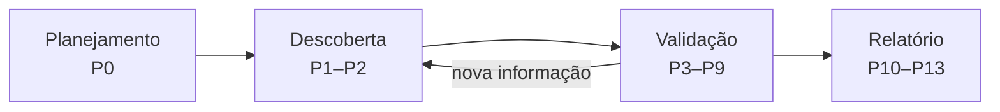
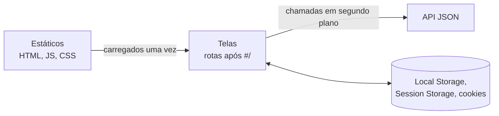

# A21 — Pentest como processo: referenciais, escopo e primeiro mapa

Um gestor pede: "façam um pentest no portal antes de liberarmos o acesso remoto". Por onde começar? Abrir uma ferramenta e varrer tudo produz uma lista de alertas, mas não responde se o portal é seguro, nem prova nada. Antes do primeiro pacote, alguém precisa dizer **o que** será testado, **até onde**, **como parar** e **o que conta como prova**.

Esta aula abre o bloco de pentest web. Ela organiza o processo, apresenta os referenciais pela função de cada um e transforma as regras de engajamento em configuração verificável do ZAP. Termina com o primeiro mapa de uma aplicação real.

## Objetivos de aprendizagem

1. Distinguir pentest de varredura, auditoria e red team, e situar cada fase do trabalho no ciclo planejamento → descoberta → validação → relatório.
2. Indicar, para cada referencial (SP 800-115, PTES, OSSTMM, WSTG, ASVS, CWE, Top 10, CVSS), a pergunta que ele responde e onde aparece no trabalho.
3. Configurar no ZAP o escopo, o modo e os limites exigidos pelo ROE, e produzir um mapa inicial de uma SPA com três hipóteses priorizadas.

**Tempo:** 100 minutos. **Recursos:** navegador; ZAP e Juice Shop **local** na demonstração do professor. A reprodução na sua máquina é opcional.<br>
**Preparação:** [A04](A04-onde-a-aplicacao-decide.md) (requisição e fronteira), [A17](A17-openvpn-ec2.md) (rede e túnel) e [A20](A20-validacao-ot-pentest.md#avaliar-sem-derrubar-a-planta) (avaliar sem derrubar a planta).<br>
**Produto:** configuração de P0 entendida e um mapa inicial com três hipóteses, que você reproduz no seu alvo do trabalho.

!!! tip "Para reproduzir localmente (opcional)"
    Com Docker instalado, inicie a mesma versão usada no trabalho, acessível só pela sua máquina:

    ```bash
    docker run --rm -p 127.0.0.1:3000:3000 bkimminich/juice-shop:v20.3.0
    ```

    Abra `http://127.0.0.1:3000`. Para encerrar, pressione Ctrl+C no terminal. No trabalho, o alvo é o **seu** Juice Shop na AWS, pelo túnel.

---

## Pentest: o que separa um teste de um ataque

!!! abstract "Síntese"
    - **Pentest** é uma avaliação **autorizada** que tenta usar falhas para demonstrar, com evidência, se uma premissa de segurança falha e com que efeito.
    - **Varredura** lista condições conhecidas; **auditoria** compara configuração e regra; **red team** testa detecção e resposta da organização.
    - O que separa teste de crime é a **autorização** de quem pode concedê-la, com escopo e limites (CP, art. 154-A).

| Atividade | Pergunta | Produto |
|---|---|---|
| Varredura de vulnerabilidades | Que condições conhecidas aparecem? | Alertas, com falsos positivos |
| Auditoria de configuração | A configuração cumpre a regra? | Conformidade por item |
| **Pentest** | Esta falha pode ser usada, e com que efeito? | Achados confirmados, com evidência |
| Red team | A organização detecta e responde? | Avaliação de detecção e resposta |

**Explicação.** O roteiro do trabalho pede **dois achados** confirmados, não uma lista. Um alerta de ferramenta é só ponto de partida para uma hipótese.

O trabalho é **caixa-cinza**: você recebe contas de teste e pode consultar o guia oficial do Juice Shop. Detalhes e a base legal estão em [Processo e referenciais](../pentest/visaogeral.md#o-que-e-e-o-que-nao-e-um-pentest).

!!! question "Checkpoint 1"
    Um colega roda a varredura ativa e anexa o relatório como "resultado do pentest". Que fase do processo ele pulou, e o que falta para qualquer alerta virar achado?

---

## O ciclo: planejar, descobrir, validar, relatar

!!! abstract "Síntese"
    - A **NIST SP 800-115** organiza o pentest em quatro fases: **planejamento, descoberta, ataque (validação) e relatório**.
    - Descoberta e validação formam um **laço**: cada resultado muda as próximas hipóteses.
    - O **PTES** detalha o mesmo caminho em sete seções, do acordo ao relatório.



| Fase (SP 800-115) | Seções do PTES | Fases do trabalho | Evidência produzida |
|---|---|---|---|
| Planejamento | 1 Pré-engajamento | **P0** ROE e ferramenta | ROE assinado, configuração, linha de base |
| Descoberta | 2 Coleta · 3 Modelagem de ameaças | **P1** Reconhecimento · **P2** Enumeração | Mapa, inventário, hipóteses |
| Ataque (validação) | 4 Análise · 5 Exploração · 6 Pós-exploração | **P3–P8** por categoria · **P9** varredura | Requisição, resposta, contraprova |
| Relatório | 7 Relatório | **P10** Correção · **P11** Detecção · **P12** OT · **P13** Risco | Achados, risco, recomendações |

**Explicação.** "Ataque", na SP 800-115, significa **validar**: tentar usar a falha com a menor ação suficiente. Ler um dado de outra conta de teste prova uma falha de autorização; apagar dados não acrescenta prova e viola o ROE.

A modelagem de ameaças do PTES retoma a [A06](A06-do-ticket-ao-modelo.md): ativos, fluxos e o que pode dar errado em cada um.

---

## Referenciais: escolher pela função

!!! abstract "Síntese"
    - Uma **metodologia** organiza o trabalho; um **guia de testes** descreve verificações; um **padrão de requisitos** define o esperado.
    - Uma **taxonomia** classifica a causa; uma **métrica** pontua a gravidade; uma **ferramenta** executa.
    - No trabalho, cada achado cita obrigatoriamente **CWE** (causa) e **caso WSTG** (teste), além da nota **CVSS 4.0**.

| Pergunta | Referencial | No trabalho |
|---|---|---|
| Como planejar, executar e relatar? | **NIST SP 800-115**; **PTES** | Fases e ROE |
| Quanto da operação está exposto? | **OSSTMM** (ISECOM) | Conceito; não aplicado integralmente |
| Como testar este comportamento web? | **OWASP WSTG 4.2** | ID do caso em cada achado |
| O que a aplicação deveria garantir? | **OWASP ASVS 5.0.0** | Escrever correção e critério de reteste |
| Que tipo de defeito é? | **MITRE CWE** | CWE em cada achado |
| Em que categoria de risco se encaixa? | **OWASP Top 10 2025**; **API Security Top 10 2023** | Quando a correspondência for defensável |
| Quão grave, em si e aqui? | **CVSS 4.0**; **OWASP Risk Rating** | P13 |
| Como agiria um adversário? | **MITRE ATT&CK** | Detecção (retoma A07) |

!!! example "Exemplo: a mesma falha pelos referenciais"
    Uma conta comum consegue ler um objeto de outra conta trocando o número na URL.

    - **WSTG 4.2:** o teste é `WSTG-ATHZ-04` (referências diretas inseguras a objetos).
    - **CWE:** a causa é CWE-639 (autorização contornada por chave controlada pelo usuário).
    - **Top 10 2025:** A01 Broken Access Control. **API Top 10 2023:** API1.
    - **ASVS:** requisito de verificar, no servidor, o acesso a cada objeto.
    - **CVSS 4.0:** depende do que o objeto contém; a nota é justificada na A24.

!!! warning "Erro comum"
    Usar o Top 10 como classificação principal. Ele é uma lista de **conscientização**: categorias amplas, sem procedimento de teste. A classificação do achado é CWE + WSTG.

Tabelas completas do WSTG, Top 10 2025 e API Top 10 2023 estão em [Processo e referenciais](../pentest/visaogeral.md#referenciais-escolher-pela-funcao).

!!! question "Checkpoint 2"
    Associe cada pergunta ao referencial: (a) "Que procedimento testa o logout?"; (b) "Essa falha é de autorização ou de validação de entrada?"; (c) "Quanto isso é grave para esta empresa?".

---

## Infraestrutura: o que muda em relação à A17

!!! abstract "Síntese"
    - A rede é a mesma da A17: gateway público, alvo privado, **sem NAT** e sem Internet no alvo.
    - Mudam três coisas: o cliente é a **VM Kali**; o gateway **filtra e registra** cada nova conexão (`TF_NEW`, `TF_FWD_DROP`); tudo **volta sozinho** após cada sessão do Learner Lab.
    - Cada contraprova I0–I5 exige o **resultado** e a **configuração** que o explica.

| Na A17 | No trabalho | Por quê |
|---|---|---|
| Cliente Windows/Linux | VM Kali | Túnel, ferramentas e evidências no mesmo lugar |
| Regras de forwarding em memória | Cadeia `TF_FWD` com LOG, persistente | Filtrar o mínimo e **registrar** quem conectou |
| Processo OpenVPN em primeiro plano | Serviço `openvpn-server@server` | Sobrevive às paradas |
| Serviço HTTP Python | Juice Shop instalado **pelo túnel**, com hash conferido | O alvo nunca ganha Internet |
| Sem revogação no ciclo final | Certificado de teste revogado (I.7) | Contenção de uma identidade |

**Explicação: a ordem da cadeia `TF_FWD`.** Primeiro passam as conexões já estabelecidas; depois cada conexão **nova** autorizada é registrada (`LOG`) e aceita; o resto é registrado por amostragem e descartado. `LOG` vem antes de `ACCEPT` porque `ACCEPT` encerra a avaliação.

**Explicação: por que exportar logs a cada sessão.** O log de acesso do Juice Shop guarda poucos dias, e o banco é recriado a cada reinício. A rotina I.8 do roteiro exporta os registros antes de *End Lab*; eles serão a base da detecção (P11).

Detalhes, diagrama, persistência e diagnóstico por camada: [Infraestrutura do laboratório](../pentest/infraestrutura.md).

---

## Do ROE à ferramenta: escopo, modo e limites no ZAP

!!! abstract "Síntese"
    - O **ROE** define alvo, janela, técnicas, intensidade, parada e recuperação. Cada regra precisa de **lugar de aplicação** e **evidência**.
    - No ZAP: **contexto** com expressão exata, modo **Protected**, **Rate Limit** e opções do **Fuzzer**.
    - Threads limitam **concorrência**; o limite de **taxa** é que impõe o teto de requisições por segundo.

| Regra do ROE | Onde aplicar | Evidência |
|---|---|---|
| Só o alvo autorizado | Contexto `tf-alvo` + modo *Protected* | Captura do contexto e do modo |
| ≤ 10 req/s | *Tools → Options → Network → Rate Limit* | Captura da regra habilitada |
| Fuzzer: 2 threads, 100 ms | *Tools → Options → Fuzzer* | Captura das opções |
| Linha de base | `curl -w` cinco vezes (roteiro 14.1) | Arquivo com horário UTC |

### Demonstração: configurar o ZAP para o escopo

Acompanhe a demonstração. Se reproduzir localmente, troque o endereço do alvo por `127.0.0.1:3000`.

1. **Estado inicial:** ZAP aberto, sessão nova, Juice Shop respondendo.
2. **Abrir o navegador pelo ZAP:** *Quick Start → Manual Explore*, URL do alvo, *Launch Browser*. Navegue até a página inicial.
3. **Criar o contexto:** na árvore *Sites*, botão direito no alvo → *Include in Context → New Context*. Nome `tf-alvo`. Em *Include in Context*, substitua a expressão sugerida por:

    ```text
    ^http://10\.77\.2\.10:3000(?:/.*)?$
    ```

    Marque *In Scope*.

4. **Modo:** no seletor da barra de ferramentas, escolha **Protected**.
5. **Limite de taxa:** *Tools → Options → Network → Rate Limit → Add*: host `10.77.2.10`, 10 requisições por segundo, *Enabled*.
6. **Fuzzer:** *Tools → Options → Fuzzer*: 2 threads; *Delay when fuzzing* 100 ms.
7. **Salvar:** *File → Persist Session*, com nome datado.

**Resultado esperado:** o alvo aparece com o ícone de escopo na árvore *Sites*; o modo indica *Protected*; a regra de taxa está habilitada.<br>
**Registrar:** capturas do contexto, do modo, do Rate Limit e do Fuzzer.<br>
**Critério de parada:** se a árvore *Sites* mostrar endereços fora do alvo **dentro** do contexto, a expressão está errada; corrija antes de continuar.

!!! question "Checkpoint 3"
    Por que a expressão `http://10.77.2.10:3000.*` é insegura? Dê duas URLs fora do escopo que ela aceitaria.

!!! info "Limite"
    O modo *Protected* impede o ZAP de **atacar** fora do contexto. Ele não impede o navegador de **carregar** recursos de outros endereços.

Referência de cada função do ZAP: [ZAP — referência de operação](../pentest/zap.md). Regras de engajamento, parada e linha de base: [Escopo, ROE e diário](../pentest/planejamento.md).

---

## Primeiro mapa: as quatro camadas de uma SPA

!!! abstract "Síntese"
    - O Juice Shop é uma **SPA**: o navegador baixa o JavaScript, monta as telas e chama a API em segundo plano.
    - Separe **telas** (rotas do cliente), **estáticos**, **chamadas de API** e **dados guardados no navegador**.
    - Compare a **navegação manual** com o **Client Spider**: o que só um encontrou é informação.



### Demonstração: mapear antes e depois do login

1. **Estado inicial:** contexto configurado, *History* vazio (botão de limpar) e filtro de escopo ativo.
2. **Navegue como visitante:** página inicial, busca, detalhe de um produto. Observe no *History* quais requisições trazem JSON.
3. **Cadastre e faça login** com uma conta `@lab.invalid`. Observe que novas chamadas aparecem e o que muda em *Storage* (DevTools do navegador aberto pelo ZAP, aba *Storage*).
4. **Percorra** cesta, perfil e suporte.
5. **Execute o Client Spider** no contexto e compare a árvore *Sites* com a captura feita depois da navegação manual.

**Resultado esperado:** uma lista de telas, um conjunto de chamadas de API agrupáveis por caminho e, depois do login, dados novos no navegador.<br>
**Registrar:** captura da árvore antes e depois do spider; tabela com as quatro camadas.<br>
**Critério de parada:** não envie formulários com dados reais; use só contas de teste.

| Pergunta do mapa | Onde procurar |
|---|---|
| Que dados o sistema manipula? | Respostas JSON no *History* |
| O que muda depois do login? | Novas chamadas; *Storage* |
| Que chamadas acontecem sem clique? | *History* logo após abrir uma tela |
| O que parece escondido só no frontend? | Rotas no JavaScript sem botão na interface |

Método completo, inventário de endpoints e priorização: [Reconhecimento e enumeração](../pentest/coleta.md).

---

## Diário: transformar observação em hipótese

!!! abstract "Síntese"
    - O diário registra **hipóteses**, não cliques: premissa testada, teste planejado, o que **confirmaria** e o que **negaria**.
    - Uma hipótese boa nomeia a **premissa** ("o servidor confere o dono do objeto"), não a técnica ("testar IDOR").
    - Hipóteses descartadas também são resultado e recebem crédito de método.

!!! example "Exemplo trabalhado — de observação a hipótese"
    **Observação do mapa:** depois do login, uma chamada de API traz no caminho um número que parece identificar um objeto da conta.<br>
    **Hipótese:** o servidor entrega o objeto pelo número, sem conferir se ele pertence à conta autenticada.<br>
    **Teste planejado:** com uma segunda conta, repetir a chamada no Requester trocando só a credencial.<br>
    **Confirmaria:** 200 com o conteúdo do objeto da primeira conta. **Negaria:** 401/403/404 sem o conteúdo.<br>
    **Prioridade:** alta. O indício é direto, o teste é uma única requisição e o impacto é dado de outra conta.

O formato completo da entrada está em [Escopo, ROE e diário](../pentest/planejamento.md#diario-de-investigacao-uma-entrada-por-hipotese).

!!! question "Checkpoint 4 — três hipóteses"
    A partir do mapa demonstrado, escreva **três hipóteses** em uma linha cada, nomeando a premissa. Para uma delas, escreva o que negaria. Elas são a evidência mínima de P1 no seu trabalho.

---

## Atividade {#atividade}

A atividade única do bloco de pentest é o **trabalho final**, com enunciado, pacote, prazos e forma de entrega na atividade do Google Classroom. Esta aula prepara as seções do roteiro:

- **Parte 0 e Parte I:** preparar a VM Kali e a infraestrutura; checkpoint I0–I5 aprovado pelo professor antes do período de pentest.
- **P0:** ROE assinado; contexto, modo, Rate Limit e Fuzzer configurados no **seu** ZAP; linha de base.
- **P1:** mapa das quatro camadas, comparação manual × Client Spider e três hipóteses priorizadas no diário.

Os checkpoints desta página não geram entrega separada.

## Diagnóstico

| Dificuldade | Como prosseguir |
|---|---|
| O navegador do ZAP não abre | Confira em *Marketplace → Installed* o add-on de navegador; use *Manual Explore* com Firefox |
| O alvo não aparece em *Sites* | A requisição não passou pelo proxy: use o navegador aberto pelo ZAP |
| O contexto inclui endereços estranhos | Expressão sem `^`, `$` ou com `.` sem escape |
| O Client Spider não inicia | Depende do add-on *Client Side Integration* e da extensão no navegador; teste na Parte 0 |
| Não sei se a chamada é de API | Veja o tipo da resposta (`application/json`) e se a URL mudou na barra de endereço |

## Revisão rápida

1. Em que fase do ciclo da SP 800-115 uma hipótese descartada devolve você, e por quê?
2. Que pergunta o WSTG responde que a CWE não responde?
3. Por que limitar threads no Fuzzer não basta para respeitar 10 requisições por segundo?

**Continuidade:** a A22 reabre as três hipóteses do mapa. Ela acrescenta a enumeração calibrada e os testes de identidade: autenticação, sessão e autorização entre duas contas.

## Fontes de referência

- [NIST SP 800-115](https://csrc.nist.gov/pubs/sp/800/115/final): seções 3–5 e apêndice B.
- [PTES](http://www.pentest-standard.org/) e [ISECOM — OSSTMM](https://www.isecom.org/research.html).
- [OWASP WSTG 4.2](https://owasp.org/www-project-web-security-testing-guide/v42/), [ASVS](https://owasp.org/www-project-application-security-verification-standard/), [Top 10 2025](https://owasp.org/Top10/2025/) e [API Security Top 10 2023](https://owasp.org/API-Security/editions/2023/en/0x11-t10/).
- [ZAP — modos](https://www.zaproxy.org/docs/desktop/start/features/modes/), [contextos](https://www.zaproxy.org/docs/desktop/start/features/contexts/) e [Rate Limit](https://www.zaproxy.org/docs/desktop/addons/network/options/ratelimit/).
- [OWASP Juice Shop — Companion Guide](https://pwning.owasp-juice.shop/companion-guide/latest/).
- Código Penal, [art. 154-A](https://www.planalto.gov.br/ccivil_03/decreto-lei/del2848compilado.htm).

Versões e endereços conferidos em **10 nov. 2026**.
