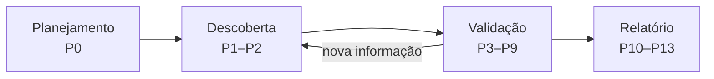
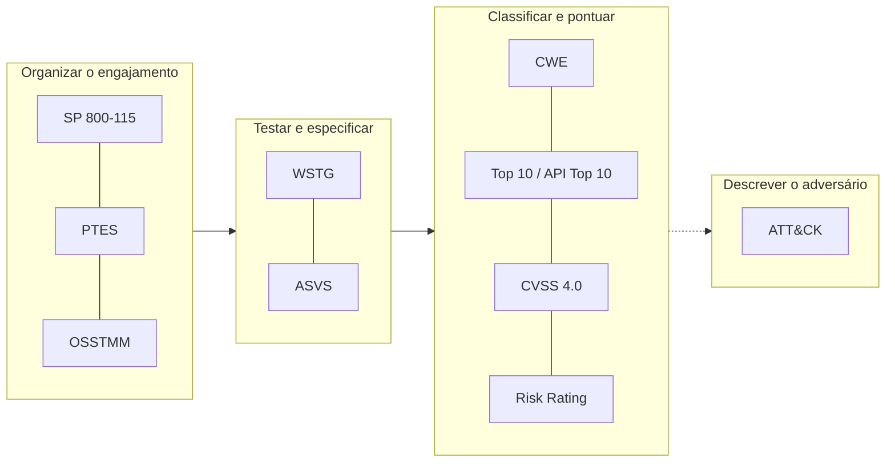
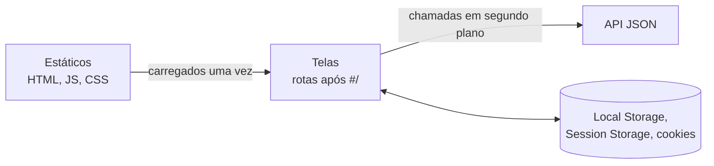

# A21 — Pentest como processo: referenciais, escopo e primeiro mapa

Um gestor pede: "façam um pentest no portal antes de liberarmos o acesso remoto". Por onde começar? Abrir uma ferramenta e varrer tudo produz uma lista de alertas, mas não responde se o portal é seguro, nem prova nada. Antes do primeiro pacote, alguém precisa dizer **o que** será testado, **até onde**, **como parar** e **o que conta como prova**.

Esta aula abre o bloco de pentest web. Ela organiza o processo, apresenta os referenciais pela função de cada um e transforma as regras de engajamento em configuração verificável do **ZAP** (*Zed Attack Proxy*), a ferramenta de interceptação usada no trabalho. Termina com o primeiro mapa de uma aplicação real.

## Objetivos de aprendizagem

1. Distinguir pentest de varredura, auditoria e red team, e situar cada fase do trabalho no ciclo planejamento → descoberta → validação → relatório.
2. Indicar, para cada referencial apresentado (metodologias, guias de teste, padrões de requisitos, taxonomias e métricas), a pergunta que ele responde e onde aparece no trabalho.
3. Configurar no ZAP o escopo, o modo e os limites exigidos pelas regras de engajamento, e produzir um mapa inicial de uma aplicação web com três hipóteses priorizadas.

**Tempo:** 100 minutos. **Recursos:** navegador; ZAP e Juice Shop **local** na demonstração do professor. A reprodução na sua máquina é opcional.<br>
**Preparação:** [A04](A04-onde-a-aplicacao-decide.md) (requisição e fronteira), [A17](A17-openvpn-ec2.md) (rede e túnel) e [A20](A20-validacao-ot-pentest.md#avaliar-sem-derrubar-a-planta) (avaliar sem derrubar a planta).<br>
**Produto:** configuração de P0 entendida e um mapa inicial com três hipóteses, que você reproduz no seu alvo do trabalho.

!!! info "Siglas desta aula"
    | Sigla | Nome por extenso | Em português | O que é |
    |---|---|---|---|
    | **NIST SP 800-115** | *National Institute of Standards and Technology — Special Publication 800-115* | Publicação especial 800-115 do Instituto Nacional de Padrões e Tecnologia dos EUA | Guia oficial para planejar, executar e relatar avaliações técnicas de segurança |
    | **PTES** | *Penetration Testing Execution Standard* | Padrão de Execução de Testes de Invasão | Metodologia comunitária que divide o pentest em sete seções, do acordo ao relatório |
    | **OSSTMM** | *Open Source Security Testing Methodology Manual* | Manual de Metodologia Aberta de Testes de Segurança | Metodologia da ISECOM que **mede** a exposição operacional |
    | **OWASP** | *Open Worldwide Application Security Project* | Projeto Aberto Mundial de Segurança de Aplicações | Fundação sem fins lucrativos que mantém WSTG, ASVS, Top 10 e o Juice Shop |
    | **WSTG** | *Web Security Testing Guide* | Guia de Testes de Segurança Web | Catálogo de casos de teste para aplicações web |
    | **ASVS** | *Application Security Verification Standard* | Padrão de Verificação de Segurança de Aplicações | Lista de requisitos verificáveis que uma aplicação deve cumprir |
    | **CWE** | *Common Weakness Enumeration* | Enumeração Comum de Fraquezas | Dicionário de **tipos** de defeito de software, mantido pelo MITRE |
    | **CVE** | *Common Vulnerabilities and Exposures* | Vulnerabilidades e Exposições Comuns | Identificador de uma vulnerabilidade **concreta** num produto e versão |
    | **CVSS** | *Common Vulnerability Scoring System* | Sistema Comum de Pontuação de Vulnerabilidades | Métrica de severidade de 0 a 10, mantida pelo FIRST |
    | **ATT&CK** | *Adversarial Tactics, Techniques, and Common Knowledge* | Táticas, Técnicas e Conhecimento Comum Adversariais | Base do MITRE sobre o comportamento de atacantes reais |
    | **ROE** | *Rules of Engagement* | Regras de engajamento | Documento que autoriza o teste e define alvo, limites, parada e recuperação |
    | **ZAP** | *Zed Attack Proxy* | — | Proxy de interceptação para testar aplicações web, mantido pela Checkmarx em código aberto |
    | **SPA** | *Single-Page Application* | Aplicação de página única | Aplicação web em que o navegador baixa o código uma vez e monta as telas localmente |

!!! tip "Para reproduzir localmente (opcional)"
    Com Docker instalado, inicie a mesma versão usada no trabalho, acessível só pela sua máquina:

    ```bash
    docker run --rm -p 127.0.0.1:3000:3000 bkimminich/juice-shop:v20.3.0
    ```

    Abra `http://127.0.0.1:3000`. Para encerrar, pressione Ctrl+C no terminal. No trabalho, o alvo é o **seu** Juice Shop na AWS, pelo túnel.

---

## Pentest: o que separa um teste de um ataque

!!! abstract "Síntese"
    - **Pentest** é uma avaliação **autorizada** que tenta usar falhas para demonstrar, com evidência, se uma premissa de segurança falha e com que efeito.
    - **Varredura** lista condições conhecidas; **auditoria** compara configuração e regra; **red team** testa detecção e resposta da organização.
    - O que separa teste de crime é a **autorização** de quem pode concedê-la, com escopo e limites (CP, art. 154-A).

| Atividade | Pergunta | Produto |
|---|---|---|
| Varredura de vulnerabilidades | Que condições conhecidas aparecem? | Alertas, com falsos positivos |
| Auditoria de configuração | A configuração cumpre a regra? | Conformidade por item |
| **Pentest** | Esta falha pode ser usada, e com que efeito? | Achados confirmados, com evidência |
| Red team | A organização detecta e responde? | Avaliação de detecção e resposta |

**Explicação.** O roteiro do trabalho pede **dois achados** confirmados, não uma lista. Um alerta de ferramenta é só ponto de partida para uma hipótese.

O trabalho é **caixa-cinza**: você recebe contas de teste e pode consultar o guia oficial do Juice Shop. Detalhes e a base legal estão em [Processo e referenciais](../pentest/visaogeral.md#o-que-e-e-o-que-nao-e-um-pentest).

!!! question "Checkpoint 1"
    Um colega roda a varredura ativa e anexa o relatório como "resultado do pentest". Que fase do processo ele pulou, e o que falta para qualquer alerta virar achado?

---

## O ciclo: planejar, descobrir, validar, relatar

!!! abstract "Síntese"
    - A **NIST SP 800-115**, guia de avaliação técnica do instituto de padrões dos EUA, organiza o pentest em quatro fases: **planejamento, descoberta, ataque (validação) e relatório**.
    - Descoberta e validação formam um **laço**: cada resultado muda as próximas hipóteses.
    - O **PTES** (*Penetration Testing Execution Standard*, Padrão de Execução de Testes de Invasão) detalha o mesmo caminho em sete seções, do acordo ao relatório.



| Fase (SP 800-115) | Seções do PTES | Fases do trabalho | Evidência produzida |
|---|---|---|---|
| Planejamento | 1 Pré-engajamento | **P0** ROE e ferramenta | ROE assinado, configuração, linha de base |
| Descoberta | 2 Coleta · 3 Modelagem de ameaças | **P1** Reconhecimento · **P2** Enumeração | Mapa, inventário, hipóteses |
| Ataque (validação) | 4 Análise · 5 Exploração · 6 Pós-exploração | **P3–P8** por categoria · **P9** varredura | Requisição, resposta, contraprova |
| Relatório | 7 Relatório | **P10** Correção · **P11** Detecção · **P12** OT · **P13** Risco | Achados, risco, recomendações |

**Explicação.** "Ataque", na SP 800-115, significa **validar**: tentar usar a falha com a menor ação suficiente. Ler um dado de outra conta de teste prova uma falha de autorização; apagar dados não acrescenta prova e viola o ROE.

A modelagem de ameaças do PTES retoma a [A06](A06-do-ticket-ao-modelo.md): ativos, fluxos e o que pode dar errado em cada um.

---

## Referenciais: escolher pela função

!!! abstract "Síntese"
    - Uma **metodologia** organiza o trabalho; um **guia de testes** descreve verificações; um **padrão de requisitos** define o esperado.
    - Uma **taxonomia** classifica a causa; uma **métrica** pontua a gravidade; uma **ferramenta** executa.
    - No trabalho, cada achado cita obrigatoriamente **CWE** (causa) e **caso WSTG** (teste), além da nota **CVSS 4.0**.

| Pergunta | Referencial | No trabalho |
|---|---|---|
| Como planejar, executar e relatar? | **NIST SP 800-115**; **PTES** | Fases e ROE |
| Quanto da operação está exposto? | **OSSTMM** (ISECOM) | Conceito; não aplicado integralmente |
| Como testar este comportamento web? | **OWASP WSTG 4.2** | ID do caso em cada achado |
| O que a aplicação deveria garantir? | **OWASP ASVS 5.0.0** | Escrever correção e critério de reteste |
| Que tipo de defeito é? | **MITRE CWE** | CWE em cada achado |
| Em que categoria de risco se encaixa? | **OWASP Top 10 2025**; **API Security Top 10 2023** | Quando a correspondência for defensável |
| Quão grave, em si e aqui? | **CVSS 4.0**; **OWASP Risk Rating** | P13 |
| Como agiria um adversário? | **MITRE ATT&CK** | Detecção (retoma A07) |

!!! example "Exemplo: a mesma falha pelos referenciais"
    Uma conta comum consegue ler um objeto de outra conta trocando o número na URL.

    - **WSTG 4.2:** o teste é `WSTG-ATHZ-04` (referências diretas inseguras a objetos).
    - **CWE:** a causa é CWE-639 (autorização contornada por chave controlada pelo usuário).
    - **Top 10 2025:** A01 Broken Access Control. **API Top 10 2023:** API1.
    - **ASVS:** requisito de verificar, no servidor, o acesso a cada objeto.
    - **CVSS 4.0:** depende do que o objeto contém; a nota é justificada na A24.

!!! warning "Erro comum"
    Usar o Top 10 como classificação principal. Ele é uma lista de **conscientização**: categorias amplas, sem procedimento de teste. A classificação do achado é CWE + WSTG.

Tabelas completas do WSTG, Top 10 2025 e API Top 10 2023 estão em [Processo e referenciais](../pentest/visaogeral.md#referenciais-escolher-pela-funcao).

!!! question "Checkpoint 2"
    Associe cada pergunta ao referencial: (a) "Que procedimento testa o logout?"; (b) "Essa falha é de autorização ou de validação de entrada?"; (c) "Quanto isso é grave para esta empresa?".

---

## Referenciais em detalhe: origem, estrutura e uso

Esta seção é para **estudo e consulta**. Cada referencial tem uma ficha com o mesmo formato:

- **o que propõe**, com origem e versão;
- **como está organizado**;
- **como usar no trabalho**;
- **limites**;
- **por onde ir além**.

Leia na ordem em que o trabalho os usa: primeiro os que **organizam** o teste, depois os que **descrevem** testes e requisitos, por fim os que **classificam** e **pontuam**.



### NIST SP 800-115 — o guia de avaliação técnica

| Ficha | |
|---|---|
| Quem publica | NIST (*National Institute of Standards and Technology*, EUA) |
| Versão | *Technical Guide to Information Security Testing and Assessment*, setembro de 2008, sem revisão posterior |
| Tipo | Metodologia de avaliação: planejar, executar e relatar |
| Pergunta | Como organizar uma avaliação técnica de segurança, do pedido ao relatório? |

**O que propõe.** O guia trata o pentest como **uma** das técnicas de avaliação, ao lado da revisão de documentos e da varredura. A tese central é que cada técnica responde a uma pergunta diferente e tem um custo diferente para o alvo. Escolher a técnica é parte do planejamento.

**Como está organizado.**

| Seções | Conteúdo |
|---|---|
| 3 — Técnicas de revisão | Documentação, logs, regras de firewall, configuração, captura passiva de tráfego, integridade de arquivos |
| 4 — Identificação e análise do alvo | Descoberta de rede, identificação de portas e serviços, varredura de vulnerabilidades, redes sem fio |
| 5 — Validação de vulnerabilidades | Quebra de senhas, **teste de invasão** e engenharia social |
| 6 a 8 — Planejamento, execução e pós-teste | Escopo, logística, coleta e guarda de dados, análise, relatório e mitigação |
| Apêndice B | **Modelo de regras de engajamento** |
| Apêndices C e D | Teste de aplicações e de acesso remoto |

**O ciclo do pentest (seção 5.2).** São quatro fases: **planejamento**, **descoberta**, **ataque** e **relatório**. A fase de ataque tem quatro passos: obter acesso, escalar privilégio, explorar o sistema e instalar ferramentas adicionais. Um laço volta à descoberta: cada acesso obtido revela informação nova. O guia também insiste que a varredura **sugere** a existência de uma vulnerabilidade, enquanto o ataque a **confirma**.

**No trabalho.**

- O ROE da seção 3 do roteiro segue a lógica do apêndice B.
- As fases P0–P13 seguem o ciclo de quatro fases.
- A exigência de transformar alerta em achado confirmado vem da distinção entre varredura e validação.

**Limites.** É um guia de 2008. Ferramentas, exemplos e algumas técnicas estão desatualizados, e ele não traz procedimentos específicos para aplicações web modernas. Use-o pela **estrutura**, e o WSTG pelos testes.

**Para ir além.**

- [Texto oficial (PDF)](https://nvlpubs.nist.gov/nistpubs/Legacy/SP/nistspecialpublication800-115.pdf): leia a seção 5.2 e o apêndice B.
- [NIST SP 800-53 Rev. 5](https://csrc.nist.gov/pubs/sp/800/53/r5/upd1/final), controle **CA-8** (*Penetration Testing*): como o pentest entra num catálogo de controles. É o mesmo controle visto na [A20](A20-validacao-ot-pentest.md#avaliar-sem-derrubar-a-planta).

### PTES — o padrão de execução feito por profissionais

| Ficha | |
|---|---|
| Nome | *Penetration Testing Execution Standard* — Padrão de Execução de Testes de Invasão |
| Quem publica | Grupo de profissionais de pentest, em projeto comunitário iniciado por volta de 2009 |
| Versão | Padrão em sete seções e diretrizes técnicas, publicados no site do projeto, sem atualização significativa há anos |
| Tipo | Metodologia de engajamento |
| Pergunta | Que etapas um pentest percorre, e o que o cliente deve esperar de cada uma? |

**O que propõe.** O PTES nasceu para dar a clientes e avaliadores uma **linguagem comum**: o que um "pentest" deve incluir, para que um teste superficial não seja vendido como completo.

**Como está organizado.**

| Seção | O que se faz | Equivalente no trabalho |
|---|---|---|
| 1. Interações pré-engajamento | Escopo, ROE, contatos, janela, critérios de parada, aceite | P0 e ROE |
| 2. Coleta de informações | Reconhecimento passivo e ativo | P1–P2 |
| 3. Modelagem de ameaças | Ativos e processos de negócio, agentes de ameaça, capacidades | Hipóteses priorizadas (retoma [A06](A06-do-ticket-ao-modelo.md)) |
| 4. Análise de vulnerabilidades | Testes ativos e passivos, validação, pesquisa | P3–P9 |
| 5. Exploração | Usar a vulnerabilidade com precisão, contornando contramedidas | Demonstração do achado |
| 6. Pós-exploração | Determinar o valor do acesso obtido; limpeza | Impacto delimitado; sem persistência |
| 7. Relatório | Sumário executivo e relatório técnico | E3 |

**No trabalho.** O PTES dá o vocabulário das fases e reforça dois pontos do roteiro: a modelagem de ameaças antecede os testes, e a pós-exploração tem **regras**. No laboratório, ela se limita a demonstrar o impacto, sem persistência nem movimento para fora do alvo.

**Limites.** As diretrizes técnicas citam ferramentas e técnicas datadas. O padrão não define como pontuar risco nem como testar aplicações web em detalhe.

**Para ir além.**

- [pentest-standard.org](http://www.pentest-standard.org/): leia as seções 1 (*Pre-engagement*) e 7 (*Reporting*). São as mais úteis para o trabalho e as menos dependentes de ferramenta.

### OSSTMM — medir a segurança operacional

| Ficha | |
|---|---|
| Nome | *Open Source Security Testing Methodology Manual* — Manual de Metodologia Aberta de Testes de Segurança |
| Quem publica | ISECOM (*Institute for Security and Open Methodologies*) |
| Versão | OSSTMM 3, de 2010 |
| Tipo | Metodologia de teste e **medição** |
| Pergunta | Quanto do alvo está exposto, quais controles existem, e como expressar isso em número? |

**O que propõe.** Em vez de listar vulnerabilidades, o OSSTMM mede a **segurança operacional**: a separação entre as ameaças e os ativos. O teste conta por onde é possível interagir com o alvo e quais controles protegem cada interação.

**Como está organizado.**

| Conceito | Significado |
|---|---|
| **Canais** | Cinco: humano, físico, sem fio, telecomunicações e redes de dados |
| **Porosidade** | Pontos de interação: **visibilidade** (o que se vê), **acesso** (onde se interage) e **confiança** (onde um elemento aceita outro sem verificar) |
| **Controles** | Dez controles operacionais. Interativos: autenticação, indenização, resiliência, subjugação, continuidade. De processo: não repúdio, confidencialidade, privacidade, integridade, alarme |
| **Limitações** | Falhas que reduzem a eficácia de controles ou ampliam a porosidade |
| ***rav*** | Valor que combina porosidade, controles e limitações em uma medida da superfície de ataque |
| **Tipos de teste** | Cego, duplo-cego, caixa-cinza, duplo caixa-cinza, *tandem* e reverso, conforme o que avaliador e alvo sabem um do outro |
| **STAR** | Modelo de relatório (*Security Test Audit Report*) |

**No trabalho.** O OSSTMM não é aplicado integralmente. Ele ajuda a enxergar a infraestrutura como **porosidade**:

- **visibilidade:** o gateway tem IP público;
- **acesso:** UDP 1194, e TCP 22/3000 pelo túnel;
- **confiança:** o alvo confia no gateway como origem.

Ajuda também a nomear controles. O certificado é **autenticação**; o registro `TF_NEW` é **alarme**; a revogação é **continuidade** da proteção.

**Limites.**

- O método completo exige estudo próprio e é trabalhoso.
- A versão 3 é de 2010.
- "Operacional" no nome não significa automação industrial.

**Para ir além.**

- [ISECOM — pesquisa e manuais](https://www.isecom.org/research.html): leia os capítulos sobre segurança operacional e o cálculo do *rav*.

### OWASP WSTG — o catálogo de testes web

| Ficha | |
|---|---|
| Nome | *Web Security Testing Guide* — Guia de Testes de Segurança Web |
| Quem publica | OWASP (*Open Worldwide Application Security Project*), fundação sem fins lucrativos |
| Versão | 4.2, de dezembro de 2020 (versão estável); a 5.0 está em desenvolvimento |
| Tipo | Guia de **testes** de aplicações web |
| Pergunta | Como testar este comportamento, e que evidência observar? |

**O que propõe.** Um catálogo de casos de teste para aplicações web. Cada caso explica o que testar, como e o que indica a falha. Seus identificadores estáveis permitem dizer exatamente **qual** teste foi feito.

**Como está organizado.** O capítulo 4 traz os testes, em 12 categorias:

- `INFO` coleta de informações;
- `CONF` configuração e implantação;
- `IDNT` gestão de identidade;
- `ATHN` autenticação;
- `ATHZ` autorização;
- `SESS` sessão;
- `INPV` validação de entrada;
- `ERRH` tratamento de erros;
- `CRYP` criptografia;
- `BUSL` lógica de negócio;
- `CLNT` lado do cliente;
- `APIT` APIs (na 4.2, só GraphQL).

Cada caso tem a mesma estrutura: **resumo**, **objetivos do teste**, **como testar**, **correção** e **ferramentas**. O capítulo 5 orienta o relatório.

**No trabalho.** Todo achado cita o caso WSTG, por exemplo `WSTG-v42-ATHZ-04`. Antes de cada fase, leia os **objetivos do teste** dos casos correspondentes: eles viram hipóteses do diário.

**Limites.** O guia lista testes possíveis, não obrigatórios. Aplicar todos não é viável nem necessário. A 4.2 não tem casos próprios para JWT nem para APIs REST; a autorização em APIs entra por `ATHZ`, complementada pelo API Top 10.

**Para ir além.**

- [WSTG 4.2](https://owasp.org/www-project-web-security-testing-guide/v42/): comece pelos casos `ATHZ-04`, `SESS-06` e `INPV-05`.

### OWASP ASVS — o padrão de requisitos verificáveis

| Ficha | |
|---|---|
| Nome | *Application Security Verification Standard* — Padrão de Verificação de Segurança de Aplicações |
| Quem publica | OWASP |
| Versão | 5.0.0, de maio de 2025 |
| Tipo | Padrão de **requisitos** de segurança de aplicações |
| Pergunta | O que a aplicação deveria garantir, e como verificar que garante? |

**O que propõe.** Onde o WSTG diz **como testar**, o ASVS diz **o que deve ser verdade**. Cada requisito é uma afirmação verificável, usada por desenvolvedores (especificar), testadores (verificar) e compradores (exigir).

**Como está organizado.** Há 17 capítulos, de V1 a V17. Os mais ligados ao trabalho são:

- V1 codificação e sanitização;
- V2 validação e lógica de negócio;
- V4 API e serviços web;
- V6 autenticação;
- V7 gestão de sessão;
- V8 autorização;
- V9 *tokens* autocontidos, isto é, JWT;
- V16 registro de segurança e tratamento de erros.

Três **níveis** acumulativos: **L1** (mínimo), **L2** (a maioria das aplicações) e **L3** (aplicações críticas). Os requisitos são citados com a versão, no formato `v5.0.0-8.2.2`.

**No trabalho.** Use o ASVS para escrever a **correção** (P10) como requisito e o **reteste** como verificação desse requisito. Por exemplo, procure no capítulo V8 o requisito de verificação de acesso a objetos e transforme-o em caso indevido e caso legítimo.

**Limites.** Citar um requisito não comprova conformidade com o padrão inteiro. O ASVS não é metodologia de teste nem lista de riscos.

**Para ir além.**

- [Projeto ASVS](https://owasp.org/www-project-application-security-verification-standard/) e [texto no GitHub](https://github.com/OWASP/ASVS/tree/master/5.0/en): leia V7, V8 e V9 lado a lado com os achados de identidade.

### MITRE CWE — o dicionário de fraquezas

| Ficha | |
|---|---|
| Nome | *Common Weakness Enumeration* — Enumeração Comum de Fraquezas |
| Quem publica | MITRE, com patrocínio da CISA (EUA); lançado em 2006 |
| Versão | Catálogo atualizado continuamente, com mais de 900 fraquezas; lista **Top 25** anual |
| Tipo | **Taxonomia** de fraquezas de software e hardware |
| Pergunta | Que tipo de defeito, na causa, permitiu esta vulnerabilidade? |

**O que propõe.** Um vocabulário comum para **tipos** de defeito. Uma **CVE** identifica uma vulnerabilidade concreta num produto e versão. A **CWE** identifica o tipo de erro que a causou: muitas CVEs diferentes têm a mesma CWE.

**Como está organizado.**

| Nível de abstração | Exemplo | Uso |
|---|---|---|
| Pilar | CWE-284, controle de acesso impróprio | Amplo demais para um achado |
| Classe | CWE-285, autorização imprópria | Quando a evidência não permite detalhar |
| Base | CWE-639, autorização contornada por chave controlada pelo usuário | **Preferido** em achados |
| Variante | Específica de tecnologia | Quando a evidência mostra o detalhe |

As **visões** organizam o catálogo para públicos diferentes, como a de pesquisa (CWE-1000) e a de desenvolvimento (CWE-699). A **Top 25** lista as fraquezas mais perigosas, calculadas a partir das CVEs publicadas.

**No trabalho.** Todo achado cita a CWE pela **causa**. A página de cada CWE traz exemplos de código, consequências e mitigações, úteis para P10.

**Limites.** Escolher pela aparência do efeito leva a CWEs genéricas. Uma mesma falha pode ter cadeia de CWEs; cite a que a evidência sustenta.

**Para ir além.**

- [cwe.mitre.org](https://cwe.mitre.org/) e [Top 25](https://cwe.mitre.org/top25/): abra CWE-639, CWE-79 e CWE-89 e compare as seções *Demonstrative Examples* e *Potential Mitigations*.

### OWASP Top 10 e API Security Top 10 — listas de conscientização

| Ficha | |
|---|---|
| Nome | *OWASP Top 10* — as dez categorias de risco mais críticas em aplicações web; *API Security Top 10* — o equivalente para APIs |
| Quem publica | OWASP |
| Versão | Top 10 **2025** (edições anteriores: 2003, 2004, 2007, 2010, 2013, 2017, 2021); API Security Top 10 **2023** (anterior: 2019) |
| Tipo | Documento de **conscientização** sobre categorias de risco |
| Pergunta | Quais categorias de risco merecem mais atenção em aplicações web e APIs? |

**O que propõe.** Cada categoria do Top 10 agrupa várias CWEs relacionadas. A seleção combina dados de testes e contribuições da comunidade. A lista de APIs destaca riscos que se manifestam de forma diferente quando o cliente consome uma API diretamente, como a autorização por objeto, por propriedade e por função.

**Como está organizado.** Cada categoria traz uma descrição, como prevenir, exemplos de cenário e as **CWEs mapeadas**. As duas listas completas estão em [Processo e referenciais](../pentest/visaogeral.md#owasp-top-10-2025-e-api-security-top-10-2023-categorias-de-risco).

**No trabalho.** A categoria entra no achado como contexto, **quando defensável**. Exemplos:

- A01 para controle de acesso;
- A05 para injeção;
- API1 para autorização por objeto.

O roteiro também usa A02, A03 e A04 de 2025 para orientar a fase P7.

**Limites.** Não é metodologia nem checklist completo. Uma aplicação "sem os dez" não está segura. O ranking muda entre edições, então registre sempre o ano.

**Para ir além.**

- [Top 10 2025](https://owasp.org/Top10/2025/) e [API Security Top 10 2023](https://owasp.org/API-Security/editions/2023/en/0x11-t10/): leia A01 e API1 e observe quantas CWEs cada uma agrupa.

### FIRST CVSS 4.0 — a nota de severidade

| Ficha | |
|---|---|
| Nome | *Common Vulnerability Scoring System* — Sistema Comum de Pontuação de Vulnerabilidades |
| Quem publica | FIRST (*Forum of Incident Response and Security Teams*) |
| Versão | 4.0, de novembro de 2023 (anteriores: 2.0 de 2007, 3.0 de 2015, 3.1 de 2019) |
| Tipo | **Métrica** de severidade de vulnerabilidades |
| Pergunta | Quão grave é esta vulnerabilidade, por características observáveis? |

**O que propõe.** Uma nota de 0 a 10 calculada a partir de um **vetor** de métricas. A nota resume; o vetor explica. A FIRST alerta que a nota base mede **severidade**, não **risco**.

**Como está organizado.**

| Grupo | Métricas | Quem preenche |
|---|---|---|
| **Base** | Explorabilidade (AV, AC, AT, PR, UI) e impacto no sistema vulnerável (VC, VI, VA) e subsequente (SC, SI, SA) | Quem analisa a vulnerabilidade |
| **Ameaça** | Maturidade de exploração (E) | Atualizado conforme surgem explorações |
| **Ambiental** | Requisitos de C/I/A do ativo e métricas modificadas (MAV, MPR…) | A organização que usa o sistema |
| **Suplementar** | Segurança física (S), automatizável (AU), recuperação (R), densidade de valor (V), esforço de resposta (RE), urgência do fornecedor (U) | Informativo; não altera a nota |

A nomenclatura indica o que foi considerado: **CVSS-B** (só base), **CVSS-BT**, **CVSS-BE** e **CVSS-BTE**. Faixas: 0,1–3,9 **Baixa**; 4,0–6,9 **Média**; 7,0–8,9 **Alta**; 9,0–10,0 **Crítica**.

**No trabalho.** O vetor base é obrigatório (P13), com justificativa de cada métrica de impacto. A métrica suplementar **Safety (S)** é útil para a transferência OT (P12): ela registra quando a exploração pode ferir pessoas.

**Limites.** O mesmo vetor vale para qualquer ambiente; o contexto vem das métricas ambientais ou de outra metodologia. Pequenas diferenças de julgamento (VC:H ou VC:L) mudam a faixa.

**Para ir além.**

- [Especificação](https://www.first.org/cvss/v4-0/specification-document), [guia de uso](https://www.first.org/cvss/v4-0/user-guide) e [exemplos pontuados](https://www.first.org/cvss/v4-0/examples): compare dois exemplos de aplicação web.

### OWASP Risk Rating — o risco no contexto

| Ficha | |
|---|---|
| Nome | *OWASP Risk Rating Methodology* — Metodologia de Classificação de Risco da OWASP |
| Quem publica | OWASP, como metodologia comunitária |
| Versão | Página de metodologia mantida pela comunidade |
| Tipo | Metodologia de **estimativa de risco** |
| Pergunta | Quão provável e quão danoso, para **este** negócio? |

**O que propõe.** Estimar **probabilidade** e **impacto** com fatores explícitos, de 0 a 9, e combinar os dois níveis em uma severidade. É a mesma lógica da avaliação de riscos da [A09](A09-decisao-de-riscos.md), aplicada a um achado técnico.

**Como está organizado.**

- **Probabilidade.** Agente de ameaça: habilidade, motivação, oportunidade e tamanho do grupo. Vulnerabilidade: facilidade de descoberta, facilidade de exploração, conhecimento público e detecção.
- **Impacto.** Técnico: confidencialidade, integridade, disponibilidade e responsabilização. Negócio: financeiro, reputação, não conformidade e privacidade.
- **Matriz.** Combina os níveis de probabilidade e impacto (baixo, médio e alto) em Informativo, Baixo, Médio, Alto ou Crítico.

**No trabalho.** Use-o na justificativa contextual de P13, ao lado do CVSS. Aqui a VPN entra como fator de **oportunidade**: só quem tem identidade VPN alcança o alvo.

**Limites.** Os fatores são estimativas; o valor está em **declarar as premissas**. Sem dados reais, evite falsa precisão.

**Para ir além.**

- [OWASP Risk Rating Methodology](https://owasp.org/www-community/OWASP_Risk_Rating_Methodology): refaça o exemplo da página com um dos seus achados.

### MITRE ATT&CK — o comportamento do adversário

| Ficha | |
|---|---|
| Nome | *Adversarial Tactics, Techniques, and Common Knowledge* — Táticas, Técnicas e Conhecimento Comum Adversariais |
| Quem publica | MITRE; criado em 2013 e público desde 2015 |
| Versão | Atualizado continuamente; matrizes *Enterprise*, *Mobile* e *ICS* |
| Tipo | Base de conhecimento de **táticas e técnicas** observadas em ataques reais |
| Pergunta | Que comportamento um adversário real teria, e como detectá-lo? |

**O que propõe.** Descrever o que adversários **fazem**, com base em incidentes documentados. As **táticas** são os objetivos (por que); as **técnicas**, os meios (como). Cada técnica traz exemplos de grupos, mitigações e fontes de dados para detecção.

**Como está organizado.** A matriz *Enterprise* tem 14 táticas, de *Reconnaissance* a *Impact*. Técnicas ligadas ao trabalho:

- **T1190**, *Exploit Public-Facing Application*: explorar a aplicação exposta;
- **T1110**, *Brute Force*: tentativas de senha, base da regra de detecção de P11;
- **T1078**, *Valid Accounts*: uso de contas válidas, como um certificado VPN comprometido.

A matriz *ICS* foi usada na [A07](A07-do-modelo-a-decisao.md).

**No trabalho.** ATT&CK não classifica o achado (isso é CWE). Ele ajuda em **P11**: que comportamento de ataque a regra pretende detectar, e que fonte de dados o revela.

**Limites.** Descreve comportamentos já observados, não fraquezas de software. Mapear um achado a uma técnica não mede seu risco.

**Para ir além.**

- [attack.mitre.org](https://attack.mitre.org/): abra T1110 e leia a seção *Detection*. Compare com a regra avaliada na A24.

### Onde o pentest aparece em padrões de gestão

O pentest não é só uma atividade técnica: ele é **exigido ou recomendado** por padrões que você viu em governança ([A08](A08-governanca-sgsi.md)).

| Padrão | Onde | O que diz, em resumo |
|---|---|---|
| ISO/IEC 27001:2022, Anexo A | 8.8 Gestão de vulnerabilidades técnicas; 8.29 Testes de segurança no desenvolvimento e aceitação; 8.34 Proteção dos sistemas durante testes de auditoria | Identificar e tratar vulnerabilidades; testar segurança antes de aceitar sistemas; planejar testes para não afetar a operação |
| NIST SP 800-53 Rev. 5 | CA-8 *Penetration Testing* | Teste de invasão como controle, com frequência e escopo definidos; adaptado à OT no *overlay* da SP 800-82 (A20) |
| PCI DSS v4.0 | Requisito 11.4 | Pentest interno e externo periódico em ambientes que processam cartões |

### Ambientes para praticar além do trabalho

| Ambiente | O que oferece |
|---|---|
| [OWASP Juice Shop — Companion Guide](https://pwning.owasp-juice.shop/companion-guide/latest/) | Explicação de cada categoria de desafio e desafios de código para estudar correções |
| [PortSwigger Web Security Academy](https://portswigger.net/web-security) | Teoria e laboratórios gratuitos por tema: controle de acesso, injeção SQL, XSS, JWT, lógica de negócio |
| [OWASP WebGoat](https://owasp.org/www-project-webgoat/) | Aplicação deliberadamente vulnerável com lições guiadas |

Pratique só nesses ambientes, feitos para isso, ou em laboratórios com autorização.

---

## Infraestrutura: o que muda em relação à A17

!!! abstract "Síntese"
    - A rede é a mesma da A17: gateway público, alvo privado, **sem NAT** e sem Internet no alvo.
    - Mudam três coisas: o cliente é a **VM Kali**; o gateway **filtra e registra** cada nova conexão (`TF_NEW`, `TF_FWD_DROP`); tudo **volta sozinho** após cada sessão do Learner Lab.
    - Cada contraprova I0–I5 exige o **resultado** e a **configuração** que o explica.

| Na A17 | No trabalho | Por quê |
|---|---|---|
| Cliente Windows/Linux | VM Kali | Túnel, ferramentas e evidências no mesmo lugar |
| Regras de forwarding em memória | Cadeia `TF_FWD` com LOG, persistente | Filtrar o mínimo e **registrar** quem conectou |
| Processo OpenVPN em primeiro plano | Serviço `openvpn-server@server` | Sobrevive às paradas |
| Serviço HTTP Python | Juice Shop instalado **pelo túnel**, com hash conferido | O alvo nunca ganha Internet |
| Sem revogação no ciclo final | Certificado de teste revogado (I.7) | Contenção de uma identidade |

**Explicação: a ordem da cadeia `TF_FWD`.** Primeiro passam as conexões já estabelecidas; depois cada conexão **nova** autorizada é registrada (`LOG`) e aceita; o resto é registrado por amostragem e descartado. `LOG` vem antes de `ACCEPT` porque `ACCEPT` encerra a avaliação.

**Explicação: por que exportar logs a cada sessão.** O log de acesso do Juice Shop guarda poucos dias, e o banco é recriado a cada reinício. A rotina I.8 do roteiro exporta os registros antes de *End Lab*; eles serão a base da detecção (P11).

Detalhes, diagrama, persistência e diagnóstico por camada: [Infraestrutura do laboratório](../pentest/infraestrutura.md).

---

## Do ROE à ferramenta: escopo, modo e limites no ZAP

!!! abstract "Síntese"
    - O **ROE** define alvo, janela, técnicas, intensidade, parada e recuperação. Cada regra precisa de **lugar de aplicação** e **evidência**.
    - No ZAP: **contexto** com expressão exata, modo **Protected**, **Rate Limit** e opções do **Fuzzer**.
    - Threads limitam **concorrência**; o limite de **taxa** é que impõe o teto de requisições por segundo.

| Regra do ROE | Onde aplicar | Evidência |
|---|---|---|
| Só o alvo autorizado | Contexto `tf-alvo` + modo *Protected* | Captura do contexto e do modo |
| ≤ 10 req/s | *Tools → Options → Network → Rate Limit* | Captura da regra habilitada |
| Fuzzer: 2 threads, 100 ms | *Tools → Options → Fuzzer* | Captura das opções |
| Linha de base | `curl -w` cinco vezes (roteiro 14.1) | Arquivo com horário UTC |

### Demonstração: configurar o ZAP para o escopo

Acompanhe a demonstração. Se reproduzir localmente, troque o endereço do alvo por `127.0.0.1:3000`.

1. **Estado inicial:** ZAP aberto, sessão nova, Juice Shop respondendo.
2. **Abrir o navegador pelo ZAP:** *Quick Start → Manual Explore*, URL do alvo, *Launch Browser*. Navegue até a página inicial.
3. **Criar o contexto:** na árvore *Sites*, botão direito no alvo → *Include in Context → New Context*. Nome `tf-alvo`. Em *Include in Context*, substitua a expressão sugerida por:

    ```text
    ^http://10\.77\.2\.10:3000(?:/.*)?$
    ```

    Marque *In Scope*.

4. **Modo:** no seletor da barra de ferramentas, escolha **Protected**.
5. **Limite de taxa:** *Tools → Options → Network → Rate Limit → Add*: host `10.77.2.10`, 10 requisições por segundo, *Enabled*.
6. **Fuzzer:** *Tools → Options → Fuzzer*: 2 threads; *Delay when fuzzing* 100 ms.
7. **Salvar:** *File → Persist Session*, com nome datado.

**Resultado esperado:** o alvo aparece com o ícone de escopo na árvore *Sites*; o modo indica *Protected*; a regra de taxa está habilitada.<br>
**Registrar:** capturas do contexto, do modo, do Rate Limit e do Fuzzer.<br>
**Critério de parada:** se a árvore *Sites* mostrar endereços fora do alvo **dentro** do contexto, a expressão está errada; corrija antes de continuar.

!!! question "Checkpoint 3"
    Por que a expressão `http://10.77.2.10:3000.*` é insegura? Dê duas URLs fora do escopo que ela aceitaria.

!!! info "Limite"
    O modo *Protected* impede o ZAP de **atacar** fora do contexto. Ele não impede o navegador de **carregar** recursos de outros endereços.

Referência de cada função do ZAP: [ZAP — referência de operação](../pentest/zap.md). Regras de engajamento, parada e linha de base: [Escopo, ROE e diário](../pentest/planejamento.md).

---

## Primeiro mapa: as quatro camadas de uma SPA

!!! abstract "Síntese"
    - O Juice Shop é uma **SPA** (*single-page application*, aplicação de página única): o navegador baixa o JavaScript, monta as telas e chama a API em segundo plano.
    - Separe **telas** (rotas do cliente), **estáticos**, **chamadas de API** e **dados guardados no navegador**.
    - Compare a **navegação manual** com o **Client Spider**: o que só um encontrou é informação.



### Demonstração: mapear antes e depois do login

1. **Estado inicial:** contexto configurado, *History* vazio (botão de limpar) e filtro de escopo ativo.
2. **Navegue como visitante:** página inicial, busca, detalhe de um produto. Observe no *History* quais requisições trazem JSON.
3. **Cadastre e faça login** com uma conta `@lab.invalid`. Observe que novas chamadas aparecem e o que muda em *Storage* (DevTools do navegador aberto pelo ZAP, aba *Storage*).
4. **Percorra** cesta, perfil e suporte.
5. **Execute o Client Spider** no contexto e compare a árvore *Sites* com a captura feita depois da navegação manual.

**Resultado esperado:** uma lista de telas, um conjunto de chamadas de API agrupáveis por caminho e, depois do login, dados novos no navegador.<br>
**Registrar:** captura da árvore antes e depois do spider; tabela com as quatro camadas.<br>
**Critério de parada:** não envie formulários com dados reais; use só contas de teste.

| Pergunta do mapa | Onde procurar |
|---|---|
| Que dados o sistema manipula? | Respostas JSON no *History* |
| O que muda depois do login? | Novas chamadas; *Storage* |
| Que chamadas acontecem sem clique? | *History* logo após abrir uma tela |
| O que parece escondido só no frontend? | Rotas no JavaScript sem botão na interface |

Método completo, inventário de endpoints e priorização: [Reconhecimento e enumeração](../pentest/coleta.md).

---

## Diário: transformar observação em hipótese

!!! abstract "Síntese"
    - O diário registra **hipóteses**, não cliques: premissa testada, teste planejado, o que **confirmaria** e o que **negaria**.
    - Uma hipótese boa nomeia a **premissa** ("o servidor confere o dono do objeto"), não a técnica ("testar IDOR").
    - Hipóteses descartadas também são resultado e recebem crédito de método.

!!! example "Exemplo trabalhado — de observação a hipótese"
    **Observação do mapa:** depois do login, uma chamada de API traz no caminho um número que parece identificar um objeto da conta.<br>
    **Hipótese:** o servidor entrega o objeto pelo número, sem conferir se ele pertence à conta autenticada.<br>
    **Teste planejado:** com uma segunda conta, repetir a chamada no Requester trocando só a credencial.<br>
    **Confirmaria:** 200 com o conteúdo do objeto da primeira conta. **Negaria:** 401/403/404 sem o conteúdo.<br>
    **Prioridade:** alta. O indício é direto, o teste é uma única requisição e o impacto é dado de outra conta.

O formato completo da entrada está em [Escopo, ROE e diário](../pentest/planejamento.md#diario-de-investigacao-uma-entrada-por-hipotese).

!!! question "Checkpoint 4 — três hipóteses"
    A partir do mapa demonstrado, escreva **três hipóteses** em uma linha cada, nomeando a premissa. Para uma delas, escreva o que negaria. Elas são a evidência mínima de P1 no seu trabalho.

---

## Atividade {#atividade}

A atividade única do bloco de pentest é o **trabalho final**, com enunciado, pacote, prazos e forma de entrega na atividade do Google Classroom. Esta aula prepara as seções do roteiro:

- **Parte 0 e Parte I:** preparar a VM Kali e a infraestrutura; checkpoint I0–I5 aprovado pelo professor antes do período de pentest.
- **P0:** ROE assinado; contexto, modo, Rate Limit e Fuzzer configurados no **seu** ZAP; linha de base.
- **P1:** mapa das quatro camadas, comparação manual × Client Spider e três hipóteses priorizadas no diário.

Os checkpoints desta página não geram entrega separada.

## Diagnóstico

| Dificuldade | Como prosseguir |
|---|---|
| O navegador do ZAP não abre | Confira em *Marketplace → Installed* o add-on de navegador; use *Manual Explore* com Firefox |
| O alvo não aparece em *Sites* | A requisição não passou pelo proxy: use o navegador aberto pelo ZAP |
| O contexto inclui endereços estranhos | Expressão sem `^`, `$` ou com `.` sem escape |
| O Client Spider não inicia | Depende do add-on *Client Side Integration* e da extensão no navegador; teste na Parte 0 |
| Não sei se a chamada é de API | Veja o tipo da resposta (`application/json`) e se a URL mudou na barra de endereço |

## Revisão rápida

1. Em que fase do ciclo da SP 800-115 uma hipótese descartada devolve você, e por quê?
2. Que pergunta o WSTG responde que a CWE não responde?
3. Por que limitar threads no Fuzzer não basta para respeitar 10 requisições por segundo?

**Continuidade:** a A22 reabre as três hipóteses do mapa. Ela acrescenta a enumeração calibrada e os testes de identidade: autenticação, sessão e autorização entre duas contas.

## Fontes de referência

- [NIST SP 800-115](https://csrc.nist.gov/pubs/sp/800/115/final): seções 3–5 e apêndice B.
- [PTES](http://www.pentest-standard.org/) e [ISECOM — OSSTMM](https://www.isecom.org/research.html).
- [OWASP WSTG 4.2](https://owasp.org/www-project-web-security-testing-guide/v42/), [ASVS](https://owasp.org/www-project-application-security-verification-standard/), [Top 10 2025](https://owasp.org/Top10/2025/) e [API Security Top 10 2023](https://owasp.org/API-Security/editions/2023/en/0x11-t10/).
- [ZAP — modos](https://www.zaproxy.org/docs/desktop/start/features/modes/), [contextos](https://www.zaproxy.org/docs/desktop/start/features/contexts/) e [Rate Limit](https://www.zaproxy.org/docs/desktop/addons/network/options/ratelimit/).
- [OWASP Juice Shop — Companion Guide](https://pwning.owasp-juice.shop/companion-guide/latest/).
- Código Penal, [art. 154-A](https://www.planalto.gov.br/ccivil_03/decreto-lei/del2848compilado.htm).

Versões e endereços conferidos em **10 nov. 2026**.
