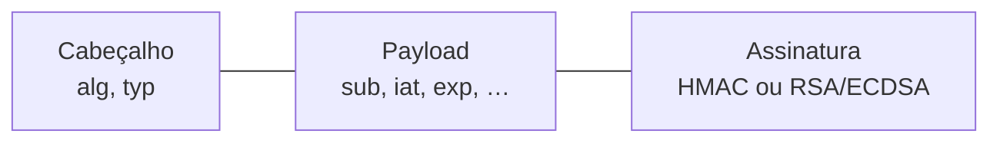

# A22 — Superfície e identidade: enumerar, autenticar, autorizar

Na A21, o mapa da aplicação gerou hipóteses. Várias delas envolvem a mesma pergunta: **quem é você para o servidor, e o que ele deixa você fazer?** Para respondê-la com evidência, primeiro é preciso saber o que existe (enumeração calibrada). Depois, entender como a identidade é provada e mantida (autenticação e sessão). Por fim, verificar se cada requisição é autorizada no servidor, e não só escondida na interface.

Esta aula prepara o **achado de identidade** exigido no trabalho: autenticação, sessão ou autorização (fases P3, P4 ou P6).

## Objetivos de aprendizagem

1. Enumerar portas e conteúdo do alvo dentro do ROE, interpretando estados *filtered* e calibrando a resposta "inexistente" de uma SPA antes de filtrar.
2. Analisar um JWT (algoritmo, *claims*, expiração), distinguir decodificar de validar e testar se logout e mensagens de erro protegem a sessão e as contas.
3. Testar autorização horizontal e vertical com duas contas fora da interface, lendo código **e corpo**, e registrar o resultado em uma matriz.

**Tempo:** 100 minutos. **Recursos:** navegador, ZAP da A21, terminal com Python 3, `curl`, `nmap` e `ffuf` para a prática local. A leitura de evidências fornecida abaixo permite acompanhar mesmo sem alguma ferramenta.<br>
**Preparação:** contexto e limites do ZAP ([A21](A21-pentest-processo-referenciais-e-escopo.md)); sessão e autorização com Ana e Bruno ([A05](A05-quem-e-voce-e-pode-fazer-isto.md)); HMAC e assinaturas ([A15](A15-chaves-assinaturas-certificados.md), [A16](A16-tls-ciclo-de-chaves.md#hmac)).<br>
**Produto:** calibração, análise de token e uma matriz de autorização preenchida, que você reproduz no seu alvo do trabalho.

## Preparar o laboratório desta aula

O exemplo executável é uma aplicação **fictícia** de ordens de manutenção. Ela usa duas contas descartáveis e uma falha de leitura intencional. Roda apenas em `127.0.0.1:3001`, sem Docker, rede externa ou resposta do Juice Shop. Na A21 você configurou um contexto para `127.0.0.1:3000`; crie um **segundo contexto local** para esta aula, com `^http://127\.0\.0\.1:3001(?:/.*)?$`, modo *Protected* e Rate Limit de 10 req/s para `127.0.0.1`. Confira o ícone de escopo antes de enviar tráfego pelo ZAP. O proxy da A21 continua no centro do percurso: **requisição → ZAP (*History*) → aplicação → ZAP (*Response*)**. O gateway VPN do trabalho é um equipamento diferente; só ele ajuda a explicar um `filtered` na rede AWS.

1. Clone o [repositório de práticas](https://github.com/rafaelrezo/seguranca-digital-praticas/tree/main/a22) uma vez e entre na pasta `a22`. Quem já tem o clone pode usar `git pull --ff-only` **se não tiver alterações próprias**; caso contrário, faça um clone novo em outra pasta. Arquivos para consulta direta: [`servidor_ordens_a22.py`](../assets/pentest/servidor_ordens_a22.py), [`palavras_a22.txt`](../assets/pentest/palavras_a22.txt), [`ler_jwt.py`](../assets/pentest/ler_jwt.py) e [`servidor_jwt.py`](../assets/pentest/servidor_jwt.py).

    ```bash
    git clone https://github.com/rafaelrezo/seguranca-digital-praticas.git
    cd seguranca-digital-praticas/a22
    python3 servidor_ordens_a22.py
    ```

    Deixe esse terminal aberto; `Ctrl+C` encerra. Não é preciso criar EC2 para esta prática. O Juice Shop local da A21 continua disponível por Docker, mas a aplicação de ordens evita antecipar um achado do trabalho final.
2. Em outro terminal, execute `curl -i http://127.0.0.1:3001/`. Espere `HTTP/1.0 200 OK` e um JSON com `"aplicacao": "Ordens A22"`. Se falhar, confira o terminal do servidor e se a porta 3001 está livre.
3. No ZAP, confirme o contexto local, *Protected* e o limite de taxa. Use *Quick Start → Manual Explore* com `http://127.0.0.1:3001/` ou envie os comandos `curl` com `-x http://127.0.0.1:8080`. A porta `8080` é a configuração comum do proxy local; se a sua for diferente, veja *Tools → Options → Network → Local Servers/Proxies*.

**Registre** hora, URL, configuração de escopo e ID da primeira mensagem no *History*. Se uma URL fora de `127.0.0.1:3001` aparecer dentro do contexto, pare e corrija a expressão. Para aplicar o método ao trabalho, use somente o alvo e os limites definidos no ROE entregue pelo Classroom.

---

## Enumeração controlada: o que existe, sem varrer além do escopo

!!! abstract "Síntese"
    - Primeiro, `nmap` só no laboratório `127.0.0.1`, portas `3001,3002`. No trabalho, o alvo e as portas são os do ROE; uma porta *filtered* exige decidir **quem** bloqueou.
    - Numa SPA, caminhos inexistentes podem responder **200** com a página principal. **Calibre** antes de filtrar.
    - Leia cabeçalhos, métodos e mensagens de erro de forma pontual, nas respostas que você já tem.

### Portas: estado e responsável pelo bloqueio

| Estado | O que o `nmap` observou | O que você decide |
|---|---|---|
| `open` | Serviço aceitou a conexão | Qual serviço e se está no escopo |
| `closed` | O host recusou (RST) | Nada escuta; o caminho até o host existe |
| `filtered` | Sem resposta | **Gateway** (linha `TF_FWD_DROP`) ou **SG do alvo**? |

Com o servidor local aberto, execute:

```bash
nmap -Pn -sT -p 3001,3002 --max-rate 50 127.0.0.1
```

**Preveja e compare.** A porta 3001 deve estar `open`; 3002, sem serviço, deve estar `closed`. `-Pn` dispensa descoberta prévia do host, `-sT` tenta uma conexão TCP completa, `-p` restringe as portas e `--max-rate 50` limita a emissão de pacotes. Registre a saída. Se ambas estiverem `closed`, confira se o servidor continua aberto. Esse teste local **não** produz um caso *filtered*.

**No trabalho.** Só depois de confirmar o túnel e o ROE, use o comando de P2 com o IP e as portas autorizadas, salve a saída e compare um `filtered` com o registro `TF_FWD_DROP` do gateway na mesma janela de tempo. Um registro correspondente atribui o descarte ao gateway; ausência de registro não prova, sozinha, que o grupo de segurança do alvo bloqueou. Não rode o comando do trabalho no laboratório local.

### Calibração: como é a resposta "inexistente"?

`curl -w` acrescenta código HTTP, tamanho do corpo e tipo de conteúdo depois da resposta. Compare dois nomes aleatórios, um fora e outro dentro de `/api/`, para não tratar a resposta de uma camada como se valesse para a outra:

```bash
curl -s -o /dev/null -w 'fora: %{http_code} %{size_download} %{content_type}\n' http://127.0.0.1:3001/nao-existe-a22
curl -s -o /dev/null -w 'api:  %{http_code} %{size_download} %{content_type}\n' http://127.0.0.1:3001/api/nao-existe-a22
```

**Resultado esperado:** fora da API, `200` com o mesmo JSON da raiz; dentro da API, `404` com JSON de erro. Os tamanhos são medidos na execução: registre os números que você viu. A resposta `200` fora da API **não** prova que o caminho existe. A resposta da API precisa de calibração própria.

Agora rode a lista curta `palavras_a22.txt`, que veio no clone, com teto de 20 requisições por segundo e até duas conexões simultâneas. No laboratório, faça primeiro a busca **sem filtro** para comparar as respostas; depois, separe o tamanho da resposta inexistente e repita acrescentando `-fs N`, trocando `N` pelo número medido. `FUZZ` marca onde cada palavra do arquivo será inserida.

```bash
ffuf -u http://127.0.0.1:3001/api/FUZZ -w palavras_a22.txt -rate 20 -t 2 -of md -o ffuf-a22.md
```

**Leia** o código e tamanho de cada linha. Abra manualmente um caminho filtrado com `curl -i`; um filtro pode esconder um caminho válido que tenha tamanho igual ao inexistente. Registre a calibração, a regra escolhida e essa contraprova. **Pare** se a URL não for a local esperada ou se a ferramenta começar a testar um domínio ou IP de fora do escopo.

Se não houver `ffuf`, compare estas **respostas fornecidas** do laboratório: `GET /api/ordens` → `401` sem credencial; `GET /api/login`, `/api/logout` e `/api/inexistente-a22` → `404` em requisições GET. A diferença sugere um caminho que exige identidade, mas não prova que o nome encontrado oferece uma função útil. Registre a hipótese sem marcar varredura como executada.

!!! example "Observação anterior em Juice Shop 20.3.0 local (10 nov. 2026)"
    Na instância observada, a raiz e um caminho inexistente fora da API responderam `HTTP 200`, `9984` bytes, `text/html`. É um exemplo de por que medir antes de filtrar; não presuma esse tamanho no seu alvo. No trabalho, calibre novamente as rotas do cliente e a API antes de escolher `-fs` ou `-fc`.

| Opção do `ffuf` | Função |
|---|---|
| `-rate 20` | Teto de 20 requisições por segundo (ROE) |
| `-fs N` / `-fc N` | Esconde respostas com tamanho / código N |
| `-of md -o arquivo` | Salva o resultado para evidência |

Detalhes e comando do trabalho: [Reconhecimento e enumeração](../pentest/coleta.md#descoberta-de-conteudo-calibrar-antes-de-filtrar).

!!! question "Checkpoint 1"
    Você roda `ffuf` com `-fc 404` numa SPA que responde 200 para tudo. O que aparece no resultado, e por que essa lista não serve como inventário?

---

## Autenticação e sessão: três decisões diferentes

!!! abstract "Síntese"
    - **Autenticação** prova quem você é; **sessão** carrega essa prova; **autorização** decide, a cada requisição, o que você pode fazer.
    - Uma rota que só confere "há token válido" autenticou, mas **não autorizou**.
    - Com token autocontido (JWT), o servidor aceita sem consultar estado; isso torna o **logout** difícil de efetivar.

| Decisão | Pergunta | Falha típica | CWE |
|---|---|---|---|
| Autenticação | Você é quem diz? | Credencial inválida aceita | CWE-287 |
| Sessão | Esta requisição vem de quem se autenticou? | Sessão que não expira ou não termina | CWE-613 |
| Autorização | Pode **esta** ação **neste** recurso? | Objeto de outro usuário entregue | CWE-639, 862, 863 |

### JWT: legível por todos, verificável só pelo servidor



| Parte | Quem lê | Quem produz |
|---|---|---|
| Cabeçalho e payload (Base64URL) | **Qualquer um** | Qualquer um |
| Assinatura | Qualquer um | **Só quem tem a chave** |

`HS256` usa HMAC com segredo compartilhado (o mesmo da [A16](A16-tls-ciclo-de-chaves.md#hmac)). `RS256` usa assinatura com chave privada, verificada com a pública ([A15](A15-chaves-assinaturas-certificados.md)). `none` significa sem assinatura e nunca deve ser aceito.

### Prática: decodificar não é validar

Os arquivos [`ler_jwt.py`](../assets/pentest/ler_jwt.py) e [`servidor_jwt.py`](../assets/pentest/servidor_jwt.py) estão na mesma pasta `a22` do clone. O segundo faz o papel do servidor, com uma chave fictícia que só ele conhece. Em **outro terminal**, entre em `seguranca-digital-praticas/a22` e execute:

```bash
python3 servidor_jwt.py emitir u1@lab.invalid cliente > meu.jwt
python3 ler_jwt.py meu.jwt
python3 servidor_jwt.py adulterar meu.jwt admin > adulterado.jwt
python3 ler_jwt.py adulterado.jwt
python3 servidor_jwt.py verificar meu.jwt
python3 servidor_jwt.py verificar adulterado.jwt
```

**Resultado esperado:**

- `ler_jwt.py` mostra o payload dos **dois** tokens, inclusive `"papel": "admin"` no adulterado, sem reclamar.
- O servidor responde `ACEITO: sub=u1@lab.invalid papel=cliente` para o original e `RECUSADO: assinatura não confere` para o adulterado.

**Interpretação.** O leitor só decodifica; quem tem a chave percebe a alteração. No trabalho, as perguntas são: **qual algoritmo** o token declara, **que dados** ele expõe, **quando expira** e **o servidor recusa um token alterado?**

**Registrar:** no trabalho, use `ler_jwt.py` com o token da **sua** conta de teste. Guarde o token em arquivo, não no histórico do terminal, e mascare-o no relatório.

!!! warning "Erro comum"
    Dizer que o token "está criptografado". Base64URL é codificação, reversível sem chave.

### Login, logout e mensagens de erro: comparar no laboratório

O servidor de ordens usa os identificadores opacos `lab-u1` e `lab-u2`; **não** são JWTs. Eles servem para isolar o teste de sessão. Em outro terminal na pasta da aula, faça um login por vez. `-x` encaminha a requisição pelo ZAP; `-H` informa o tipo do corpo; `-d` envia o JSON. No *History*, localize `POST /api/login` e anote os IDs.

```bash
curl -i --noproxy '' -x http://127.0.0.1:8080 -H 'Content-Type: application/json' -d '{"email":"u1@lab.invalid","senha":"senha-u1"}' http://127.0.0.1:3001/api/login
curl -i --noproxy '' -x http://127.0.0.1:8080 -H 'Content-Type: application/json' -d '{"email":"u2@lab.invalid","senha":"senha-errada"}' http://127.0.0.1:3001/api/login
curl -i --noproxy '' -x http://127.0.0.1:8080 -H 'Content-Type: application/json' -d '{"email":"ninguém@lab.invalid","senha":"senha-errada"}' http://127.0.0.1:3001/api/login
```

**Espere:** o primeiro login devolve `200` e token `lab-u1`; os outros dois devolvem `401` e a mesma mensagem `credenciais inválidas`. Compare código, corpo e tamanho. Uma resposta igual **neste exemplo** não confirma que outros sistemas tratam contas existentes e inexistentes da mesma forma; tempos e várias tentativas também exigem cuidado. No trabalho, faça apenas as tentativas pontuais permitidas pelo ROE, sem força bruta.

Para testar logout, obtenha primeiro uma linha de base autenticada. O comando abaixo envia a credencial no cabeçalho `Authorization`; o corpo deve mostrar a ordem 17. Anote seu ID no *History*. Em seguida, envie o logout e repita a **mesma** leitura com a credencial antiga:

```bash
curl -i --noproxy '' -x http://127.0.0.1:8080 -H 'Authorization: Bearer lab-u1' http://127.0.0.1:3001/api/ordens/17
curl -i --noproxy '' -x http://127.0.0.1:8080 -X POST -H 'Authorization: Bearer lab-u1' http://127.0.0.1:3001/api/logout
curl -i --noproxy '' -x http://127.0.0.1:8080 -H 'Authorization: Bearer lab-u1' http://127.0.0.1:3001/api/ordens/17
```

**Espere:** `200` com dado → `200` com confirmação do logout → `401` sem dado. Registre os três IDs e a comparação. Para repetir a prática, faça login de U1 novamente: o servidor recria a sessão. **Pare** se a primeira leitura já der `401`; primeiro recupere a linha de base.

| Resposta depois do logout | Interpretação |
|---|---|
| Igual à linha de base | O servidor continua aceitando a credencial; o logout foi só no navegador |
| 401 sem dados | A credencial foi invalidada no servidor |

**No trabalho:** anote uma requisição autenticada da sua conta antes do logout, reenvie-a depois no Requester e compare o corpo. Para enumeração, compare "senha errada para conta existente" com "conta inexistente" em código, corpo, tamanho e tempo. Diferença consistente pode revelar quem tem conta (CWE-204, `WSTG-IDNT-04`). Mascare credenciais e tokens nas capturas.

!!! question "Checkpoint 2"
    O token da sua conta tem `exp` duas horas depois de `iat`. Depois do logout, o servidor ainda aceita o token. Qual o intervalo de risco, e que evidência você coloca no diário?

Atributos de cookie, local de armazenamento e tabela WSTG/CWE: [Autenticação e sessão](../pentest/autenticacao-sessao.md).

---

## Controle de acesso: objeto, propriedade e função

!!! abstract "Síntese"
    - Autorização é decidida **no servidor**, a cada requisição: `identidade → ação → recurso → permitido?`.
    - **Horizontal:** recurso de outro usuário do mesmo nível. **Vertical:** função de outro perfil.
    - Em APIs, a falha pode estar no **objeto** (API1), na **propriedade** (API3) ou na **função** (API5).
    - O teste é feito **fora da interface**, e a conclusão lê o **corpo**, não só o código.

Na [A05](A05-quem-e-voce-e-pode-fazer-isto.md#caso-4-bruno-pede-a-cesta-de-ana), Bruno pediu a cesta de Ana. Agora o mesmo raciocínio vira método: duas contas, uma matriz e todos os níveis.

| Nível | Pergunta | API Top 10 2023 | CWE |
|---|---|---|---|
| Objeto | Este objeto pertence a quem pede? | API1 | CWE-639 |
| Propriedade | Este campo pode ser lido ou alterado por quem pede? | API3 | CWE-213, CWE-915 |
| Função | Este perfil pode usar esta operação? | API5 | CWE-285, CWE-862 |

### Duas contas no Requester: repetir uma requisição e decidir

1. **Estado inicial:** faça login de U1 e U2 na aplicação local. Se tiver feito o teste de logout, entre novamente como U1. Confirme o contexto local, *Protected* e Rate Limit. Abra *History* e escolha a linha `GET /api/ordens/17` com `Authorization: Bearer lab-u1`. A ordem 17 pertence a U1; a resposta `200` com `"dono": "u1@lab.invalid"` é a linha de base. Anote o ID.
2. **Abrir a cópia:** clique com o botão direito nessa linha → *Open/Resend with Request Editor*. Na aba de requisição, localize o cabeçalho `Authorization`. Preserve método, URL e demais campos.
3. **Trocar só a identidade:** substitua `Bearer lab-u1` por `Bearer lab-u2` e clique em **Send**. O Requester mostra a resposta; a nova mensagem também aparece no *History*. Anote seu ID.
4. **Comparar:** leia código, tamanho e **corpo**. Neste programa intencionalmente vulnerável, U2 recebe `200` e o JSON da ordem de U1: falha horizontal na leitura. O código 200 sozinho não bastaria; o campo `dono` estabelece a diferença.
5. **Contraprova de função:** selecione uma requisição de U1 e, no Requester, envie `POST /api/ordens/17/fechar` com `Bearer lab-u1`, sem corpo. Espere `403` com mensagem de supervisor, sem dado da ordem. Esta função está protegida para as contas do exemplo. Não envie uma alteração de ordem.
6. **Registrar e parar:** preencha a matriz com esperado, observado, IDs e conclusão por **ação**. Se receber `401`, confira se houve logout e refaça login. Se a URL mudar para fora do contexto, não envie.

!!! info "Se o ZAP não abrir: respostas fornecidas para análise"
    Compare `GET /api/ordens/17` com `Bearer lab-u1` → `200 {"id":17,"dono":"u1@lab.invalid"}`; a **mesma** requisição com `Bearer lab-u2` → `200` com o mesmo dono; `POST /api/ordens/17/fechar` com U1 → `403 {"erro":"somente supervisor pode fechar"}`. Preencha a matriz com a fonte **respostas fornecidas** e deixe o campo de ID do *History* como “não gerado”. Essa análise não equivale a execução no ZAP.

**No trabalho:** escolha um objeto da sua conta e um da segunda conta autorizada; obtenha uma linha de base válida para cada uma, então altere **um** elemento por vez no Requester. O endpoint e o formato da credencial devem vir do *History* do seu alvo. Não copie `/api/ordens/17` nem os tokens deste exemplo para o Juice Shop. Testes de escrita exigem dados próprios e recuperação prevista no ROE.

### Como ler a resposta

| Observado | Interpretação |
|---|---|
| 200 com o dado do outro usuário | Falha confirmada para esta ação |
| 200 com o **seu** dado ou vazio | O servidor filtrou pelo dono; controle provável |
| 403 ou 404 **sem** dado | Controle funcionando |
| 403 **com** dado no corpo | Recusa cosmética; falha |
| 500 | Outra hipótese; não conclua autorização |

!!! example "Exemplo trabalhado — matriz (aplicação fictícia de ordens de manutenção)"
    Regra: cada conta lê e altera só as próprias ordens; só supervisor fecha ordens. U1 possui a ordem 17. Respostas ilustrativas, não do Juice Shop.

    | Identidade | Recurso / função | Ação | Esperado | Observado | Evidência | Conclusão |
    |---|---|---|---|---|---|---|
    | U1 | `/api/ordens/17` | GET | 200, ordem 17 | 200, ordem 17 | anote seu ID | Linha de base |
    | U2 | `/api/ordens/17` | GET | 403/404 sem dado | 200, ordem de U1 | anote seu ID | **Falha horizontal** |
    | U1 | `/api/ordens/17/fechar` | POST | 403 | 403 sem dado | anote seu ID | Controle de função funcionando |

    A leitura falha; a função está protegida. O programa não implementa escrita de ordens, então essa propriedade **não foi testada**. A conclusão vale só para as ações executadas.

### A API devolve mais do que a tela mostra?

No exemplo local, o campo `dono` aparece no JSON do *Response*. Não há tela HTML equivalente, então o exercício **não** prova excesso de dados em relação a uma interface. No seu alvo do trabalho, abra a tela correspondente e compare os campos visíveis com o JSON da mesma requisição no *History*. Se precisar listar os nomes dos campos de uma resposta salva em `resposta.json`, use `jq` conforme o [guia de controle de acesso](../pentest/controle-acesso-apis.md#excesso-de-dados-a-api-devolve-mais-do-que-a-tela-mostra).

Um campo que a tela não usa e que não pertence ao usuário é hipótese de **excesso de dados** (API3), a confirmar pelo contexto. Um campo que o cliente **envia** e o servidor aceita sem dever, como dono ou papel, é hipótese de **atribuição em massa** (CWE-915). O servidor local não implementa essa escrita: marque-a como **não testada** na matriz, em vez de inferir o resultado.

!!! question "Checkpoint 3"
    Com o token de U2, você pede um objeto de U1 e recebe `403` com o JSON completo do objeto no corpo. Qual a conclusão, e que linha da matriz você escreve?

Método completo, atribuição em massa e WSTG/CWE: [Controle de acesso e APIs](../pentest/controle-acesso-apis.md).

---

## Atividade {#atividade}

A atividade única do bloco é o **trabalho final**, com enunciado, pacote, prazos e entrega na atividade do Google Classroom. Esta aula prepara as seções do roteiro:

- **P2:** varredura de portas restrita ao alvo, com decisão sobre *filtered*; calibração registrada antes do `ffuf`; amostra manual do descartado.
- **P3:** comparação de login, erro e logout; análise do token da sua conta; teste de reuso depois do logout; enumeração.
- **P4 e P6:** duas contas, testes horizontal e vertical, matriz preenchida; comparação entre resposta da API e tela.
- **Achado de identidade:** escolha a hipótese mais forte de P3, P4 ou P6 para aprofundar.

## Diagnóstico

| Dificuldade | Como prosseguir |
|---|---|
| Porta 3001 ocupada ou servidor não inicia | Encerre outro processo local na porta; confira se `python3 servidor_ordens_a22.py` ficou aberto antes do `curl` |
| `curl -x` funciona, mas não há linha no *History* | Use `--noproxy ''` como nos comandos; confirme a porta do proxy em *Network → Local Servers/Proxies* e o filtro *Show only URLs in Scope* |
| `nmap` mostra tudo *filtered* | Confira o túnel (`ip route get 10.77.2.10`) antes de concluir |
| `ffuf` lista centenas de resultados | Calibração ausente ou filtro por código numa SPA; filtre pelo tamanho |
| `ler_jwt.py` diz "esperava 3 partes" | O arquivo tem a palavra `Bearer`, aspas ou quebra de linha; deixe só o token |
| O Requester devolve 401 com o token de U2 | Confira se o alvo envia a credencial em cabeçalho, cookie ou ambos, e copie o formato exato |
| Mesma resposta para U1 e U2 | Leia o corpo: pode ser o dado de cada um (controle funcionando) ou o mesmo dado (falha) |

## Revisão rápida

1. Por que uma porta *filtered* não diz, sozinha, onde está o bloqueio?
2. Que evidência mostra que um logout encerrou a sessão no servidor?
3. Por que ler o corpo é obrigatório para concluir sobre autorização?

**Continuidade:** a A23 muda a pergunta de "quem pode" para "**quem interpreta**" o que você envia. Ela trata entradas, lógica de negócio e automação com triagem.

## Fontes de referência

- [OWASP WSTG 4.2](https://owasp.org/www-project-web-security-testing-guide/v42/): Information Gathering, Identity Management, Authentication, Authorization e Session Management.
- [OWASP API Security Top 10 2023](https://owasp.org/API-Security/editions/2023/en/0x11-t10/): API1, API3, API5.
- [RFC 7519 — JSON Web Token](https://www.rfc-editor.org/rfc/rfc7519) e [RFC 8725 — JWT BCP](https://www.rfc-editor.org/rfc/rfc8725).
- [Nmap — Port Scanning Basics](https://nmap.org/book/man-port-scanning-basics.html) e [ffuf](https://github.com/ffuf/ffuf).
- [OWASP Cheat Sheet — Authorization](https://cheatsheetseries.owasp.org/cheatsheets/Authorization_Cheat_Sheet.html) e [Session Management](https://cheatsheetseries.owasp.org/cheatsheets/Session_Management_Cheat_Sheet.html).

Versões e endereços conferidos em **10 nov. 2026**. Calibração observada em instância local do Juice Shop 20.3.0.
