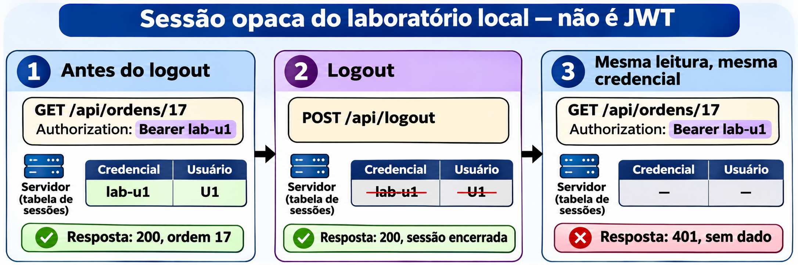

# A22 — Superfície e identidade: enumerar, autenticar, autorizar

Uma rota aparece no mapa da aplicação, mas isso ainda não diz quem pode usá-la. O roteiro da A21 propôs registrar hipóteses sem tratá-las como achados. Nesta aula, você vai seguir uma dessas hipóteses até uma decisão sustentada por requisição e resposta.

O exemplo completo usa uma **aplicação fictícia local de ordens de manutenção**. U1 possui a ordem 17; U2 possui a ordem 18. A pergunta final é: **o servidor entrega a ordem 17 quando U2 a pede?** Antes de responder, vamos identificar a superfície, obter uma credencial, entender sua verificação e testar se ela deixa de valer no logout. Nenhum resultado deste exemplo é resposta do Juice Shop.

O percurso reaproveita o método **hipótese → requisição → resposta → decisão**. Cada etapa acrescenta uma linha ao registro; uma resposta isolada não autoriza uma conclusão sobre toda a aplicação.

## Objetivos de aprendizagem

1. Identificar portas e caminhos dentro do escopo, calibrar respostas inexistentes antes de filtrar e explicar o limite de um resultado *filtered*.
2. Comparar respostas de login, distinguir sessão opaca de JWT, verificar assinatura em um programa local e testar o reuso da mesma credencial após logout.
3. Repetir uma requisição com duas identidades no ZAP Requester, interpretar código **e corpo** e registrar o alcance da conclusão numa matriz de autorização.

**Tempo:** 100 minutos. **Recursos:** ZAP da A21 com Requester, terminal com Python 3, `curl`, `nmap` e `ffuf`. As respostas fornecidas permitem analisar a mesma decisão se alguma ferramenta faltar.<br>
**Preparação:** contexto e limites do ZAP ([A21](A21-pentest-processo-referenciais-e-escopo.md)); sessão e autorização com Ana e Bruno ([A05](A05-quem-e-voce-e-pode-fazer-isto.md)); HMAC e assinaturas ([A15](A15-chaves-assinaturas-certificados.md), [A16](A16-tls-ciclo-de-chaves.md#hmac)).<br>
**Produto:** um registro R0–R5 com calibração, comparação de credenciais, contraprova de logout e matriz de autorização. O método será aplicado ao alvo autorizado no trabalho final.

## Percurso e registro

| Etapa | Pergunta | Evidência a guardar |
|---|---|---|
| R0 — Preparar | O alvo e os limites estão corretos? | URL, contexto, modo, taxa e ID inicial do *History* |
| R1 — Descobrir | O que responde e como o inexistente responde? | Estado da porta; código, tamanho e tipo; filtro e amostra descartada |
| R2 — Autenticar | O login distingue conta existente de inexistente? | Três respostas, com código, corpo e tamanho |
| R3 — Entender a credencial | Ler o JWT prova que ele é válido? | Payload original e alterado; duas decisões do verificador |
| R4 — Encerrar | A mesma credencial funciona depois do logout? | Três IDs e respostas: leitura, logout, releitura |
| R5 — Autorizar | U2 recebe a ordem de U1? | Matriz: identidade, ação, recurso, esperado, observado, IDs e conclusão |

Em cada R, escreva **executado** ou **resposta fornecida**. O servidor de ordens usa identificadores **opacos**; o JWT aparece em dois programas locais separados. Essa separação permite comparar mecanismos sem atribuir JWT à API fictícia.

## Preparar o laboratório desta aula

!!! abstract "Conceito — escopo, proxy e gateway"
    O **contexto** diz quais URLs o ZAP trata como alvo. O modo *Protected* limita ações de ataque do ZAP a esse contexto; o *Rate Limit* limita o tráfego que sai do ZAP. O `ffuf` usa seu próprio limite porque fala diretamente com o servidor.

    Nesta aula, `curl → ZAP → 127.0.0.1:3001` é um percurso local. No trabalho, o tráfego segue pelo túnel e pelo gateway VPN antes do alvo privado. **ZAP registra e reenvia HTTP; o gateway filtra tráfego de rede.** Um resultado `filtered` no trabalho não identifica, sozinho, qual equipamento bloqueou.

<div class="a22-figure-scroll" role="region" tabindex="0" aria-label="Imagem 39: percurso local e percurso do trabalho; role horizontalmente para ler" markdown="1">

{#figura-39 loading=lazy}

</div>

*Imagem 39 — Proxy ZAP e gateway VPN cumprem funções diferentes.* [Abrir a imagem ampliada](../assets/pentest/imagem39.png).

**Leia a figura:** “Resposta no ZAP” nomeia a aba de observação. A resposta HTTP retorna ao cliente pelo proxy; o quadro não representa um ponto final da rede. O gateway só aparece no percurso do trabalho.

### R0 — Iniciar, delimitar e obter o primeiro rastro

1. **Prepare os arquivos.** Clone o [repositório de práticas](https://github.com/rafaelrezo/seguranca-digital-praticas/tree/main/a22) uma vez. Se já o clonou e não tem alterações próprias, use `git pull --ff-only`; caso contrário, faça outro clone. Entre na pasta `a22`. Os arquivos também estão disponíveis aqui: [`servidor_ordens_a22.py`](../assets/pentest/servidor_ordens_a22.py), [`palavras_a22.txt`](../assets/pentest/palavras_a22.txt), [`ler_jwt.py`](../assets/pentest/ler_jwt.py) e [`servidor_jwt.py`](../assets/pentest/servidor_jwt.py).

    ```bash
    git clone https://github.com/rafaelrezo/seguranca-digital-praticas.git
    cd seguranca-digital-praticas/a22
    python3 servidor_ordens_a22.py
    ```

    **Resultado:** o terminal informa `Ordens A22 em http://127.0.0.1:3001`. Deixe-o aberto; `Ctrl+C` encerra. Esta prática não usa EC2 nem Docker.
2. **Confirme o servidor sem proxy.** Em outro terminal, execute `curl -i http://127.0.0.1:3001/`. Espere `HTTP/1.0 200 OK` e `"aplicacao": "Ordens A22"` no JSON. Se falhar, confira o terminal do servidor e a porta 3001. **Pare aqui** até obter essa linha de base.
3. **Crie um contexto separado no ZAP.** Confira a porta do proxy em *Tools → Options → Network → Local Servers/Proxies*; os comandos abaixo usam 8080. Envie uma vez `curl -i --noproxy '' -x http://127.0.0.1:8080 http://127.0.0.1:3001/` para fazer o alvo aparecer na árvore *Sites*. Se o filtro *Show only URLs in Scope* estiver ligado, desative-o temporariamente para ver a porta 3001. Clique com o botão direito em `http://127.0.0.1:3001` → *Include in Context* → *New Context*. Nomeie `a22-local`, marque *In Scope*, remova a expressão sugerida e adicione `^http://127\.0\.0\.1:3001(?:/.*)?$`. Confirme o ícone de alvo no nó. O contexto da A21 para a porta 3000 continua distinto.
4. **Confira os limites.** No seletor superior, escolha *Protected*. Em *Tools → Options → Network → Rate Limit*, confira a regra habilitada de 10 req/s para `127.0.0.1`. Se o proxy não usa 8080, ajuste os comandos seguintes.
5. **Produza um rastro no ZAP.** O argumento `-x` envia `curl` pelo proxy; `--noproxy ''` evita que a configuração local desvie a requisição de loopback:

    ```bash
    curl -i --noproxy '' -x http://127.0.0.1:8080 http://127.0.0.1:3001/
    ```

    No painel inferior, abra *History*, selecione o `GET /` e leia as abas *Request* e *Response*. Anote hora, URL e ID da mensagem, junto com contexto, modo e taxa. Se a requisição não aparecer, veja [Diagnóstico](#diagnostico). Se o ZAP estiver indisponível, use as respostas fornecidas nas etapas seguintes e marque “ID não gerado”. **Pare** se o contexto incluir URL fora de `127.0.0.1:3001`.

No trabalho final, substitua esses valores somente pelos do alvo e pelos limites do ROE distribuído no Classroom.

---

## Superfície: porta, caminho e resposta inexistente

Uma porta acessível ainda não identifica uma função da aplicação. Um caminho que responde 200 também pode ser uma rota inexistente. R1 combina **estado de rede**, **calibração HTTP** e **amostra manual** antes de decidir o que investigar.

!!! abstract "Conceito — o que o estado de uma porta permite dizer"
    `open` significa que um serviço aceitou a conexão; `closed` significa que o destino respondeu, mas não há serviço escutando nessa porta. `filtered` significa que o Nmap não conseguiu determinar se a porta está aberta ou fechada porque algum filtro impediu a observação. O estado descreve o **ponto de vista desta varredura**, não a causa exata.

    | Estado | Evidência | Próxima pergunta |
    |---|---|---|
    | `open` | Conexão aceita | Qual serviço e função estão no escopo? |
    | `closed` | Conexão recusada | O caminho chega ao destino? |
    | `filtered` | Sonda sem resposta útil ou rejeição por filtro | Gateway, grupo de segurança ou outro filtro? |

### R1a — Verificar só duas portas locais

1. **Estado inicial:** mantenha `servidor_ordens_a22.py` aberto e confirme a raiz com `curl`.
2. **Previsão:** anote qual porta deve estar `open` e qual deve estar `closed`. Nenhum equipamento de filtragem foi colocado entre seu terminal e o loopback.
3. **Ação:** execute apenas nas portas autorizadas do laboratório:

    ```bash
    nmap -Pn -sT -p 3001,3002 --max-rate 50 127.0.0.1
    ```

    `-Pn` dispensa descoberta do host, `-sT` usa conexão TCP, `-p` restringe as portas e `--max-rate 50` limita os pacotes enviados por segundo.
4. **Resultado e registro:** espere 3001 `open` e 3002 `closed` se a segunda porta estiver livre. Copie as duas linhas do Nmap para R1. Se 3001 estiver `closed`, volte ao servidor; se 3002 estiver `open`, outro processo a ocupa. **Não** chame esse ensaio local de teste de `filtered`.

Se `nmap` faltar, use o quadro **fornecido** “3001: serviço local ativo; 3002: sem serviço”. Ele permite discutir `open` e `closed`, mas não é uma varredura executada nem fornece um exemplo de `filtered`.

No trabalho, um `filtered` precisa ser comparado com o registro `TF_FWD_DROP` do gateway **na mesma janela de tempo** e com a configuração do grupo de segurança. Uma linha correspondente sustenta a atribuição ao gateway; a ausência dela, sozinha, não atribui o bloqueio ao grupo de segurança. Use só o alvo e as portas do ROE.

### Calibração: como é a resposta "inexistente"?

!!! abstract "Conceito — calibrar antes de filtrar"
    Uma aplicação de página única (*SPA*) pode devolver a página principal mesmo quando o caminho pedido não existe. Neste laboratório, o servidor faz algo parecido fora de `/api/`: devolve o **mesmo JSON da raiz** e código 200. Dentro de `/api/`, um caminho inexistente devolve 404. Portanto, **200 não prova existência** e a resposta inexistente de uma camada não serve como padrão da outra.

    `ffuf` substitui `FUZZ` por cada palavra da lista e mostra as respostas. `-fs N` esconde respostas com **N bytes de corpo**; `-fc 404` esconde respostas com código 404. O filtro reduz ruído, mas pode esconder uma rota válida que tenha o mesmo tamanho ou uma rota que só aceite outro método. Por isso você abre manualmente uma amostra descartada.

<div class="a22-figure-scroll" role="region" tabindex="0" aria-label="Imagem 40: comparação de respostas e fluxo de calibração; role horizontalmente para ler" markdown="1">

{#figura-40 loading=lazy}

</div>

*Imagem 40 — Calibrar a resposta inexistente antes de filtrar.* [Abrir a imagem ampliada](../assets/pentest/imagem40.png).

**Leia a figura:** a segunda coluna parece válida pelo código, mas devolve o mesmo conteúdo da raiz. A terceira coluna exige sua própria medida antes de filtrar caminhos da API.

### R1b — Medir três respostas antes da lista

1. **Estado inicial:** servidor local aberto; nenhuma varredura externa. `curl -w` imprime código, bytes do corpo e tipo depois de descartar o corpo com `-o /dev/null`.
2. **Previsão:** compare raiz, caminho inexistente fora da API e caminho inexistente dentro da API. Anote se espera respostas iguais ou diferentes.
3. **Ação:**

    ```bash
    curl -s -o /dev/null -w 'raiz: %{http_code} %{size_download} %{content_type}\n' http://127.0.0.1:3001/
    curl -s -o /dev/null -w 'fora: %{http_code} %{size_download} %{content_type}\n' http://127.0.0.1:3001/nao-existe-a22
    curl -s -o /dev/null -w 'api:  %{http_code} %{size_download} %{content_type}\n' http://127.0.0.1:3001/api/nao-existe-a22
    ```

4. **Resultado e registro:** raiz e `/nao-existe-a22` devem ter código 200 e o mesmo tamanho; `/api/nao-existe-a22` deve ter 404. Todos têm JSON. Copie os três valores de cada linha em R1. Abra `curl -i http://127.0.0.1:3001/nao-existe-a22` se quiser confirmar que o corpo coincide com a raiz. **Use o tamanho medido da resposta 404 da API no próximo passo; não copie um número de outra máquina.**

### R1c — Comparar a lista com e sem filtro

1. **Estado inicial:** abra `palavras_a22.txt` e confira as quatro palavras. Todas serão inseridas **somente** depois de `/api/` no servidor local. `ffuf` fala direto com o alvo; o Rate Limit do ZAP não controla esta chamada.
2. **Primeira passagem:** `-mc all` mostra inclusive respostas 404. `-rate 20` limita requisições por segundo e `-t 2` limita conexões simultâneas. `-of md -o` salva a saída Markdown.

    ```bash
    ffuf -u http://127.0.0.1:3001/api/FUZZ -w palavras_a22.txt -mc all -rate 20 -t 2 -of md -o ffuf-sem-filtro-a22.md
    ```

3. **Segunda passagem:** troque `N` pelo tamanho da linha `api` medida em R1b. Não digite a letra `N`. O arquivo de saída tem outro nome para preservar a primeira passagem.

    ```bash
    ffuf -u http://127.0.0.1:3001/api/FUZZ -w palavras_a22.txt -mc all -fs N -rate 20 -t 2 -of md -o ffuf-filtrado-a22.md
    ```

4. **Leia e contraponha:** sem filtro, `ordens` deve mostrar 401 e as três outras palavras, 404 em GET. Com `-fs N`, devem desaparecer respostas do mesmo tamanho da 404 calibrada. Abra uma delas manualmente, por exemplo `curl -i http://127.0.0.1:3001/api/login`. Esse GET devolve 404, embora o login **exista como POST**. Registre em R1 o filtro, o que ele descartou e o limite da conclusão. **Pare** se a URL deixar de ser `127.0.0.1:3001`.

Se `ffuf` faltar, use estas **respostas fornecidas**: `GET /api/ordens` → 401 sem credencial; `GET /api/login`, `GET /api/logout` e `GET /api/inexistente-a22` → 404. Marque R1 como **resposta fornecida**, sem afirmar que executou a lista.

!!! example "Observação anterior em Juice Shop 20.3.0 local (10 nov. 2026)"
    Na instância observada, a raiz e um caminho inexistente fora da API responderam `HTTP 200`, `9984` bytes, `text/html`. É um exemplo de por que medir antes de filtrar; não presuma esse tamanho no seu alvo. No trabalho, calibre novamente as rotas do cliente e a API antes de escolher `-fs` ou `-fc`.

| Opção do `ffuf` | Função |
|---|---|
| `-rate 20` | Teto de 20 requisições por segundo (ROE) |
| `-mc all` | Mostra também os códigos que o padrão da ferramenta esconderia |
| `-fs N` / `-fc N` | Esconde respostas com tamanho / código N |
| `-of md -o arquivo` | Salva o resultado para evidência |

### R1d — Abrir a rota que exige identidade

A lista revelou `GET /api/ordens` como uma resposta diferente. Confirme uma vez pelo ZAP:

```bash
curl -i --noproxy '' -x http://127.0.0.1:8080 http://127.0.0.1:3001/api/ordens
```

Espere **401** e o corpo `credencial ausente ou inválida`. Anote o ID no *History*. Essa resposta mostra que a rota existe e pede uma credencial; **não** mostra se o controle de acesso por dono funciona. R2 investigará o login e R5, a autorização.

No trabalho, calibre novamente as rotas do cliente e da API antes de escolher filtro. Use os limites do ROE e consulte [Reconhecimento e enumeração](../pentest/coleta.md#descoberta-de-conteudo-calibrar-antes-de-filtrar).

!!! question "Checkpoint 1"
    Você roda `ffuf` com `-fc 404` numa SPA que devolve 200 para todos os caminhos inexistentes. O que aparece no resultado, e por que essa lista não serve como inventário? Que contraprova de R1 evita descartar um caminho POST quando o GET deu 404?

---

## Identidade: login, credencial e logout

A rota `GET /api/ordens` respondeu 401 sem credencial. Agora investigue **como a identidade é apresentada** e **se uma credencial antiga deixa de valer**. A autorização sobre a ordem fica para R5.

!!! abstract "Conceitos — autenticação, sessão e autorização"
    **Autenticação** confere a credencial no login. **Sessão** permite reconhecer a identidade nas requisições seguintes. **Autorização** decide se essa identidade pode realizar **esta ação** sobre **este recurso**. Uma rota que só verifica se há credencial válida ainda não verificou o dono do objeto.

    | Decisão | Pergunta | Evidência desta aula |
    |---|---|---|
    | Autenticação | Quem apresentou uma credencial aceita? | Três respostas de login (R2) |
    | Sessão | A credencial continua válida? | JWT local (R3) e reuso após logout (R4) |
    | Autorização | Pode acessar esta ordem ou função? | Mesmo GET com U1 e U2 (R5) |

### R2 — Comparar três respostas de login

!!! abstract "Conceito — erro de login e enumeração de contas"
    Se a resposta para **conta existente com senha errada** difere da resposta para **conta inexistente**, alguém pode descobrir quais identidades possuem cadastro. Compare código, corpo, tamanho e, quando pertinente, tempo. Uma amostra curta mostra apenas o comportamento das tentativas feitas; não prova ausência de enumeração por outras rotas ou condições.

1. **Estado inicial:** servidor local e ZAP ativos; contexto `a22-local`, *Protected* e limite de 10 req/s conferidos. No *History*, saiba onde localizar o ID, *Request* e *Response*.
2. **Previsão:** anote o resultado esperado para U1 com senha correta, U2 com senha errada e conta inexistente com senha errada. `-H` declara JSON; `-d` envia o corpo e faz o `curl` usar POST. `-x` envia pelo ZAP.
3. **Ação:** execute uma linha por vez. Volte ao *History* após cada uma e anote o ID antes da próxima.

    ```bash
    curl -i --noproxy '' -x http://127.0.0.1:8080 -H 'Content-Type: application/json' -d '{"email":"u1@lab.invalid","senha":"senha-u1"}' http://127.0.0.1:3001/api/login
    curl -i --noproxy '' -x http://127.0.0.1:8080 -H 'Content-Type: application/json' -d '{"email":"u2@lab.invalid","senha":"senha-errada"}' http://127.0.0.1:3001/api/login
    curl -i --noproxy '' -x http://127.0.0.1:8080 -H 'Content-Type: application/json' -d '{"email":"ninguem@lab.invalid","senha":"senha-errada"}' http://127.0.0.1:3001/api/login
    ```

4. **Leia e registre R2:** U1 deve receber 200 e `lab-u1`. As outras duas tentativas devem receber 401 com `credenciais inválidas`. Compare também `Content-Length` e o corpo, sem copiar senhas para o registro. A igualdade **dessas duas respostas** não comprova tratamento uniforme em outro sistema. **Pare** se a URL, o método ou o contexto não corresponderem ao laboratório.

O programa local usa `lab-u1` e `lab-u2` como **identificadores fixos de demonstração** e já os mantém associados às contas ao iniciar; o login confirma ou restabelece a associação. Essa escolha permite repetir o teste, mas não demonstra geração imprevisível de sessão.

!!! info "Alternativa R2 — respostas fornecidas"
    U1 com senha correta → 200, `{"token":"lab-u1","tipo":"opaco; não é JWT"}`. U2 com senha errada → 401, `{"erro":"credenciais inválidas"}`. Conta inexistente com senha errada → a **mesma** resposta 401. Registre a comparação como resposta fornecida e deixe os IDs em branco.

### R3 — Ler um JWT e pedir ao verificador para decidir

!!! abstract "Conceito — identificador opaco e JWT assinado"
    | Mecanismo | O que o cliente apresenta | O que o servidor confere | Como o logout pode invalidar |
    |---|---|---|---|
    | Identificador opaco da API local | `lab-u1`, sem dados de identidade legíveis nele | Associação numa tabela do servidor | Remover a associação |
    | JWT assinado do programa separado | Cabeçalho, *payload* com *claims* e assinatura | Algoritmo permitido, assinatura, validade e demais condições exigidas pela aplicação | Revogação no servidor; prazo curto apenas limita a janela de reuso |

    No JWT **assinado** deste exercício, cabeçalho e *payload* são Base64URL: qualquer pessoa pode **decodificar** seus dados. A assinatura HMAC-SHA256 (HS256) cobre `cabeçalho.payload`. Alterar o papel sem produzir uma assinatura nova deixa o conteúdo legível, mas torna a assinatura inválida. `sub` identifica o sujeito; `iat` indica emissão; `exp`, expiração. O verificador precisa usar o algoritmo que espera, sem confiar apenas no `alg` informado pelo token.

    Os dois programas locais simulam emissor e verificador. A chave aparece no **código didático distribuído**; num serviço real, ficaria privada no servidor. `servidor_jwt.py` confere HS256, assinatura e `exp`, mas **não** implementa validação completa de emissor, destinatário, contexto ou revogação. Consulte a [RFC 8725](https://www.rfc-editor.org/rfc/rfc8725) antes de tomar esse exemplo como projeto de produção.

<div class="a22-figure-scroll" role="region" tabindex="0" aria-label="Imagem 41: leitura e verificação de JWT; role horizontalmente para ler" markdown="1">

{#figura-41 loading=lazy}

</div>

*Imagem 41 — Decodificar mostra dados; verificar decide sobre o token.* [Abrir a imagem ampliada](../assets/pentest/imagem41.png).

**Leia a figura:** HMAC usa `cabeçalho.payload` **e a chave** para produzir a assinatura. O leitor não usa essa chave; o verificador local a usa e também confere `exp`. Esse programa demonstra esses controles, não a validação completa exigida num serviço real.

1. **Estado inicial:** na pasta `a22`, confira que `ler_jwt.py` e `servidor_jwt.py` estão presentes. Eles não se comunicam com a API de ordens nem enviam requisições à rede.
2. **Emita e leia:** o primeiro comando cria um arquivo com o token; o segundo mostra cabeçalho, *claims* e tamanho da assinatura, **sem verificá-la**.

    ```bash
    python3 servidor_jwt.py emitir u1@lab.invalid cliente > meu.jwt
    python3 ler_jwt.py meu.jwt
    ```

3. **Altere e leia:** o primeiro comando troca `papel` para `admin` no *payload*, mas conserva a assinatura original. O leitor mostrará `admin` porque só decodifica.

    ```bash
    python3 servidor_jwt.py adulterar meu.jwt admin > adulterado.jwt
    python3 ler_jwt.py adulterado.jwt
    ```

4. **Verifique os dois:** o verificador deve aceitar o original com `papel=cliente` e recusar o alterado com `assinatura não confere`.

    ```bash
    python3 servidor_jwt.py verificar meu.jwt
    python3 servidor_jwt.py verificar adulterado.jwt
    ```

5. **Registre R3:** anote `alg`, `sub`, `iat`, `exp`, papel visível nos dois arquivos e as duas decisões. O horário varia a cada execução; `ler_jwt.py` também o mostra em UTC. Não inclua o token completo no relatório. Se aparecer “esperava 3 partes”, deixe no arquivo somente o token, sem `Bearer` ou aspas.

**No trabalho:** analise apenas a credencial da sua conta de teste. Confirme no *History* se ela é JWT antes de usar o leitor. O formato, a verificação e a expiração do alvo precisam ser observados; os resultados locais não os antecipam.

!!! info "Alternativa R3 — comparação fornecida"
    Token original: `alg=HS256`; `sub=u1@lab.invalid`; `papel=cliente`; `exp=iat+3600`; verificador: `ACEITO`. Token com o mesmo cabeçalho e assinatura, mas `papel=admin` no *payload*: o leitor mostra `admin` e o verificador responde `RECUSADO: assinatura não confere`. Os tempos são simbólicos: não registre uma hora de execução que você não observou.

### R4 — Repetir a mesma leitura depois do logout

!!! abstract "Conceito — o que prova o encerramento da sessão"
    Uma mensagem “logout concluído” não demonstra que a credencial antiga perdeu validade. A contraprova é repetir a **mesma requisição autenticada com a mesma credencial** após o logout e comparar código **e corpo**. Na API local, o servidor remove a associação do identificador opaco. Um JWT autocontido, se aceito apenas por assinatura e `exp`, pode continuar utilizável até expirar; seu encerramento efetivo requer um mecanismo adicional.

<div class="a22-figure-scroll a22-figure-wide" role="region" tabindex="0" aria-label="Imagem 42: três quadros do logout; role horizontalmente para ler" markdown="1">

{#figura-42 loading=lazy}

</div>

*Imagem 42 — Logout: repetir a mesma leitura com a mesma credencial.* [Abrir a imagem ampliada](../assets/pentest/imagem42.png).

**Leia a figura:** o POST de logout também leva `Bearer lab-u1`. O que muda é a tabela do servidor; o GET e a credencial dos quadros 1 e 3 continuam iguais. A recusa no quadro 3 é a contraprova.

1. **Estado inicial:** U1 recebeu `lab-u1` em R2. Se você já executou logout nesta instância, repita o login correto antes de continuar.
2. **Linha de base:** envie `GET /api/ordens/17` com `Bearer lab-u1`. Espere 200 e o JSON da ordem 17. Anote o ID no *History*. Se receber 401, **pare** e restabeleça a linha de base.
3. **Logout:** envie `POST /api/logout` com a **mesma** credencial. Espere 200 e `sessão encerrada no servidor`. Anote o segundo ID.
4. **Contraprova:** repita **sem alterar método, URL ou credencial** o GET do passo 2. Espere 401 **sem o dado da ordem**. Anote o terceiro ID.

    ```bash
    curl -i --noproxy '' -x http://127.0.0.1:8080 -H 'Authorization: Bearer lab-u1' http://127.0.0.1:3001/api/ordens/17
    curl -i --noproxy '' -x http://127.0.0.1:8080 -X POST -H 'Authorization: Bearer lab-u1' http://127.0.0.1:3001/api/logout
    curl -i --noproxy '' -x http://127.0.0.1:8080 -H 'Authorization: Bearer lab-u1' http://127.0.0.1:3001/api/ordens/17
    ```

5. **Registre R4:** escreva `200 com ordem → 200 com confirmação → 401 sem ordem`, com os IDs. Se o terceiro GET continuar trazendo a ordem, o logout não invalidou essa credencial no servidor **nessa ação**. Refaça o login de U1 antes de R5.

!!! info "Alternativa R4 — respostas fornecidas"
    `GET /api/ordens/17` com `lab-u1` → 200 com ordem 17 de U1; `POST /api/logout` com `lab-u1` → 200 com `sessão encerrada no servidor`; o **mesmo GET com o mesmo token** → 401 com `credencial ausente ou inválida`, sem ordem. Marque “IDs não gerados” e fonte “respostas fornecidas”.

No trabalho, reenvie pelo Requester uma requisição autenticada capturada antes do logout e compare a resposta depois. Para enumeração de contas, faça só as tentativas pontuais permitidas no ROE. Mascare credenciais e tokens nas capturas. Método e limites: [Autenticação e sessão](../pentest/autenticacao-sessao.md).

!!! question "Checkpoint 2"
    Um JWT tem `exp` duas horas depois de `iat`. Após o logout, a mesma requisição com o token antigo continua retornando dados. Qual intervalo de reuso o teste sugere, que outra condição poderia encerrá-lo antes, e quais IDs/respostas entram no diário?

---

## Autorização: a identidade pode ler esta ordem?

O login de U1 e U2 funcionou, e R4 mostrou que uma sessão opaca pode ser encerrada no servidor. Agora mantenha **a mesma ação e o mesmo recurso** e troque apenas a identidade. A diferença entre as respostas testa a regra de propriedade da ordem 17.

!!! abstract "Conceito — decisão por requisição"
    Para cada pedido, o servidor precisa verificar `identidade → ação → recurso → permitido?`. **Autorização horizontal** compara contas do mesmo perfil: U2 não deve ler a ordem de U1. **Autorização vertical** pergunta se um perfil comum pode executar uma função reservada, como fechar uma ordem. A interface pode esconder um botão; o servidor precisa decidir mesmo quando a requisição é enviada diretamente.

    | Nível | Pergunta | Referência |
    |---|---|---|
    | Objeto | Esta ordem pertence a quem pede? | OWASP API1:2023; CWE-639 |
    | Propriedade | Este campo pode ser visto ou definido por quem pede? | OWASP API3:2023; CWE-213/CWE-915 |
    | Função | Este perfil pode executar esta operação? | OWASP API5:2023; CWE-862 |

    A [A05](A05-quem-e-voce-e-pode-fazer-isto.md#caso-4-bruno-pede-a-cesta-de-ana) usou a cesta de Ana e Bruno para formular a regra. Nesta prática, o mesmo método usa **ordens fictícias**; os resultados não representam o Juice Shop.

### R5a — Criar duas linhas de base válidas

1. **Estado inicial:** após R4, refaça o login correto de U1 pelo primeiro POST de R2. Confira 200 e `lab-u1` no *History*. Se o servidor foi reiniciado, repita também esse login.
2. **Login de U2:** use o mesmo POST com a senha correta; o corpo deve trazer `lab-u2`. Confirme 200 e anote o ID.

    ```bash
    curl -i --noproxy '' -x http://127.0.0.1:8080 -H 'Content-Type: application/json' -d '{"email":"u2@lab.invalid","senha":"senha-u2"}' http://127.0.0.1:3001/api/login
    ```

3. **Ação:** envie as leituras próprias pelo proxy, uma por vez:

    ```bash
    curl -i --noproxy '' -x http://127.0.0.1:8080 -H 'Authorization: Bearer lab-u1' http://127.0.0.1:3001/api/ordens/17
    curl -i --noproxy '' -x http://127.0.0.1:8080 -H 'Authorization: Bearer lab-u2' http://127.0.0.1:3001/api/ordens/18
    ```

4. **Resultado e registro:** U1 deve receber 200 com `id: 17` e `dono: u1@lab.invalid`; U2, 200 com `id: 18` e `dono: u2@lab.invalid`. Anote os dois IDs do *History*. Se alguma linha receber 401, **pare**: a credencial não está válida e a comparação seguinte não testaria autorização.

### R5b — Trocar somente a identidade no Requester

1. No *History*, selecione a linha **U1 → GET /api/ordens/17** de R5a. Na aba *Response*, confira outra vez `id` e `dono`. Essa é a linha de base de um objeto existente.
2. Clique com o botão direito na linha → **Open in Requester Tab…**. O Requester abre uma cópia editável. Na requisição, localize `Authorization: Bearer lab-u1`; mantenha método, caminho e outros campos.
3. Troque **apenas** `lab-u1` por `lab-u2` e clique em **Send**. A resposta aparece no Requester e a nova mensagem entra no *History*. Anote o ID.
4. Compare o **código** e o **corpo** com a linha de base de U1 e com a linha própria de U2. Neste programa, o GET de U2 para a ordem 17 retorna **200 com `dono: u1@lab.invalid`**. U2 recebeu um objeto de U1: falha horizontal **nessa leitura**. O 200, isolado, não estabeleceria isso.

<div class="a22-figure-scroll" role="region" tabindex="0" aria-label="Imagem 43: troca de identidade no Requester; role horizontalmente para ler" markdown="1">

{#figura-43 loading=lazy}

</div>

*Imagem 43 — Requester: a troca de identidade e o corpo decisivo.* [Abrir a imagem ampliada](../assets/pentest/imagem43.png).

**Leia a figura:** é um **esquema**, não uma captura do ZAP. Ele seleciona `id` e `dono` do JSON; o corpo real do programa também traz `descricao`. A conclusão vale apenas para o GET mostrado.

### R5c — Conferir uma função separada

A regra da aplicação fictícia reserva o fechamento de ordens a um supervisor. U1 e U2 são clientes. Este teste usa outro método e outra rota; portanto, é **outra linha da matriz**, não parte da troca única de R5b.

1. Abra no Requester uma requisição autenticada de U1. Altere a linha da requisição para `POST /api/ordens/17/fechar`, mantenha `Authorization: Bearer lab-u1` e não envie corpo. Confira que a URL continua no contexto local antes de clicar em **Send**.
2. Espere **403** com `somente supervisor pode fechar` e **sem o objeto da ordem**. Anote o ID. A recusa sustenta que essa função foi bloqueada para U1; **não** demonstra que todas as funções do sistema estão protegidas.
3. **Pare** se houver alteração inesperada de estado. O programa local não modifica a ordem nesse endpoint.

!!! info "Alternativa de análise — respostas fornecidas"
    Se o ZAP não abrir, use: U1 → `GET /api/ordens/17` → 200 com `id:17, dono:u1@lab.invalid`; U2 → `GET /api/ordens/18` → 200 com `id:18, dono:u2@lab.invalid`; U2 → `GET /api/ordens/17` → 200 com `id:17, dono:u1@lab.invalid`; U1 → `POST /api/ordens/17/fechar` → 403 com `somente supervisor pode fechar`, sem dado da ordem. Marque **respostas fornecidas** e “ID não gerado”; não registre como execução no ZAP.

### R5d — Ler o resultado e preencher a matriz

!!! abstract "Conceito — código e corpo têm papéis diferentes"
    Um 200 pode trazer o objeto de outra pessoa, o próprio objeto ou um corpo vazio. Um 403 pode vir acompanhado indevidamente do dado protegido. Para julgar autorização, confirme **credencial válida**, **objeto existente**, **regra de propriedade** e **corpo entregue**.

    | Observado | Conclusão permitida |
    |---|---|
    | U2 recebe 200 com a ordem de U1 | Falha horizontal nesta ação |
    | U2 recebe 200 só com sua ordem ou corpo vazio | Controle provável; confirme a regra e outro objeto |
    | U2 recebe 403/404 sem dado, após linhas de base válidas | A leitura indevida foi negada neste teste |
    | U2 recebe 403 com a ordem de U1 no corpo | O código nega, mas o dado vazou: falha |
    | Resposta 401 ou 500 | Corrija sessão ou investigue o erro; não conclua autorização |

| Identidade | Ação e recurso | Esperado pela regra | Observado | ID do *History* | Conclusão |
|---|---|---|---|---|---|
| U1 | `GET /api/ordens/17` | 200, sua ordem | 200, ordem 17 de U1 | anote o seu | Linha de base |
| U2 | `GET /api/ordens/18` | 200, sua ordem | 200, ordem 18 de U2 | anote o seu | Linha de base |
| U2 | `GET /api/ordens/17` | Negado, sem dado de U1 | 200, ordem 17 de U1 | anote o seu | **Falha horizontal na leitura** |
| U1 | `POST /api/ordens/17/fechar` | 403, sem ordem | 403, sem ordem | anote o seu | Função negada neste teste |

Complete R5 com seus IDs e com uma frase sobre **qual ação falhou**. O programa não implementa escrita de ordens, então alteração de dono e atribuição em massa ficam **não testadas**.

### Propriedade: o JSON traz dado além da tela?

No exemplo local, `dono` aparece no JSON da resposta, mas não há tela HTML equivalente. Portanto, a prática **não prova excesso de dados em relação à interface**. No alvo do trabalho, compare os campos que a tela usa com o JSON da **mesma requisição** no *History*. Um campo extra pode ser necessário ao cliente; avalie a regra de acesso antes de chamá-lo de exposição.

Se o cliente envia `dono` ou `papel` e o servidor aceita uma alteração não permitida, há hipótese de **atribuição em massa** (CWE-915). Isso exige teste próprio e autorização para escrita; não foi executado no programa local. O [guia de controle de acesso e APIs](../pentest/controle-acesso-apis.md) detalha o método.

**No trabalho:** escolha um objeto da sua conta e um da segunda conta autorizada. Obtenha linhas de base válidas, copie do *History* o formato real de credencial e altere **um elemento por vez** no Requester. Não copie os caminhos ou tokens desta aplicação para o Juice Shop. Testes de escrita exigem dados próprios e recuperação prevista no ROE.

!!! question "Checkpoint 3"
    Com a credencial válida de U2, você pede um objeto existente de U1 e recebe 403 **com o JSON completo desse objeto no corpo**. Que conclusão cabe na matriz? O que o código, sozinho, teria sugerido?

---

## Atividade {#atividade}

A atividade única do bloco é o **trabalho final**, com enunciado, pacote, prazos e entrega na atividade do Google Classroom. Esta aula prepara as seções do roteiro:

- **P2:** varredura de portas restrita ao alvo, com decisão sobre *filtered*; calibração registrada antes do `ffuf`; amostra manual do descartado.
- **P3:** comparação de login, erro e logout; análise do token da sua conta; teste de reuso depois do logout; enumeração.
- **P4 e P6:** duas contas, testes horizontal e vertical, matriz preenchida; comparação entre resposta da API e tela.
- **Achado de identidade:** escolha a hipótese mais forte de P3, P4 ou P6 para aprofundar.

## Diagnóstico

| Dificuldade | Como prosseguir |
|---|---|
| Porta 3001 ocupada ou servidor não inicia | Encerre outro processo local na porta; confira se `python3 servidor_ordens_a22.py` ficou aberto antes do `curl` |
| `curl -x` funciona, mas não há linha no *History* | Use `--noproxy ''` como nos comandos; confirme a porta do proxy em *Network → Local Servers/Proxies* e o filtro *Show only URLs in Scope* |
| `nmap` mostra `filtered` | No loopback, confira se o alvo é mesmo `127.0.0.1`; no trabalho, confira túnel, rota e registros do gateway antes de atribuir causa |
| `ffuf` lista resultados demais no trabalho | Refaça a calibração da mesma camada e confira uma amostra descartada antes de escolher `-fs` ou `-fc` |
| `ler_jwt.py` diz "esperava 3 partes" | O arquivo pode conter `Bearer`, aspas ou texto adicional; deixe só o token em uma linha |
| O Requester devolve 401 com a credencial de U2 | No laboratório, refaça login de U2; no trabalho, copie do *History* o formato exato do cabeçalho ou cookie |
| Mesma resposta para U1 e U2 | Leia o corpo: pode ser o dado de cada um (controle funcionando) ou o mesmo dado (falha) |

## Revisão rápida

1. Por que uma porta *filtered* não diz, sozinha, onde está o bloqueio?
2. Que evidência mostra que um logout encerrou a sessão no servidor?
3. Por que ler o corpo é obrigatório para concluir sobre autorização?

**Continuidade:** guarde na matriz R5 o **ID, método, caminho, campo alterado e corpo da resposta**. A A23 reabre esses elementos no Requester e muda a pergunta de “quem pode enviar?” para “quem interpreta a entrada enviada?”.

## Fontes de referência

- [OWASP WSTG 4.2](https://owasp.org/www-project-web-security-testing-guide/v42/): Information Gathering, Identity Management, Authentication, Authorization e Session Management.
- [OWASP API Security Top 10 2023](https://owasp.org/API-Security/editions/2023/en/0x11-t10/): API1, API3, API5.
- [RFC 7519 — JSON Web Token](https://www.rfc-editor.org/rfc/rfc7519) e [RFC 8725 — JWT BCP](https://www.rfc-editor.org/rfc/rfc8725).
- [Nmap — Port Scanning Basics](https://nmap.org/book/man-port-scanning-basics.html) e [ffuf](https://github.com/ffuf/ffuf).
- [OWASP Cheat Sheet — Authorization](https://cheatsheetseries.owasp.org/cheatsheets/Authorization_Cheat_Sheet.html) e [Session Management](https://cheatsheetseries.owasp.org/cheatsheets/Session_Management_Cheat_Sheet.html).

Versões e endereços conferidos em **10 nov. 2026**. Calibração observada em instância local do Juice Shop 20.3.0.
