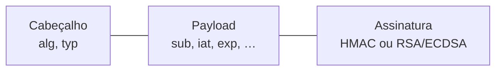

# A22 — Superfície e identidade: enumerar, autenticar, autorizar

Na A21, o mapa da aplicação gerou hipóteses. Várias delas envolvem a mesma pergunta: **quem é você para o servidor, e o que ele deixa você fazer?** Para respondê-la com evidência, primeiro é preciso saber o que existe (enumeração calibrada). Depois, entender como a identidade é provada e mantida (autenticação e sessão). Por fim, verificar se cada requisição é autorizada no servidor, e não só escondida na interface.

Esta aula prepara o **achado de identidade** exigido no trabalho: autenticação, sessão ou autorização (fases P3, P4 ou P6).

## Objetivos de aprendizagem

1. Enumerar portas e conteúdo do alvo dentro do ROE, interpretando estados *filtered* e calibrando a resposta "inexistente" de uma SPA antes de filtrar.
2. Analisar um JWT (algoritmo, *claims*, expiração), distinguir decodificar de validar e testar se logout e mensagens de erro protegem a sessão e as contas.
3. Testar autorização horizontal e vertical com duas contas fora da interface, lendo código **e corpo**, e registrar o resultado em uma matriz.

**Tempo:** 100 minutos. **Recursos:** navegador; terminal com Python 3 para a prática de JWT; ZAP e Juice Shop local na demonstração do professor.<br>
**Preparação:** contexto e limites do ZAP ([A21](A21-pentest-processo-referenciais-e-escopo.md)); sessão e autorização com Ana e Bruno ([A05](A05-quem-e-voce-e-pode-fazer-isto.md)); HMAC e assinaturas ([A15](A15-chaves-assinaturas-certificados.md), [A16](A16-tls-ciclo-de-chaves.md#hmac)).<br>
**Produto:** calibração, análise de token e uma matriz de autorização preenchida, que você reproduz no seu alvo do trabalho.

---

## Enumeração controlada: o que existe, sem varrer além do escopo

!!! abstract "Síntese"
    - `nmap` só em `10.77.2.10`, com portas e taxa limitadas. Uma porta *filtered* exige decidir **quem** bloqueou.
    - Numa SPA, caminhos inexistentes podem responder **200** com a página principal. **Calibre** antes de filtrar.
    - Leia cabeçalhos, métodos e mensagens de erro de forma pontual, nas respostas que você já tem.

### Portas: estado e responsável pelo bloqueio

| Estado | O que o `nmap` observou | O que você decide |
|---|---|---|
| `open` | Serviço aceitou a conexão | Qual serviço e se está no escopo |
| `closed` | O host recusou (RST) | Nada escuta; o caminho até o host existe |
| `filtered` | Sem resposta | **Gateway** (linha `TF_FWD_DROP`) ou **SG do alvo**? |

```bash
sudo nmap -Pn -sT -p 22,3000 -sV 10.77.2.10 -oN evidencias/02_enum/nmap_escopo.txt
# no gateway, em seguida:
sudo journalctl -k --since -5min | grep TF_FWD_DROP | tail
```

**Explicação.** `-Pn` trata o host como ativo sem testar antes; `-sT` faz conexão TCP completa; `-sV` tenta identificar o serviço. Se `TF_FWD_DROP` registra a porta testada, o descarte ocorreu no gateway: o SG do alvo nem foi consultado.

### Calibração: como é a resposta "inexistente"?

!!! example "Observação em Juice Shop 20.3.0 local (10 nov. 2026)"
    ```text
    raiz:        HTTP 200, 9984 bytes, text/html
    inexistente: HTTP 200, 9984 bytes, text/html
    ```

    Para rotas do cliente, "não existe" tem **o mesmo código e o mesmo tamanho** da página inicial. Um filtro por código esconderia tudo ou mostraria tudo; o filtro útil é por tamanho.

**Demonstração.** O professor executa o roteiro 14.5 no alvo local: `curl -w` com um caminho aleatório, primeiro fora e depois dentro do prefixo da API.

**Sua vez, no trabalho:** calibre **separadamente** a API. Ela pode responder de modo diferente das rotas do cliente. Depois rode o `ffuf` com `-rate 20` e o filtro adequado, e examine à mão uma amostra do que foi descartado.

| Opção do `ffuf` | Função |
|---|---|
| `-rate 20` | Teto de 20 requisições por segundo (ROE) |
| `-fs N` / `-fc N` | Esconde respostas com tamanho / código N |
| `-of md -o arquivo` | Salva o resultado para evidência |

Detalhes: [Reconhecimento e enumeração](../pentest/coleta.md#descoberta-de-conteudo-calibrar-antes-de-filtrar).

!!! question "Checkpoint 1"
    Você roda `ffuf` com `-fc 404` numa SPA que responde 200 para tudo. O que aparece no resultado, e por que essa lista não serve como inventário?

---

## Autenticação e sessão: três decisões diferentes

!!! abstract "Síntese"
    - **Autenticação** prova quem você é; **sessão** carrega essa prova; **autorização** decide, a cada requisição, o que você pode fazer.
    - Uma rota que só confere "há token válido" autenticou, mas **não autorizou**.
    - Com token autocontido (JWT), o servidor aceita sem consultar estado; isso torna o **logout** difícil de efetivar.

| Decisão | Pergunta | Falha típica | CWE |
|---|---|---|---|
| Autenticação | Você é quem diz? | Credencial inválida aceita | CWE-287 |
| Sessão | Esta requisição vem de quem se autenticou? | Sessão que não expira ou não termina | CWE-613 |
| Autorização | Pode **esta** ação **neste** recurso? | Objeto de outro usuário entregue | CWE-639, 862, 863 |

### JWT: legível por todos, verificável só pelo servidor



| Parte | Quem lê | Quem produz |
|---|---|---|
| Cabeçalho e payload (Base64URL) | **Qualquer um** | Qualquer um |
| Assinatura | Qualquer um | **Só quem tem a chave** |

`HS256` usa HMAC com segredo compartilhado (o mesmo da [A16](A16-tls-ciclo-de-chaves.md#hmac)). `RS256` usa assinatura com chave privada, verificada com a pública ([A15](A15-chaves-assinaturas-certificados.md)). `none` significa sem assinatura e nunca deve ser aceito.

### Prática: decodificar não é validar

Baixe [`ler_jwt.py`](../assets/pentest/ler_jwt.py) e [`servidor_jwt.py`](../assets/pentest/servidor_jwt.py) para uma pasta. O segundo faz o papel do servidor, com uma chave fictícia que só ele conhece. No terminal, nessa pasta:

```bash
python3 servidor_jwt.py emitir u1@lab.invalid cliente > meu.jwt
python3 ler_jwt.py meu.jwt
python3 servidor_jwt.py adulterar meu.jwt admin > adulterado.jwt
python3 ler_jwt.py adulterado.jwt
python3 servidor_jwt.py verificar meu.jwt
python3 servidor_jwt.py verificar adulterado.jwt
```

**Resultado esperado:**

- `ler_jwt.py` mostra o payload dos **dois** tokens, inclusive `"papel": "admin"` no adulterado, sem reclamar.
- O servidor responde `ACEITO: sub=u1@lab.invalid papel=cliente` para o original e `RECUSADO: assinatura não confere` para o adulterado.

**Interpretação.** O leitor só decodifica; quem tem a chave percebe a alteração. No trabalho, as perguntas são: **qual algoritmo** o token declara, **que dados** ele expõe, **quando expira** e **o servidor recusa um token alterado?**

**Registrar:** no trabalho, use `ler_jwt.py` (ou o roteiro 14.7) com o token da **sua** conta de teste. Guarde o token em arquivo, não no histórico do terminal, e mascare-o no relatório.

!!! warning "Erro comum"
    Dizer que o token "está criptografado". Base64URL é codificação, reversível sem chave.

### Demonstração: logout e mensagens de erro

**Logout.** O professor faz login, anota uma requisição autenticada (ID no *History*), faz logout e reenvia a mesma requisição no Requester com a credencial antiga.

| Resposta depois do logout | Interpretação |
|---|---|
| Igual à linha de base | O servidor continua aceitando a credencial; o logout foi só no navegador |
| 401 sem dados | A credencial foi invalidada no servidor |

**Enumeração de usuários.** O professor salva as respostas de "senha errada para conta existente" e "conta inexistente" e as compara (roteiro 14.6, `diff`): código, corpo, tamanho, tempo. Qualquer diferença consistente revela quem tem conta (CWE-204, `WSTG-IDNT-04`).

!!! question "Checkpoint 2"
    O token da sua conta tem `exp` duas horas depois de `iat`. Depois do logout, o servidor ainda aceita o token. Qual o intervalo de risco, e que evidência você coloca no diário?

Atributos de cookie, local de armazenamento e tabela WSTG/CWE: [Autenticação e sessão](../pentest/autenticacao-sessao.md).

---

## Controle de acesso: objeto, propriedade e função

!!! abstract "Síntese"
    - Autorização é decidida **no servidor**, a cada requisição: `identidade → ação → recurso → permitido?`.
    - **Horizontal:** recurso de outro usuário do mesmo nível. **Vertical:** função de outro perfil.
    - Em APIs, a falha pode estar no **objeto** (API1), na **propriedade** (API3) ou na **função** (API5).
    - O teste é feito **fora da interface**, e a conclusão lê o **corpo**, não só o código.

Na [A05](A05-quem-e-voce-e-pode-fazer-isto.md#caso-4-bruno-pede-a-cesta-de-ana), Bruno pediu a cesta de Ana. Agora o mesmo raciocínio vira método: duas contas, uma matriz e todos os níveis.

| Nível | Pergunta | API Top 10 2023 | CWE |
|---|---|---|---|
| Objeto | Este objeto pertence a quem pede? | API1 | CWE-639 |
| Propriedade | Este campo pode ser lido ou alterado por quem pede? | API3 | CWE-213, CWE-915 |
| Função | Este perfil pode usar esta operação? | API5 | CWE-285, CWE-862 |

### Demonstração: duas contas no Requester

1. **Estado inicial:** contas U1 e U2 criadas no alvo local; cada uma acessou um recurso próprio pela interface (IDs anotados).
2. **Escolher** uma requisição de U1 que traga um objeto de U1.
3. **Trocar a credencial:** *Open/Resend with Request Editor*; substituir a credencial pela de U2; enviar.
4. **Comparar** com a linha de base: código, tamanho, **corpo**.
5. **Registrar** na matriz, inclusive se o controle funcionar.
6. **Parar** antes de qualquer alteração ou exclusão de dados de outra conta.

O mesmo teste por terminal está no roteiro (14.8): uma resposta com o token de U1, outra com o de U2, e `diff` entre as duas.

### Como ler a resposta

| Observado | Interpretação |
|---|---|
| 200 com o dado do outro usuário | Falha confirmada para esta ação |
| 200 com o **seu** dado ou vazio | O servidor filtrou pelo dono; controle provável |
| 403 ou 404 **sem** dado | Controle funcionando |
| 403 **com** dado no corpo | Recusa cosmética; falha |
| 500 | Outra hipótese; não conclua autorização |

!!! example "Exemplo trabalhado — matriz (aplicação fictícia de ordens de manutenção)"
    Regra: cada conta lê e altera só as próprias ordens; só supervisor fecha ordens. U1 possui a ordem 17. Respostas ilustrativas, não do Juice Shop.

    | Identidade | Recurso / função | Ação | Esperado | Observado | Evidência | Conclusão |
    |---|---|---|---|---|---|---|
    | U1 | `/api/ordens/17` | GET | 200, ordem 17 | 200, ordem 17 | msg 405 | Linha de base |
    | U2 | `/api/ordens/17` | GET | 403/404 sem dado | 200, ordem de U1 | msg 412 | **Falha horizontal** |
    | U2 | `/api/ordens/17` | PUT | 403/404 | 403 sem dado | msg 418 | Controle funcionando |
    | U1 | `/api/ordens/17/fechar` | POST | 403 | 403 sem dado | msg 421 | Controle de função funcionando |

    A leitura falha; a escrita e a função estão protegidas. A conclusão vale para as ações testadas.

### A API devolve mais do que a tela mostra?

Compare os campos da resposta com o que a tela exibe. O roteiro (14.10) lista os campos com `jq`:

```bash
jq -r 'paths(scalars) | map(if type=="number" then "[]" else tostring end) | join(".")' \
   evidencias/07_dados/resposta.json | sort -u
```

Um campo que a tela não usa e que não pertence ao usuário é hipótese de **excesso de dados** (API3). Um campo que o cliente **envia** e o servidor aceita sem dever, como dono ou papel, é hipótese de **atribuição em massa** (CWE-915).

!!! question "Checkpoint 3"
    Com o token de U2, você pede um objeto de U1 e recebe `403` com o JSON completo do objeto no corpo. Qual a conclusão, e que linha da matriz você escreve?

Método completo, atribuição em massa e WSTG/CWE: [Controle de acesso e APIs](../pentest/controle-acesso-apis.md).

---

## Atividade {#atividade}

A atividade única do bloco é o **trabalho final**, com enunciado, pacote, prazos e entrega na atividade do Google Classroom. Esta aula prepara as seções do roteiro:

- **P2:** varredura de portas restrita ao alvo, com decisão sobre *filtered*; calibração registrada antes do `ffuf`; amostra manual do descartado.
- **P3:** comparação de login, erro e logout; análise do token da sua conta; teste de reuso depois do logout; enumeração.
- **P4 e P6:** duas contas, testes horizontal e vertical, matriz preenchida; comparação entre resposta da API e tela.
- **Achado de identidade:** escolha a hipótese mais forte de P3, P4 ou P6 para aprofundar.

## Diagnóstico

| Dificuldade | Como prosseguir |
|---|---|
| `nmap` mostra tudo *filtered* | Confira o túnel (`ip route get 10.77.2.10`) antes de concluir |
| `ffuf` lista centenas de resultados | Calibração ausente ou filtro por código numa SPA; filtre pelo tamanho |
| `ler_jwt.py` diz "esperava 3 partes" | O arquivo tem a palavra `Bearer`, aspas ou quebra de linha; deixe só o token |
| O Requester devolve 401 com o token de U2 | Confira se o alvo envia a credencial em cabeçalho, cookie ou ambos, e copie o formato exato |
| Mesma resposta para U1 e U2 | Leia o corpo: pode ser o dado de cada um (controle funcionando) ou o mesmo dado (falha) |

## Revisão rápida

1. Por que uma porta *filtered* não diz, sozinha, onde está o bloqueio?
2. Que evidência mostra que um logout encerrou a sessão no servidor?
3. Por que ler o corpo é obrigatório para concluir sobre autorização?

**Continuidade:** a A23 muda a pergunta de "quem pode" para "**quem interpreta**" o que você envia. Ela trata entradas, lógica de negócio e automação com triagem.

## Fontes de referência

- [OWASP WSTG 4.2](https://owasp.org/www-project-web-security-testing-guide/v42/): Information Gathering, Identity Management, Authentication, Authorization e Session Management.
- [OWASP API Security Top 10 2023](https://owasp.org/API-Security/editions/2023/en/0x11-t10/): API1, API3, API5.
- [RFC 7519 — JSON Web Token](https://www.rfc-editor.org/rfc/rfc7519) e [RFC 8725 — JWT BCP](https://www.rfc-editor.org/rfc/rfc8725).
- [Nmap — Port Scanning Basics](https://nmap.org/book/man-port-scanning-basics.html) e [ffuf](https://github.com/ffuf/ffuf).
- [OWASP Cheat Sheet — Authorization](https://cheatsheetseries.owasp.org/cheatsheets/Authorization_Cheat_Sheet.html) e [Session Management](https://cheatsheetseries.owasp.org/cheatsheets/Session_Management_Cheat_Sheet.html).

Versões e endereços conferidos em **10 nov. 2026**. Calibração observada em instância local do Juice Shop 20.3.0.
