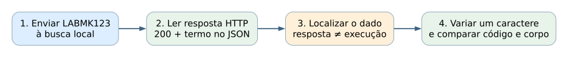
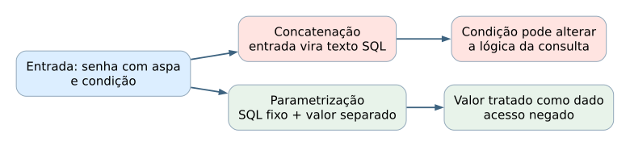
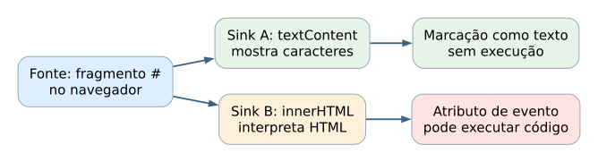
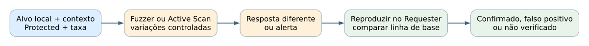

# A23 — Entradas, lógica e automação: quem interpreta o que você envia?

Na A22, a matriz R5 perguntou **quem pode enviar** uma requisição. Agora mantenha a atenção na requisição e pergunte **quem interpreta o valor enviado**. Um marcador que reaparece em uma resposta ainda é dado; uma aspa que muda a consulta SQL ou uma marcação interpretada pelo navegador pode revelar outra fronteira.

O exemplo completo desta aula usa **três laboratórios locais e independentes**: uma busca HTTP somente de leitura, uma consulta SQLite em memória e uma página HTML aberta no navegador. Eles ensinam o método sem fornecer respostas do Juice Shop. No trabalho final, aplique o mesmo método somente ao alvo e às ações permitidos pelo ROE do Classroom.

## Objetivos de aprendizagem

1. Localizar uma entrada na resposta ou no DOM, variar um elemento por vez e classificar a reação sem transformar um erro isolado em achado.
2. Comparar concatenação com parametrização em SQL e `textContent` com `innerHTML` no navegador, explicando a fronteira dado/código e a correção da classe.
3. Configurar Fuzzer e varredura ativa com limites, distinguir alerta de achado e registrar uma decisão sustentada por linha de base e contraprova.

**Tempo:** 100 minutos. **Recursos:** navegador, Python 3, `curl` e ZAP com os add-ons Requester e Fuzzer. O serviço de busca usa `127.0.0.1:3002`; SQL e HTML não enviam dados à rede. Se o ZAP faltar, use as saídas fornecidas, identificando a procedência.<br>
**Preparação:** mapa e hipóteses da [A21](A21-pentest-processo-referenciais-e-escopo.md); contexto, *History* e Requester da [A22](A22-pentest-superficie-e-identidade.md).<br>
**Produto:** registro E0–E6 com entrada, contexto, resposta, interpretação, limite e decisão. Ele prepara P5, P7–P9 e uma hipótese de achado de entrada do trabalho final.

## Percurso e registro

| Etapa | Pergunta | O que guardar |
|---|---|---|
| E0 — Preparar | O alvo e os limites são os desta prática? | URL local, contexto, modo, taxa e estado do serviço |
| E1 — Marcar | Onde o texto reaparece? | Marcador, código, corpo, ID e três variações comparadas |
| E2 — Consultar | A entrada muda o SQL ou continua dado? | Quatro saídas e a diferença entre os modos |
| E3 — Renderizar | Qual *sink* interpreta o fragmento? | Fonte, dois *sinks*, resultado e limite |
| E4 — Variar | O que o Fuzzer mudou? | Posição, lista, limites, código e corpo da resposta diferente |
| E5 — Modelar | Que exposição ou regra de negócio vale testar? | Uma hipótese, condição de confirmação e limite |
| E6 — Triar | A automação produziu um achado verificável? | Configuração, duração, alertas e decisão com contraprova |

Em cada etapa, marque **executado** ou **resposta fornecida**. Um ID do *History* só existe quando a requisição passou pelo ZAP. Guarde o ID junto do método, URL e resposta; não registre senhas, cookies ou tokens completos.

## E0 — Preparar um alvo local e conferir o escopo

!!! abstract "Conceito — três ambientes com funções diferentes"
    A busca HTTP permite observar **requisição e resposta** no ZAP. O programa SQLite mostra o **comando que o banco recebe**. A página HTML mostra o que o **navegador interpreta** no DOM. Um resultado de um ambiente não é prova de comportamento nos outros nem no Juice Shop.

1. Crie uma pasta `a23` e salve nela [`servidor_entrada_a23.py`](../assets/pentest/servidor_entrada_a23.py), [`consulta_sql.py`](../assets/pentest/consulta_sql.py) e [`laboratorio-xss.html`](../assets/pentest/laboratorio-xss.html), mantendo esses nomes. Pelo terminal, os comandos abaixo baixam as três cópias; `--fail` interrompe em erro HTTP. Se preferir o navegador, use os links e **Salve como** na pasta `a23`. Não execute o HTML diretamente na URL pública do curso.

    ```bash
    mkdir -p ~/a23
    cd ~/a23
    curl --fail --location --output servidor_entrada_a23.py https://rafaelrezo.github.io/seguranca-digital/assets/pentest/servidor_entrada_a23.py
    curl --fail --location --output consulta_sql.py https://rafaelrezo.github.io/seguranca-digital/assets/pentest/consulta_sql.py
    curl --fail --location --output laboratorio-xss.html https://rafaelrezo.github.io/seguranca-digital/assets/pentest/laboratorio-xss.html
    ```
2. No terminal, entre na pasta e inicie o serviço. Deixe esse terminal aberto.

    ```bash
    cd ~/a23
    python3 servidor_entrada_a23.py
    ```

    A linha esperada é `Busca A23 em http://127.0.0.1:3002`. Se salvou a pasta em outro lugar, use seu caminho. `Ctrl+C` encerra o serviço. Ele aceita somente GET, não grava dados e escuta apenas em loopback.
3. Em outro terminal, confirme a linha de base sem proxy:

    ```bash
    curl -i 'http://127.0.0.1:3002/'
    ```

    Espere `200` e `"aplicacao": "Busca A23"`. Se falhar, confira o nome do arquivo, o terminal do serviço e se a porta 3002 já está ocupada. **Pare** até obter essa resposta.
4. No ZAP, crie para `http://127.0.0.1:3002` um contexto separado chamado `a23-local`, como na [preparação da A22](A22-pentest-superficie-e-identidade.md#r0-iniciar-delimitar-e-obter-o-primeiro-rastro). Use a expressão `^http://127\.0\.0\.1:3002(?:/.*)?$`, modo *Protected* e regra habilitada de 10 req/s para `127.0.0.1`. Confira a porta do proxy em *Tools → Options → Network → Local Servers/Proxies*; os comandos abaixo assumem 8080. Mantenha a porta 3001 da A22 fora deste contexto.
5. Registre em E0 URL, contexto, modo e taxa. **Pare** se o ZAP mostrar alvo fora de `127.0.0.1:3002`.

## E1 — Marcar a entrada antes de procurar uma falha

!!! abstract "Conceito — fonte, resposta e interpretador"
    **Fonte** é o ponto de onde o valor vem; aqui, o parâmetro `q` da URL. **Reflexão** significa que o valor voltou na resposta. Isso não mostra execução de código. Para investigar uma falha, identifique qual componente consumiu o valor, em que formato, e compare uma variação com a linha de base.

<div class="pentest-figure-scroll pentest-figure-wide" role="region" tabindex="0" aria-label="Figura 44: etapas de marcador, resposta e variação; role horizontalmente para ler" markdown="1">

{#figura-44 loading=lazy}

</div>

*Figura 44 — O marcador identifica o caminho do dado; a comparação investiga o efeito.* [Abrir a figura ampliada](../assets/pentest/figura44-marcador.svg).

1. **Estado inicial:** o serviço responde na porta 3002 e o contexto `a23-local` está em *Protected*. No segundo terminal, envie o marcador pelo proxy. `--get` coloca `q` na URL; `--data-urlencode` codifica o valor; `-x` envia pelo ZAP; `--noproxy ''` evita desvio do loopback.

    ```bash
    curl -i --noproxy '' -x http://127.0.0.1:8080 --get --data-urlencode 'q=LABMK123' http://127.0.0.1:3002/api/busca
    ```

2. Espere `200` e `{"termo": "LABMK123", "resultados": []}`. Em *History*, selecione `GET /api/busca?q=LABMK123`; confira o mesmo termo na aba *Response*. Anote método, URL, código, trecho do corpo e ID em E1. **Conclusão limitada:** o marcador voltou em JSON; ainda não houve interpretação como HTML ou SQL.
3. Envie cada variação separadamente, mantendo o mesmo caminho e método. Compare código **e** corpo com a primeira resposta:

    ```bash
    curl -i --noproxy '' -x http://127.0.0.1:8080 --get --data-urlencode "q=abc'" http://127.0.0.1:3002/api/busca
    curl -i --noproxy '' -x http://127.0.0.1:8080 --get --data-urlencode 'q=abc<' http://127.0.0.1:3002/api/busca
    curl -i --noproxy '' -x http://127.0.0.1:8080 --get --data-urlencode 'q=abc)(' http://127.0.0.1:3002/api/busca
    ```

4. Nesta implementação, aspa e `<` devolvem `400` com `formato inválido`; `abc)(` devolve `200` com o termo no JSON. Registre as três linhas e classifique: **validação de formato** para as recusas; **reflexão em JSON** para a aceita. A resposta 400 não prova proteção de todos os pontos de entrada. **Pare** se a URL sair do loopback ou se o serviço ficar indisponível.

!!! info "Alternativa E1 — respostas fornecidas"
    Sem ZAP ou `curl`, use as quatro respostas do passo 4 e marque **resposta fornecida; ID não gerado**. A comparação e a conclusão continuam necessárias.

| Reação observada | Leitura inicial | Próxima verificação |
|---|---|---|
| 400 com mensagem de formato | Validação recusou esta entrada | Outra entrada e linha de base válida |
| 500 com erro de sintaxe | Pode ter chegado a um interpretador | Efeito controlado, sem presumir achado |
| Marcador igual no corpo ou DOM | Valor reapareceu | Contexto e codificação |
| Mudança controlada de resultado | Lógica pode ter mudado | Reproduzir e delimitar impacto |

## E2 — Comparar concatenação e parametrização no SQLite

!!! abstract "Conceito — dado e código no banco"
    A consulta **concatenada** monta um comando SQL juntando strings; uma entrada com aspa pode alterar sua sintaxe e lógica. A consulta **parametrizada** mantém o comando fixo e passa os valores separadamente ao banco. O programa imprime o SQL e o resultado para que você veja a diferença, sem rede e com banco em memória.

<div class="pentest-figure-scroll" role="region" tabindex="0" aria-label="Figura 45: concatenação e parametrização de SQL; role horizontalmente para ler" markdown="1">

{#figura-45 loading=lazy}

</div>

*Figura 45 — A correção separa o valor da estrutura da consulta.* [Abrir a figura ampliada](../assets/pentest/figura45-sql.svg).

1. **Estado inicial:** `consulta_sql.py` está na pasta `a23`; feche qualquer conclusão sobre o alvo web. Execute a senha correta para estabelecer a linha de base:

    ```bash
    python3 consulta_sql.py concatenada "u1@lab.invalid" "u1-ok"
    ```

    Espere `ACESSO CONCEDIDO` para `u1@lab.invalid`.
2. Mude só o e-mail, acrescentando uma aspa. O segundo argumento é uma senha errada:

    ```bash
    python3 consulta_sql.py concatenada "u1@lab.invalid'" "x"
    ```

    Espere `Erro do banco: unrecognized token: "x'"`. Isso mostra quebra de sintaxe, ainda sem acesso indevido.
3. Restaure o e-mail e altere **só a senha** para a condição do exemplo local:

    ```bash
    python3 consulta_sql.py concatenada "u1@lab.invalid" "x' OR papel = 'cliente"
    ```

    Espere `ACESSO CONCEDIDO` apesar da senha errada. Leia o `SQL montado`: a condição `OR papel = 'cliente'` passou a integrar o comando. Registre a conta retornada e a diferença para o passo 1.
4. Repita exatamente os mesmos e-mail e senha do passo 3, mudando **só o modo**:

    ```bash
    python3 consulta_sql.py parametrizada "u1@lab.invalid" "x' OR papel = 'cliente"
    ```

    Espere `acesso negado`; `SQL fixo` conserva `?` e `Parâmetros` mostra o valor separado. Registre as quatro saídas em E2 e explique por que filtrar a palavra `OR` seria uma correção frágil. Se o arquivo não for encontrado, confira `pwd` e o nome salvo. **Pare** se estiver executando fora da cópia local do curso.

!!! info "Alternativa E2 — saídas fornecidas"
    Se Python não estiver disponível, use os quatro resultados descritos acima e identifique E2 como **saída fornecida**, sem dizer que executou o programa.

!!! question "Checkpoint 1"
    A aspa produziu um erro e a condição produziu acesso com senha errada. Qual observação demonstra a mudança controlada da lógica? O que o modo parametrizado mudou na consulta?

## E3 — Comparar dois *sinks* no navegador

!!! abstract "Conceito — fonte, sink e contexto de XSS"
    **XSS** ocorre quando conteúdo controlado por alguém é executado como código no contexto de um site. A **fonte** fornece o valor; o **sink** o insere na página. O fragmento depois de `#` fica no navegador. `textContent` mostra caracteres como texto; `innerHTML` pede ao navegador que interprete HTML. O contexto e o modo de inserção decidem o efeito.

<div class="pentest-figure-scroll" role="region" tabindex="0" aria-label="Figura 46: fragmento da URL em textContent e innerHTML; role horizontalmente para ler" markdown="1">

{#figura-46 loading=lazy}

</div>

*Figura 46 — A mesma fonte tem efeitos diferentes conforme o sink.* [Abrir a figura ampliada](../assets/pentest/figura46-xss.svg).

1. **Estado inicial:** abra a cópia **local** de `laboratorio-xss.html` pelo navegador (*Abrir arquivo*). Confira o título “Fonte, sink e contexto” e o registro `(nenhuma execução)`. A página não envia dados a servidor. Se o navegador não encontrar o arquivo do WSL, salve uma cópia em uma pasta acessível ao navegador e abra essa cópia.
2. Na barra de endereço, acrescente `#LABMK123` ao fim da URL e pressione Enter. Os dois quadros exibem o marcador; o registro continua vazio. Anote a fonte (`location.hash`) e os dois sinks em E3.
3. Substitua o fragmento por `#<b>LABMK</b>`. No sink A aparecem os sinais `<b>` como texto; no sink B aparece **LABMK em negrito**. Isso mostra interpretação de HTML, ainda sem execução de JavaScript.
4. Substitua por `#<script>registrar('script')</script>`. O sink B não mostra conteúdo e o registro continua `(nenhuma execução)`. **Não conclua** que todo script está bloqueado: elementos `script` inseridos por `innerHTML` não executam neste mecanismo.
5. Substitua por `#`. O sink A mostra a marcação; o sink B mostra uma imagem quebrada e o registro recebe `executou: img`. Atualize a página entre as tentativas se quiser limpar o registro; depois, digite o fragmento novamente. Pare se estiver em uma URL pública em vez do arquivo local.
6. Registre em E3 a sequência **fonte → sink → resultado**, distinguindo marcador, interpretação de HTML e execução. A correção para este sink é tratar o valor como texto (`textContent`); outros contextos exigem codificação própria. A prática não demonstra acesso a cookies ou impacto sobre outra conta.

!!! info "Alternativa E3 — quadro de resultados"
    Se o navegador não abrir o arquivo, use os resultados dos passos 2–5 como **respostas fornecidas**. Compare A e B e explique por que o teste com `<script>` sozinho daria uma conclusão falsa.

!!! question "Checkpoint 2"
    O fragmento não aparece numa requisição HTTP. Em qual evidência você procuraria uma execução baseada em DOM? Por que o marcador no corpo de uma API não bastaria?

A distinção entre XSS refletido, armazenado e baseado em DOM, outros contextos e as correspondências WSTG/CWE está em [Entradas: injeção e XSS](../pentest/entradas.md).

## E4 — Usar o Fuzzer para variar uma posição

!!! abstract "Conceito — diferença é hipótese"
    O Fuzzer substitui **uma posição selecionada** por cada valor de uma lista. Ele ajuda a comparar respostas, mas uma linha diferente não é automaticamente vulnerabilidade. Nesta busca local, uma resposta 400 para um termo longo é a **validação esperada**, não uma injeção.

1. **Estado inicial:** mantenha `servidor_entrada_a23.py` ativo e selecione no *History* a requisição de E1 com `q=LABMK123`. Confira que a URL termina em `127.0.0.1:3002/api/busca` e que a resposta inicial foi 200.
2. Clique com o botão direito nessa linha → *Attack → Fuzz…*. Na aba *Fuzz Locations*, destaque somente `LABMK123` no valor de `q` e clique *Add…*. Adicione estes três valores de texto, um por linha:

    ```text
    LABMK123
    abc123
    abcdefghijklmnopqrstuvwxyz1234567890ABCDE
    ```

    O último tem 41 caracteres e foi escolhido para acionar o limite local de 40.
3. Na aba *Options*, confira **2 threads** e **100 ms** de atraso. Mantenha uma única posição e nenhuma outra automação ativa. Inicie o Fuzzer.
4. Na aba *Fuzzer*, compare código, tamanho e corpo. Os dois primeiros valores devem dar **200**; o de 41 caracteres, **400** com `formato inválido`. Abra a requisição e a resposta da linha diferente. Anote em E4 posição, lista, configuração, IDs se houver e interpretação: **a validação funcionou neste caso**. Se os resultados forem diferentes, pare, confira qual texto foi selecionado e repita só essa lista curta.

!!! info "Alternativa E4 — resultados fornecidos"
    Sem Fuzzer, use os três resultados do passo 4. Marque **resposta fornecida; ID não gerado**. Explique qual variação se destacou e por que ela não é um achado.

## E5 — Separar exposição de regra de negócio

!!! abstract "Conceito — duas perguntas que o scanner não decide"
    **Exposição** pergunta se um campo, erro, arquivo ou versão foi entregue a quem não precisava dele. Compare resposta e regra de acesso antes de chamar um campo de vazamento; uma versão só sustenta uma CVE quando há evidência de versão e configuração. **Lógica de negócio** pergunta se o servidor preserva uma invariante mesmo quando a sequência de ações muda.

| Pergunta | Exemplo curto | O que falta para concluir |
|---|---|---|
| Exposição | A22 retorna o campo `dono` no JSON | Comparar com a função e a regra de acesso; não há tela equivalente nesse laboratório |
| Lógica | “Uma ordem só pode ser concluída depois de aprovada” | Um endpoint de estado e uma leitura posterior; o serviço local de A23 não os implementa |

1. Em E5, escreva **uma** hipótese de exposição ou lógica para investigar no trabalho autorizado. Declare a regra, uma linha de base válida, a única variável que mudaria e qual resposta confirmaria ou negaria a hipótese.
2. Marque **proposta, não executada**. Não atribua ao serviço de busca uma operação de escrita, e não transforme a recusa de `POST /api/ordens/17/fechar` da A22 em teste de transição de estado.

## E6 — Configurar uma varredura curta e triar o resultado

!!! abstract "Conceito — automação não substitui validação"
    A varredura ativa envia testes ao alvo e pode alterar estado. Nesta aula, use **somente o serviço local de busca**, que aceita GET e não grava dados. A política determina quais regras rodam; *Strength* muda a quantidade de testes; *Threshold* muda a sensibilidade dos alertas. O *Rate Limit* limita a taxa do tráfego do ZAP. Um alerta é um pedido de investigação; falhas de lógica, como a matriz U1/U2 da A22, exigem comparação manual.

<div class="pentest-figure-scroll pentest-figure-wide" role="region" tabindex="0" aria-label="Figura 47: da automação controlada à decisão sobre um alerta; role horizontalmente para ler" markdown="1">

{#figura-47 loading=lazy}

</div>

*Figura 47 — A reprodução transforma um sinal automático em decisão.* [Abrir a figura ampliada](../assets/pentest/figura47-automacao.svg).

1. **Antes de iniciar:** confirme `127.0.0.1:3002`, contexto `a23-local`, modo *Protected*, regra de 10 req/s e Fuzzer encerrado. No *History*, confirme uma resposta 200 à busca com `q=LABMK123`. Se houver outro alvo selecionado, **pare**.
2. Em *Analyse → Scan Policy Manager*, crie ou selecione uma política para esta prática com *Strength* **Low** e *Threshold* **Medium**. Em *Tools → Options → Active Scan*, ajuste **2 threads por host** e **Maximum Scan Duration** de **3 minutos**. Esses controles não substituem o contexto nem a taxa.
3. Na linha `GET /api/busca?q=LABMK123` do *History*, use *Attack → Active Scan…*. Na aba *Scope*, selecione `a23-local`, usuário **anônimo**, **desmarque Recurse** e confira o endereço inicial. Se sua versão mostrar o nome da política, selecione a política do passo 2. Inicie somente depois dessa conferência.
4. Acompanhe a aba *Active Scan*: horário de início, progresso, duração e quantidade de alertas. Pare ao atingir 3 minutos, se o serviço responder lentamente ou se o alvo sair do loopback. Uma execução sem alertas também é resultado; anote **zero alertas**, sem afirmar ausência de falhas.
5. Se houver alerta, abra a requisição indicada, repita-a no Requester e compare com a linha de base válida. Registre nome, URL, parâmetro, risco/confiança atribuídos pelo ZAP, ID, observado e decisão. Use **confirmado** só com efeito reproduzido; **falso positivo** quando uma contraprova explica o sinal; **não verificado** quando faltar condição ou evidência. Se não houver alertas, use a linha 400 do Fuzzer como exercício de triagem: ela é **validação esperada**, não um alerta nem um achado do ZAP.

| Sinal | Evidência a confrontar | Decisão permitida |
|---|---|---|
| Alerta com efeito repetido e linha de base válida | Requisição, resposta, contraprova | Confirmado no alcance testado |
| Alerta explicado por comportamento esperado | Repetição e regra do serviço | Falso positivo justificado |
| Alerta sem reprodução ou condição disponível | Falta identificada | Não verificado |
| Zero alertas | Configuração e duração | Nenhum alerta produzido nesta execução |

No **trabalho final**, P9 usa o próprio alvo autorizado, depois de P1–P8, uma execução por integrante, uma automação por vez e até **30 minutos**. A configuração, a identidade e a triagem precisam corresponder ao ROE do Classroom. O ensaio de três minutos em loopback não cumpre P9.

## Atividade {#atividade}

A atividade única do bloco continua sendo o **trabalho final**, distribuído no Google Classroom. Esta aula prepara:

- **P5:** ponto de entrada, contexto provável, marcador, variações, reações e um achado de entrada confirmado com evidência; para XSS, fonte, sink e execução no navegador.
- **P7–P8:** comparação de campo/erro/componente com a regra de acesso; uma invariante de negócio e um teste autorizado.
- **P9:** varredura no próprio alvo com limites do ROE, duração e triagem dos alertas.

O registro E0–E6 é prática e referência. Não substitui os testes e entregáveis específicos do roteiro do trabalho.

## Diagnóstico

| Dificuldade | Como prosseguir |
|---|---|
| Porta 3002 ocupada | Encerre o processo local que a usa ou peça orientação; não aponte o ZAP para outro alvo por conveniência |
| `curl` responde, mas não aparece no *History* | Confira `--noproxy ''`, porta do proxy e filtro *Show only URLs in Scope* |
| `consulta_sql.py` não é encontrado | Execute `pwd`; entre na pasta `a23` e confira o nome do arquivo |
| O HTML não muda ao trocar o fragmento | Pressione Enter; o arquivo reage ao evento `hashchange` |
| O evento `img` não aparece | Confira aspas, parênteses e se abriu a cópia local do arquivo; recarregue antes da nova tentativa |
| O Fuzzer devolve respostas iguais | Confira se selecionou apenas `LABMK123` e se o valor longo tem 41 caracteres |
| A varredura deixa o serviço lento | Pare, anote horário e duração; reduza o escopo antes de outra execução |
| Um alerta não se reproduz | Preserve a requisição original e a linha de base; registre **não verificado** até explicar a diferença |

## Revisão rápida

1. Qual observação em E1 mostra reflexão e qual em E2 mostra mudança controlada da lógica?
2. Por que a tentativa com `<script>` sozinha não descarta XSS no laboratório HTML?
3. Qual evidência transforma uma resposta diferente do Fuzzer ou um alerta do ZAP em achado?

**Continuidade:** guarde em E2/E3 a **entrada original, a única variável alterada, a resposta e o limite**. A A24 reabre esses quatro elementos junto com a matriz R5 da A22 para classificar um achado, propor correção e planejar um reteste.

## Fontes de referência

- [OWASP WSTG 4.2 — Input Validation](https://owasp.org/www-project-web-security-testing-guide/v42/4-Web_Application_Security_Testing/07-Input_Validation_Testing/README), [Client-side](https://owasp.org/www-project-web-security-testing-guide/v42/4-Web_Application_Security_Testing/11-Client-side_Testing/README) e [Business Logic](https://owasp.org/www-project-web-security-testing-guide/v42/4-Web_Application_Security_Testing/10-Business_Logic_Testing/README).
- [OWASP Cheat Sheet — SQL Injection Prevention](https://cheatsheetseries.owasp.org/cheatsheets/SQL_Injection_Prevention_Cheat_Sheet.html) e [XSS Prevention](https://cheatsheetseries.owasp.org/cheatsheets/Cross_Site_Scripting_Prevention_Cheat_Sheet.html).
- [HTML Standard — `innerHTML`](https://html.spec.whatwg.org/multipage/dynamic-markup-insertion.html#dom-element-innerhtml).
- [ZAP — Fuzzer](https://www.zaproxy.org/docs/desktop/addons/fuzzer/dialogue/), [Active Scan](https://www.zaproxy.org/docs/desktop/start/features/ascan/), [Scan Policy](https://www.zaproxy.org/docs/desktop/start/features/scanpolicy/) e [opções de duração e threads](https://www.zaproxy.org/docs/desktop/ui/dialogs/options/ascan/).
