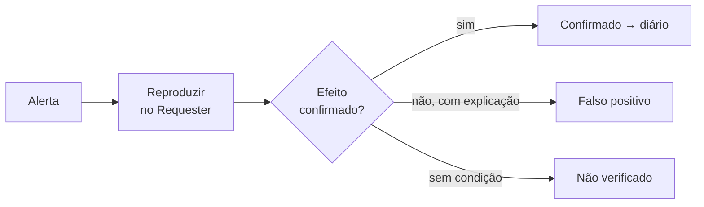

# A23 — Entradas, lógica e automação: quem interpreta o que você envia?

Na A22, a pergunta era quem pode fazer o quê. Agora ela muda: o que acontece com o **conteúdo** que você envia? Um campo de busca, um comentário, um parâmetro na URL: em algum ponto, um interpretador lê esse texto. Pode ser um banco de dados, o navegador ou o sistema de arquivos. Se ele passa a tratar o texto como instrução, a fronteira entre dado e código caiu.

Esta aula prepara o **achado de entrada de dados** exigido no trabalho (P5). Ela também cobre exposição e lógica de negócio (P7–P8) e o uso crítico da varredura automatizada (P9).

## Objetivos de aprendizagem

1. Descobrir onde uma entrada reaparece e quem a interpreta, usando marcador inofensivo e caracteres de contexto, e classificar a reação observada.
2. Explicar injeção SQL e XSS pela fronteira dado/código (fonte, sink, contexto) e indicar a correção que trata a classe, com base em execuções locais.
3. Configurar uma varredura ativa dentro dos limites e triar seus alertas em confirmado, falso positivo ou não verificado.

**Tempo:** 100 minutos. **Recursos:** navegador; terminal com Python 3; ZAP e Juice Shop local na demonstração do professor.<br>
**Preparação:** mapa e hipóteses ([A21](A21-pentest-processo-referenciais-e-escopo.md)); Requester e leitura de resposta ([A22](A22-pentest-superficie-e-identidade.md)).<br>
**Produto:** classificação de reações a entradas, duas práticas locais executadas e uma tabela de triagem modelo.

---

## Entrada como dado ou como instrução

!!! abstract "Síntese"
    - **Injeção** acontece quando a entrada atravessa a fronteira entre **dado** e **código**.
    - Antes de testar, escreva o **contexto provável**: SQL, NoSQL, HTML, atributo, JavaScript/DOM, caminho, template, JSON.
    - **Marcador primeiro, carga depois:** descubra onde a entrada reaparece antes de tentar quebrar o contexto.
    - Classifique a reação: **validação**, **erro de sintaxe**, **reflexão** ou **comportamento inesperado**.

| Contexto | Quem interpreta | Correção da classe | CWE |
|---|---|---|---|
| SQL | Banco relacional | Consulta parametrizada | CWE-89 |
| NoSQL | Banco de documentos | Validar o **tipo** do valor | CWE-943 |
| HTML / atributo | Navegador | Codificar a saída para o contexto | CWE-79 |
| DOM | JavaScript da página | Usar *sinks* seguros (`textContent`) | CWE-79 |
| Caminho de arquivo | Sistema de arquivos | Canonizar e conferir a pasta permitida | CWE-22 |

### Demonstração: marcador e caracteres de contexto

1. **Estado inicial:** um ponto de entrada escolhido no mapa, por exemplo um campo de busca, com a requisição correspondente no *History*.
2. **Marcador:** enviar `LABMK` seguido de um número único. Procurar o marcador na resposta da API, no HTML e no DOM.
3. **Caracteres de contexto:** reenviar com `abc'`, `abc"`, `abc<b>`, `abc)(`, `abc{{1}}`, um por vez (roteiro 14.9).
4. **Comparar** código, tamanho, mensagem e onde o texto reaparece em cada variação.
5. **Registrar** a reação de cada variação na tabela abaixo.
6. **Parar** se aparecer efeito sobre dados de outras contas ou degradação do alvo.

| Reação | Exemplo | O que indica |
|---|---|---|
| Validação | 400 com "formato inválido" | Entrada rejeitada antes de ser usada |
| Erro de sintaxe | 500 com mensagem do banco | A entrada chegou ao interpretador e quebrou a sintaxe |
| Reflexão | Marcador igual na resposta | A entrada volta; falta saber o contexto e a codificação |
| Comportamento inesperado | Mais resultados, outra ordem | A entrada pode ter mudado a **lógica** |

!!! warning "Erro comum"
    Tratar um erro 500 como achado. Ele mostra que a entrada chegou a algum lugar. O achado exige efeito **controlado**, com impacto delimitado.

---

## Injeção SQL: a mesma entrada em duas consultas

!!! abstract "Síntese"
    - Concatenar a entrada ao texto do SQL deixa o usuário **escrever parte do comando**.
    - A correção da classe é a **parametrização**: o comando é fixo e a entrada viaja separada, sempre como dado.
    - No alvo, você não vê o SQL: deduz o contexto pela **reação**.

### Prática: executar e comparar

O programa [`consulta_sql.py`](../assets/pentest/consulta_sql.py) cria um banco SQLite **em memória**, com duas contas fictícias, e faz a mesma verificação de login de dois jeitos. Baixe-o e, na pasta, execute:

```bash
python3 consulta_sql.py concatenada "u1@lab.invalid" "u1-ok"
python3 consulta_sql.py concatenada "u1@lab.invalid'" "x"
python3 consulta_sql.py concatenada "u1@lab.invalid" "x' OR papel = 'cliente"
python3 consulta_sql.py parametrizada "u1@lab.invalid" "x' OR papel = 'cliente"
```

| Execução | Resultado observado | Interpretação |
|---|---|---|
| 1. Senha correta | `ACESSO CONCEDIDO` | Linha de base |
| 2. Aspa no e-mail | `Erro do banco: unrecognized token: "x'"` | A aspa fechou a string antes da hora: **erro de sintaxe** |
| 3. Condição na senha | `ACESSO CONCEDIDO` com senha errada | A entrada mudou a **lógica**: `(email AND senha) OR papel = 'cliente'` |
| 4. Mesma entrada, parametrizada | `acesso negado` | A entrada foi comparada como texto, aspas incluídas |

**O que isto ensina:** o defeito é a **concatenação**. Filtrar a palavra `OR` ou a aspa trataria só este exemplo; a parametrização trata a classe.

!!! question "Checkpoint 1"
    No alvo, a variação `abc'` devolve 500 com uma mensagem do banco e `abc''` (duas aspas) devolve 200. O que essa diferença sugere sobre o contexto, e por que ainda não é um achado?

---

## XSS: fonte, sink e contexto

!!! abstract "Síntese"
    - **XSS** é dado controlado pelo atacante executado como código no navegador, **no contexto do site**.
    - Analise três elementos: **fonte** (de onde vem), **sink** (onde é inserido) e **contexto** (como é lido).
    - Tipos: **refletido**, **armazenado** e **baseado em DOM**. O fragmento `#…` não vai ao servidor: a evidência de XSS baseado em DOM é o **navegador**.

| Tipo | Caminho do dado | Evidência principal |
|---|---|---|
| Refletido | Requisição → resposta → página | Resposta HTTP sem codificação |
| Armazenado | Salvo → exibido a outros | Requisição que salva + página que exibe |
| DOM | Fonte no navegador → *sink* no JavaScript | DOM e execução no navegador |

### Prática: dois sinks, a mesma fonte

O arquivo [`laboratorio-xss.html`](../assets/pentest/laboratorio-xss.html) lê o fragmento da URL e o insere com `textContent` (sink A) e com `innerHTML` (sink B). Uma caixa registra se algum código executou. Abra-o e acrescente ao final da URL, um por vez:

| Fragmento | Sink A | Sink B | Registro |
|---|---|---|---|
| `#LABMK123` | `LABMK123` | `LABMK123` | — |
| `#<b>LABMK</b>` | marcas como texto | **negrito** | — |
| `#<script>registrar('script')</script>` | texto | nada visível | **nada executou** |
| `#` | texto | imagem quebrada | **executou: img** |

**Interpretação:**

- O marcador mostra só que a entrada **reaparece**.
- O `<b>` mostra que o sink B **interpreta HTML**.
- O `<script>` não executa por `innerHTML`, pela especificação HTML. Concluir "não há XSS" seria errado.
- O atributo de evento executa: o **contexto** decide, não a palavra `script`.

**Correção da classe:** sink seguro (`textContent`) ou codificação para o contexto. Bloquear a palavra `script` não resolve.

!!! danger "Delimite o impacto"
    No trabalho, demonstre execução com ação **inofensiva e visível**. Descreva o impacto potencial, como ler um token acessível a JavaScript, sem executá-lo contra contas que não sejam as suas.

Contextos, NoSQL, caminho de arquivo e WSTG/CWE: [Entradas: injeção e XSS](../pentest/entradas.md).

---

## Fuzzer: variar uma entrada com limites

!!! abstract "Síntese"
    - O **Fuzzer** envia uma lista de variações para **uma posição** da requisição e mostra as respostas lado a lado.
    - Use listas **curtas e escolhidas pelo contexto**, com 2 threads e 100 ms de atraso.
    - Ordene o resultado por código e tamanho: o que destoa é candidato a hipótese.

**Demonstração.** O professor seleciona o valor de um parâmetro no *History* → *Attack → Fuzz…* → adiciona como carga a mesma lista do passo de caracteres de contexto → confere *Options → Fuzzer* → executa → ordena por tamanho.

**Registrar:** lista usada, posição, configuração e as variações que destoaram, com ID.

---

## Exposição e lógica de negócio

!!! abstract "Síntese"
    - **Exposição:** campos, mensagens de erro, versões e arquivos entregues a quem não precisa deles. Relacione a uma CVE **só com evidência de versão**.
    - **Infraestrutura:** HTTP em claro na VPC e SSH pelo pool VPN são decisões a justificar, como achado ou risco aceito.
    - **Lógica:** escreva **invariantes**, o que nunca deveria acontecer, e verifique se o servidor as garante.

| Técnica de lógica | Pergunta |
|---|---|
| Valor impossível | O servidor valida o domínio do valor? |
| Repetição | Existe limite de uso? |
| Reordenação | O servidor exige o estado anterior? |
| Interrupção | O servidor revalida no fim do fluxo? |

!!! example "Exemplo — invariante de fluxo (aplicação fictícia de ordens)"
    Invariante: *uma ordem só passa a "concluída" depois de "aprovada"*.<br>
    Teste de **reordenação**: pedir a conclusão de uma ordem **sua** ainda "aberta".<br>
    Confirmaria: a ordem aparece como "concluída" numa leitura posterior. Negaria: recusa por estado inválido.

!!! question "Checkpoint 2"
    Escreva uma invariante para um fluxo de cupom de desconto e diga qual das quatro técnicas a testaria.

Detalhes e tabela de risco da infraestrutura: [Exposição, configuração e lógica](../pentest/exposicao-logica.md).

---

## Varredura ativa: ampla, rasa e com triagem

!!! abstract "Síntese"
    - A varredura ativa vem **depois** de P1–P8, no próprio alvo, uma automação por vez, até 30 minutos.
    - *Strength* (quantos testes) e *Threshold* (sensibilidade do alerta) **não** limitam tráfego; o *Rate Limit* limita.
    - A identidade padrão é **anônima**; varredura autenticada exige prova no *History*.
    - Todo alerta de risco médio ou maior recebe decisão: **confirmado**, **falso positivo** ou **não verificado**.



### Demonstração: configurar, executar e triar

1. **Confirmar:** modo *Protected*, contexto, *Rate Limit*, nenhuma outra automação.
2. **Política:** *Analyse → Scan Policy Manager* → *Strength* Low/Medium, *Threshold* Medium.
3. ***Options → Active Scan***: 2 threads por host; duração máxima.
4. **Iniciar** com o contexto como alvo, identidade anônima. Anotar o horário.
5. **Acompanhar** a linha de base (tempo de resposta). Parar se o alvo degradar.
6. **Triar** dois ou três alertas: reproduzir no Requester, decidir e justificar.

| ID | Alerta | Risco ZAP | Confiança ZAP | URL / parâmetro | Decisão | Justificativa |
|---|---|---|---|---|---|---|

!!! warning "Erro comum"
    Copiar um alerta para o relatório como achado. O risco e a confiança do ZAP são estimativas da ferramenta; a severidade é sua, com evidência.

!!! question "Checkpoint 3"
    Que tipo de falha a varredura ativa tende a **não** encontrar? Use um exemplo da A22 para responder.

Configuração completa e identidade autenticada: [Varredura ativa e triagem](../pentest/varredura-triagem.md).

---

## Atividade {#atividade}

A atividade única do bloco é o **trabalho final**, com enunciado, pacote, prazos e entrega na atividade do Google Classroom. Esta aula prepara as seções do roteiro:

- **P5:** pontos de entrada com contexto provável escrito antes; marcador; variações; reações classificadas; para XSS, fonte, sink, contexto e evidência no navegador. **Achado de entrada de dados.**
- **P7–P8:** campos sensíveis, erros, componentes com evidência de versão, decisão sobre a infraestrutura; invariantes e ao menos uma testada.
- **P9:** uma varredura ativa por integrante, no próprio alvo, com configuração, identidade, duração, relatório e triagem.

## Diagnóstico

| Dificuldade | Como prosseguir |
|---|---|
| O marcador não aparece em lugar nenhum | Procure no DOM (DevTools → *Inspector*), não só na resposta; pode ser renderizado pelo JavaScript |
| `python3` não encontrado | No Windows, use o WSL; ou `py` em vez de `python3` |
| O laboratório XSS não muda ao trocar o fragmento | Pressione Enter na barra de endereço; a página reage ao evento `hashchange` |
| A varredura deixa o alvo lento | Pare, anote o horário, exporte os registros (I.8) e reduza *Strength* |
| Não sei se o alerta é falso positivo | Reproduza a requisição exata do alerta e compare com a linha de base; sem diferença atribuível, justifique o falso positivo |

## Revisão rápida

1. Por que usar marcador inofensivo antes de qualquer carga?
2. Por que o `<script>` não executou no laboratório, e o que isso ensina sobre concluir pela ausência de XSS?
3. Por que *Strength* e *Threshold* não substituem o *Rate Limit*?

**Continuidade:** a A24 pega um achado e o leva até a decisão: classificação, CVSS, correção da classe, reteste, detecção, transferência para OT e relatório.

## Fontes de referência

- [OWASP WSTG 4.2 — Input Validation](https://owasp.org/www-project-web-security-testing-guide/v42/4-Web_Application_Security_Testing/07-Input_Validation_Testing/README), [Client-side](https://owasp.org/www-project-web-security-testing-guide/v42/4-Web_Application_Security_Testing/11-Client-side_Testing/README) e [Business Logic](https://owasp.org/www-project-web-security-testing-guide/v42/4-Web_Application_Security_Testing/10-Business_Logic_Testing/README).
- [OWASP Cheat Sheet — SQL Injection Prevention](https://cheatsheetseries.owasp.org/cheatsheets/SQL_Injection_Prevention_Cheat_Sheet.html) e [XSS Prevention](https://cheatsheetseries.owasp.org/cheatsheets/Cross_Site_Scripting_Prevention_Cheat_Sheet.html).
- [HTML Standard — innerHTML](https://html.spec.whatwg.org/multipage/dynamic-markup-insertion.html#dom-element-innerhtml).
- [ZAP — Fuzzer](https://www.zaproxy.org/docs/desktop/addons/fuzzer/), [Active Scan](https://www.zaproxy.org/docs/desktop/start/features/ascan/) e [Scan Policy](https://www.zaproxy.org/docs/desktop/start/features/scanpolicy/).

Versões e endereços conferidos em **10 nov. 2026**. Saídas das práticas locais observadas em Python 3 e Chrome.
