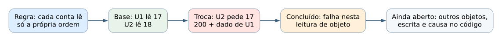
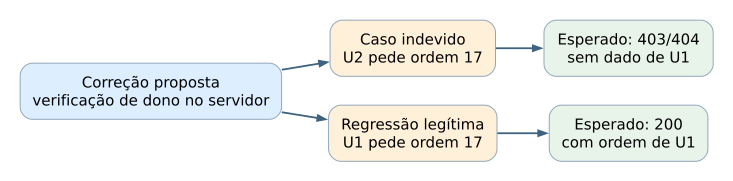

# A24 — Do achado à decisão: risco, correção, detecção e relatório

Na A22, U2 obteve a ordem 17 de U1; na A23, uma entrada mudou a lógica de uma consulta local. Uma resposta inesperada é o começo de um achado. Para orientar uma decisão, ainda é preciso **delimitar o que foi demonstrado**, classificar a causa provável, justificar a gravidade, propor uma correção, descrever o reteste e dizer como uma exploração poderia ser percebida.

Vamos trabalhar **F01**, a leitura indevida de uma ordem na aplicação fictícia de A22. Os registros de detecção desta aula são artificiais e independentes desse servidor. No trabalho final, use as evidências do **seu** alvo, sem transportar URLs, credenciais, notas ou conclusões do exemplo local para o Juice Shop.

## Objetivos de aprendizagem

1. Transformar uma requisição e sua contraprova em um achado de alcance explícito, associando CWE, WSTG, categorias OWASP e um vetor CVSS 4.0 com premissas verificáveis.
2. Propor a correção da classe e um plano de reteste que recuse o caso indevido **e** preserve a função legítima, sem chamar a proposta de correção aplicada.
3. Correlacionar fontes de log com seus limites, avaliar uma regra em eventos rotulados e comunicar a decisão técnica e operacional, inclusive sua transferência cautelosa para OT.

**Tempo:** 100 minutos. **Recursos:** navegador para a [calculadora CVSS 4.0 do FIRST](https://www.first.org/cvss/calculator/4.0), terminal com Python 3 e `curl` para baixar o pacote de registros artificiais.<br>
**Preparação:** matriz R5 da [A22](A22-pentest-superficie-e-identidade.md#r5d-ler-o-resultado-e-preencher-a-matriz), entrada/resposta/limite da [A23](A23-pentest-entradas-logica-e-automacao.md), análise de risco da [A09](A09-decisao-de-riscos.md), telemetria da [A13](A13-protecao-de-endpoints.md) e restrições OT da [A20](A20-validacao-ot-pentest.md).<br>
**Produto:** registro D0–D6: F01 classificado, vetor argumentado, correção e reteste **propostos**, regra avaliada, ficha OT e síntese para relatório. Ele serve de modelo para os dois achados do trabalho final.

## Percurso e registro

| Etapa | Pergunta | Evidência ou decisão a guardar |
|---|---|---|
| D0 — Delimitar | O que R5 mostrou de fato? | Regra, três respostas, IDs próprios ou procedência fornecida, alcance |
| D1 — Classificar | Qual causa provável e qual teste? | CWE, WSTG, categorias e justificativa |
| D2 — Pontuar | Que premissas sustentam cada métrica? | Vetor base, nota, impacto observado e hipótese adicional |
| D3 — Corrigir | O indevido falha e o legítimo continua? | Correção proposta, dois casos e resultados esperados |
| D4 — Detectar | Quem, quando e com qual confiança? | VP/FP/FN/VN, duas execuções da regra, fontes e limite |
| D5 — Transferir | O que mudaria em OT? | Função, consequência, método seguro, parada e recuperação |
| D6 — Comunicar | O gestor e o técnico conseguem decidir? | Sumário, achado, limites e próxima verificação |

Escreva **observado**, **inferido** ou **proposto** ao lado de cada afirmação importante. Quando usar a matriz da página sem executar A22, marque **resposta fornecida** e “ID não gerado”.

## D0 — Delimitar F01 antes de classificá-lo

!!! abstract "Conceito — alcance da evidência"
    Uma **linha de base** prova que a conta e o objeto funcionam no caso permitido. Uma **troca controlada** altera só a identidade e compara a resposta. A conclusão vale para a ação e o objeto testados; não se estende automaticamente a toda rota, a todos os objetos, à escrita ou a outro alvo.

<div class="pentest-figure-scroll pentest-figure-wide" role="region" tabindex="0" aria-label="Figura 48: regra, linhas de base, troca de identidade e limite do achado; role horizontalmente para ler" markdown="1">

{#figura-48 loading=lazy}

</div>

*Figura 48 — F01 começa pelo que a matriz R5 realmente demonstrou.* [Abrir a figura ampliada](../assets/pentest/figura48-achado.svg).

1. Abra sua matriz R5 da A22 ou a [matriz trabalhada na página](A22-pentest-superficie-e-identidade.md#r5d-ler-o-resultado-e-preencher-a-matriz). Identifique a regra: U1 possui a ordem 17; U2 possui a 18; cada conta deve ler apenas a própria ordem.
2. Separe três linhas, mantendo método e caminho visíveis: **U1 → GET 17 → 200 com dono U1**; **U2 → GET 18 → 200 com dono U2**; **U2 → GET 17 → 200 com dono U1**. Se executou no ZAP, anote seus IDs do *History*; eles variam por sessão. Se usou a tabela da página, anote “resposta fornecida; ID não gerado”. Não inclua cabeçalhos de credencial completos.
3. Em D0, escreva: **“Na leitura GET da ordem 17, a credencial válida de U2 recebeu o objeto de U1; a regra de propriedade falhou nesta ação.”** A tentativa de fechar uma ordem foi um teste de função separado; ela não prova segurança ou insegurança de todas as operações de escrita.
4. Registre o que **não** foi testado: outras ordens, alteração/exclusão, repetição em outro alvo e a linha exata do código. O servidor da A22 tem uma falha intencional conhecida pelo material, mas a resposta HTTP sozinha sustenta a falha de autorização, não a localização da causa na implementação.

!!! example "F01 — ficha inicial, antes da nota"
    | Campo | Conteúdo sustentado |
    |---|---|
    | Ativo e regra | `GET /api/ordens/{id}`; cada conta lê só suas ordens |
    | Linha de base | U1 lê 17 e U2 lê 18, ambas com corpo do dono correto |
    | Falha | U2 lê 17 e recebe 200 com `id:17` e `dono:u1@lab.invalid` |
    | Impacto observado | Leitura de **uma** ordem de outra conta. O servidor local inclui `descricao: Inspecionar bomba`; a resposta resumida fornecida na A22 transcreve apenas `id` e `dono`. |
    | Em aberto | Alcance em outros objetos, escrita, outros alvos, impacto operacional |

## D1 — Classificar causa provável, teste e categoria

!!! abstract "Conceito — quatro referências, quatro funções"
    **CWE** nomeia a fraqueza; **WSTG** nomeia o teste e sua versão; **Top 10** e **API Top 10** agrupam riscos. O corpo entregue a U2 é o **efeito**. A hipótese de causa é que a consulta do objeto não fez uma verificação suficiente de dono; uma revisão de implementação pode localizar a falha exata.

| Referência | Aplicação a F01 | Justificativa observável |
|---|---|---|
| [CWE-639](https://cwe.mitre.org/data/definitions/639.html) | Desvio de autorização por chave controlada pelo usuário | Mudar a referência do objeto permite ler registro de outra conta |
| [WSTG-v42-ATHZ-04](https://wstg.owasp.org/v4.2/4-Web_Application_Security_Testing/05-Authorization_Testing/04-Testing_for_Insecure_Direct_Object_References/) | Teste de referência direta insegura a objeto | Baselines válidas e pedido do objeto alheio |
| [A01:2025](https://top10.owasp.org/2025/A01_2025-Broken_Access_Control/) | *Broken Access Control* | Controle de propriedade falha nessa leitura |
| [API1:2023](https://api-security.owasp.org/editions/2023/en/0xa1-broken-object-level-authorization/) | *Broken Object Level Authorization* | API entrega objeto cujo dono é outro usuário |

1. Em D1, copie a referência de cada linha e escreva **uma frase sua** ligando-a à evidência de D0. Não use CWE-200 como causa só porque houve divulgação: ela descreve um efeito menos específico.
2. Se classificar um achado de entrada da A23, escolha a CWE pela **fronteira atravessada** (por exemplo, SQL ou HTML) e a WSTG pelo teste executado. Uma resposta 500 isolada não basta para classificar uma injeção confirmada.

## D2 — Justificar CVSS 4.0 e risco no contexto

!!! abstract "Conceito — vetor base e premissas"
    O vetor CVSS 4.0 guarda **explorabilidade** (AV, AC, AT, PR, UI) e **impacto** no sistema vulnerável (VC, VI, VA) ou em sistema subsequente (SC, SI, SA). A nota só tem sentido junto do vetor e das premissas. A **nota base** não substitui a análise de probabilidade e impacto no ambiente específico.

Para exercitar a calculadora, use este **cenário didático declarado**: a mesma rota web estaria alcançável por rede para **contas previamente concedidas**; uma conta comum é necessária; só a leitura da ordem 17 está demonstrada. O servidor local continua em loopback e não há VPN nele. A nota abaixo é **condicional a esse cenário**, não uma medição do laboratório nem uma nota pronta para o trabalho.

| Métrica | Valor | Justificativa no cenário declarado |
|---|---|---|
| AV / AC / AT | N / L / N | Rota web alcançável por rede; sem condição adicional demonstrada |
| PR / UI | L / N | Conta comum previamente concedida; outra pessoa não precisa agir |
| VC | **L** | Uma ordem alheia foi lida; acesso amplo ou dado de impacto alto não foi demonstrado |
| VI / VA | N / N | A falha avaliada é de leitura; não se atribui a ela alteração ou indisponibilidade |
| SC / SI / SA | N / N / N | Nenhum efeito em outro sistema foi demonstrado |

```text
CVSS:4.0/AV:N/AC:L/AT:N/PR:L/UI:N/VC:L/VI:N/VA:N/SC:N/SI:N/SA:N  →  5.3 (Média)
```

1. Abra a [calculadora oficial](https://www.first.org/cvss/calculator/4.0). Comece pelo vetor padrão e selecione, na ordem, os valores da tabela. Confira que a nota base é **5.3** e copie **vetor e nota** em D2.
2. Mude **só VC de L para H** e observe **7.1 (Alta)**. Registre que essa segunda nota exigiria uma justificativa de impacto maior, como evidência de acesso amplo ou de conteúdo sensível com efeito elevado; **não** é o resultado demonstrado em R5.
3. Volte a `VC:L`. No trabalho, avalie PR e AV de acordo com as condições reais: conta que qualquer pessoa pode criar pode não exigir `PR:L`; uma rede administrativa limitada por VPN pode alterar a avaliação de AV. Um certificado VPN não vira `PR:H` automaticamente. Consulte as definições do FIRST e declare suas premissas antes de fixar o vetor.

!!! abstract "Conceito — risco contextual"
    O [OWASP Risk Rating](https://owasp.org/www-community/OWASP_Risk_Rating_Methodology) considera **probabilidade** e **impacto técnico/de negócio** no ambiente. Para F01 local, falta informação sobre valor operacional das ordens, quantidade de contas e exposição do sistema; não atribua “risco alto” como fato. Em D2, escreva quais dados adicionais mudariam sua decisão e se a estimativa ainda é provisória.

!!! question "Checkpoint 1"
    Um colega marcou `PR:H` porque o trabalho usa certificado VPN e marcou `VC:H` porque uma ordem foi lida. Que duas premissas precisam ser revistas?

O significado de cada métrica e a matriz contextual estão em [Classificação e risco](../pentest/risco-classificacao.md).

## D3 — Propor uma correção e um reteste em dois sentidos

!!! abstract "Conceito — correção e regressão"
    **Causa raiz provável:** a leitura por identificador não aplica a regra de propriedade ao objeto retornado. A correção da classe coloca a verificação **no servidor** para cada rota que lê um objeto, usando a identidade autenticada e a regra de autorização. Esconder o link ou trocar IDs sequenciais por aleatórios não remove a falha quando o identificador é conhecido.

<div class="pentest-figure-scroll" role="region" tabindex="0" aria-label="Figura 49: reteste com caso indevido e regressão legítima; role horizontalmente para ler" markdown="1">

{#figura-49 loading=lazy}

</div>

*Figura 49 — Recusar tudo não preserva a função legítima.* [Abrir a figura ampliada](../assets/pentest/figura49-reteste.svg).

1. Escreva em D3 a **mudança proposta**: consultar a ordem e verificar, no servidor, se `dono` corresponde ao usuário autenticado ou se uma permissão explícita autoriza a leitura. Aplique a regra a todas as rotas equivalentes depois de inventariá-las.
2. Monte o plano abaixo. Separe **antes observado** de **depois esperado**; nesta aula, a correção **não foi implantada**, portanto nenhum “depois” é teste executado.

    | Caso | Antes observado | Depois esperado | O que guardar no reteste real |
    |---|---|---|---|
    | Indevido: U2 → GET 17 | 200 com ordem de U1 | 403/404 **sem** dado de U1 | Código, corpo, ID e comparação |
    | Regressão: U1 → GET 17 | 200 com própria ordem | 200 com própria ordem | Código, corpo, ID e comparação |
    | Cobertura: U2 → outro objeto alheio | Não testado | Negado sem dado | Nova linha de base e resposta |

3. Leia a tabela como decisão: se o indevido falhar mas U1 também receber 403, a mudança bloqueou a função legítima e **não passa** no plano. No trabalho, proponha correção e reteste para **os dois achados**; só registre “corrigido” quando uma implementação e as duas verificações tiverem ocorrido.

!!! question "Checkpoint 2"
    Qual linha reprova uma correção que faz toda leitura retornar 403? Por que o teste de cobertura exige nova linha de base?

## D4 — Avaliar uma regra e rastrear a origem com limites

!!! abstract "Conceito — evento, rótulo e confiança"
    Uma regra de detecção é testável quando existe um conjunto de eventos com **rótulo conhecido**. **VP** é ataque com alerta, **FP** é uso legítimo com alerta, **FN** é ataque sem alerta e **VN** é uso legítimo sem alerta. Uma taxa sem esses rótulos é estimativa sem base. Para atribuir origem, compare quem controla cada campo dos logs.

Os cinco arquivos do [pacote de detecção A24](../assets/pentest/deteccao-a24.zip) são **artificiais** e independentes de F01; inclusive os horários e a data de 24 nov. são simulados. O pacote contém `alvo_access.log`, `gateway_rede.log`, `openvpn.log`, `janelas_rotuladas.csv` e `avaliar_regra.py`. Também há [arquivos individuais](../pentest/correcao-deteccao.md#pratica-avaliar-uma-regra-em-eventos-rotulados) para quem não puder baixar o ZIP.

1. Salve o ZIP e extraia-o. Pelo terminal, você pode fazer a preparação completa numa pasta própria:

    ```bash
    mkdir -p ~/a24
    cd ~/a24
    curl --fail --location --output deteccao-a24.zip https://rafaelrezo.github.io/seguranca-digital/assets/pentest/deteccao-a24.zip
    python3 -m zipfile -e deteccao-a24.zip .
    cd deteccao
    ```

    `--fail` faz o download falhar em erro HTTP; `-e` extrai o ZIP no diretório atual. Confira com `ls` que os cinco arquivos estão nesta pasta antes de seguir. Se usar o navegador, extraia o ZIP e abra o terminal dentro da pasta `deteccao`.
2. Leia `janelas_rotuladas.csv`: J2 é ataque com 12 erros de senha no mesmo minuto; J3 é uso legítimo com seis erros; J4–J6 são três minutos de tentativa lenta; J7 é ataque com origem declarada diferente em cada requisição. Os rótulos foram criados para o exercício, não inferidos pelo script.
3. Execute a regra com limiar **maior que 5** respostas 401 por origem registrada e minuto:

    ```bash
    python3 avaliar_regra.py alvo_access.log janelas_rotuladas.csv
    ```

    Espere `VP=1  FP=1  FN=4  VN=1`, `Ataques detectados: 1 de 5` e `Alertas corretos: 1 de 2`. Identifique na tabela impressa J2 como VP, J3 como FP, J4–J6 e J7 como FN. Registre esses valores em D4.
4. Mude **só o limiar** para 3:

    ```bash
    python3 avaliar_regra.py alvo_access.log janelas_rotuladas.csv 3
    ```

    Espere `VP=4  FP=1  FN=1  VN=1`. J4–J6 passam a disparar; J3 continua falso positivo e J7 continua falso negativo. Anote a troca entre cobertura e ruído. Nenhum limiar corrige uma origem enganosa.
5. Agora investigue **por que J7 não apareceu**. Estes comandos localizam apenas linhas dos dados artificiais:

    ```bash
    grep 'd07-u5' openvpn.log
    grep 'SRC=10.8.0.6' gateway_rede.log
    grep '14:06:' alvo_access.log | head -3
    ```

    O primeiro log associa `d07-u5` ao IP de túnel `10.8.0.6`; o segundo mostra `TF_NEW SRC=10.8.0.6` às 14:06:01; o log da aplicação mostra 401 entre 14:06:03 e 14:06:48 com origens **declaradas** diferentes. Registre as linhas e a hipótese: o cliente influenciou `X-Forwarded-For`, então a contagem por origem registrada se fragmentou.

<div class="pentest-figure-scroll pentest-figure-wide" role="region" tabindex="0" aria-label="Figura 50: certificado, IP de túnel, conexão e origem declarada; role horizontalmente para ler" markdown="1">

{#figura-50 loading=lazy}

</div>

*Figura 50 — A seta tracejada entre conexão e requisições representa correlação temporal, não prova individual de cada pedido.* [Abrir a figura ampliada](../assets/pentest/figura50-rastreio.svg).

!!! warning "Limite da atribuição"
    Nos dados artificiais, o rótulo de J7 identifica a origem real e os logs são coerentes com ela. Em um sistema real, **horários próximos não bastam** para atribuir cada HTTP a uma conexão. Use IP/porta, ID de conexão ou de requisição quando disponíveis e sincronize relógios. Não trate `X-Forwarded-For` como origem confiável sem um proxy que o reescreva.

**Decisão defensiva:** usar a origem obtida de uma fonte confiável e registrar uma identidade de requisição reduz a evasão por cabeçalho. Uma contenção como revogar um certificado afeta **novas conexões** e exige atribuição forte e plano de retorno; esta aula não revoga nada. No trabalho, avalie a regra no seu conjunto rotulado, não copie as taxas artificiais.

!!! info "Alternativa D4 — saídas fornecidas"
    Se Python ou download falhar, use os resultados e as três linhas de associação descritos nos passos 3–5, marcando **saída fornecida**. Faça a mesma comparação entre limiares e indique o limite da atribuição.

!!! question "Checkpoint 3"
    Por que J7 continua FN quando o limiar cai de 5 para 3? Qual fonte confirma o IP de túnel, e que informação ainda faltaria para associar cada requisição à conexão?

O método e os arquivos individuais estão em [Correção, reteste e detecção](../pentest/correcao-deteccao.md).

## D5 — Transferir a pergunta para OT sem transportar o teste

!!! abstract "Conceito — consequência física e método adequado"
    Em OT, a mesma leitura indevida pode revelar intervenções e estados de equipamentos. **Não** se conclui que bombas, dosadoras ou válvulas possam ser comandadas: F01 só mostra leitura de uma ordem. A técnica de validação deve respeitar continuidade do processo, suporte do fabricante, janela e recuperação. Um teste ativo em produção depende de autorização e avaliação de risco específicas.

1. Considere, **como hipótese de transferência**, que uma aplicação semelhante atenda à manutenção de uma estação de tratamento. Preencha uma ficha de uma página com: ativo e função; consequência plausível da leitura; ligação adicional que seria necessária para afetar o processo; método de verificação seguro; responsável, janela, critério de parada e recuperação.
2. Use este recorte trabalhado como ponto de partida, sem apresentá-lo como sistema real observado:

    | Campo | Exemplo de decisão |
    |---|---|
    | Função | Portal registra ordens de manutenção de bombas e sensores |
    | Consequência plausível | Leitura de uma ordem pode revelar manutenção programada |
    | Ainda não demonstrado | Alteração de comandos, ligação à IHM/CLP ou impacto físico |
    | Método | Réplica ou revisão de código; teste de duas contas só em janela aprovada |
    | Parada e retorno | Interromper ante atraso de supervisão; restaurar estado validado |

3. Em D5, escreva qual técnica do trabalho web você **não repetiria automaticamente** em produção OT e por quê. Consulte a [A20](A20-validacao-ot-pentest.md#avaliar-sem-derrubar-a-planta) para as condições de teste.

## D6 — Escrever para a decisão e para a correção

!!! abstract "Conceito — dois leitores"
    O **sumário executivo** diz ao gestor o que foi testado, o impacto comprovado, a prioridade e os limites. O **achado técnico** permite ao responsável reproduzir, localizar a causa provável e planejar a correção e o reteste. Ambos devem distinguir observado, inferido e proposto.

| Campo | Exemplo curto de F01 |
|---|---|
| Para o gestor | “No laboratório fictício, uma conta comum leu uma ordem pertencente a outra conta. O alcance em outras ordens e o impacto de negócio precisam de validação.” |
| Para o técnico | “U2 → `GET /api/ordens/17` → 200 com `dono:u1@lab.invalid`, após bases válidas U1/17 e U2/18. CWE-639; verificar autorização de objeto no servidor; retestar indevido e regressão.” |

1. Em D6, redija **duas frases para o gestor** e um **parágrafo técnico** sobre F01. Inclua a condição que limita a conclusão. Não escreva “todas as ordens expostas” nem “corrigido” sem as evidências correspondentes.
2. Para o trabalho final, o [modelo de achado e relatório](../pentest/relatorio.md) exige dois achados de **causas distintas**: um de identidade (P3, P4 ou P6) e um de entrada (P5). Para cada um, confira evidência, causa, vetor e nota, correção proposta, reteste e limite. A linha do tempo e a regra de P11 usam um deles; P12 é a ficha OT de uma página.
3. Antes da arguição, cada integrante deve conseguir explicar por que uma contraprova sustenta o achado, que resultado o negaria, qual evidência sustenta cada métrica, o que falta testar e quais decisões com IA foram aceitas ou rejeitadas. Não envie dados sensíveis a ferramentas de IA.

## Atividade {#atividade}

A **atividade única** do bloco é o trabalho final, cujo enunciado, prazos, pacote e entrega estão no Google Classroom. Esta aula prepara:

- **P10:** causa raiz, correção da classe e plano de reteste com caso indevido e regressão, para os dois achados.
- **P11:** linha do tempo de um achado, hipótese de origem registrada, regra avaliada no próprio conjunto rotulado e contenção proporcional.
- **P12:** ficha OT de uma página, com consequência, método, parada e recuperação.
- **P13:** CWE, WSTG, vetor CVSS 4.0 justificado e risco contextual para os dois achados.
- **Relatório e arguição:** comunicação para gestor e técnico, reprodução cruzada e limites explícitos.

D0–D6 é um exemplo de estudo. Os resultados do laboratório e dos logs artificiais não contam como evidência de teste no Juice Shop.

## Diagnóstico

| Dificuldade | Como prosseguir |
|---|---|
| A matriz R5 não tem IDs | Se ela veio da página, escreva “resposta fornecida; ID não gerado”; não invente mensagens |
| A calculadora devolve outra nota | Compare **cada** letra do vetor e confira se está calculando a nota base; uma métrica diferente muda o resultado |
| O ZIP não extrai | Confira se o download terminou, execute `python3 -m zipfile -l deteccao-a24.zip` e use os links individuais do guia |
| O script não acha os logs | Entre na pasta `deteccao` extraída e confira `ls`; execute os comandos nela |
| Os IPs parecem diferentes | `::ffff:10.8.0.6` é IPv4 mapeado em IPv6; normalize antes de comparar com `SRC=10.8.0.6` |
| A regra não detecta J7 | A origem declarada muda em cada requisição; baixar limiar não corrige a fonte |
| Faltam eventos rotulados no trabalho | Planeje casos autorizados com rótulos e horários conhecidos antes de calcular VP/FP/FN/VN; sem rótulos, não publique taxa |

## Revisão rápida

1. Que frase de F01 é observada, qual é inferência de causa e qual é proposta de correção?
2. Por que `VC:H` não decorre da leitura de uma única ordem, e que premissa sustenta `PR:L` no exemplo?
3. Qual linha do reteste reprova uma correção que bloqueia todos os usuários?
4. Por que a linha `TF_NEW` não prova sozinha a autoria de cada HTTP?

**Encerramento:** o relatório do trabalho deve permitir que outra pessoa refaça cada teste **dentro do escopo**, compare o caso legítimo e o indevido e saiba exatamente o que ainda não foi verificado.

## Fontes de referência

- [FIRST — especificação CVSS 4.0](https://www.first.org/cvss/v4.0/specification-document) e [calculadora](https://www.first.org/cvss/calculator/4.0).
- [OWASP Risk Rating Methodology](https://owasp.org/www-community/OWASP_Risk_Rating_Methodology).
- [MITRE CWE-639](https://cwe.mitre.org/data/definitions/639.html) e [CWE-348](https://cwe.mitre.org/data/definitions/348.html).
- [OWASP WSTG 4.2 — autorização](https://wstg.owasp.org/v4.2/4-Web_Application_Security_Testing/05-Authorization_Testing/04-Testing_for_Insecure_Direct_Object_References/).
- [NIST SP 800-115](https://csrc.nist.gov/pubs/sp/800/115/final) e [NIST SP 800-82 Rev. 3](https://csrc.nist.gov/pubs/sp/800/82/r3/final).

As notas 5.3 e 7.1 foram recalculadas para os vetores declarados. As saídas da regra foram reproduzidas com os arquivos artificiais desta página; nenhum reteste de correção foi executado.
