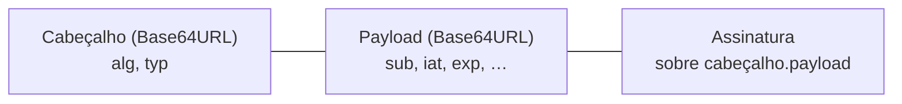

# Autenticação e sessão: quem é você para o servidor, e por quanto tempo

!!! abstract "Cartão de consulta"
    **Use quando:** analisar login, cadastro, recuperação de senha, logout, cookies ou tokens (P3).<br>
    **Pergunta central:** como o servidor decide quem você é, como ele lembra disso entre requisições, e quando deixa de lembrar?<br>
    **Aula:** [A22](../aulas/A22-pentest-superficie-e-identidade.md). **Base:** [A05](../aulas/A05-quem-e-voce-e-pode-fazer-isto.md) (sessão e autorização), [A15](../aulas/A15-chaves-assinaturas-certificados.md) e [A16](../aulas/A16-tls-ciclo-de-chaves.md#hmac) (assinatura e HMAC).

## Síntese

- **Autenticação** prova quem você é uma vez; **sessão** carrega essa prova nas requisições seguintes; **autorização** decide, a cada requisição, o que você pode fazer.
- Um **JWT** é legível por qualquer um: o payload é só codificado em Base64URL. A proteção está na **assinatura**, que só o servidor confere.
- **Logout** só encerra a sessão se o servidor deixar de aceitar a credencial. Apagar o token no navegador não basta.
- Diferenças entre respostas de "senha errada" e "usuário inexistente" revelam quem tem conta (**enumeração**).

---

## Três decisões diferentes

| Decisão | Pergunta | Quando acontece | Falha típica | CWE |
|---|---|---|---|---|
| Autenticação | Você é quem diz ser? | No login | Aceitar credencial inválida | CWE-287 |
| Sessão | Esta requisição vem de quem já se autenticou? | Em toda requisição seguinte | Sessão que não expira ou não termina | CWE-613, CWE-384 |
| Autorização | Esta identidade pode fazer esta ação neste recurso? | Em toda requisição | Ver [Controle de acesso](controle-acesso-apis.md) | CWE-862, CWE-863, CWE-639 |

!!! question "Pergunta do roteiro"
    *Autenticação e autorização são decididas no mesmo ponto?* Em geral, não: o login emite uma credencial; cada rota depois precisa conferir permissão. Uma rota que só confere "há um token válido" autenticou, mas não autorizou.

## Como o servidor lembra de você

| Mecanismo | O que o cliente guarda | Onde fica o estado | Como encerrar |
|---|---|---|---|
| Sessão com identificador opaco | Um número aleatório, em cookie | No servidor (tabela de sessões) | Servidor apaga o registro; o número deixa de valer |
| Token autocontido (JWT) | Um documento assinado com as afirmações | No próprio token | Esperar `exp`, ou o servidor manter lista de revogados |

Com token autocontido, o servidor **não precisa consultar nada** para aceitar a requisição: confere a assinatura e a validade. Isso escala bem, mas torna o logout difícil: se o servidor não guarda estado, um token copiado continua válido até expirar.

## JWT: estrutura e quem verifica

Um JWT tem três partes separadas por ponto: `cabeçalho.payload.assinatura`.



| Parte | Conteúdo | Quem pode ler | Quem pode produzir |
|---|---|---|---|
| Cabeçalho | Algoritmo (`alg`) e tipo | Qualquer um | Qualquer um |
| Payload | Afirmações (*claims*): sujeito, emissão, expiração, papéis | **Qualquer um** | Qualquer um |
| Assinatura | HMAC ou assinatura digital sobre as duas primeiras partes | Qualquer um | **Só quem tem a chave** |

**Claims registradas** (RFC 7519): `iss` (emissor), `sub` (sujeito), `aud` (destinatário), `exp` (expira em), `nbf` (não antes de), `iat` (emitido em). São números de segundos desde 1970 (UTC).

| Algoritmo | Mecanismo | Chave para assinar | Chave para verificar | Retoma |
|---|---|---|---|---|
| `HS256` | HMAC-SHA256 | Segredo compartilhado | O **mesmo** segredo | [A16 — HMAC](../aulas/A16-tls-ciclo-de-chaves.md#hmac) |
| `RS256` | Assinatura RSA com SHA-256 | Chave **privada** do servidor | Chave **pública** | [A15 — assinaturas](../aulas/A15-chaves-assinaturas-certificados.md) |
| `none` | Sem assinatura | — | — | Nunca deve ser aceito por um servidor |

!!! warning "Erro comum"
    Dizer que o token "está criptografado" porque parece ilegível. Base64URL é **codificação**, reversível sem chave. Qualquer dado no payload deve ser tratado como público.

### Prática: decodificar não é validar

Dois programas locais mostram a diferença. Nenhum envia nada à rede.

1. Baixe [`ler_jwt.py`](../assets/pentest/ler_jwt.py) e [`servidor_jwt.py`](../assets/pentest/servidor_jwt.py) para a mesma pasta.
2. No terminal, nessa pasta, emita um token de laboratório e leia-o:

```bash
python3 servidor_jwt.py emitir u1@lab.invalid cliente > meu.jwt
python3 ler_jwt.py meu.jwt
python3 servidor_jwt.py verificar meu.jwt
```

Saída observada (os horários mudam a cada execução):

```text
CABEÇALHO:
{
  "alg": "HS256",
  "typ": "JWT"
}

PAYLOAD:
{
  "sub": "u1@lab.invalid",
  "papel": "cliente",
  "iat": 1794348336,
  "exp": 1794351936
}
  iat = 2026-11-10 22:05:36 UTC
  exp = 2026-11-10 23:05:36 UTC

ASSINATURA: 32 bytes (não verificada por este programa)
ACEITO: sub=u1@lab.invalid papel=cliente
```

3. Agora troque o papel no payload, mantendo a assinatura original, e peça ao servidor para verificar:

```bash
python3 servidor_jwt.py adulterar meu.jwt admin > adulterado.jwt
python3 ler_jwt.py adulterado.jwt
python3 servidor_jwt.py verificar adulterado.jwt
```

```text
PAYLOAD:
{
  "sub": "u1@lab.invalid",
  "papel": "admin",
  ...
}
RECUSADO: assinatura não confere
```

**Interpretação.** O leitor mostrou `"papel": "admin"` sem reclamar: decodificar aceita qualquer coisa. Só o servidor, que tem a chave, percebeu a adulteração. Por isso, no trabalho, as perguntas são: **qual algoritmo o token declara**, **quem verifica a assinatura** e **o servidor recusa um token alterado?**

!!! info "Limite da evidência"
    Este laboratório usa HS256 com uma chave fictícia. O token do Juice Shop pode usar outro algoritmo e outras afirmações. Use o `ler_jwt.py` (ou o roteiro 14.7) com o token da **sua** conta de teste e registre o que observar. Guarde o token em arquivo, não no histórico do terminal, e mascare-o no relatório.

## Onde o token fica no navegador

| Local | Lido por JavaScript da página? | Enviado automaticamente? | Risco principal |
|---|---|---|---|
| Cookie com `HttpOnly` | Não | Sim, a cada requisição ao site | Requisições forjadas por outros sites (CSRF), conforme `SameSite` |
| Cookie sem `HttpOnly` | Sim | Sim | Roubo por XSS **e** CSRF |
| Local Storage / Session Storage | Sim | Não; o código adiciona ao cabeçalho | Roubo por XSS |

### Atributos de cookie

| Atributo | Efeito | No laboratório (HTTP) |
|---|---|---|
| `HttpOnly` | JavaScript não lê o cookie | Reduz o efeito de um XSS sobre a sessão |
| `Secure` | Cookie só é enviado por HTTPS | Num alvo HTTP, um cookie `Secure` não seria enviado; registre a ausência como contexto |
| `SameSite=Strict` | Não enviado em requisições vindas de outros sites | Forte contra CSRF; pode quebrar links de entrada |
| `SameSite=Lax` | Enviado em navegação de topo (links), não em formulários POST de outros sites | Padrão dos navegadores atuais quando omitido |
| `SameSite=None` | Sempre enviado; exige `Secure` | Só faz sentido em HTTPS |

Veja no DevTools (*Storage → Cookies*) ou no cabeçalho `Set-Cookie` da resposta.

## Logout e expiração: o servidor deixou de aceitar?

**Hipótese a testar:** "depois do logout, a credencial anterior é recusada pelo servidor".

1. Faça login com a conta de teste; localize no *History* uma requisição autenticada (linha de base, com ID).
2. Guarde a credencial dessa requisição.
3. Faça logout pela interface.
4. No Requester, reenvie a requisição da etapa 1 **com a credencial antiga**.
5. **Confirmaria:** a resposta continua igual à linha de base. **Negaria:** 401 ou 403, sem os dados.

Repita a ideia para expiração: qual o intervalo entre `iat` e `exp`? É compatível com a função da aplicação?

## Enumeração de usuários

**Definição.** A aplicação revela se uma conta existe pela **diferença** entre respostas. CWE-204 (*Observable Response Discrepancy*).

Compare, nas mesmas condições: senha errada para conta existente × conta inexistente. Também cadastro com e-mail já usado, e recuperação de senha.

| Comparar | Como |
|---|---|
| Código HTTP | Primeira linha da resposta |
| Corpo | Mensagem, campos |
| Tamanho | `Content-Length` ou bytes recebidos |
| Tempo | Médio de várias tentativas; verificar hash de senha leva tempo |
| Cabeçalhos | Algum cabeçalho aparece só num caso? |

O roteiro (14.6) salva cada resposta em arquivo e compara com `diff`. Se **nada** difere, registre o controle funcionando: também é resultado.

!!! warning "Respeite o ROE"
    Tentativas de senha contra contas que vêm no Juice Shop estão limitadas a **100 por conta**, com o limite de taxa ativo. Contas reais, nunca.

## Correspondência com WSTG 4.2 e CWE

| Caso WSTG | Tema | CWE de apoio |
|---|---|---|
| `WSTG-IDNT-04` | Enumeração de contas | CWE-204 |
| `WSTG-ATHN-02` | Credenciais padrão | CWE-1392 |
| `WSTG-ATHN-03` | Bloqueio fraco contra tentativas | CWE-307 |
| `WSTG-ATHN-04` | Contornar o esquema de autenticação | CWE-287 |
| `WSTG-ATHN-07` | Política de senha fraca | CWE-521 |
| `WSTG-ATHN-09` | Troca ou recuperação de senha fraca | CWE-640 |
| `WSTG-SESS-01` | Esquema de gestão de sessão (inclui análise do token) | CWE-384; CWE-347 se a assinatura não for verificada |
| `WSTG-SESS-02` | Atributos de cookie | CWE-1004, CWE-614 |
| `WSTG-SESS-03` | Fixação de sessão | CWE-384 |
| `WSTG-SESS-06` | Logout | CWE-613 |
| `WSTG-SESS-07` | Tempo de sessão | CWE-613 |
| `WSTG-CLNT-12` | Armazenamento no navegador | CWE-922 |

A versão 4.2 não tem um caso próprio para JWT (versões posteriores têm). Analise o token dentro de `WSTG-SESS-01` e cite a CWE pela causa. Confira o identificador na página do caso antes de citá-lo.

## Checklist da fase P3

- Comparação de cadastro, login válido, senha errada, usuário inexistente e logout (código, corpo, tempo, cabeçalhos).
- Local do token, algoritmo, *claims*, expiração; dado sensível no payload?
- Teste de reuso da credencial depois do logout.
- Atributos de cookie, quando houver cookies, com o efeito no contexto HTTP.
- Recuperação de senha e mensagens de erro quanto à enumeração.
- Pelo menos uma hipótese registrada, inclusive se descartada.

## Revisão rápida

1. Por que um JWT alterado pode ser decodificado normalmente, e quem percebe a alteração?
2. Que evidência mostra que o logout encerrou a sessão no servidor, e não só no navegador?
3. Que quatro elementos da resposta você compara para decidir se há enumeração de usuários?

## Fontes de referência

- [RFC 7519 — JSON Web Token](https://www.rfc-editor.org/rfc/rfc7519) e [RFC 8725 — JWT Best Current Practices](https://www.rfc-editor.org/rfc/rfc8725).
- [OWASP WSTG 4.2 — Authentication Testing](https://owasp.org/www-project-web-security-testing-guide/v42/4-Web_Application_Security_Testing/04-Authentication_Testing/README) e [Session Management Testing](https://owasp.org/www-project-web-security-testing-guide/v42/4-Web_Application_Security_Testing/06-Session_Management_Testing/README).
- [OWASP Cheat Sheet — Session Management](https://cheatsheetseries.owasp.org/cheatsheets/Session_Management_Cheat_Sheet.html) e [JSON Web Token](https://cheatsheetseries.owasp.org/cheatsheets/JSON_Web_Token_Cheat_Sheet.html).
- [MDN — Set-Cookie](https://developer.mozilla.org/en-US/docs/Web/HTTP/Headers/Set-Cookie).
- [PortSwigger Web Security Academy — Authentication](https://portswigger.net/web-security/authentication) e [JWT](https://portswigger.net/web-security/jwt).
