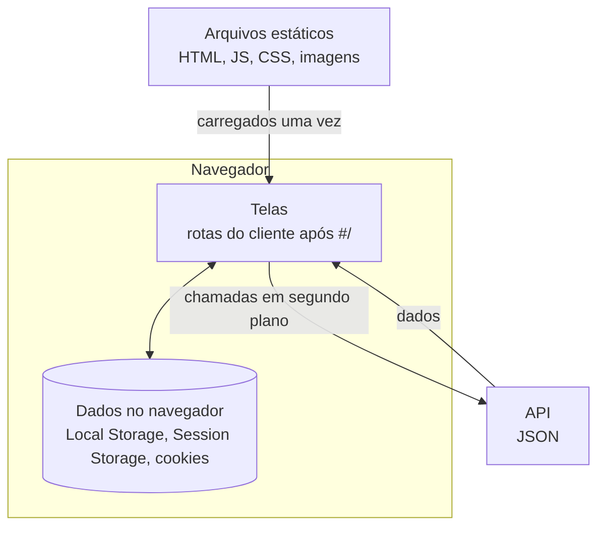

# Reconhecimento e enumeração: mapear a superfície antes de testar

!!! abstract "Cartão de consulta"
    **Use quando:** construir o mapa da aplicação (P1), inventariar endpoints e portas (P2) ou priorizar hipóteses.<br>
    **Pergunta central:** que funções, dados, rotas e serviços o alvo expõe, e o que vale testar primeiro?<br>
    **Aulas:** [A21](../aulas/A21-pentest-processo-referenciais-e-escopo.md) (mapa da SPA) e [A22](../aulas/A22-pentest-superficie-e-identidade.md) (enumeração). **No trabalho:** P1–P2.

## Síntese

- **Reconhecimento** responde "o que esta aplicação faz e com que dados"; **enumeração** responde "que caminhos, portas e respostas existem".
- Numa SPA, separe quatro coisas: **telas** (rotas do cliente), **arquivos estáticos**, **chamadas de API** e **dados guardados no navegador**.
- Antes de descobrir conteúdo, **calibre**: veja como o alvo responde a algo que não existe.
- O produto da fase não é uma lista longa. É um **mapa** com **hipóteses priorizadas**.

---

## Passivo e ativo

| Tipo | O que faz | Exemplo no trabalho | Interfere no alvo? |
|---|---|---|---|
| Passivo | Observa o que já está disponível | Ler o HTML e o JavaScript baixados; ler o tráfego da navegação comum; documentação pública do Juice Shop | Não |
| Ativo | Envia estímulos para provocar respostas | `nmap`, `ffuf`, Client Spider, requisições com métodos diferentes | Sim, dentro dos limites do ROE |

Comece pelo passivo. Ele gera hipóteses sem custo para o alvo e orienta o ativo.

## Mapear uma SPA: quatro camadas

O Juice Shop é uma **SPA** (*single-page application*). O navegador baixa um HTML pequeno e um JavaScript grande; o JavaScript monta as telas e chama a API.



| Camada | Como reconhecer | Onde ver | Pergunta de segurança |
|---|---|---|---|
| Telas | Mudam a URL depois de `#/` sem nova página | Barra de endereço; JavaScript | Uma tela "escondida" está protegida no servidor ou só não tem link? |
| Estáticos | `.js`, `.css`, imagens, fontes | *Sites* no ZAP | O código revela rotas, chaves ou funções não exibidas? |
| API | Respostas JSON, em geral sob prefixos próprios | *History*, filtrando por tipo | O servidor decide quem pode ver o quê? |
| Dados no navegador | Valores guardados pelo cliente | DevTools → *Storage* (Firefox) | O que fica guardado, por quanto tempo, e quem pode ler? |

!!! tip "No trabalho"
    Registre funcionalidades **visíveis** (há botão) e **inferidas** (aparecem no JavaScript ou na API, sem botão). O que o roteiro chama de "parece escondido só no frontend" é exatamente a segunda lista.

### Perguntas do mapa

- Que **dados** o sistema manipula? Quais são pessoais, financeiros ou de outros usuários?
- O que **muda depois do login**? Novas chamadas, novos campos, novos dados guardados?
- Que chamadas acontecem **sem interação direta**, só por abrir uma tela?
- Que funções aparecem no **código** mas não na **interface**?

### Manual × Client Spider

1. Navegue como usuário comum pelos fluxos principais: cadastro, login, busca, cesta, pedido, avaliação, suporte, perfil.
2. Salve uma captura da árvore *Sites*.
3. Execute o Client Spider no contexto.
4. Compare: o que só um dos dois encontrou?

O spider é mais **amplo**; você é mais **profundo** (preenche formulários, faz login, completa fluxos). A diferença entre os dois é parte da evidência de P1.

## Inventário de endpoints

Para cada chamada de API relevante, registre:

| Método | Caminho (com parâmetros genéricos) | Autenticação exigida? | Código típico | Dado retornado | Observação |
|---|---|---|---|---|---|
| `GET` | `/caminho/{id}` | sim/não/não testado | 200 | campos principais | hipótese que ele sugere |

Use `{id}` no lugar de valores concretos para agrupar chamadas do mesmo tipo. "Autenticação exigida" só pode ser preenchido **depois** de repetir a chamada sem credencial.

## Portas: o que o `nmap` diz, e o que não diz

O roteiro limita a varredura a `10.77.2.10` (14.4):

```bash
sudo nmap -Pn -sT -p 22,3000 -sV 10.77.2.10 -oN evidencias/02_enum/nmap_escopo.txt
```

| Opção | Significado |
|---|---|
| `-Pn` | Não testa se o host está ativo antes; trata como ativo (o ICMP pode estar filtrado) |
| `-sT` | Varredura por conexão TCP completa, feita pelo sistema operacional |
| `-p 22,3000` | Só as portas indicadas |
| `-sV` | Tenta identificar serviço e versão pela resposta |
| `--max-rate 50` | Teto de pacotes por segundo |
| `-oN arquivo` | Grava a saída em texto |

| Estado | O que o `nmap` observou | O que você ainda precisa decidir |
|---|---|---|
| `open` | Um serviço aceitou a conexão | Qual serviço, e se está no escopo |
| `closed` | O host respondeu recusando (RST) | Nada escuta; o caminho até o host está aberto |
| `filtered` | Nenhuma resposta, ou resposta de bloqueio | **Quem** bloqueou: gateway ou SG do alvo? |

!!! warning "Erro comum"
    Concluir que uma porta *filtered* está bloqueada "no alvo". Na sua topologia, o gateway descarta antes. Se a linha `TF_FWD_DROP` aparece no gateway para aquela porta, o bloqueio foi lá. Veja [Infraestrutura](infraestrutura.md#contraprovas-i0i5-resultado-configuracao).

## Descoberta de conteúdo: calibrar antes de filtrar

**Síntese.** Ferramentas como o `ffuf` testam nomes de uma lista e mostram as respostas "diferentes de inexistente". Para isso, você precisa saber **como é** a resposta a algo inexistente.

**Por que numa SPA isso é crítico.** Muitas SPAs devolvem a página principal, com HTTP **200**, para qualquer caminho desconhecido: o próprio JavaScript decide depois que a tela não existe. Um filtro só por código (`404`) esconderia tudo, ou mostraria tudo.

!!! example "Exemplo trabalhado — calibração em Juice Shop 20.3.0 local"
    Observação feita em uma instância local da versão fixada no trabalho, em 10 nov. 2026:

    ```text
    raiz:        HTTP 200, 9984 bytes, text/html
    inexistente: HTTP 200, 9984 bytes, text/html
    ```

    **Interpretação:** para rotas fora da API, "não existe" tem o **mesmo código e o mesmo tamanho** da página inicial. O filtro útil aqui é por tamanho (`-fs 9984`), não por código.

    **Sua extensão:** calibre separadamente um caminho inexistente **dentro do prefixo da API**. A API pode responder de forma diferente das rotas do cliente; registre código, tamanho e tipo.

```bash
ffuf -u "$TARGET/FUZZ" -w /usr/share/wordlists/dirb/common.txt -rate 20 -t 5 \
     -fs <bytes-da-calibracao> -of md -o evidencias/02_enum/ffuf.md
```

| Opção | Significado |
|---|---|
| `FUZZ` | Posição onde cada palavra da lista é inserida |
| `-w` | Lista de palavras |
| `-rate 20` | No máximo 20 requisições por segundo (ROE) |
| `-t 5` | Até 5 requisições simultâneas |
| `-fs` / `-fc` | Filtra (esconde) respostas com esse tamanho / código |
| `-of md -o` | Formato e arquivo de saída |

!!! info "Limite da evidência"
    Um filtro pode esconder uma descoberta válida que, por acaso, tenha o tamanho filtrado. Examine **à mão** uma amostra do que foi descartado e registre o que viu.

## Cabeçalhos, métodos e erros

Leia, de forma pontual, as respostas que você já tem:

| Elemento | O que observar | Por que importa |
|---|---|---|
| `Content-Security-Policy` | Existe? Restringe a origem de scripts? | Limita o efeito de XSS |
| `X-Frame-Options` / `frame-ancestors` | A página pode ser embutida em outra? | *Clickjacking* |
| `X-Content-Type-Options: nosniff` | O navegador respeita o tipo declarado? | Evita interpretar dado como script |
| `Access-Control-Allow-Origin` | Que origens podem ler respostas por script? | CORS permissivo expõe dados a outros sites |
| `Strict-Transport-Security` | Só faz sentido em HTTPS | Registre a ausência como **contexto** do laboratório HTTP |
| Cabeçalhos de servidor e versão | Revelam tecnologia e versão? | Componente vulnerável (P7) |
| Mensagens de erro | Pilha de execução, consulta, caminho interno? | Exposição e pista de contexto (P5, P7) |
| Métodos aceitos | Respostas a `OPTIONS`, `PUT`, `DELETE` em rotas de leitura | Função exposta sem necessidade |

## Priorizar hipóteses

Saia da fase com **três hipóteses** priorizadas (evidência mínima de P1). Um critério simples:

| Critério | Pergunta |
|---|---|
| Impacto | Se a premissa falhar, que dado ou função é afetado? |
| Indício | Que observação do mapa sugere a falha? |
| Custo do teste | Qual a menor ação que confirma ou nega, dentro do ROE? |

Hipótese boa nomeia a **premissa**: "o servidor exige que o dono do objeto seja o usuário autenticado". Hipótese fraca nomeia a técnica: "testar IDOR".

## Correspondência com o WSTG 4.2

| Caso | Tema |
|---|---|
| `WSTG-INFO-02` | Identificar servidor web |
| `WSTG-INFO-05` | Revisar conteúdo da página em busca de vazamento |
| `WSTG-INFO-06` | Identificar pontos de entrada |
| `WSTG-INFO-07` | Mapear caminhos de execução |
| `WSTG-INFO-08` | Identificar framework |
| `WSTG-INFO-10` | Mapear a arquitetura |
| `WSTG-CONF-06` | Testar métodos HTTP |

## Checklist das fases P1–P2

- Mapa de telas, estáticos, API e dados no navegador.
- Comparação manual × Client Spider.
- Inventário de endpoints com método, autenticação, código.
- Varredura de portas somente no alvo, com decisão sobre *filtered*.
- Calibração registrada antes da descoberta de conteúdo, com amostra manual do descartado.
- Três hipóteses priorizadas e justificadas.

## Revisão rápida

1. Por que um filtro só por código HTTP falha na descoberta de conteúdo de uma SPA?
2. Como você decide se uma porta *filtered* foi bloqueada no gateway ou no alvo?
3. Qual a diferença entre uma funcionalidade visível e uma inferida, e por que a segunda interessa?

## Fontes de referência

- [OWASP WSTG 4.2 — Information Gathering](https://owasp.org/www-project-web-security-testing-guide/v42/4-Web_Application_Security_Testing/01-Information_Gathering/README).
- [Nmap — Port Scanning Basics](https://nmap.org/book/man-port-scanning-basics.html) (estados das portas).
- [ffuf — documentação](https://github.com/ffuf/ffuf).
- [MDN — cabeçalhos HTTP](https://developer.mozilla.org/pt-BR/docs/Web/HTTP/Headers).
