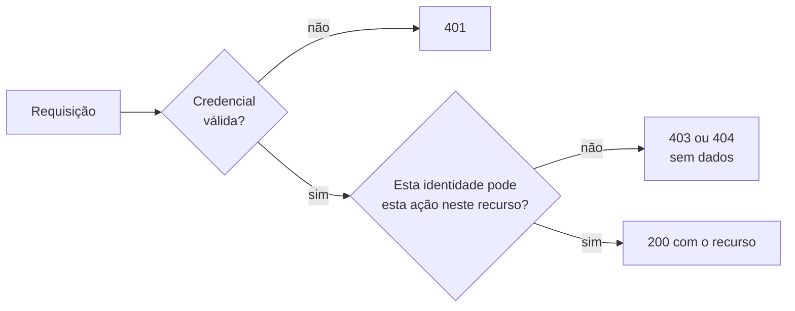

# Controle de acesso e APIs: o servidor confere quem pode o quê?

!!! abstract "Cartão de consulta"
    **Use quando:** testar acesso entre contas (P4), avaliar endpoints de API (P6) ou preencher a matriz de autorização.<br>
    **Pergunta central:** para cada requisição, o servidor verifica se **esta identidade** pode fazer **esta ação** sobre **este objeto ou função**?<br>
    **Aula:** [A22](../aulas/A22-pentest-superficie-e-identidade.md). **Base:** [A05 — Quem é você e pode fazer isto?](../aulas/A05-quem-e-voce-e-pode-fazer-isto.md) (Ana, Bruno e a cesta).

## Síntese

- Autorização é uma decisão **por requisição**, no **servidor**: `identidade → ação → recurso → permitido?`.
- **Horizontal:** acessar algo de outro usuário do mesmo nível. **Vertical:** usar uma função de outro perfil.
- Em APIs, a falha pode estar no **objeto** (API1), na **propriedade** (API3) ou na **função** (API5).
- Esconder um botão não é controle. O teste é feito **fora da interface**, repetindo a requisição com outra identidade ou outro identificador.
- Leia o **corpo**, não só o código: um 200 sem dado e um 403 com dado dizem coisas opostas.

---

## A decisão que precisa existir



O primeiro losango é **autenticação** (já visto em [Autenticação e sessão](autenticacao-sessao.md)). O segundo é **autorização**. A falha típica acontece quando a aplicação implementa só o primeiro: "tem token válido? então entrega".

Como na [A05](../aulas/A05-quem-e-voce-e-pode-fazer-isto.md#a-correcao-pertence-ao-servidor), a correção pertence ao servidor: a interface pode esconder um botão, mas a requisição pode ser montada sem ela.

## Três níveis de autorização em APIs

| Nível | Pergunta | Exemplo de violação | API Top 10 2023 | CWE |
|---|---|---|---|---|
| **Objeto** | Este objeto pertence a quem pede? | Trocar o identificador na URL e ler o pedido de outra conta | API1 — *Broken Object Level Authorization* | CWE-639 |
| **Propriedade** | Este campo pode ser lido ou alterado por quem pede? | API devolve campos que a tela não mostra; ou aceita no corpo um campo que o usuário não deveria definir | API3 — *Broken Object Property Level Authorization* | CWE-213 (excesso), CWE-915 (atribuição em massa) |
| **Função** | Este perfil pode usar esta operação? | Usuário comum chama uma rota administrativa, ou usa um método (`DELETE`, `PUT`) não previsto | API5 — *Broken Function Level Authorization* | CWE-285, CWE-862 |

**Horizontal × vertical:**

| Tipo | Quem tenta | O quê | Nível típico |
|---|---|---|---|
| Horizontal | U2 (cliente) | Recurso de U1 (cliente) | Objeto, propriedade |
| Vertical | U1 (cliente) | Função de administrador | Função |

## Método: duas contas e uma matriz

1. **Crie duas contas** de teste no seu alvo (U1 e U2), com e-mails `@lab.invalid`.
2. **Linha de base:** cada conta acessa os **próprios** recursos pela interface. Anote os IDs das mensagens.
3. **Escolha um recurso** que U1 possui e registre seu identificador.
4. **Troque a identidade:** reenvie a requisição de U1 com o token de U2 (Requester ou roteiro 14.8).
5. **Troque o identificador:** com o token de U2, peça o objeto de U1.
6. **Compare** código, tamanho e **corpo** com a linha de base.
7. **Preencha a matriz**, inclusive quando o controle funcionar.

```bash
curl -s -i "$TARGET/$RECURSO_U1" -H "Authorization: Bearer $TOKEN_U1" -o evidencias/04_acesso/U1_le_U1.txt
curl -s -i "$TARGET/$RECURSO_U1" -H "Authorization: Bearer $TOKEN_U2" -o evidencias/04_acesso/U2_le_U1.txt
diff -u evidencias/04_acesso/U1_le_U1.txt evidencias/04_acesso/U2_le_U1.txt
```

| Parte do comando | Função |
|---|---|
| `-i` | Inclui os cabeçalhos da resposta no arquivo, para comparar código e tamanho |
| `-H "Authorization: Bearer …"` | Envia a credencial como o cliente envia; confira no *History* como o seu alvo a envia |
| `-o arquivo` | Salva a resposta com nome que diz quem pediu o quê |
| `diff -u` | Mostra as linhas diferentes; **corpos iguais** com tokens diferentes indicam falha de autorização |

!!! info "Antes de usar o comando"
    Os valores de `RECURSO_U1`, `TOKEN_U1` e `TOKEN_U2` vêm da **sua** observação no ZAP. Confira se o alvo envia a credencial em `Authorization`, em cookie ou em ambos, e reproduza o mesmo formato.

### Como ler a resposta

| Resposta observada | Interpretação provável | Próximo passo |
|---|---|---|
| 200 com o dado do outro usuário | Falha de autorização confirmada para esta ação | Reproduzir no alvo do colega; testar outro objeto |
| 200 com corpo vazio ou com o **seu** próprio dado | O servidor ignorou o identificador ou filtrou pelo dono | Controle provavelmente funcionando; confirme com outro objeto |
| 401 | Sem credencial válida | Confira se o token foi enviado como o cliente envia |
| 403 sem dado | Recusa explícita | Controle funcionando; registre |
| 404 sem dado | Recusa que esconde a existência do objeto | Controle funcionando, possivelmente melhor que 403 |
| 403 **com** dado no corpo | A recusa é só cosmética | Falha; o código engana |
| 500 | Erro não tratado | Hipótese nova (P5/P7); não conclua autorização |

!!! warning "Erro comum"
    Concluir pelo código HTTP. O roteiro pergunta: "a recusa vem com código adequado **e sem conteúdo no corpo**?". Sempre leia o corpo.

## Exemplo trabalhado: matriz de autorização

!!! example "Aplicação didática fictícia — ordens de manutenção"
    A regra declarada é: *cada conta só lê e altera as próprias ordens; só o perfil supervisor fecha ordens*. U1 possui a ordem 17; U2 possui a 18. Caminhos e respostas são **artificiais**, não do Juice Shop.

    | Identidade | Recurso / função | Ação | Esperado pela regra | Observado | Evidência | Conclusão |
    |---|---|---|---|---|---|---|
    | U1 | `/api/ordens/17` | GET | 200, ordem 17 | 200, ordem 17 | msg 405 | Linha de base |
    | U2 | `/api/ordens/17` | GET | 403/404 sem dado | 200, ordem 17 de U1 | msg 412 | **Falha horizontal (objeto)** |
    | U2 | `/api/ordens/17` | PUT (descrição) | 403/404 | 403, corpo `{"erro":"proibido"}` | msg 418 | Controle de escrita funcionando |
    | U1 | `/api/ordens/17/fechar` | POST | 403 (não é supervisor) | 403, sem dado | msg 421 | Controle de função funcionando |
    | U1 | `/api/ordens` | POST com `"dono": "U2"` | Ignorar `dono`, usar o da sessão | 201, ordem criada com dono U2 | msg 430 | **Falha de propriedade (atribuição em massa)** |

    **O que a matriz mostra:** a leitura por objeto falha; a escrita por objeto e a função de supervisor estão protegidas. A criação aceita um campo que deveria ser definido pelo servidor. São **duas causas raiz diferentes**: falta de verificação de dono na leitura; vinculação automática de todos os campos do corpo.

    **Limite:** um objeto por conta não prova o comportamento para todos os objetos e perfis. A conclusão vale para as ações testadas.

## Excesso de dados: a API devolve mais do que a tela mostra

Uma API pode devolver o objeto inteiro e deixar a tela escolher o que exibir. Os campos ocultos continuam na resposta.

```bash
curl -s "$TARGET/<endpoint-api>" -H "Authorization: Bearer $TOKEN_U1" -o evidencias/07_dados/resposta.json
jq -r 'paths(scalars) | map(if type=="number" then "[]" else tostring end) | join(".")' \
   evidencias/07_dados/resposta.json | sort -u
```

| Parte | Função |
|---|---|
| `paths(scalars)` | Lista o caminho de cada valor simples do JSON |
| `map(if type=="number" then "[]" …)` | Troca índices de lista por `[]`, agrupando itens repetidos |
| `join(".")` e `sort -u` | Monta nomes como `dados.[].email` e remove repetições |

Compare a lista de campos com o que a tela exibe. Preencha, para cada endpoint relevante:

| Endpoint | Método | Autenticação | Dados retornados × necessários | Risco API Top 10 2023 | Evidência |
|---|---|---|---|---|---|

## Atribuição em massa (*mass assignment*)

**Definição.** A aplicação copia automaticamente todos os campos do corpo JSON para o objeto salvo, incluindo campos que o usuário não deveria controlar (dono, papel, preço, status). CWE-915.

**Como formular a hipótese:** observe a resposta de criação ou atualização. Ela devolve campos que o formulário não envia? Esses campos, enviados pelo cliente, seriam aceitos?

**Teste mínimo:** reenviar a requisição legítima acrescentando **um** campo, com valor inofensivo e identificável. Verifique na resposta e numa leitura posterior se o valor foi aceito.

## Correspondência com WSTG 4.2 e CWE

| Caso WSTG | Tema | CWE de apoio |
|---|---|---|
| `WSTG-ATHZ-02` | Contornar o esquema de autorização | CWE-862, CWE-863 |
| `WSTG-ATHZ-03` | Escalada de privilégio | CWE-269 |
| `WSTG-ATHZ-04` | Referência direta insegura a objeto (IDOR) | CWE-639 |
| `WSTG-BUSL-02` | Forjar requisições | CWE-915 (quando for atribuição em massa) |

## Checklist das fases P4 e P6

- Duas contas no seu alvo; linha de base de cada uma.
- Pelo menos um teste horizontal e um vertical.
- Matriz preenchida, com "controle funcionando" registrado quando for o caso.
- Comparação entre o que a API devolve e o que a tela mostra.
- Pelo menos um teste de propriedade (excesso ou atribuição) e um de função.
- Corpo da resposta lido e citado na conclusão.

## Revisão rápida

1. Que diferença existe entre uma falha de autorização por objeto e por função?
2. Por que um 403 não basta para concluir que o controle funciona?
3. O que você precisa testar além de um único objeto antes de generalizar a conclusão?

## Fontes de referência

- [OWASP API Security Top 10 2023](https://owasp.org/API-Security/editions/2023/en/0x11-t10/): API1, API3, API5.
- [OWASP WSTG 4.2 — Authorization Testing](https://owasp.org/www-project-web-security-testing-guide/v42/4-Web_Application_Security_Testing/05-Authorization_Testing/README).
- [OWASP Cheat Sheet — Authorization](https://cheatsheetseries.owasp.org/cheatsheets/Authorization_Cheat_Sheet.html) e [Mass Assignment](https://cheatsheetseries.owasp.org/cheatsheets/Mass_Assignment_Cheat_Sheet.html).
- [MITRE CWE-639](https://cwe.mitre.org/data/definitions/639.html), [CWE-862](https://cwe.mitre.org/data/definitions/862.html), [CWE-863](https://cwe.mitre.org/data/definitions/863.html), [CWE-915](https://cwe.mitre.org/data/definitions/915.html).
- [PortSwigger Web Security Academy — Access control](https://portswigger.net/web-security/access-control).
