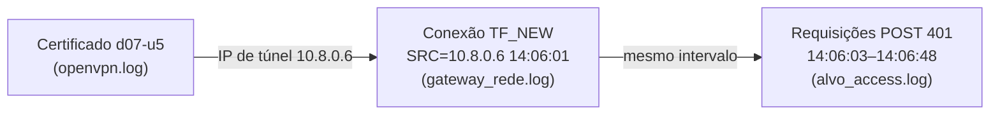

# Correção, reteste e detecção: do achado à defesa

!!! abstract "Cartão de consulta"
    **Use quando:** propor a correção de um achado (P10), planejar o reteste, montar a linha do tempo ou avaliar uma regra de detecção (P11).<br>
    **Pergunta central:** que mudança impede a **classe** do problema, como provar que ela funciona sem quebrar o uso legítimo, e como perceber se alguém explorou a falha?<br>
    **Aula:** [A24](../aulas/A24-pentest-do-achado-a-decisao.md). **Base:** [A13 — telemetria e contenção](../aulas/A13-protecao-de-endpoints.md#telemetria) e [A20 — caso permitido/negado](../aulas/A20-validacao-ot-pentest.md#regras-de-engajamento-um-plano-para-testar-o-bloqueio).

## Síntese

- **Causa raiz** é o controle que falta ou está no lugar errado. A correção trata a **classe**, não o exemplo testado.
- O **reteste** tem dois casos: o **indevido** deve passar a ser recusado e o **legítimo** deve continuar funcionando (regressão).
- A **linha do tempo** liga sujeito, conexão, requisição, horário e resultado, usando fontes de confiança diferente.
- Um campo de log que o cliente controla não serve para atribuição.
- Uma regra de detecção só tem taxa de acerto se for avaliada em **eventos rotulados**; sem eles, fale em falsos positivos e negativos **potenciais**.

---

## Causa raiz: sintoma, causa e classe

| Nível | Pergunta | Exemplo (leitura de objeto alheio) |
|---|---|---|
| Sintoma | O que foi observado? | U2 leu a ordem 17 de U1 |
| Causa imediata | Por que aconteceu nesta rota? | A rota busca a ordem só pelo número |
| **Causa raiz** | Que controle falta, ou está no lugar errado? | Não há verificação de dono **no servidor**; a interface só não mostra o link |
| **Classe** | Onde mais a mesma causa pode existir? | Qualquer rota que receba um identificador de objeto do cliente |

| Correção proposta | Trata a classe? | Por quê |
|---|---|---|
| Esconder o botão ou o link | Não | A requisição continua possível fora da interface |
| Trocar números sequenciais por identificadores aleatórios | Não | Dificulta adivinhar, mas quem obtém o identificador ainda lê |
| Bloquear o número 17 para U2 | Não | Trata o exemplo |
| **Verificar no servidor, em cada rota com identificador, se o objeto pertence ao usuário da sessão (ou se o papel permite)**, de forma centralizada | **Sim** | Remove a causa em todas as rotas que usam o mecanismo comum |

!!! tip "No trabalho"
    Quando houver o **desafio de código** correspondente no Juice Shop (*coding challenge*), use-o como apoio: ele mostra o trecho vulnerável e alternativas de correção. Justifique por que as alternativas descartadas **não** tratam a causa.

## Plano de reteste: o indevido falha, o legítimo continua

| Caso | Identidade | Ação | Antes da correção | Esperado depois | Evidência esperada |
|---|---|---|---|---|---|
| Indevido | U2 | Ler ordem 17 (de U1) | 200 com dado | 403/404 **sem** dado | Resposta salva + diff com a anterior |
| **Regressão** | U1 | Ler ordem 17 (própria) | 200 com dado | 200 com dado | Igual à linha de base |
| Cobertura | U2 | Ler outra ordem de outra conta | 200 com dado | 403/404 sem dado | Resposta salva |
| Função preservada | U2 | Ler ordem 18 (própria) | 200 com dado | 200 com dado | Igual à linha de base |

**Por que a regressão é obrigatória:** uma "correção" que recusa tudo passaria no caso indevido e quebraria a aplicação. É o mesmo raciocínio de função preservada da [A20](../aulas/A20-validacao-ot-pentest.md).

O trabalho **não exige aplicar** a correção no alvo. Exige o plano, com a evidência que você coletaria em cada caso.

## Detecção: de quem era esta requisição?

### Três fontes, três níveis de confiança

| Fonte | Registra | Quem controla o conteúdo | Serve para |
|---|---|---|---|
| Journal do OpenVPN | Certificado (CN) ↔ IP de túnel ↔ horário | O gateway, a partir do certificado verificado | **Sujeito**: que identidade usava o IP |
| Log do kernel (`TF_NEW`) | Nova conexão TCP: origem, destino, porta, horário | O gateway, a partir do cabeçalho IP real | **Conexão**: de que IP veio |
| Log de acesso da aplicação | Requisição: origem declarada, método, caminho, código | A aplicação, **com campos que podem vir do cliente** | **Ação**: o que foi pedido e o resultado |



### Por que o IP do log da aplicação pode mentir

Quando uma aplicação fica atrás de um proxy, ela pode ser configurada para confiar no cabeçalho `X-Forwarded-For`, que o proxy preenche com o IP original. Se **nenhum proxy** confiável remove ou reescreve esse cabeçalho, o **cliente** pode enviá-lo com qualquer valor, e a aplicação registra o valor declarado. CWE-348 (*Use of Less Trusted Source*).

**Hipótese a testar no seu alvo (P11):** "o IP gravado pela aplicação pode ser influenciado pelo cliente".

1. Envie uma requisição a uma rota que apareça no log de acesso, com o cabeçalho `X-Forwarded-For` contendo um endereço de documentação (por exemplo, `203.0.113.77`).
2. Exporte o log de acesso (rotina I.8) e localize a linha pelo horário e pelo caminho.
3. Compare o IP registrado com a linha `TF_NEW` da mesma conexão.
4. **Confirmaria:** o log mostra o valor enviado. **Negaria:** o log mostra o seu IP de túnel.

!!! info "Detalhes do registro"
    - Nem toda requisição aparece no log de acesso: arquivos estáticos podem ser servidos antes do registrador. Escolha uma rota que você confirmou estar no log.
    - O Node.js pode registrar um IPv4 como `::ffff:10.8.0.6` (IPv4 mapeado em IPv6). Normalize antes de comparar com `SRC=10.8.0.6`.
    - Com *keep-alive*, várias requisições usam **a mesma** conexão TCP: uma linha `TF_NEW` pode corresponder a muitas linhas no log da aplicação.

## Prática: avaliar uma regra em eventos rotulados

A pasta [`deteccao/`](../assets/pentest/deteccao/avaliar_regra.py) contém registros **artificiais**, gerados para o curso, no formato dos registros do trabalho, e um avaliador:

| Arquivo | Conteúdo |
|---|---|
| [`alvo_access.log`](../assets/pentest/deteccao/alvo_access.log) | 46 requisições a uma API fictícia de login |
| [`gateway_rede.log`](../assets/pentest/deteccao/gateway_rede.log) | Linhas `TF_NEW` de cinco IPs de túnel |
| [`openvpn.log`](../assets/pentest/deteccao/openvpn.log) | Certificado ↔ IP de túnel de cinco identidades |
| [`janelas_rotuladas.csv`](../assets/pentest/deteccao/janelas_rotuladas.csv) | Sete janelas de um minuto rotuladas como `ataque` ou `legitimo`, pela **origem real** |
| [`avaliar_regra.py`](../assets/pentest/deteccao/avaliar_regra.py) | Aplica a regra e conta acertos e erros |

**A regra candidata do roteiro (14.11):** mais de 5 respostas 401 por origem, no mesmo minuto.

Baixe os cinco arquivos para uma pasta `deteccao` e execute, nela:

```bash
awk '$9==401 {split($4,t,":"); print $1, substr(t[1],2), t[2]":"t[3]}' alvo_access.log \
  | sort | uniq -c | awk '$1>5'
python3 avaliar_regra.py alvo_access.log janelas_rotuladas.csv
```

| Parte do `awk` | Função |
|---|---|
| `$9==401` | Nono campo da linha (código HTTP) igual a 401 |
| `split($4,t,":")` | Divide o quarto campo (`[24/Nov/2026:14:01:03`) em data, hora, minuto, segundo |
| `print $1, substr(t[1],2), t[2]":"t[3]` | Imprime origem, data sem o `[` e `hora:minuto` |
| `sort \| uniq -c` | Conta linhas iguais: 401 por origem e minuto |
| `awk '$1>5'` | Mantém só contagens maiores que 5 |

Saída observada:

```text
     12 ::ffff:10.8.0.3 24/Nov/2026 14:01
      6 ::ffff:10.8.0.4 24/Nov/2026 14:02
```

```text
Regra: mais de 5 respostas 401 por origem registrada no mesmo minuto

janela origem real  minuto  rótulo    401 no log  resultado
J1     10.8.0.2     14:00   legitimo  1           verdadeiro negativo
J2     10.8.0.3     14:01   ataque    12          verdadeiro positivo
J3     10.8.0.4     14:02   legitimo  6           FALSO POSITIVO
J4     10.8.0.5     14:03   ataque    4           FALSO NEGATIVO
J5     10.8.0.5     14:04   ataque    4           FALSO NEGATIVO
J6     10.8.0.5     14:05   ataque    4           FALSO NEGATIVO
J7     10.8.0.6     14:06   ataque    0           FALSO NEGATIVO

VP=1  FP=1  FN=4  VN=1
Ataques detectados: 1 de 5
Alertas corretos: 1 de 2
```

**Leia o resultado:**

| Janela | O que aconteceu | Lição |
|---|---|---|
| J2 | Tentativa rápida, 12 em um minuto | A regra funciona para o caso que motivou sua criação |
| J3 | Pessoa errou a senha 6 vezes e depois acertou | **Falso positivo**: o limiar está perto do comportamento humano |
| J4–J6 | Tentativa lenta, 4 por minuto, durante 3 minutos | **Falso negativo**: a janela de um minuto não acumula |
| J7 | Tentativa rápida, mas cada requisição declarou um `X-Forwarded-For` diferente | **Falso negativo**: a origem do log da aplicação foi controlada pelo cliente; nenhuma "origem" passou de 1 |

Agora rode com limiar 3 (`python3 avaliar_regra.py alvo_access.log janelas_rotuladas.csv 3`). A tentativa lenta passa a ser detectada, mas o falso positivo continua e **J7 continua invisível**. Nenhum ajuste de limiar resolve J7: a correção é **mudar a fonte da origem** (endereço do socket, ou o log de rede do gateway).

!!! example "Sua extensão"
    Use `gateway_rede.log` e `openvpn.log` para dizer **qual certificado** fez as tentativas de J7. Registre o raciocínio: que linha liga o IP de túnel ao certificado, e que linha liga o IP de túnel ao horário das requisições?

!!! info "Limite da evidência"
    Os rótulos foram definidos por quem gerou os dados. No trabalho, você produz o próprio conjunto: por exemplo, 10 logins legítimos e 10 tentativas que a regra deveria detectar, com horários anotados. Sem conjunto rotulado, não escreva taxas.

## Contenção proporcional

Detectar não basta: qual a resposta **proporcional**?

| Opção | Alcance | Efeito colateral |
|---|---|---|
| Bloquear o IP de túnel no gateway | Só aquela sessão | O IP muda na próxima conexão |
| **Revogar o certificado** (I.7) | A identidade, em qualquer nova conexão | O dono legítimo precisa de novo certificado |
| Bloquear a conta na aplicação | A conta, por qualquer caminho | Pode ser usado para bloquear contas alheias (negação de serviço) |
| Parar o serviço | Todos | Indisponibilidade para todos |

A escolha depende da evidência de **quem** fez o quê, que é exatamente o que a linha do tempo fornece. É o mesmo raciocínio de contenção e retorno da [A13](../aulas/A13-protecao-de-endpoints.md).

## Checklist das fases P10–P11

- Causa raiz e classe de cada achado; correção que trata a classe; alternativas descartadas.
- Plano de reteste com caso indevido, regressão e evidência esperada.
- Linha do tempo de um achado: certificado → IP de túnel → `TF_NEW` → requisição → resultado.
- Hipótese sobre a origem registrada pela aplicação, testada no seu alvo.
- Regra de detecção avaliada em eventos rotulados, com VP, FP e FN.
- Contenção proporcional relacionada à revogação de I.7.

## Revisão rápida

1. Por que identificadores aleatórios não corrigem uma falha de autorização por objeto?
2. Por que nenhum limiar de contagem detecta a janela J7, e que mudança de fonte resolveria?
3. Que dois casos todo plano de reteste precisa ter, e o que cada um evita?

## Fontes de referência

- [OWASP Cheat Sheet — Logging](https://cheatsheetseries.owasp.org/cheatsheets/Logging_Cheat_Sheet.html) e [Authorization](https://cheatsheetseries.owasp.org/cheatsheets/Authorization_Cheat_Sheet.html).
- [MITRE CWE-348 — Use of Less Trusted Source](https://cwe.mitre.org/data/definitions/348.html) e [CWE-117 — Improper Output Neutralization for Logs](https://cwe.mitre.org/data/definitions/117.html).
- [MDN — X-Forwarded-For](https://developer.mozilla.org/en-US/docs/Web/HTTP/Headers/X-Forwarded-For) (seção de segurança e privacidade).
- [Express — behind proxies (`trust proxy`)](https://expressjs.com/en/guide/behind-proxies.html).
- [OWASP Juice Shop — Companion Guide](https://pwning.owasp-juice.shop/companion-guide/latest/) (desafios de código).
- [NIST SP 800-61 Rev. 3](https://csrc.nist.gov/pubs/sp/800/61/r3/final) (resposta a incidentes).
