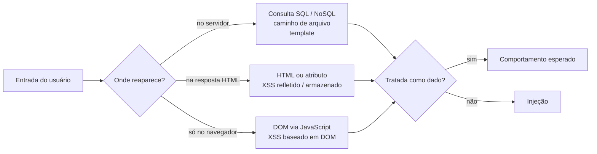

# Entradas: injeção e XSS — quem interpreta o que você envia?

!!! abstract "Cartão de consulta"
    **Use quando:** investigar campos, parâmetros, corpos JSON, uploads e qualquer lugar onde sua entrada reaparece (P5).<br>
    **Pergunta central:** a entrada continua sendo **dado**, ou algum interpretador passa a tratá-la como **instrução**?<br>
    **Aula:** [A23](../aulas/A23-pentest-entradas-logica-e-automacao.md). **No trabalho:** P5 e o achado obrigatório de entrada de dados.

## Síntese

- **Injeção** acontece quando a entrada atravessa a fronteira entre **dado** e **código**: o interpretador (banco, navegador, sistema de arquivos) passa a executá-la como instrução.
- Antes de testar, escreva o **contexto provável**: SQL, NoSQL, HTML, atributo, JavaScript/DOM, caminho, template ou JSON.
- Comece por um **marcador inofensivo** para descobrir onde a entrada reaparece; só depois use caracteres que quebram o contexto.
- Em XSS, a pergunta é **fonte → sink → contexto**. Execução no DOM pode não aparecer no log do servidor: a evidência é o navegador.
- A correção trata a **classe**: separar dado de código (parametrização, codificação por contexto), não bloquear uma palavra.

---

## O mesmo erro em vários interpretadores



| Contexto | Interpretador | Caracteres que costumam quebrar o contexto | Correção da classe | CWE |
|---|---|---|---|---|
| SQL | Banco relacional | `'` `"` `)` `--` `;` | Consulta parametrizada | CWE-89 |
| NoSQL | Banco de documentos | Objetos/operadores onde se esperava texto | Validar tipo; não aceitar objeto onde se espera valor | CWE-943 |
| Corpo HTML | Navegador | `<` `>` | Codificar para HTML ao exibir | CWE-79 |
| Atributo HTML | Navegador | `"` `'` espaço | Codificar para atributo; sempre entre aspas | CWE-79 |
| JavaScript / DOM | Navegador | Depende do *sink* (`innerHTML`, `eval`, `href`) | Usar `textContent`; evitar *sinks* perigosos | CWE-79 |
| Caminho de arquivo | Sistema de arquivos | `../` `%2e%2e%2f` | Canonizar o caminho e conferir que fica dentro da pasta permitida | CWE-22 |
| Template | Motor de template no servidor | `{{` `}}` `${` | Não montar template com entrada | CWE-1336 |

## Método: marcador antes de qualquer carga

O roteiro (14.9) segue três passos. Cada um responde uma pergunta diferente.

| Passo | Entrada | Pergunta | O que registrar |
|---|---|---|---|
| 1. Marcador | `LABMK` seguido de um número único | **Onde** a entrada reaparece? Resposta da API, HTML, DOM, log? | Locais onde o marcador aparece |
| 2. Caracteres de contexto | `abc'`, `abc"`, `abc<b>`, `abc)(`, `abc{{1}}` | **Quem** interpreta, e qual caractere muda o comportamento? | Código, corpo, tamanho, mensagem de cada variação |
| 3. Teste da hipótese | A menor entrada que demonstra a interpretação | O efeito é **controlável** e qual o **impacto delimitado**? | Requisição, resposta, evidência no navegador |

### Distinguir quatro reações

| Reação observada | Exemplo | O que indica |
|---|---|---|
| **Erro de validação** | 400 com "e-mail inválido" | A aplicação rejeitou a entrada antes de usá-la; controle funcionando para aquele campo |
| **Erro de sintaxe** | 500 com mensagem do banco ou pilha de execução | A entrada chegou ao interpretador **e quebrou** a sintaxe: forte indício de concatenação |
| **Reflexão** | O marcador aparece igual na resposta | A entrada volta ao cliente; resta saber em que contexto e se é codificada |
| **Comportamento inesperado** | Mais resultados, outra conta, outra ordem | A entrada pode ter mudado a **lógica**; formular hipótese específica |

!!! warning "Erro comum"
    Tratar erro 500 como achado. Um erro mostra que a entrada chegou a algum lugar; o **achado** exige mostrar que você controla o efeito, com impacto delimitado. Mensagens de erro detalhadas, por si, são outro problema (P7, CWE-209).

## Prática: a mesma entrada em duas consultas

O programa [`consulta_sql.py`](../assets/pentest/consulta_sql.py) cria um banco SQLite **em memória**, com duas contas fictícias. A mesma verificação de login é feita de dois jeitos: **concatenando** a entrada ao texto do SQL, e **parametrizando**. Nada é enviado à rede.

Baixe o arquivo, abra um terminal na pasta e execute cada linha:

```bash
python3 consulta_sql.py concatenada "u1@lab.invalid" "u1-ok"
python3 consulta_sql.py concatenada "u1@lab.invalid'" "x"
python3 consulta_sql.py concatenada "u1@lab.invalid" "x' OR papel = 'cliente"
python3 consulta_sql.py parametrizada "u1@lab.invalid" "x' OR papel = 'cliente"
```

Saídas observadas:

```text
SQL montado : SELECT id, email, papel FROM contas WHERE email = 'u1@lab.invalid' AND senha = 'u1-ok'
Linhas      : [(2, 'u1@lab.invalid', 'cliente')]
Resultado   : ACESSO CONCEDIDO

SQL montado : SELECT id, email, papel FROM contas WHERE email = 'u1@lab.invalid'' AND senha = 'x'
Erro do banco: unrecognized token: "x'"

SQL montado : SELECT id, email, papel FROM contas WHERE email = 'u1@lab.invalid' AND senha = 'x' OR papel = 'cliente'
Linhas      : [(2, 'u1@lab.invalid', 'cliente')]
Resultado   : ACESSO CONCEDIDO

SQL fixo    : SELECT id, email, papel FROM contas WHERE email = ? AND senha = ?
Parâmetros  : ('u1@lab.invalid', "x' OR papel = 'cliente")
Linhas      : []
Resultado   : acesso negado
```

**Leia as quatro saídas:**

1. **Funcionamento normal.** É a linha de base.
2. **Uma aspa quebrou a sintaxe.** A aspa do usuário fechou a string antes da hora; o resto virou SQL inválido. É o "erro de sintaxe" da tabela anterior.
3. **A entrada mudou a lógica.** `AND` tem precedência sobre `OR`: a condição virou `(email = … AND senha = 'x') OR papel = 'cliente'`. A senha errada foi irrelevante.
4. **Parametrizada, a mesma entrada é só texto.** O comando é fixo; o banco compara a senha com a string inteira, aspas incluídas, e não encontra ninguém.

**O que isto ensina para o trabalho:** o defeito é a **concatenação**, e a correção da classe é a **parametrização**. Filtrar a palavra `OR` ou a aspa trataria só o exemplo testado.

!!! info "Limite da evidência"
    Este é um programa didático. No alvo, você não vê o SQL montado: deduz o contexto pela **reação** (erro, mudança de resultado). Registre a dedução como hipótese até ter evidência de comportamento controlado.

## XSS: fonte, sink e contexto

**Definição.** *Cross-site scripting* (XSS) acontece quando dados controlados pelo atacante são inseridos numa página de modo que o navegador os execute como código, **no contexto do site**. O script injetado tem os mesmos poderes do script legítimo da página: ler dados exibidos, fazer requisições como o usuário, ler o que estiver acessível a JavaScript.

| Termo | Significado | Exemplo |
|---|---|---|
| **Fonte** (*source*) | De onde vem o dado controlável | Parâmetro da URL, fragmento `#…`, campo de formulário, dado salvo |
| **Sink** | Onde o dado é inserido ou executado | `innerHTML`, `document.write`, atributo `href`, `eval` |
| **Contexto** | Como o interpretador lê aquele ponto | Corpo HTML, atributo, URL, código JavaScript |

| Tipo | Onde o dado passa | Persistência | Evidência principal |
|---|---|---|---|
| Refletido | Requisição → resposta do servidor → página | Não; precisa que a vítima abra o link | Resposta HTTP com a entrada sem codificação |
| Armazenado | Salvo no servidor → exibido a outros | Sim; atinge quem abrir a página | Requisição que salva + página que exibe |
| Baseado em DOM | Fonte no navegador → *sink* no JavaScript | Depende da fonte | **Navegador** (DOM, console); pode não haver rastro no servidor |

!!! info "Limite da evidência"
    O fragmento depois de `#` **não é enviado ao servidor**. Um XSS baseado em DOM que use essa fonte não aparece no log de acesso do alvo. Registre a evidência no navegador: captura da execução, DOM no DevTools, URL usada.

### Prática: fonte, sink e contexto no navegador

O arquivo [`laboratorio-xss.html`](../assets/pentest/laboratorio-xss.html) é uma página local. Ela lê o fragmento da URL (a **fonte**) e insere o mesmo texto em dois **sinks**: `textContent` (sempre texto) e `innerHTML` (interpretado como HTML). Uma terceira caixa registra se algum código executou.

1. Abra o arquivo no navegador (pelo link acima ou salvo no computador).
2. Acrescente ao final da URL cada fragmento abaixo e pressione Enter. Observe as duas caixas e o registro.

| Fragmento acrescentado | Sink A (`textContent`) | Sink B (`innerHTML`) | Registro |
|---|---|---|---|
| `#LABMK123` | Mostra `LABMK123` | Mostra `LABMK123` | Nada |
| `#<b>LABMK</b>` | Mostra as marcas `<b>` como texto | Mostra **LABMK** em negrito | Nada |
| `#<script>registrar('script')</script>` | Mostra o texto | Nada visível | **Nada**: `innerHTML` não executa `<script>` inserido |
| `#` | Mostra o texto | Imagem quebrada | **Linha "executou: img"** |

**Interpretação:**

- O marcador provou só que a entrada **reaparece** nos dois lugares.
- O `<b>` provou que o sink B **interpreta HTML**, e o A não.
- O `<script>` não executou: a especificação HTML não executa scripts inseridos por `innerHTML`. Conclusão errada seria "não há XSS".
- O manipulador de evento `onerror` executou: o contexto HTML permite atributos que rodam código.

**Correção da classe:** usar o sink seguro (`textContent`) ou codificar a saída para o contexto. Bloquear a palavra `script` não resolveria; o terceiro caso mostra que nem seria a entrada perigosa.

!!! danger "Delimite o impacto"
    No trabalho, demonstre execução com uma ação **inofensiva e visível** (como esta página faz com `registrar`). Explique o impacto potencial no relatório, por exemplo leitura de um token acessível a JavaScript, sem executá-lo contra contas que não sejam as suas de teste.

## Outros contextos de entrada

**Caminho de arquivo (CWE-22).** Quando a entrada compõe um caminho, sequências como `../` podem sair da pasta prevista. A correção é **canonizar** o caminho (resolver `..` e codificações) e verificar se o resultado continua dentro da pasta permitida. Teste só leitura de arquivos do próprio alvo, nunca escrita.

**NoSQL (CWE-943).** Bancos de documentos recebem consultas como objetos. Se a aplicação aceita um **objeto** onde esperava um **texto**, operadores de comparação podem mudar a lógica. Observe o tipo dos valores no corpo JSON e a reação quando o tipo muda.

**Upload.** Arquivo é entrada: tipo, tamanho, nome e conteúdo. A pergunta é sempre a mesma: quem interpreta esse arquivo depois?

## Correspondência com WSTG 4.2 e CWE

| Caso WSTG | Tema | CWE |
|---|---|---|
| `WSTG-INPV-01` | XSS refletido | CWE-79 |
| `WSTG-INPV-02` | XSS armazenado | CWE-79 |
| `WSTG-INPV-05` | Injeção SQL (inclui seção sobre NoSQL) | CWE-89, CWE-943 |
| `WSTG-CLNT-01` | XSS baseado em DOM | CWE-79 |
| `WSTG-CLNT-03` | Injeção de HTML | CWE-80 |
| `WSTG-ATHZ-01` | Travessia de diretório | CWE-22 |
| `WSTG-ERRH-01` e `ERRH-02` | Erros e pilhas de execução expostos | CWE-209 |
| `WSTG-BUSL-08` e `BUSL-09` | Upload de tipos inesperados ou maliciosos | CWE-434 |

## Checklist da fase P5

- Lista de pontos de entrada, com o contexto provável escrito **antes** do teste.
- Marcador registrado: onde reaparece e quem interpreta.
- Variações de contexto com código, corpo e mensagem de cada uma.
- Reações classificadas: validação, sintaxe, reflexão ou comportamento inesperado.
- Para XSS: fonte, sink, contexto e tipo; evidência no navegador quando for DOM.
- Impacto demonstrado com ação inofensiva e delimitado no texto.

## Revisão rápida

1. Por que usar um marcador inofensivo antes de qualquer carga?
2. No laboratório de XSS, por que o `<script>` não executou e o `onerror` executou? O que isso ensina sobre concluir "não há XSS"?
3. Qual é a correção da **classe** para injeção SQL, e por que filtrar palavras não a substitui?

## Fontes de referência

- [OWASP WSTG 4.2 — Input Validation Testing](https://owasp.org/www-project-web-security-testing-guide/v42/4-Web_Application_Security_Testing/07-Input_Validation_Testing/README) e [Client-side Testing](https://owasp.org/www-project-web-security-testing-guide/v42/4-Web_Application_Security_Testing/11-Client-side_Testing/README).
- [OWASP Cheat Sheet — SQL Injection Prevention](https://cheatsheetseries.owasp.org/cheatsheets/SQL_Injection_Prevention_Cheat_Sheet.html), [XSS Prevention](https://cheatsheetseries.owasp.org/cheatsheets/Cross_Site_Scripting_Prevention_Cheat_Sheet.html) e [DOM based XSS Prevention](https://cheatsheetseries.owasp.org/cheatsheets/DOM_based_XSS_Prevention_Cheat_Sheet.html).
- [HTML Standard — innerHTML e scripts](https://html.spec.whatwg.org/multipage/dynamic-markup-insertion.html#dom-element-innerhtml) e [MDN — Element.innerHTML, considerações de segurança](https://developer.mozilla.org/en-US/docs/Web/API/Element/innerHTML#security_considerations).
- [MITRE CWE-79](https://cwe.mitre.org/data/definitions/79.html), [CWE-89](https://cwe.mitre.org/data/definitions/89.html), [CWE-943](https://cwe.mitre.org/data/definitions/943.html), [CWE-22](https://cwe.mitre.org/data/definitions/22.html).
- [PortSwigger Web Security Academy — SQL injection](https://portswigger.net/web-security/sql-injection) e [Cross-site scripting](https://portswigger.net/web-security/cross-site-scripting).
