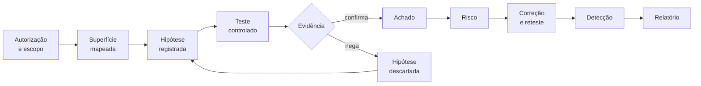

# Guia de pentest web: consulta por fase

Este guia reúne os conceitos, as operações e os critérios de evidência usados no bloco de pentest (A21–A24) e no trabalho final. As aulas apresentam a síntese e demonstram as operações. Aqui você encontra o detalhe para consultar durante a investigação.

!!! abstract "Como usar este guia"
    1. Localize na tabela abaixo a **fase** em que você está.
    2. Abra a página indicada e leia primeiro o **Cartão de consulta** e a **Síntese**.
    3. Use as seções **Erro comum**, **Limite da evidência** e **Checklist** antes de registrar uma conclusão no diário.

## Mapa: fase → página → aula

| Fase do trabalho | Pergunta da fase | Página de consulta | Aula |
|---|---|---|---|
| Visão do processo | Como um pentest se organiza, do acordo ao relatório? | [Processo e referenciais](visaogeral.md) | [A21](../aulas/A21-pentest-processo-referenciais-e-escopo.md) |
| Parte 0 e Parte I | O que muda da A17 para a infraestrutura do trabalho? | [Infraestrutura do laboratório](infraestrutura.md) | [A21](../aulas/A21-pentest-processo-referenciais-e-escopo.md#infraestrutura-o-que-muda-em-relacao-a-a17) |
| P0 | O que estou autorizado a fazer, e como a ferramenta respeita isso? | [Escopo, ROE e diário](planejamento.md) e [ZAP](zap.md) | [A21](../aulas/A21-pentest-processo-referenciais-e-escopo.md) |
| P1–P2 | Que superfície a aplicação expõe? | [Reconhecimento e enumeração](coleta.md) | [A21](../aulas/A21-pentest-processo-referenciais-e-escopo.md) e [A22](../aulas/A22-pentest-superficie-e-identidade.md) |
| P3 | Quem é você para o servidor, e por quanto tempo? | [Autenticação e sessão](autenticacao-sessao.md) | [A22](../aulas/A22-pentest-superficie-e-identidade.md) |
| P4 e P6 | O servidor confere se você pode acessar este objeto ou função? | [Controle de acesso e APIs](controle-acesso-apis.md) | [A22](../aulas/A22-pentest-superficie-e-identidade.md) |
| P5 | Quem interpreta a entrada, e como? | [Entradas: injeção e XSS](entradas.md) | [A23](../aulas/A23-pentest-entradas-logica-e-automacao.md) |
| P7–P8 | O que a aplicação revela, e que regra de negócio pode ser violada? | [Exposição, configuração e lógica](exposicao-logica.md) | [A23](../aulas/A23-pentest-entradas-logica-e-automacao.md) |
| P9 | O que a automação encontra, e o que ela reporta sem confirmar? | [Varredura ativa e triagem](varredura-triagem.md) | [A23](../aulas/A23-pentest-entradas-logica-e-automacao.md) |
| P13 | Quão grave é, neste contexto? | [Classificação e risco](risco-classificacao.md) | [A24](../aulas/A24-pentest-do-achado-a-decisao.md) |
| P10–P11 | Como corrigir a causa, retestar e detectar? | [Correção, reteste e detecção](correcao-deteccao.md) | [A24](../aulas/A24-pentest-do-achado-a-decisao.md) |
| P12 | O que mudaria se o alvo fosse industrial? | [A20 — avaliar sem derrubar a planta](../aulas/A20-validacao-ot-pentest.md#avaliar-sem-derrubar-a-planta) | [A24](../aulas/A24-pentest-do-achado-a-decisao.md) |
| Relatório e arguição | Como comunicar e defender um achado? | [Achado, relatório e arguição](relatorio.md) | [A24](../aulas/A24-pentest-do-achado-a-decisao.md) |

## A frase que organiza todas as fases

!!! quote ""
    Não busque apenas quebrar a aplicação. Busque entender **qual premissa de segurança falhou**, **como você provou essa falha**, **qual impacto ela gera**, **que mudança impediria a mesma classe de problema** e **como você perceberia** se alguém a explorasse.

Cada página do guia desenvolve uma parte dessa cadeia:

**Leia o fluxo:** a seta de volta, de *hipótese descartada* para *hipótese registrada*, é o centro do método. Um teste negativo bem registrado também é resultado.

## Arquivos de prática deste guia

Todos rodam localmente, sem tocar em nenhum alvo de rede.

| Arquivo | Para que serve | Página |
|---|---|---|
| [`ler_jwt.py`](../assets/pentest/ler_jwt.py) | Decodificar cabeçalho e payload de um JWT | [Autenticação e sessão](autenticacao-sessao.md#pratica-decodificar-nao-e-validar) |
| [`servidor_jwt.py`](../assets/pentest/servidor_jwt.py) | Emitir, verificar e adulterar um JWT HS256 de laboratório | [Autenticação e sessão](autenticacao-sessao.md#pratica-decodificar-nao-e-validar) |
| [`consulta_sql.py`](../assets/pentest/consulta_sql.py) | Comparar consulta SQL concatenada e parametrizada | [Entradas](entradas.md#pratica-a-mesma-entrada-em-duas-consultas) |
| [`laboratorio-xss.html`](../assets/pentest/laboratorio-xss.html) | Observar fonte, sink e contexto no navegador | [Entradas](entradas.md#pratica-fonte-sink-e-contexto-no-navegador) |
| [Pasta `deteccao/`](correcao-deteccao.md#pratica-avaliar-uma-regra-em-eventos-rotulados) | Logs artificiais rotulados e avaliador de regra | [Correção, reteste e detecção](correcao-deteccao.md#pratica-avaliar-uma-regra-em-eventos-rotulados) |
