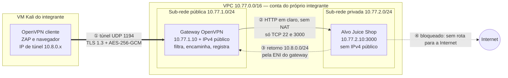
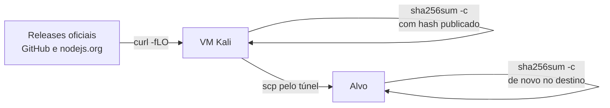

# Infraestrutura do laboratório: o que muda em relação à A17

!!! abstract "Cartão de consulta"
    **Use quando:** montar a Parte 0 (VM Kali) e a Parte I (infraestrutura AWS), justificar uma regra na arguição ou diagnosticar uma conexão que não funciona. 
    **Pergunta central:** o alvo só é alcançável por mim, pelo caminho previsto, e eu consigo provar isso? 
    **Aula:** [A21](../aulas/A21-pentest-processo-referenciais-e-escopo.md#infraestrutura-o-que-muda-em-relacao-a-a17). **Base:** [A17 — OpenVPN e máquina interna](../aulas/A17-openvpn-ec2.md).

## Síntese

- A rede é a mesma da A17: gateway OpenVPN público, alvo em sub-rede privada, **sem NAT** e sem saída para a Internet.
- O que muda: a **VM Kali** é o cliente; o gateway **filtra e registra** cada nova conexão; serviços e regras **sobrevivem** às paradas do Learner Lab.
- O alvo recebe o Juice Shop **pelo túnel**, com integridade conferida por hash, sem nunca ganhar Internet.
- Cada contraprova (I0–I5) precisa de **duas evidências**: o resultado observado e a configuração que o explica.

---

## Topologia de um integrante

**Leia o diagrama:** o túnel cifrado (①) termina no gateway. O trecho ② trafega HTTP em claro dentro da VPC; isso é aceitável no laboratório, mas deve aparecer no relatório (P7). Sem NAT, o alvo recebe o IP de túnel real `10.8.0.x`, o que permite atribuir conexões. Cada integrante monta a **própria** infraestrutura, com a própria PKI; as duas da dupla usam os mesmos endereços e não se comunicam.

## Diferenças em relação à A17, com o motivo

| Item | A17 | Trabalho | Por que mudou |
|---|---|---|---|
| Cliente | Windows ou Linux local | **VM Kali** | Ferramentas de teste, túnel e evidências no mesmo lugar, isolados do hospedeiro |
| Servidor OpenVPN | Processo em primeiro plano | Serviço `openvpn-server@server` | O túnel volta sozinho após cada *Start Lab* |
| Forwarding no gateway | Regras em memória | Cadeia `TF_FWD`, com registro e persistência | Filtrar o mínimo e **registrar** cada conexão para atribuição |
| Alvo | Serviço HTTP Python, `t3.micro` | Juice Shop, `t3.small` (2 GiB) | Aplicação real, que precisa de memória |
| Alvo: IAM e metadados | — | Sem perfil IAM; metadados desativados | Uma falha no alvo não pode obter credenciais da nuvem |
| SG do alvo | TCP 22 e 8080 de 10.8.0.0/24 | TCP 22 e **3000**; **sem regra de saída** | Só o necessário entra; nada sai por iniciativa do alvo |
| PKI | 2 dias | Validade do trabalho, com certificado de teste para revogar | Ciclo completo: emitir, usar, revogar |

## Forwarding mínimo: ler a cadeia `TF_FWD`

O roteiro (I.4) cria uma cadeia própria na tabela `FORWARD`. A **ordem** das regras é a decisão:

| Ordem | Regra (resumo) | Função |
|---:|---|---|
| 1 | `ESTABLISHED,RELATED → ACCEPT` | Deixa passar respostas e pacotes de conexões já aceitas |
| 2 | `NEW` de `10.8.0.0/24` para `10.77.2.10`, TCP 22/3000 → `LOG "TF_NEW "` | Registra cada conexão nova autorizada |
| 3 | Mesma condição → `ACCEPT` | Aceita a conexão registrada |
| 4 | Qualquer outro → `LOG "TF_FWD_DROP "` (limitado a 10/min) | Registra amostras do que foi descartado |
| 5 | Qualquer outro → `DROP` | Descarta |

!!! question "Perguntas da arguição, com a explicação"
    **Por que `ESTABLISHED,RELATED` vem primeiro?** A maioria dos pacotes pertence a conexões já aceitas. Avaliar isso primeiro evita registrar cada pacote e deixa o retorno passar sem regra específica.

    **Por que `FORWARD`, e não `INPUT`?** `INPUT` trata pacotes **destinados ao próprio gateway**. O tráfego para o alvo **atravessa** o gateway: é encaminhamento.

    **Por que `LOG` antes de `ACCEPT`?** `LOG` não encerra a avaliação; `ACCEPT` encerra. Na ordem inversa, nada seria registrado.

    **O que aconteceria com `MASQUERADE`?** O alvo veria todas as conexões vindo de `10.77.1.10`. O log da aplicação perderia a distinção entre identidades, e a rota de retorno deixaria de ser necessária, escondendo um erro de configuração.

## Persistência: o que volta sozinho depois de parar

O Learner Lab para as instâncias ao fim de cada sessão. Sem persistência, a cada sessão você remontaria tudo.

| O que precisa voltar | Mecanismo | Como conferir |
|---|---|---|
| Encaminhamento IPv4 | `/etc/sysctl.d/99-tf-forward.conf` | `sysctl net.ipv4.ip_forward` → `1` |
| Regras `TF_FWD` | `iptables-persistent` + `netfilter-persistent save` | `sudo iptables -L TF_FWD -v -n` |
| Servidor OpenVPN | `systemctl enable openvpn-server@server` | `systemctl is-active openvpn-server@server` |
| Juice Shop | `systemctl enable juice-shop` | `curl` HTTP 200 pelo túnel |
| Registros | Journal persistente em `/var/log/journal` | `journalctl --list-boots` mostra sessões anteriores |

!!! info "Limite da evidência"
    O **banco** do Juice Shop é recriado a cada reinício. Contas e dados de teste precisam ser recriados (rotina I.8). O **log de acesso** da aplicação guarda poucos dias: exporte-o ao fim de cada sessão.

## Instalar o alvo sem dar Internet a ele

O alvo não tem saída. Os pacotes do Node.js e do Juice Shop são baixados **na VM Kali**, conferidos e enviados **pelo túnel**.

**O que o hash garante:** que o arquivo recebido é idêntico ao arquivo cujo hash foi publicado, e que a cópia não mudou no caminho até o alvo ([A16 — hash e digest](../aulas/A16-tls-ciclo-de-chaves.md#digest)).

**O que não garante sem assinatura:** que o hash publicado é autêntico. Se o atacante controlar a página que publica arquivo e hash, os dois podem ser trocados juntos. A procedência depende de confiar no canal HTTPS do site oficial ([A15 — assinaturas](../aulas/A15-chaves-assinaturas-certificados.md)).

### O serviço do alvo e seus limites

| Diretiva da unidade `juice-shop.service` | Efeito | Por que importa no pentest |
|---|---|---|
| `User=juice` | Processo sem privilégio de administrador | Uma falha de execução no alvo não vira controle da máquina |
| `MemoryMax=1500M` | Teto de memória | Uma varredura agressiva não derruba o sistema inteiro |
| `NoNewPrivileges=true` | O processo não ganha privilégios novos | Limita escalada por executáveis com setuid |
| `Restart=on-failure` | Reinicia se cair | Recupera de falhas, mas **apaga** o estado do experimento |
| `safetyMode: enabled` | Desativa desafios danosos ao host | O alvo continua vulnerável, sem riscos para a instância |

## Contraprovas I0–I5: resultado + configuração

**Síntese.** Uma falha de conexão sozinha não prova a causa. Para cada contraprova, registre o **resultado** e a **configuração que o explica**.

| ID | Pergunta | Resultado observado | Configuração que explica |
|---|---|---|---|
| I0 | Sem túnel, o alvo responde? | Timeout ou erro de rota | Alvo sem IPv4 público; rota só pelo túnel |
| I1 | Com túnel, o alvo responde? | HTTP 200; rota sai por `tun0` | Rota empurrada pelo servidor; contadores `TF_FWD` aumentando |
| I2 | Porta fora do escopo passa? | Timeout | Linha `TF_FWD_DROP` no gateway |
| I3 | O alvo alcança a Internet? | Status diferente de 0 | Tabela privada sem `0.0.0.0/0`; SG sem saída |
| I4 | O alvo está exposto? | — | Console: sem IPv4 público, sem IAM, metadados desativados |
| I5 | A conexão é atribuível? | Certificado ↔ IP de túnel ↔ horário ↔ `TF_NEW` | Journal do OpenVPN + log do kernel |

!!! warning "Erro comum"
    Atribuir I2 ao security group do alvo sem olhar o gateway. Se a linha `TF_FWD_DROP` aparece, o descarte ocorreu **no gateway**; o SG do alvo nem foi consultado. A mesma lógica vale para as portas *filtered* do `nmap` em P2.

## Revogação: conter uma identidade

A revogação (I.7) simula um certificado comprometido. A evidência tem **duas metades**: o perfil de teste é recusado (`certificate revoked` no log do servidor) **e** o seu perfil continua funcionando. Só a primeira metade não distingue revogação de servidor quebrado.

## Rotina de sessão e retenção de registros

A cada *Start Lab*, o IPv4 público do gateway muda e o banco do Juice Shop é recriado. Ao fim de cada sessão, **antes** de *End Lab*, exporte os registros (I.8):

| Arquivo exportado | Origem | Para que serve |
|---|---|---|
| `openvpn.log` | Journal do OpenVPN | Certificado ↔ IP de túnel ↔ horário |
| `gateway_rede.log` | Kernel do gateway (`TF_NEW`, `TF_FWD_DROP`) | Conexões por origem, na rede |
| `alvo_access.log` | Log de acesso do Juice Shop | Requisições, na aplicação |
| `alvo_servico.log` | Journal do serviço | Reinícios e erros |
| `SHA256SUMS` | `sha256sum` dos arquivos | Detectar alteração posterior da cópia |

!!! info "Limite da evidência"
    Você administra as máquinas: essas exportações **corroboram** o diário, mas não são prova forense independente. O valor está na coerência entre diário, sessão do ZAP e registros.

## Diagnóstico por camada

Quando algo não funciona, siga o caminho do pacote e pare na primeira camada que falha:

| Camada | Pergunta | Comando ou local |
|---|---|---|
| VM | A VM sai para a Internet? | `ip -4 route`; `curl -s https://checkip.amazonaws.com` |
| SG do gateway | O /32 permitido é o IPv4 atual da VM? | Console EC2 → Security group |
| Túnel | O cliente chegou a `Initialization Sequence Completed`? | Terminal do `openvpn` |
| Rota na VM | `10.77.2.10` sai por `tun0`? | `ip -4 route get 10.77.2.10` |
| Forwarding | Os contadores de `TF_FWD` aumentam? | `sudo iptables -L TF_FWD -v -n` |
| Gateway | *Source/destination check* desativado? | Console → instância → *Networking* |
| SG do alvo | TCP 3000 de `10.8.0.0/24`? | Console |
| Serviço | O Juice Shop está ativo? | `systemctl status juice-shop` (no alvo) |
| Retorno | Tabela privada tem `10.8.0.0/24 → ENI` *Active*? | Console VPC |

A tabela de diagnóstico da [A17](../aulas/A17-openvpn-ec2.md#alternativa) continua válida.

## Revisão rápida

1. Por que a regra `LOG "TF_NEW "` precisa vir antes do `ACCEPT` correspondente?
2. O que um hash conferido no destino prova sobre o pacote do Juice Shop, e o que ele não prova?
3. Na contraprova I2, como você decide se o bloqueio aconteceu no gateway ou no SG do alvo?

## Fontes de referência

- [A17 — OpenVPN e máquina interna](../aulas/A17-openvpn-ec2.md): rede, PKI, retorno e encerramento.
- [OpenVPN 2.6 — manual de referência](https://openvpn.net/community-resources/reference-manual-for-openvpn-2-6/).
- [netfilter/iptables — documentação](https://www.netfilter.org/documentation/) e `man iptables-extensions` (alvos `LOG`, módulo `conntrack`).
- [systemd.exec](https://www.freedesktop.org/software/systemd/man/latest/systemd.exec.html) e [systemd.resource-control](https://www.freedesktop.org/software/systemd/man/latest/systemd.resource-control.html).
- [OWASP Juice Shop — executar a aplicação](https://pwning.owasp-juice.shop/companion-guide/latest/part1/running.html).
