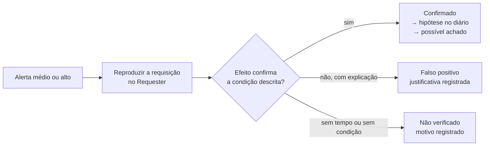

# Varredura ativa e triagem: alerta não é achado

!!! abstract "Cartão de consulta"
    **Use quando:** configurar e executar a varredura ativa (P9) ou classificar os alertas produzidos. 
    **Pergunta central:** o que a automação encontra que você não encontrou, e o que ela reporta que não se confirma? 
    **Aula:** [A23](../aulas/A23-pentest-entradas-logica-e-automacao.md). **No trabalho:** P9 (uma execução por integrante, no próprio alvo).

## Síntese

- A varredura ativa envia muitas requisições de ataque padronizadas. Ela é **ampla e rasa**; o teste manual é **estreito e profundo**.
- Ela vem **depois** de P1–P8, dentro de limites: contexto, modo *Protected*, *Rate Limit*, 2 threads, até 30 minutos.
- Defina a **identidade** da varredura. Anônima é o padrão; autenticada exige prova no *History* de que o servidor aceitou a credencial.
- Cada alerta de risco médio ou maior recebe uma decisão: **confirmado**, **falso positivo** (com justificativa) ou **não verificado**.

---

## Passiva × ativa

| | Varredura passiva | Varredura ativa |
|---|---|---|
| O que faz | Analisa respostas que já passaram pelo proxy | Envia variações de ataque a cada parâmetro e caminho |
| Tráfego gerado | Nenhum | Alto (centenas a milhares de requisições) |
| Risco ao alvo | Nenhum | Degradação, dados alterados, contas bloqueadas |
| Quando no trabalho | Sempre ligada | Só em P9 |
| Típico de encontrar | Cabeçalhos ausentes, cookies sem atributo, versões | Injeções, XSS refletido, travessia de caminho |

## Antes de iniciar: quatro confirmações

1. **Modo *Protected*** e contexto `tf-alvo` com a expressão exata.
2. ***Rate Limit*** ativo para `10.77.2.10` e **nenhuma outra automação** rodando contra o seu alvo (Fuzzer, spider, `ffuf`). Registre o horário de início no diário.
3. **Linha de base** recente, com horário, para comparar degradação.
4. **Critério de parada** à vista: alvo sem resposta por mais de 2 minutos ou CPU travada → parar, anotar, exportar registros (I.8).

## Configuração: o que cada controle limita

| Controle | Onde | Valor sugerido | O que **não** limita |
|---|---|---|---|
| *Strength* | Política de varredura (*Analyse → Scan Policy Manager*) | Low ou Medium | Taxa de requisições |
| *Threshold* | Mesma política | Medium | Taxa de requisições |
| Threads por host | *Options → Active Scan* | 2 | Taxa, se as respostas forem rápidas |
| Duração máxima | *Options → Active Scan* (tempo máximo de varredura) | 30 min | — |
| *Rate Limit* | *Options → Network → Rate Limit* | 10 req/s | — (é o teto real de tráfego) |

**Strength** define **quantos** testes de cada tipo são enviados. **Threshold** define **quão sensível** é o critério para gerar alerta: mais baixo produz mais alertas e mais falsos positivos.

## Identidade da varredura

| Opção | Vantagem | Limitação | Evidência exigida |
|---|---|---|---|
| **Anônima** (padrão) | Simples e reprodutível | Não alcança funções que exigem login | Declarar a lacuna de cobertura |
| Autenticada | Alcança áreas logadas | Token expira; logout acidental pela própria varredura | Mensagem no *History*, enviada pela varredura, **aceita** como o usuário configurado |

!!! warning "Erro comum"
    Achar que a varredura é autenticada porque você estava logado no navegador. A varredura ativa envia as próprias requisições; ela só usa uma identidade se o **contexto** tiver um usuário configurado (ou se uma regra acrescentar a credencial). Prove com uma mensagem da varredura que recebeu dado que só aquele usuário veria.

## Triagem: três decisões por alerta

| Decisão | Critério | Exemplo de justificativa |
|---|---|---|
| **Confirmado** | Você reproduziu a condição e entende o efeito | "Msg 812: o marcador é refletido sem codificação no corpo HTML; execução confirmada no navegador" |
| **Falso positivo** | Você mostra por que a condição **não** ocorre | "O alerta de injeção SQL foi gerado por variação de tempo; repetida 5 vezes, a diferença some; mesma resposta com e sem carga" |
| **Não verificado** | Não houve como confirmar nem negar | "Exige estado que o ROE não permite criar" |

**Tabela de triagem (P9):**

| ID do alerta | Nome | Risco ZAP | Confiança ZAP | URL / parâmetro | Decisão | Evidência / justificativa |
|---|---|---|---|---|---|---|

!!! info "Limite da evidência"
    O **risco** e a **confiança** mostrados pelo ZAP são estimativas da ferramenta. A severidade do achado é sua, com CVSS e contexto ([Classificação e risco](risco-classificacao.md)). Um alerta copiado como achado sem confirmação é **penalizado** no trabalho.

## O que comparar depois

- Alertas confirmados que você **já** tinha encontrado manualmente: a automação confirmou o seu método.
- Alertas confirmados que você **não** tinha: por que o seu mapa não os previu?
- Hipóteses manuais confirmadas que a automação **não** encontrou: em geral, autorização e lógica de negócio, que dependem de entender a regra.

Essa comparação responde à pergunta da fase e vai para a seção 9 do relatório.

## Checklist da fase P9

- Confirmações de modo, contexto, *Rate Limit* e exclusividade.
- Identidade definida e, se autenticada, comprovada no *History*.
- Política com *Strength* e *Threshold* registrados; 2 threads; até 30 min.
- Horário de início e fim, com a linha de base comparada.
- Relatório do ZAP gerado e tabela de triagem de todos os alertas de risco médio ou maior.

## Revisão rápida

1. Por que *Strength* e *Threshold* não substituem o *Rate Limit*?
2. Que evidência prova que uma varredura foi autenticada?
3. Que tipo de falha a varredura ativa tende a não encontrar, e por quê?

## Fontes de referência

- [ZAP — Active Scan](https://www.zaproxy.org/docs/desktop/start/features/ascan/) e [Scan Policy](https://www.zaproxy.org/docs/desktop/start/features/scanpolicy/).
- [ZAP — Authentication](https://www.zaproxy.org/docs/desktop/start/features/authentication/) e [Users](https://www.zaproxy.org/docs/desktop/start/features/users/).
- [ZAP — Alerts](https://www.zaproxy.org/docs/desktop/start/features/alerts/).
- [NIST SP 800-115](https://csrc.nist.gov/pubs/sp/800/115/final), seção 4 (varredura de vulnerabilidades e seus limites).
