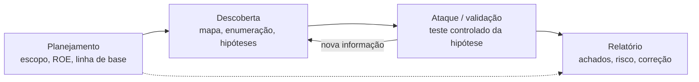

# Processo de pentest e referenciais: o que cada um organiza

!!! abstract "Cartão de consulta"
    **Use quando:** precisar explicar o método do trabalho, escolher qual referência citar ou justificar por que um teste vem antes de outro. 
    **Pergunta central:** como um pentest se organiza, do acordo ao relatório, e qual referência responde a cada pergunta? 
    **Aula:** [A21](../aulas/A21-pentest-processo-referenciais-e-escopo.md). **No trabalho:** seção de metodologia do relatório (E3) e arguição.

## Síntese

- **Pentest** é uma avaliação **autorizada** que tenta, de forma controlada, usar falhas para demonstrar impacto. Sem autorização escrita, não é pentest.
- O processo tem um ciclo: **planejar → descobrir → atacar (validar) → relatar**. Descoberta e validação se repetem a cada nova informação.
- Os referenciais **não são equivalentes**: uns organizam o engajamento, outros descrevem testes, outros classificam fraquezas ou pontuam risco.
- O produto não é a lista de falhas. É a **evidência** de qual premissa falhou, com impacto, correção e forma de detectar.

---

## O que é, e o que não é, um pentest

**Definição.** Um teste de invasão (*penetration test*) é uma avaliação técnica em que o avaliador, com autorização e regras definidas, **tenta explorar** vulnerabilidades para verificar se uma premissa de segurança realmente falha e qual o efeito. A [NIST SP 800-115](https://csrc.nist.gov/pubs/sp/800/115/final) o descreve como teste que imita ataques reais para identificar formas de contornar recursos de segurança.

Atividades próximas respondem perguntas diferentes:

| Atividade | Pergunta que responde | Produto típico | Não confunda com pentest porque… |
|---|---|---|---|
| Varredura de vulnerabilidades | Que condições conhecidas aparecem neste alvo? | Lista de alertas com severidade | Não confirma exploração nem impacto; gera falsos positivos |
| Auditoria ou revisão de configuração | A configuração cumpre a regra declarada? | Conformidade por item | Compara documento e estado; não testa caminhos de abuso |
| **Pentest** | Esta falha pode ser usada, e com que efeito? | Achados confirmados com evidência | — |
| Red team | A organização detecta e responde a um adversário com objetivo? | Avaliação de detecção e resposta | Testa pessoas e processos de defesa, com objetivo amplo e menos aviso |
| Programa de *bug bounty* | Pesquisadores externos encontram falhas no escopo publicado? | Relatos individuais | Escopo e incentivo são públicos e contínuos, sem método único |

!!! warning "Erro comum"
    Chamar de "pentest" a execução de um scanner. Um alerta automático é **ponto de partida para uma hipótese**, não um achado. Veja [Varredura ativa e triagem](varredura-triagem.md).

### Autorização e legalidade

No Brasil, o [art. 154-A do Código Penal](https://www.planalto.gov.br/ccivil_03/decreto-lei/del2848compilado.htm), incluído pela [Lei 12.737/2012](https://www.planalto.gov.br/ccivil_03/_ato2011-2014/2012/lei/l12737.htm) e alterado pela [Lei 14.155/2021](https://www.planalto.gov.br/ccivil_03/_ato2019-2022/2021/lei/l14155.htm), tipifica a invasão de dispositivo informático alheio **sem autorização expressa ou tácita** do usuário. O que separa o teste profissional do crime é a autorização de quem pode concedê-la, com escopo e limites definidos.

No trabalho, essa autorização é o **ROE**: um documento que você preenche e assina antes do primeiro teste, para a sua própria infraestrutura. Veja [Escopo, ROE e diário](planejamento.md).

### Abordagens pelo conhecimento prévio

| Abordagem | O avaliador recebe | Melhor uso | Limitação |
|---|---|---|---|
| Caixa-preta (*black box*) | Só o endereço do alvo | Ver o que um atacante externo descobre | Gasta tempo em descoberta; pode não cobrir funções internas |
| Caixa-cinza (*gray box*) | Contas de teste, documentação parcial | Testar autorização entre perfis com eficiência | Pode herdar premissas do material recebido |
| Caixa-branca (*white box*) | Código, arquitetura, configurações | Encontrar a causa raiz e cobrir mais caminhos | Exige mais esforço de análise; menos realista quanto à descoberta |

O trabalho é **caixa-cinza**: você implanta o alvo, cria contas de teste e pode consultar o guia oficial do Juice Shop. O código-fonte é público e pode apoiar a correção (P10), mas a evidência do achado vem do comportamento observado.

---

## O ciclo do teste: planejar, descobrir, validar, relatar

**Síntese.** A SP 800-115 descreve o pentest em quatro fases. A seta de volta entre *ataque* e *descoberta* é a parte mais importante: cada resultado gera informação que muda as próximas hipóteses.

| Fase | O que acontece | Evidência que ela produz | No trabalho |
|---|---|---|---|
| **Planejamento** | Acordar alvo, janela, técnicas permitidas, limites, parada, comunicação | ROE assinado, configuração da ferramenta, linha de base | P0 |
| **Descoberta** | Mapear funções, rotas, APIs, portas, versões; formular hipóteses | Mapa da aplicação, inventário de endpoints, hipóteses priorizadas | P1–P2 |
| **Ataque (validação)** | Testar cada hipótese com a menor ação que a confirme ou negue | Requisição, resposta, diferença observada, contraprova | P3–P9 |
| **Relatório** | Explicar causa, impacto, correção, reteste, detecção e risco | Achados no modelo, matriz de risco, recomendações | P10–P13 e E3 |

**Explicação.** "Ataque", na SP 800-115, significa **validar** uma vulnerabilidade potencial tentando usá-la. No laboratório da disciplina isso sempre acontece com a menor ação suficiente: ler um objeto de outra conta de teste prova a falha; apagar dados não acrescenta prova e viola o ROE.

!!! question "Checkpoint"
    Você encontrou um alerta "SQL Injection" no ZAP. Em qual fase isso está, e o que falta para virar achado? 
    *Pista:* o alerta é informação de **descoberta**. Falta um teste de **validação** com evidência que confirme ou negue a hipótese.

---

## Referenciais: escolher pela função

**Síntese.** Uma metodologia organiza o trabalho. Um guia de testes descreve verificações. Um padrão de requisitos define o comportamento esperado. Uma taxonomia classifica a fraqueza. Uma métrica pontua a severidade. Uma ferramenta executa operações. Essas funções se complementam; nenhuma substitui as outras.

| Função | Referencial | Pergunta que responde | Como aparece no trabalho |
|---|---|---|---|
| Organizar o engajamento | [NIST SP 800-115](https://csrc.nist.gov/pubs/sp/800/115/final) | Como planejar, executar e relatar uma avaliação técnica? | Fases e ROE (apêndice B) |
| Organizar o engajamento | [PTES](http://www.pentest-standard.org/) | Que etapas um pentest percorre, do acordo ao relatório? | Vocabulário das fases |
| Medir a superfície operacional | [OSSTMM](https://www.isecom.org/research.html) (ISECOM) | Quanto da operação está exposto, e com que controles? | Referência conceitual; não aplicada integralmente |
| Descrever **como testar** web | [OWASP WSTG 4.2](https://owasp.org/www-project-web-security-testing-guide/v42/) | Que procedimento verifica este comportamento web? | **ID do caso de teste em cada achado** (obrigatório) |
| Descrever **o que deveria ser verdade** | [OWASP ASVS 5.0.0](https://owasp.org/www-project-application-security-verification-standard/) | Que requisito a aplicação deveria cumprir? | Formular a correção e o critério de reteste |
| Classificar a fraqueza | [MITRE CWE](https://cwe.mitre.org/) | Qual é o tipo de defeito, na causa? | **CWE em cada achado** (obrigatório) |
| Categorizar o risco web | [OWASP Top 10 2025](https://owasp.org/Top10/2025/) e [API Security Top 10 2023](https://owasp.org/API-Security/editions/2023/en/0x11-t10/) | Em que categoria de risco conhecida isto se encaixa? | Quando a correspondência for defensável |
| Pontuar a severidade | [FIRST CVSS 4.0](https://www.first.org/cvss/v4-0/) | Quão grave é a vulnerabilidade em si? | Vetor e nota base (P13) |
| Avaliar o risco no contexto | [OWASP Risk Rating](https://owasp.org/www-community/OWASP_Risk_Rating_Methodology) | Quão provável e quão danoso, para este negócio? | Justificativa contextual (P13) |
| Descrever o adversário | [MITRE ATT&CK](https://attack.mitre.org/) | Que comportamento um adversário real teria? | Detecção e transferência (A07, P11) |

### NIST SP 800-115: planejamento e relatório

Guia de 2008 do NIST para **testes e avaliações técnicas de segurança**. Organiza as técnicas em três famílias:

- **Revisão:** documentação, logs, regras de firewall, configuração, captura passiva de tráfego.
- **Identificação e análise do alvo:** descoberta de rede, identificação de portas e serviços, varredura de vulnerabilidades.
- **Validação de vulnerabilidade do alvo:** quebra de senhas, pentest, engenharia social.

O apêndice B traz um modelo de **regras de engajamento**. É antigo quanto a ferramentas, mas continua útil para estruturar autorização, execução e relatório. Você já o viu na [A20](../aulas/A20-validacao-ot-pentest.md#regras-de-engajamento-um-plano-para-testar-o-bloqueio).

### PTES: as sete seções de um engajamento

O *Penetration Testing Execution Standard* é uma iniciativa comunitária que descreve o engajamento em sete seções:

1. **Interações pré-engajamento:** escopo, ROE, contatos, janela, aceite.
2. **Coleta de informações:** reconhecimento passivo e ativo.
3. **Modelagem de ameaças:** ativos, processos de negócio, quem atacaria e como.
4. **Análise de vulnerabilidades:** encontrar e validar condições exploráveis.
5. **Exploração:** obter o acesso que a falha permite.
6. **Pós-exploração:** determinar o valor do acesso obtido, dentro do escopo.
7. **Relatório:** sumário executivo e relatório técnico.

**Relação com o curso:** a modelagem de ameaças retoma a [A06](../aulas/A06-do-ticket-ao-modelo.md) (STRIDE). No trabalho, pós-exploração é restrita: demonstrar o impacto delimitado, sem persistência nem movimento para fora do alvo.

### OSSTMM: medir em vez de listar

O *Open Source Security Testing Methodology Manual*, da ISECOM, trata a segurança como **medição operacional**. Divide o alvo em canais (humano, físico, sem fio, telecomunicações e redes de dados) e mede a **porosidade**: visibilidade, acesso e confiança. Também avalia controles e limitações.

**Limite:** "operacional" no nome não significa automação industrial. O método completo exige estudo próprio; no curso, ele serve para mostrar que um teste pode **medir** a exposição, não apenas listar falhas.

### OWASP WSTG 4.2: o guia de casos de teste web

O *Web Security Testing Guide* descreve **como testar** aplicações web. Os testes estão agrupados em categorias com identificadores estáveis:

| Código | Categoria | Fase do trabalho |
|---|---|---|
| `INFO` | Coleta de informações | P1–P2 |
| `CONF` | Configuração e implantação | P2, P7 |
| `IDNT` | Gestão de identidade (cadastro, enumeração de contas) | P3 |
| `ATHN` | Autenticação | P3 |
| `ATHZ` | Autorização | P4, P6 |
| `SESS` | Gestão de sessão | P3 |
| `INPV` | Validação de entrada | P5 |
| `ERRH` | Tratamento de erros | P5, P7 |
| `CRYP` | Criptografia fraca | P7 |
| `BUSL` | Lógica de negócio | P8 |
| `CLNT` | Lado do cliente (inclui XSS baseado em DOM) | P5 |
| `APIT` | APIs (na 4.2, apenas GraphQL) | — |

Na 4.2, a autorização em APIs REST é testada pelos casos de `ATHZ` (por exemplo, `ATHZ-02` e `ATHZ-04`), complementados pelo API Security Top 10 2023.

**Como citar:** use o identificador com a versão, por exemplo `WSTG-v42-ATHZ-04`, e o link da página do caso. Registre a versão: o projeto mantém a 4.2 como publicada enquanto prepara a 5.0, e um link "latest" pode mudar de conteúdo.

### OWASP ASVS 5.0.0: o requisito que a correção deve cumprir

O *Application Security Verification Standard* lista **requisitos verificáveis** de segurança, organizados por capítulos e níveis (L1, L2, L3). Use-o para escrever a correção como requisito: "o servidor verifica, a cada requisição, se o usuário autenticado é dono do objeto solicitado".

**Limite:** citar um requisito não comprova que a aplicação cumpre o ASVS inteiro.

### OWASP Top 10 2025 e API Security Top 10 2023: categorias de risco

São listas de **conscientização**, com as categorias de risco mais relevantes. Não são metodologia nem lista de verificação completa.

| Top 10 2025 (aplicações web) | API Security Top 10 2023 |
|---|---|
| A01 Broken Access Control | API1 Broken Object Level Authorization |
| A02 Security Misconfiguration | API2 Broken Authentication |
| A03 Software Supply Chain Failures | API3 Broken Object Property Level Authorization |
| A04 Cryptographic Failures | API4 Unrestricted Resource Consumption |
| A05 Injection | API5 Broken Function Level Authorization |
| A06 Insecure Design | API6 Unrestricted Access to Sensitive Business Flows |
| A07 Authentication Failures | API7 Server Side Request Forgery |
| A08 Software or Data Integrity Failures | API8 Security Misconfiguration |
| A09 Security Logging and Alerting Failures | API9 Improper Inventory Management |
| A10 Mishandling of Exceptional Conditions | API10 Unsafe Consumption of APIs |

!!! warning "Erro comum"
    Usar o Top 10 como classificação principal do achado. A classificação obrigatória é **CWE + caso WSTG**. A categoria do Top 10 entra só quando a correspondência for defensável. Veja [Classificação e risco](risco-classificacao.md).

---

## Do referencial à fase do trabalho

O trabalho segue o ciclo da SP 800-115 e usa o WSTG como fonte dos casos de teste:

| Fase da SP 800-115 | Seção do PTES | Fases do trabalho | Categorias WSTG |
|---|---|---|---|
| Planejamento | 1 Pré-engajamento | P0 (ROE e ferramenta) | — |
| Descoberta | 2 Coleta · 3 Modelagem | P1 Reconhecimento · P2 Enumeração | INFO, CONF |
| Ataque (validação) | 4 Análise · 5 Exploração · 6 Pós-exploração | P3 Autenticação/sessão · P4 Acesso · P5 Entradas · P6 APIs · P7 Exposição · P8 Lógica · P9 Varredura | IDNT, ATHN, SESS, ATHZ, INPV, CLNT, ERRH, CRYP, BUSL |
| Relatório | 7 Relatório | P10 Correção · P11 Detecção · P12 OT · P13 Risco · E3 | — |

## Checklist: método defensável

- O teste tinha autorização escrita, alvo e janela definidos antes de começar.
- Cada teste partiu de uma hipótese registrada, com a evidência que confirmaria ou negaria.
- Resultados negativos foram registrados.
- Cada achado cita CWE e caso WSTG, com versão.
- A automação foi usada depois do teste manual, com resultado triado.

## Revisão rápida

1. Qual a diferença entre um alerta de varredura e um achado de pentest?
2. Por que o WSTG e a CWE aparecem juntos em cada achado, se respondem perguntas diferentes?
3. Em que fase do ciclo uma hipótese descartada devolve você, e por quê?

## Fontes de referência

- [NIST SP 800-115 — Technical Guide to Information Security Testing and Assessment](https://csrc.nist.gov/pubs/sp/800/115/final): seções 3–5 e apêndice B.
- [PTES — Penetration Testing Execution Standard](http://www.pentest-standard.org/).
- [ISECOM — OSSTMM](https://www.isecom.org/research.html).
- [OWASP WSTG 4.2](https://owasp.org/www-project-web-security-testing-guide/v42/) e [ASVS](https://owasp.org/www-project-application-security-verification-standard/).
- [OWASP Top 10 2025](https://owasp.org/Top10/2025/) e [OWASP API Security Top 10 2023](https://owasp.org/API-Security/editions/2023/en/0x11-t10/).
- [MITRE CWE](https://cwe.mitre.org/) e [CWE Top 25](https://cwe.mitre.org/top25/).
- [FIRST CVSS 4.0](https://www.first.org/cvss/v4-0/) e [OWASP Risk Rating Methodology](https://owasp.org/www-community/OWASP_Risk_Rating_Methodology).
- Código Penal, [art. 154-A](https://www.planalto.gov.br/ccivil_03/decreto-lei/del2848compilado.htm).

Versões e endereços conferidos em **10 nov. 2026**.
