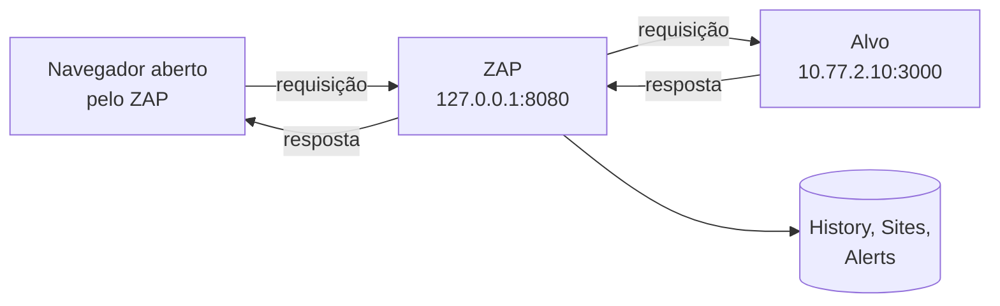

# ZAP: referência de operação para o trabalho

!!! abstract "Cartão de consulta"
    **Use quando:** precisar localizar uma função do ZAP, conferir uma configuração exigida pelo ROE ou guardar evidência com ID de mensagem.<br>
    **Pergunta central:** onde, no ZAP, cada tarefa do trabalho é feita, e qual cuidado acompanha cada uma?<br>
    **Aulas:** [A21](../aulas/A21-pentest-processo-referenciais-e-escopo.md) (proxy, escopo, limites), [A22](../aulas/A22-pentest-superficie-e-identidade.md) (Requester), [A23](../aulas/A23-pentest-entradas-logica-e-automacao.md) (Fuzzer, varredura). **No trabalho:** P0 a P9.

## Síntese

- O ZAP é um **proxy de interceptação**: fica entre o navegador e o alvo, registra cada requisição e resposta e permite repeti-las com alterações.
- Antes de qualquer teste: **contexto** com o escopo exato, modo **Protected** e **limite de taxa**.
- O **History** é a sua fonte de evidência: cada mensagem tem um **ID** citável no diário.
- **Requester** testa uma hipótese por vez; **Fuzzer** varia uma entrada; **varredura ativa** automatiza muitos testes e precisa de triagem.

---

## Como o proxy funciona



**Explicação.** O navegador envia cada pedido ao ZAP, que o repassa ao alvo e devolve a resposta. No caminho, o ZAP grava as duas mensagens, analisa passivamente a resposta e permite pausar, editar ou reenviar. É o mesmo rastro que você viu no DevTools na [A04](../aulas/A04-onde-a-aplicacao-decide.md), agora com histórico persistente e ferramentas de repetição.

Comandos de terminal também podem passar pelo ZAP, com `curl -x http://127.0.0.1:8080`. A requisição aparece no *History* com ID (roteiro 14.2).

## Onde fica cada tarefa

| Tarefa | No ZAP | Cuidado |
|---|---|---|
| Abrir o navegador já configurado | *Quick Start → Manual Explore*, URL do alvo, *Launch Browser* | Use esse navegador para o alvo; o alvo é HTTP, não precisa instalar o certificado do ZAP |
| Ver tudo o que o navegador pediu | Aba **History** e árvore **Sites** | Ative o filtro de escopo para esconder ruído |
| Restringir a ferramenta ao alvo | **Contexto** + **modo Protected** | O modo protege ações ativas; não é firewall do navegador |
| Limitar requisições por segundo | *Tools → Options → Network → Rate Limit* | Threads limitam concorrência, não taxa |
| Pausar e editar uma requisição | *Breakpoints* | Deixe desligado na navegação comum |
| Reenviar alterando um detalhe | Botão direito na mensagem → *Open/Resend with Request Editor* (Requester) | Principal ferramenta para testar hipóteses |
| Enviar variações de uma entrada | Botão direito → *Attack → Fuzz…* | *Options → Fuzzer*: 2 threads, 100 ms |
| Codificar e decodificar | *Tools → Encode/Decode/Hash* (Ctrl+E) | Decodificar um JWT não valida a assinatura |
| Descobrir rotas de uma SPA | **Client Spider** (add-on *Client Side Integration*) | Depende da extensão no navegador; teste na Parte 0 |
| Procurar falhas automaticamente | Varredura **passiva** (contínua) e **ativa** | Ativa só na P9; alerta não é achado |
| Guardar evidência | *File → Persist Session*; *Report → Generate Report*; ID da mensagem | Cite o ID no diário |

!!! note "Versões"
    O roteiro fixa o pacote `zaproxy` do Kali na série 2.17. Nomes de menu de add-ons podem variar entre versões; se não encontrar um item, use a busca da ajuda (*Help → ZAP User Guide*) e registre a versão em uso.

## Contexto e modo: o escopo dentro da ferramenta

**Definição.** Um **contexto** é um conjunto de URLs agrupadas por expressão regular. Ele define o que está *In Scope* para as ferramentas ativas e para filtros de exibição.

**A expressão do trabalho:**

```text
^http://10\.77\.2\.10:3000(?:/.*)?$
```

| Parte | Significado | Se faltasse… |
|---|---|---|
| `^` e `$` | Início e fim da URL inteira | Uma URL de outro site que **contém** o texto também casaria |
| `\.` | Ponto literal | `.` sem escape casa qualquer caractere: `10a77b2c10` passaria |
| `:3000` seguido de `(?:/.*)?` | Porta exata, opcionalmente seguida de caminho | `:30001` também casaria |

**Modos** (seletor na barra de ferramentas):

| Modo | O que permite | Uso no trabalho |
|---|---|---|
| Safe | Nada potencialmente perigoso | Útil só para observar |
| **Protected** | Ações perigosas **somente** em URLs do contexto em escopo | **Obrigatório** |
| Standard | Ações perigosas em qualquer URL | Não usar |
| ATTACK | Varre automaticamente o que entra no escopo | Não usar |

!!! info "Limite da evidência"
    O modo *Protected* impede que o ZAP **ataque** fora do escopo. Ele não impede o navegador de **carregar** recursos de outros endereços. Por isso o ROE também restringe onde você navega.

!!! question "Checkpoint"
    Por que `http://10.77.2.10:3000.*` é uma expressão insegura para o escopo? Dê duas URLs fora do escopo que ela aceitaria.

## Limite de taxa e Fuzzer

| Configuração | Onde | Valor do ROE |
|---|---|---|
| Rate Limit por host | *Options → Network → Rate Limit* → regra para `10.77.2.10`, habilitada | 10 req/s |
| Concorrência do Fuzzer | *Options → Fuzzer* → threads por fuzzer | 2 |
| Atraso do Fuzzer | *Options → Fuzzer* → *Delay when fuzzing* | 100 ms |

**Por que os dois:** duas threads com respostas de 20 ms ainda podem gerar cerca de 100 requisições por segundo. O atraso e o limite de taxa é que impõem o teto.

## Requester: uma hipótese, uma alteração

**Síntese.** O Requester reenvia uma mensagem do *History* com **uma** alteração controlada: outro token, outro identificador, outro método, outro campo no corpo. Você compara a resposta com a original.

**Procedimento:**

1. **Estado inicial:** a requisição legítima está no *History*, com ID anotado (linha de base).
2. **Ação:** botão direito → *Open/Resend with Request Editor*.
3. **Alteração:** mude **um** elemento ligado à hipótese.
4. **Enviar** e ler a resposta: código, cabeçalhos, **corpo** e tamanho.
5. **Registrar:** ID da nova mensagem, diferença observada e interpretação.
6. **Parar** se a resposta indicar efeito fora do previsto (por exemplo, alteração de dados que você não pretendia).

!!! warning "Erro comum"
    Mudar várias coisas ao mesmo tempo. Se a resposta mudar, você não sabe qual alteração causou a diferença.

## Client Spider × navegação manual

O Juice Shop é uma **SPA** (*single-page application*): o navegador baixa o JavaScript e monta as telas localmente; muitas rotas existem só no cliente, depois de `#/`. Um *spider* tradicional, que segue links em HTML, enxerga pouco. O **Client Spider** dirige um navegador real e registra o que o JavaScript pede.

Compare sempre a árvore *Sites* depois da sua navegação manual com a árvore depois do Client Spider: o que um encontrou e o outro não é informação de reconhecimento (P1). Veja [Reconhecimento e enumeração](coleta.md).

## Varredura passiva e ativa

| Tipo | O que faz | Tráfego extra | Quando |
|---|---|---|---|
| Passiva | Analisa as respostas que já passaram pelo proxy | Nenhum | Sempre, automaticamente |
| Ativa | Envia requisições de ataque para testar condições conhecidas | Alto | Só na P9, com limites |

Detalhes de configuração, identidade e triagem estão em [Varredura ativa e triagem](varredura-triagem.md).

## Guardar evidência

- **ID da mensagem:** coluna *Id* do *History*. Cite no diário: "ZAP msg 412".
- **Sessão:** *File → Persist Session* com nome datado. Contém tokens e dados do alvo: entregue só ao professor.
- **Relatório:** *Report → Generate Report*, com o modelo HTML tradicional, para a P9.
- **Nota no alerta:** em *Alerts*, edite o alerta para registrar a confiança (*Confirmed*, *False Positive*) depois da triagem.

## Checklist do ZAP antes de testar

- Versão do ZAP e add-ons (*Fuzzer*, *Requester*, *Client Side Integration*, *Network*) registrados.
- Contexto `tf-alvo` com a expressão exata e *In Scope*.
- Modo *Protected*.
- Rate Limit habilitado para `10.77.2.10`.
- Fuzzer com 2 threads e 100 ms.
- Sessão salva com nome datado.

## Revisão rápida

1. O que o modo *Protected* impede, e o que ele não impede?
2. Por que o Client Spider encontra rotas que um spider tradicional não encontra numa SPA?
3. Que informação do *History* você cita no diário para tornar uma evidência rastreável?

## Fontes de referência

- [ZAP — documentação do desktop](https://www.zaproxy.org/docs/desktop/).
- [ZAP — modos](https://www.zaproxy.org/docs/desktop/start/features/modes/) e [contextos](https://www.zaproxy.org/docs/desktop/start/features/contexts/).
- [ZAP — Rate Limit](https://www.zaproxy.org/docs/desktop/addons/network/options/ratelimit/) e [opções do Fuzzer](https://www.zaproxy.org/docs/desktop/addons/fuzzer/options/).
- [ZAP — Client Spider](https://www.zaproxy.org/docs/desktop/addons/client-side-integration/spider/).
- [Kali — pacote zaproxy](https://www.kali.org/tools/zaproxy/).
